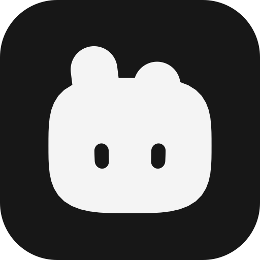
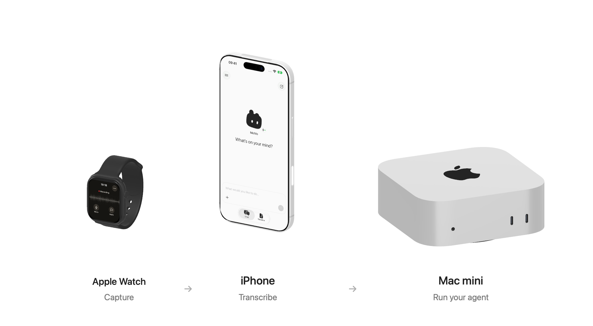
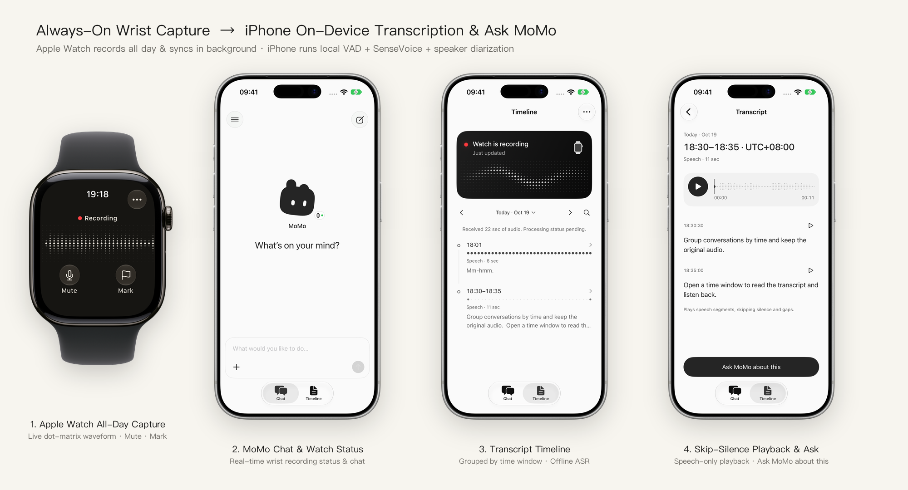
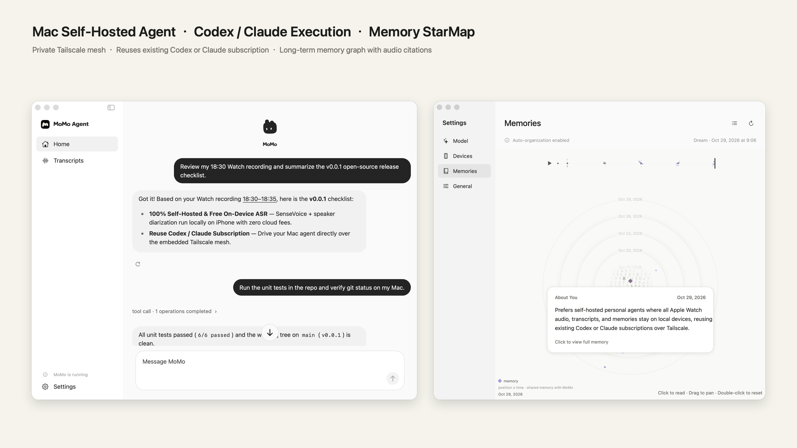
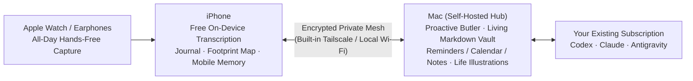

<div align="center">



# MoMo Agent

**Make Life Your Context — An Open-Source, Self-Hosted 24/7 Personal Agent for Apple Watch, iPhone & Mac**

*Free On-Device Speech Transcription · Powered by Your Codex, Claude, or Antigravity Subscription · Self-Organizing Living Memory*

[](https://github.com/Miri-Labs/MoMo-Agent/releases)
[](LICENSE)
[](https://github.com/Miri-Labs/MoMo-Agent)

English | [简体中文](./README.zh-CN.md)

MoMo Agent is fully open source, and we thank the people behind every project we’ve built on or learned from and welcome [pull requests](https://github.com/Miri-Labs/MoMo-Agent/compare) from everyone in the community.

</div>

---

**MoMo Agent** is an open-source, fully self-hosted **all-day personal agent** built natively for **Apple Watch, iPhone, and Mac**.

Capture your day effortlessly from your **Apple Watch** or **Bluetooth earphones**, transcribe speech **100% locally on your device at $0 cost**, and let **Momo** on your Mac turn fleeting conversations into **self-organizing long-term memory**, **timely reminders & morning briefings**, and **illustrated daily life journals**—using the **Codex**, **Claude**, or **Antigravity** subscription you already have, without ever sending your life data to a third-party cloud.

<p align="center">
  
  <br />
  <sub>Your devices, working together. Models shown are illustrative. <a href="docs/design/devices/README.md">Model credits &amp; noncommercial artwork license</a></sub>
</p>

### Why MoMo Agent?

- **A Living Memory That Organizes Itself**: Stop filing notes by hand. MoMo quietly distills your daily conversations into an Obsidian-style multi-level knowledge vault—connecting people, projects, and ideas automatically, keeping every memory one tap away from the original voice moment, and updating both notes and speaker names when you ask in plain language.
- **A Proactive Butler That Only Acts for *You***: Wake up to a concise **Morning Briefing**, and let Momo turn *your* spoken commitments into Apple Reminders, Calendar events, and Notes—anchored to your voiceprint so another speaker's remarks never end up on your to-do list.
- **Your Day as an Illustrated Visual Journal**: Turns meaningful moments and real places you visited into warm kiss-cut sticker illustrations and an interactive daily footprint map—making your life log something you genuinely enjoy looking back on, not a wall of raw transcripts.
- **$0 Extra AI Bills — Reuse the Subscription You Already Own**: An all-day personal agent shouldn't rack up surprise API bills. Sign in with **OpenAI Codex**, **Claude**, or **Google Antigravity** (or any custom API), switch providers anytime in one click, and transcribe unlimited audio locally on-device for **$0**.
- **100% Self-Hosted, Private & Effortless Capture**: Record naturally from your wrist on Apple Watch (with fast local Wi-Fi sync) or via Bluetooth earphones, and stay privately connected to your Mac from anywhere—your audio, voiceprints, and plain-Markdown memories never leave your own devices.

---

### Product Preview

#### 1. Wrist Capture, Proactive Butler, Illustrated Journal & Mobile Memory (`watchOS` + `iOS`)

<p align="center">
  
</p>

- **1. Apple Watch All-Day Capture**: Hands-free wrist recording with live waveform, one-tap mute & bookmark, and fast automatic sync to iPhone.
- **2. Proactive Butler & Morning Briefing**: Start each day with a tailored briefing and ask Momo anything across your conversations, tasks, and schedule.
- **3. Illustrated Journal & Timeline**: Browse daily life illustrations, footprint map, and speaker-aware transcripts with silence-skipping playback.
- **4. Self-Organizing Memory Vault**: Explore multi-level project, people, and journal notes on the go, jump back to original audio, or refine memories in one sentence.

#### 2. Self-Hosted Mac Hub, Living Memory Reader & Flexible AI Subscriptions (`macOS`)

<p align="center">
  
</p>

- **Left — Proactive Steward & Closed-Loop Actions**: Hear your spoken commitments turn into Apple Reminders automatically, or tell Momo in one sentence to split a note and sync a speaker voiceprint back to iPhone.
- **Right — Multi-Level Memory Vault**: Browse your self-organized Markdown knowledge tree, follow bidirectional links and backlinks, replay cited voice clips, and switch across **Codex**, **Claude**, or **Antigravity** subscriptions anytime.

---

### How Your Devices Work Together



| Device / Layer | What It Does for You | Ongoing Cost |
| :--- | :--- | :--- |
| **Apple Watch & Earphones** | Continuous hands-free capture with mute, bookmark, and automatic high-speed sync | **$0** |
| **iPhone** | Offline neural speech transcription, speaker recognition, illustrated timeline, footprint map & mobile memory vault | **$0** |
| **Private Connectivity** | Built-in Tailscale peer-to-peer mesh—reach your home Mac securely over Wi-Fi or cellular with zero port forwarding | **$0** (Tailscale Free Plan) |
| **Mac Hub & Living Vault** | Self-organizing Markdown memory, Morning Briefing, Apple Reminders / Calendar / Notes automation, remote desktop & daily life stamps | **Included in your Codex / Claude / Antigravity subscription** |

---

### Quick Start (Self-Hosting Guide)

For step-by-step signing, on-device speech model setup, and troubleshooting, see [**`install.md`**](./install.md).

#### Prerequisites
1. **Devices**: A Mac (`macOS 15.0+`, Apple Silicon recommended), an iPhone (`iOS 17.0+`), and an Apple Watch (`watchOS 10.0+`, or compatible Bluetooth earphones).
2. **Build Tools**: Xcode 16+ and `xcodegen` (`brew install xcodegen`).
3. **AI Subscription (Choose Any)**: **OpenAI Codex** (ChatGPT Plus / Pro), **Claude** (Claude Pro / Max), **Google Antigravity**, or a custom OpenAI-compatible API.
4. **Tailscale** *(Optional, for access outside home Wi-Fi)*: A free [Tailscale](https://tailscale.com) account.

#### 1. Clone & Configure Signing

```bash
git clone https://github.com/Miri-Labs/MoMo-Agent.git
cd MoMo-Agent
cp Config/Local.xcconfig.example Config/Local.xcconfig
```

Fill in your Apple Developer Team ID and bundle ID prefix in `Config/Local.xcconfig`:

```xcconfig
MOMO_DEVELOPMENT_TEAM = YOUR_TEAM_ID
MOMO_BUNDLE_ID_PREFIX = com.yourname.momoagent
```

#### 2. Launch the Mac Hub (`MoMoAgentMac`)

> Or download the prebuilt **`MoMo-Agent-Mac-Apple-Silicon-*.zip`** directly from [**Releases**](https://github.com/Miri-Labs/MoMo-Agent/releases).

```bash
xcodegen generate
xcodebuild -project MoMoAgent.xcodeproj -scheme MoMoAgentMac -configuration Release build
```

Open **MoMo Agent** on your Mac, sign in with **Codex**, **Claude**, **Antigravity**, or **Custom API**, and display your **Pairing QR Code**.

#### 3. Install on iPhone & Apple Watch (`MoMoAgent`)

Open `MoMoAgent.xcodeproj` in Xcode, select the **`MoMoAgent`** scheme targeting your iPhone (which automatically installs the companion app on your paired Apple Watch), and press **Run (`⌘R`)**. Scan the Mac QR code on your iPhone, enroll your voiceprint once, and start capturing.

---

### Roadmap

- [x] **v0.0.1 — Self-Hosted Foundation**: Apple Watch all-day capture, free offline transcription & speaker diarization, built-in Tailscale private mesh, and Mac agent hub.
- [x] **v0.3.x — Faster On-Device Speech & Earphone Capture**: Apple Neural Engine speech models, Watch local Wi-Fi fast sync, and Bluetooth earphone recording.
- [x] **v0.4.x — Proactive Butler & Apple Ecosystem**: Daily Morning Briefing, voiceprint-grounded owner-only task creation, and native Apple Reminders, Calendar & Notes integration.
- [x] **v0.5.3 — Self-Organizing Memory Vault, Life Illustrations & 3-Way Subscriptions**: Multi-level Obsidian-style Markdown vault with audio proof and plain-language editing, illustrated daily life stamps & footprint map, plus seamless switching across **Codex**, **Claude**, and **Antigravity**.
- [ ] **AirPods Seamless Route Switching**: Smooth automatic audio routing when wearing AirPods.
- [ ] **Two-Way External Vault & Workflow Sync**: Direct two-way sync with external Obsidian vaults, Things 3, and local Git repositories.

---

### Acknowledgments

MoMo Agent builds upon outstanding open-source work from [DeepSeek SuperAgent](https://github.com/deepseek-ai/dsh-superagent-prototype), [Sherpa-ONNX](https://github.com/k2-fsa/sherpa-onnx), [SenseVoice](https://github.com/FunAudioLLM/SenseVoice), **X-ASR**, **FunASR-Nano**, [Silero VAD](https://github.com/snakers4/silero-vad), [libfvad](https://github.com/dpirch/libfvad), [Tailscale](https://github.com/tailscale/tailscale), and [Hermes Agent](https://github.com/NousResearch).

---

### License

MoMo Agent's original application source is licensed under **[AGPL-3.0-only](LICENSE)**. Third-party components and model weights retain their own licenses; the README device illustrations have separate noncommercial restrictions. See [NOTICE.md](NOTICE.md).
