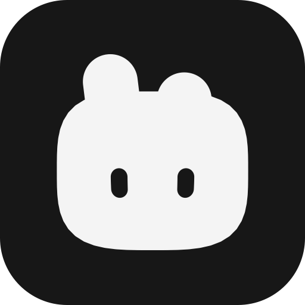
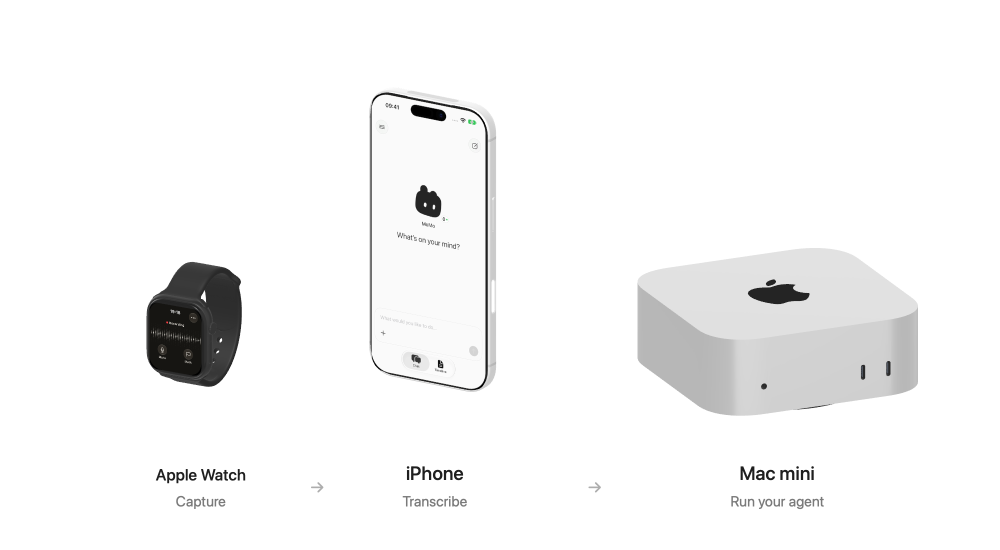
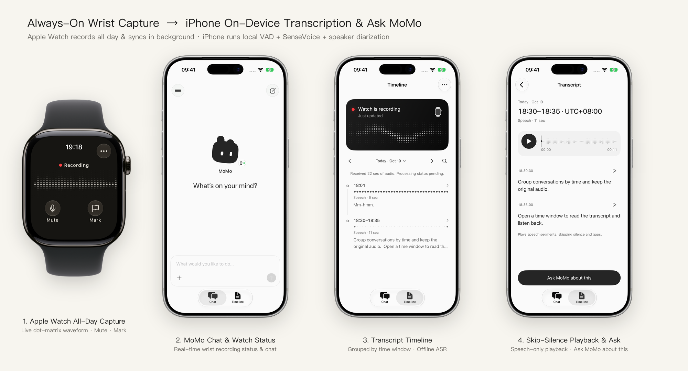
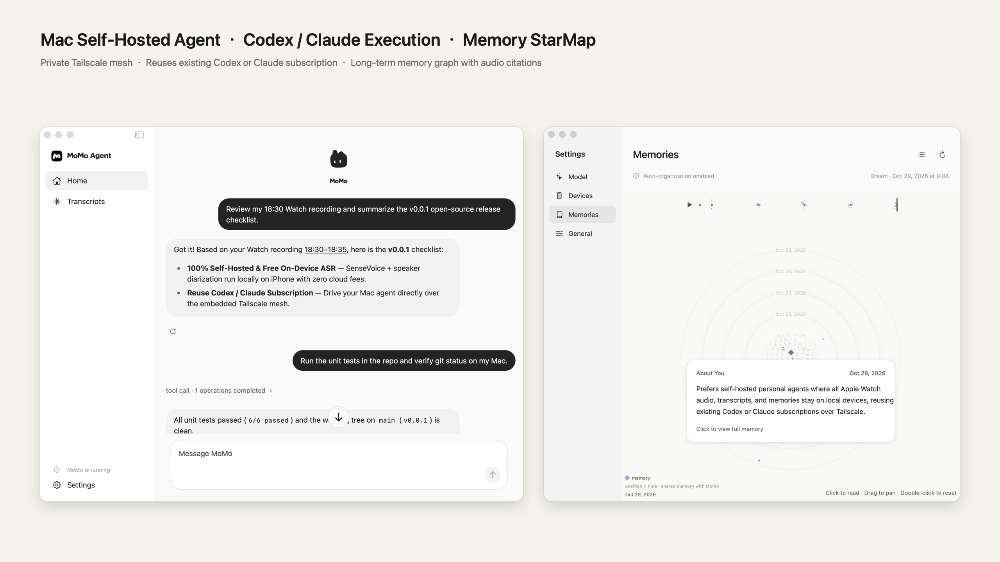
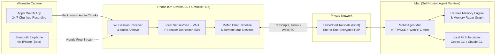

<div align="center">



# MoMo Agent

**Make Life Your Context — An Open-Source, Self-Hosted 24/7 Personal Agent with Continuous Apple Watch Audio Capture**

*Free On-Device Transcription · Powered by Your Codex or Claude Subscription · Private Mesh via Embedded Tailscale*

[](https://github.com/Miri-Labs/MoMo-Agent/releases/tag/v0.0.1)
[](LICENSE)
[](https://github.com/Miri-Labs/MoMo-Agent)
[](#why-momo-agent)
[](#why-momo-agent)
[](#why-momo-agent)

English | [简体中文](./README.zh-CN.md)

</div>

---

**MoMo Agent** is an open-source, fully self-hosted **all-day personal agent** built natively for **Apple Watch, iPhone, and Mac**.

It continuously captures your day from your wrist on **Apple Watch** or through a **Bluetooth earphone** connected to your iPhone *(beta)*, transcribes speech **100% locally and for free on your iPhone**, and syncs over an **embedded Tailscale private network** to your **Mac**, where your personal agent organizes long-term memories and executes real tasks using your existing **OpenAI Codex** or **Claude** subscription.

<p align="center">
  
  <br />
  <sub>Your devices, working together. Models shown are illustrative. <a href="docs/design/devices/README.md">Model credits &amp; noncommercial artwork license</a></sub>
</p>

### Why MoMo Agent?

- **100% Self-Hosted & Local-First Privacy**: No third-party cloud relays. Your raw audio, transcripts, SQLite FTS5 archive, and long-term memory graph live exclusively on your own Apple Watch, iPhone, and Mac.
- **$0 Transcription Cost (On-Device ASR)**: Built on Sherpa-ONNX + SenseVoice + Silero VAD / WebRTC libfvad + speaker diarization. Every word is transcribed offline on your iPhone/Mac at zero API cost.
- **Zero Extra AI Token Bills (Reuse Codex / Claude Subscriptions)**: Instead of charging per-token API fees for 24/7 context processing, MoMo Agent on Mac drives your local **Codex** (`codex` CLI / ChatGPT Plus & Pro) or **Claude** (`claude` CLI / Claude Pro & Max) subscription directly.
- **Embedded Tailscale Private Mesh**: Built-in user-space `tsnet` (`TailscaleKit`) establishes a direct encrypted peer-to-peer tunnel between your iPhone and Mac from anywhere—no public IP, no port forwarding.
- **24/7 Wearable Capture**:
  - **Apple Watch (Available Now)**: Continuous background recording, automatic chunking, wrist bookmarks, and background `WCSession` delivery to iPhone.
  - **Bluetooth Earphones (Beta 🧪)**: No Apple Watch? Your iPhone records through any earphone with a Bluetooth hands-free (HFP) microphone. Recording pauses while other audio plays, because iOS cannot record from a third-party earphone and play hi-fi audio at the same time, and resumes automatically when it stops. Tested so far on Shokz OpenMove and Sony WH-1000XM6; AirPods and other earphones are next.

---

### Product Preview

#### 1. Wrist Capture & On-Device Transcription (`watchOS` + `iOS`)

<p align="center">
  
</p>

- **1. Apple Watch All-Day Capture**: Continuous capture with dot-matrix live waveform, one-tap **Mute**, and **Mark**.
- **2. MoMo Chat & Watch Status**: Real-time wrist recording status and instant task handoff to your Mac.
- **3. Transcript Timeline**: Automatically grouped by time window and transcribed offline on your iPhone.
- **4. Skip-Silence Playback & Ask**: Speech-only segment playback (automatically skips long silences) and one-tap **"Ask MoMo about this"**.

#### 2. Self-Hosted Mac Agent & Memory Radar (`macOS`)

<p align="center">
  
</p>

- **Left**: Citation-backed conversation & remote task execution on Mac powered by your local **Codex / Claude** subscription.
- **Right**: Interactive **Memory Radar** (`StarMap`) that distills daily transcripts into verifiable long-term memories with original audio evidence.

---

### System Architecture



| Layer | Component | Key Capabilities | Cost |
| :--- | :--- | :--- | :--- |
| **Capture** | `MoMoAgentWatch` (`watchOS 10+`) | Always-on recording, live waveform, mute/bookmark, reliable background transfer; Bluetooth earphone capture on iPhone (beta) | **$0** |
| **On-Device ASR** | `MoMoSpeech` (`iOS 17+` / `macOS 15+`) | Offline SenseVoice (zh/en/ja/ko/yue), dual-stage VAD (libfvad + Silero), speaker embedding & diarization | **$0** |
| **Archive** | `MoMoArchive` (`SQLite + FTS5`) | Append-only event store, crash-safe recovery, millisecond full-text search, silence-skipping playback | **$0** |
| **Private Mesh** | `EmbeddedTailnet` (`TailscaleKit`) | User-space WireGuard / Tailscale mesh embedded inside the app; QR-code pairing with 6-digit verification | **$0** (Tailscale Free Plan) |
| **Agent Brain** | `MoMoAgentMac` + `Vendor/HermesAgent` | Autonomous tool use, citation-backed Q&A, background recording summaries, long-term Memory Radar, WebRTC remote desktop | **Included in your existing Codex / Claude subscription** |

---

### Quick Start (Self-Hosting Guide)

For complete step-by-step device provisioning, signing, model setup, and troubleshooting instructions, see [**`install.md`**](./install.md).

#### Prerequisites
1. **Hardware**: A Mac (`macOS 15.0+`), an iPhone (`iOS 17.0+`), and an Apple Watch (`watchOS 10.0+`).
2. **Xcode**: Xcode 16+ with `xcodegen` installed (`brew install xcodegen`).
3. **AI Subscription**: Either **OpenAI Codex** (`codex` CLI signed in with your ChatGPT account) or **Claude** (`claude` CLI signed in with your Claude account) on your Mac.
4. **Tailscale** *(Optional for cross-network access)*: A free [Tailscale](https://tailscale.com) account for remote connection outside your home Wi-Fi.

#### Step 1: Clone & Configure Signing

```bash
git clone https://github.com/Miri-Labs/MoMo-Agent.git
cd MoMo-Agent
cp Config/Local.xcconfig.example Config/Local.xcconfig
```

Edit `Config/Local.xcconfig` with your Apple Developer Team ID and bundle identifier prefix:

```xcconfig
MOMO_DEVELOPMENT_TEAM = YOUR_TEAM_ID
MOMO_BUNDLE_ID_PREFIX = com.yourname.momoagent
```

#### Step 2: Generate Project & Build Mac Agent (`MoMoAgentMac`)

```bash
xcodegen generate
xcodebuild -project MoMoAgent.xcodeproj -scheme MoMoAgentMac -configuration Debug build
```

Launch `MoMoAgentMac` on your Mac and follow the guided onboarding:
1. Select your AI runtime (**Codex** or **Claude**) and sign in with your subscription.
2. Enable **Tailscale** (or Same-Wi-Fi LAN mode) to display the **Pairing QR Code**.

#### Step 3: Build & Install iPhone + Apple Watch Apps (`MoMoAgent`)

Open `MoMoAgent.xcodeproj` in Xcode, select the **`MoMoAgent`** scheme targeting your connected iPhone (which automatically embeds and installs **`MoMoAgentWatch`** onto your paired Apple Watch), and press **Run (`⌘R`)**.

>Need detailed instructions on Developer Mode, model placement, or device recovery? Check out [**`install.md`**](./install.md).

---

### Repository Structure

```text
MoMo-Agent/
├── Apps/
│   ├── WatchApp/          # watchOS 10+ continuous recorder & background chunk sender
│   ├── iPhoneApp/         # iOS 17+ on-device ASR, timeline, chat & WebRTC desktop viewer
│   ├── MacApp/            # macOS 15+ self-hosted agent runtime, onboarding & Memory Radar
│   └── ClientUI/          # Shared SwiftUI design system, Tailnet transport & components
├── Packages/
│   └── MoMoAgentKit/      # Core Swift package (MoMoCapture, MoMoSpeech, MoMoArchive, MoMoAgentClient, MoMoAgentRTC)
├── Vendor/
│   ├── HermesAgent/       # Self-hosted agent runtime & StarMap memory engine
│   ├── SherpaOnnx/        # Offline speech recognition & speaker diarization XCFramework
│   └── TailscaleKit/      # Embedded user-space Tailscale (tsnet) XCFramework
├── Config/                # Signing & version configuration (v0.0.1)
└── project.yml            # XcodeGen project specification
```

---

### Roadmap

- [x] **v0.0.1** — Apple Watch 24/7 continuous capture, iPhone free offline SenseVoice + speaker diarization, embedded Tailscale private mesh, Mac self-hosted agent powered by Codex / Claude subscription, full English & Simplified Chinese UI, and WebRTC remote desktop.
- [ ] **Bluetooth Earphone & AirPods Capture** *(Beta)* — All-day iPhone capture through a Bluetooth earphone, tested so far on Shokz OpenMove and Sony WH-1000XM6. Next: AirPods and other earphones, and hands-free triggered voice memos.
- [ ] **Proactive Agent** — Proactively anticipates needs and solves problems based on your real-world life context.
- [ ] **Plugin & Skill SDK** — Custom local tools for Apple Notes, Things 3, Obsidian, and local git repositories.

---

### Acknowledgments & Open-Source Credits

MoMo Agent stands on the shoulders of extraordinary open-source projects:
- [Sherpa-ONNX](https://github.com/k2-fsa/sherpa-onnx) & [SenseVoice](https://github.com/FunAudioLLM/SenseVoice) for blazing-fast offline speech recognition and speaker diarization.
- [Silero VAD](https://github.com/snakers4/silero-vad) & [libfvad](https://github.com/dpirch/libfvad) for low-power voice activity detection.
- [Tailscale](https://github.com/tailscale/tailscale) (`tsnet`) for zero-config private mesh networking.
- [Hermes Agent](https://github.com/NousResearch) for agent orchestration and the StarMap memory graph visualization.

---

### License

MoMo Agent's original application source is licensed under **[AGPL-3.0-only](LICENSE)**. Commercial use is permitted under its terms, including the applicable source-sharing requirements. Third-party components and model weights retain their own licenses; the README device illustrations have separate noncommercial restrictions. See [licensing and credits](NOTICE.md).
