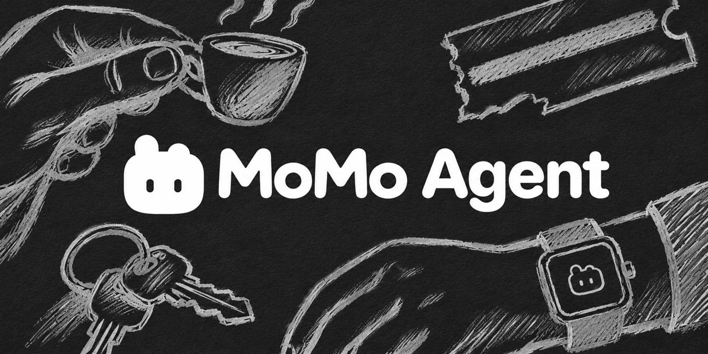
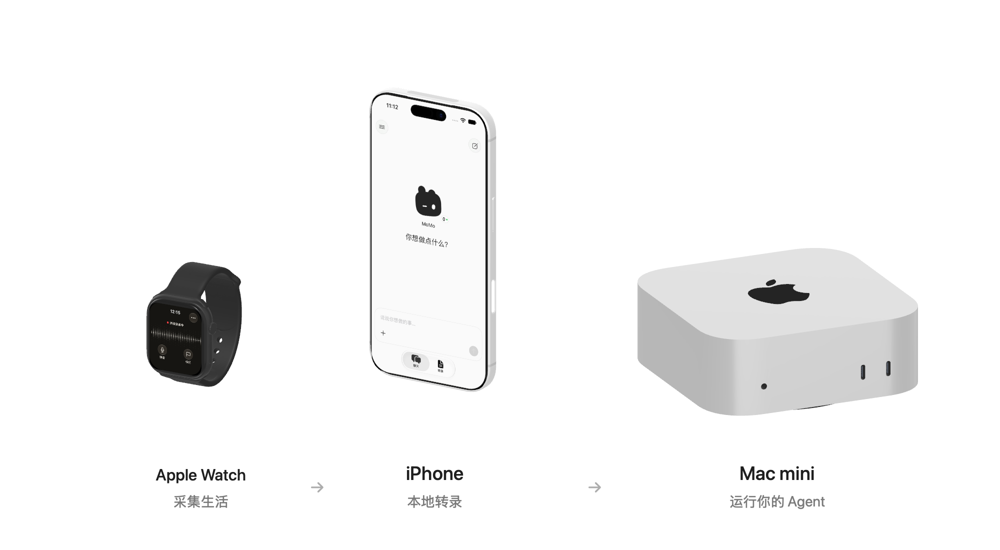
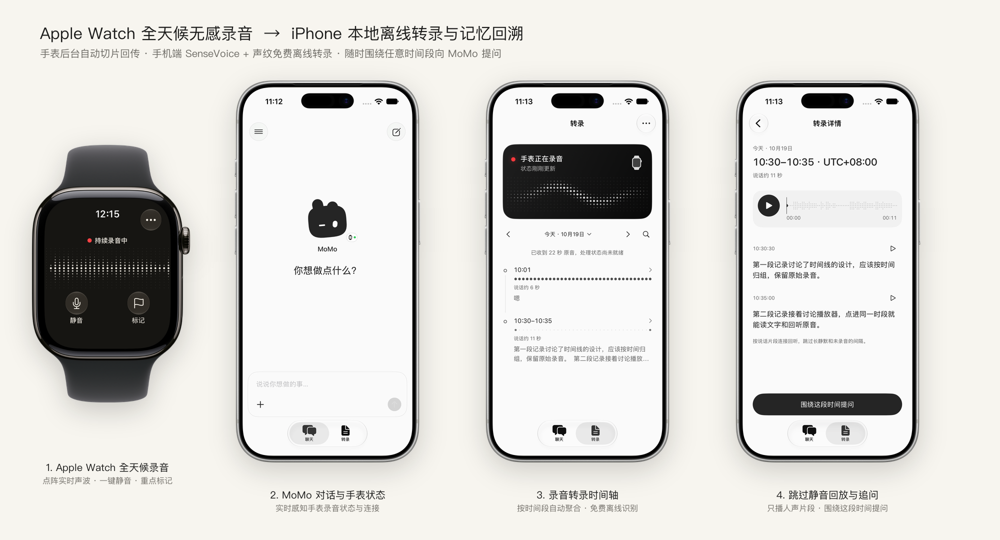
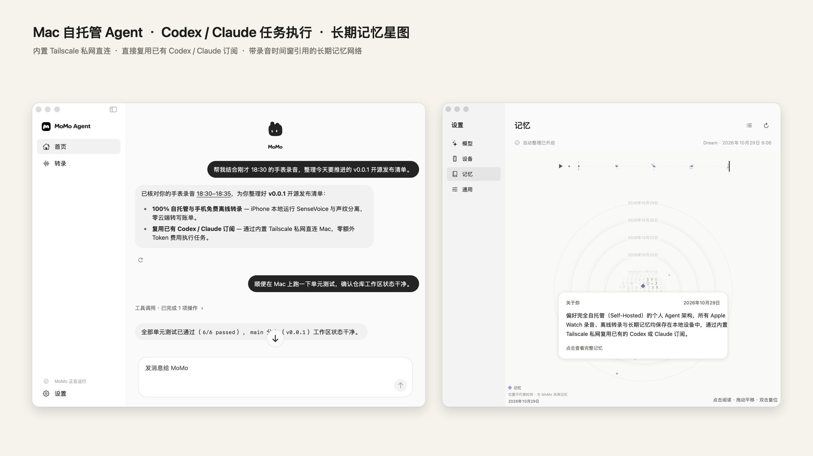
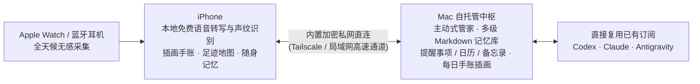

<div align="center">



# MoMo Agent

**让生活成为你的上下文 —— 全天候无感记录 · 完全自托管（Self-Hosted）的开源个人智能体**

*端侧语音转录永久免费 · 直接复用 Codex / Claude / Antigravity 订阅 · 会自己生长与整理的长期记忆*

[](https://github.com/Miri-Labs/MoMo-Agent/releases)
[](LICENSE)
[](https://github.com/Miri-Labs/MoMo-Agent)

[English](./README.md) | 简体中文

MoMo Agent 是一个纯开源项目，感谢所有我们借鉴过的项目及其背后的贡献者，也欢迎每一位社区成员[提交 PR](https://github.com/Miri-Labs/MoMo-Agent/compare)。

</div>

---

**MoMo Agent** 是专为 **Apple Watch、iPhone 与 Mac** 原生打造的开源、完全自托管（Self-Hosted）**全天候个人智能体**。

戴上手表或蓝牙耳机自然度过每一天：iPhone 在本地**永久免费**完成语音转写与说话人识别，并通过内置加密私网同步到你的 **Mac**。在那里，贴心管家 **Momo** 直接复用你已有的 **Codex**、**Claude** 或 **Antigravity** 订阅，把散落的对话沉淀为**会自己整理的长期记忆库**、生成**晨间简报与每日手账插画**，并替你打理提醒事项、日历与备忘录——**不经过任何第三方云端，也没有额外 API Token 账单。**

<p align="center">
  
  <br />
  <sub>用你自己的设备，让 MoMo 随身相伴。图中机型仅作示意。<a href="docs/design/devices/README.md">模型署名与非商用许可</a></sub>
</p>

### 为什么选择 MoMo Agent？

- **不用手动记笔记，记忆会自己生长与归档**：告别建文件夹和整理会议纪要的负担。MoMo 会在后台把每天的对话自动提炼为像 Obsidian 一样清晰的多级知识库，自动串联人物、项目与想法；每条记忆点一下就能听回当时的原音，说一句话就能同时改好笔记和说话人声纹。
- **懂分寸的主动式管家，只为你本人的承诺行动**：每天早上送上一份清爽的**晨间简报**；平时听到*你本人*亲口答应的待办与日程，自动帮你记进 Apple 提醒事项、日历和备忘录——依托你的个人声纹识别，绝不会把同事或旁人的话误记成你的任务。
- **把每一天变成有温度的插画手账与足迹**：不只是冷冰冰的文字流水账。MoMo 会结合你当天真实走过的停留点与难忘片段，自动绘制温暖的模切贴纸插画与今日足迹地图，让日常回看真正成为一种享受。
- **零额外 AI 账单，复用已有订阅随心切换**：全天候运行个人智能体，不该变成昂贵的按量计费黑洞。直接登录你已有的 **OpenAI Codex**、**Claude** 或 **Google Antigravity** 订阅（也支持自定义 API），在设置里一键随时切换；手机端语音转写更是 **100% 本地免费**。
- **100% 自托管隐私与无感随身采集**：抬腕用 Apple Watch 持续记录（同网自动走高速 Wi-Fi 秒传），没戴手表也能用蓝牙耳机采集；内置私网让你在外网也能安全直连家中 Mac，所有原始录音、声纹与纯文本 Markdown 记忆永远只留在你自己的设备里。

---

### 界面预览

#### 1. 抬腕无感记录 · 主动式管家简报 · 手账足迹转录 · 随身记忆库（`watchOS` + `iOS`）

<p align="center">
  
</p>

- **1. Apple Watch 全天候采集**：抬腕无感录音，支持实时声波反馈、一键静音与重点标记，回手机自动高速同步。
- **2. 主动式管家与晨间简报**：清晨自动汇总昨日进展与今日安排，随时围绕任何一段经历追问或交代事项。
- **3. 生活插画手账与转录时间轴**：顶部呈现今日手账插画与真实足迹地图，下方按说话人清晰展示离线转写并支持跳过静音回放。
- **4. 随身多级记忆库**：像翻阅个人知识库一样按层级查看项目、人物与日志，一键回听原音证据，或直接口述修改。

#### 2. Mac 自托管中枢 · 多级记忆阅读器 · 三大订阅一键切换（`macOS`）

<p align="center">
  
</p>

- **左 — 主动式管家与一句话闭环修订**：自动听懂你的口头待办并写入 Apple 提醒事项；说一句话即可同时拆分多级笔记并将说话人声纹同步回手机。
- **右 — 多级记忆阅读器与三大订阅**：三栏式浏览模型自主整理的多级目录树、双向关联与原音引用，并支持随时热切换 **Codex**、**Claude** 或 **Antigravity** 订阅。

---

### 三端如何协同工作



| 终端 / 层级 | 为你解决什么问题 | 持续使用成本 |
| :--- | :--- | :--- |
| **Apple Watch 与耳机** | 全天候免提无感采集，随时静音、打标记，回传省心快速 | **免费 ($0)** |
| **iPhone 随身端** | 本地离线高精度语音转写、说话人区分、手账时间轴、足迹地图与随身知识库 | **免费 ($0)** |
| **跨网私密互联** | 应用内置 Tailscale 加密直连，无需公网 IP 或端口转发，在外也能安全连回家中 Mac | **免费**（Tailscale 个人免费版） |
| **Mac 管家与记忆中枢** | 自主整理多级记忆、晨间简报、自动同步 Apple 提醒事项/日历/备忘录、远程桌面与手账插画 | **直接复用已有 Codex / Claude / Antigravity 订阅** |

---

### 快速开始（Self-Host 指南）

完整的真机签名、端侧语音模型下载与常见问题排查，请参阅 [**`install.md`**](./install.md)。

iPhone 也可以用 Safari 聊天、回听手表原音和查看记忆。手表将录音传给 Mac，在 Mac 本地转写。启动、设备配对及添加到主屏幕的步骤见[手机网页版试用](docs/implementation/mobile-web-watch-mac.md)。

#### 准备条件
1. **设备**：一台 Mac（`macOS 15.0+`，推荐 Apple Silicon）、一部 iPhone（`iOS 17.0+`），以及一块 Apple Watch（`watchOS 10.0+`，或蓝牙耳机）。
2. **构建工具**：Xcode 16+ 与 `xcodegen`（`brew install xcodegen`）。
3. **AI 订阅（任选其一）**：**OpenAI Codex**（ChatGPT Plus / Pro）、**Claude**（Claude Pro / Max）、**Google Antigravity**，或任意兼容自定义 API。
4. **Tailscale** *(可选，外网直连推荐)*：免费注册 [Tailscale](https://tailscale.com) 账号。

#### 1. 克隆仓库并配置签名

```bash
git clone https://github.com/Miri-Labs/MoMo-Agent.git
cd MoMo-Agent
cp Config/Local.xcconfig.example Config/Local.xcconfig
```

在 `Config/Local.xcconfig` 中填入你的 Apple 开发者 Team ID 与自定义前缀：

```xcconfig
MOMO_DEVELOPMENT_TEAM = 你的_TEAM_ID
MOMO_BUNDLE_ID_PREFIX = com.yourname.momoagent
```

#### 2. 启动 Mac 端中枢 (`MoMoAgentMac`)

> 你也可以直接在 [**Releases**](https://github.com/Miri-Labs/MoMo-Agent/releases) 下载打包好的 **`MoMo-Agent-Mac-Apple-Silicon-*.zip`** 开箱运行。

```bash
xcodegen generate
xcodebuild -project MoMoAgent.xcodeproj -scheme MoMoAgentMac -configuration Release build
```

打开 Mac 上的 **MoMo Agent**，选择 **Codex**、**Claude**、**Antigravity** 或 **自定义 API** 完成登录，并展示 **配对二维码**。

#### 3. 安装 iPhone 与 Apple Watch 端 (`MoMoAgent`)

用 Xcode 打开 `MoMoAgent.xcodeproj`，选择 **`MoMoAgent`** Scheme 并在你的真机 iPhone 上按下 **`⌘R`** 运行（会自动同步安装手表端）。打开手机扫码配对、录入一次个人声纹，即可开始无感记录。

---

### 路线图 (Roadmap)

- [x] **v0.0.1 — 自托管底座**：Apple Watch 全天候录音、手机端免费离线转录与声纹分离、内置 Tailscale 私网互联、Mac 智能体中枢。
- [x] **v0.3.x — 端侧加速与多设备采集**：神经网络加速离线语音模型、手表局域网高速快传、支持蓝牙耳机采集。
- [x] **v0.4.x — 主动式管家与 Apple 生态打通**：每日晨间简报、声纹驱动的「本人承诺才建待办」机制，原生联动提醒事项、日历与备忘录。
- [x] **v0.5.3 — 多级记忆库、生活插画手账与三大订阅自由切换**：会自主整理的多级双向链接记忆库（支持原音回听与一句话改笔记/声纹）、每日生活插画与足迹地图，以及 **Codex · Claude · Antigravity** 三大订阅随时热切换。
- [ ] **AirPods 无缝音频路由**：优化佩戴 AirPods 时的通话与媒体路由自动切换体验。
- [ ] **外部知识库与效率工具双向同步**：支持与本地外部 Obsidian 仓库、Things 3 及 Git 仓库直接双向同步。

---

### 致谢

MoMo Agent 基于众多优秀的开源项目构建：[DeepSeek SuperAgent](https://github.com/deepseek-ai/dsh-superagent-prototype)、[Sherpa-ONNX](https://github.com/k2-fsa/sherpa-onnx)、[SenseVoice](https://github.com/FunAudioLLM/SenseVoice)、**X-ASR**、**FunASR-Nano**、[Silero VAD](https://github.com/snakers4/silero-vad)、[libfvad](https://github.com/dpirch/libfvad)、[Tailscale](https://github.com/tailscale/tailscale) 与 [Hermes Agent](https://github.com/NousResearch)。

---

### 开源许可证

MoMo Agent 原创应用源码采用 **[AGPL-3.0-only](LICENSE)**。第三方组件与模型权重保留各自许可证；README 设备配图另有非商业使用限制。详见[许可证与第三方声明](NOTICE.md)。
