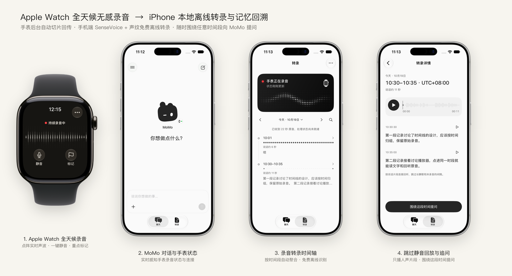
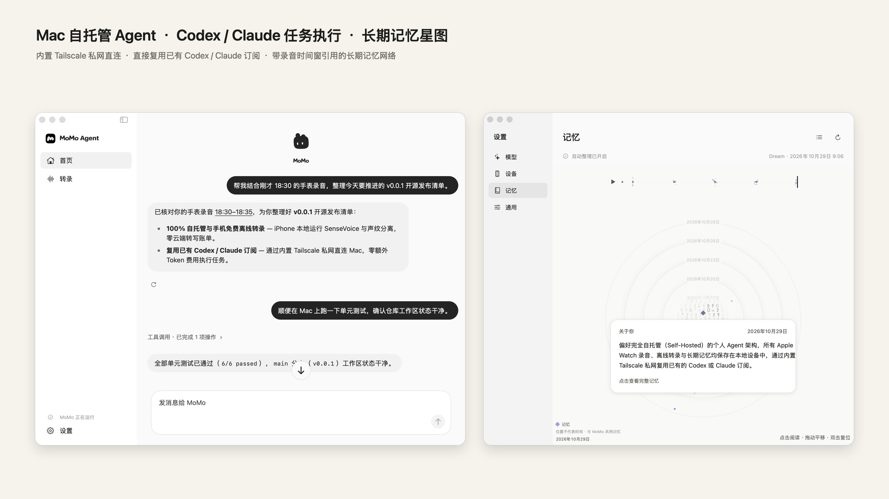
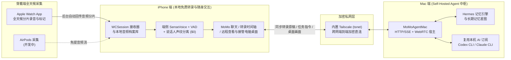

<div align="center">


# MoMo Agent

**让生活成为你的上下文 —— 全天候 Apple Watch 无感录音 · 完全自托管（Self-Hosted）的开源 Personal Agent**

*本地语音转录永久免费 · 仅用已有 Codex 或 Claude 订阅驱动 · 内置 Tailscale 组建加密私网*

[](https://github.com/Miri-Labs/MoMo-Agent/releases/tag/v0.0.1)
[](https://github.com/Miri-Labs/MoMo-Agent)
[](#核心亮点)
[](#核心亮点)
[](#核心亮点)

[English](./README.md) | 简体中文

</div>

---

**MoMo Agent** 是一个专为 **Apple Watch + iPhone + Mac** 打造的开源、完全自托管（Self-Hosted）**全天候个人智能体（Personal Agent）**。

它通过手腕上的 **Apple Watch** 进行全天候无感录音（**AirPods 录音支持正在开发中**），在 **iPhone 本地免费完成离线语音转录与声纹分离**，并通过应用内置的 **Tailscale 加密私网** 实时同步到你的 **Mac**。在 Mac 上，MoMo 直接复用你已有的 **Codex** 或 **Claude** 订阅来提炼长期记忆、回答追问并自主执行电脑任务——**无需购买任何第三方云端硬件订阅，也没有高昂的按量 API Token 账单。**

### 核心亮点

- **100% Self-Hosted 隐私优先**：不经过任何第三方云服务器。原始录音、转录文稿、SQLite FTS5 档案库以及长期记忆图谱完全保存在你自己的 Apple Watch、iPhone 与 Mac 上。
- **语音转录完全免费（端侧离线 ASR）**：基于 Sherpa-ONNX + SenseVoice + Silero VAD / WebRTC libfvad 双级语音活动检测 + 说话人声纹聚类，在 iPhone 与 Mac 本地离线完成高精度多语言转录，**转录成本为 $0**。
- **AI 仅用已有 Codex 或 Claude 订阅费（零额外 API 账单）**：全天候 Agent 最昂贵的部分往往是持续消耗的云端 API Token。MoMo Agent 直接调用你 Mac 上已登录的 **OpenAI Codex**（ChatGPT Plus / Pro 订阅）或 **Claude**（Claude Pro / Max 订阅）CLI 运行时，用固定月费获得顶级 Agent 推理与行动能力。
- **内置 Tailscale 加密私网（无需公网 IP）**：App 内部直接集成用户态 `tsnet`（`TailscaleKit`），无需配置端口映射或购买云服务器，出门在外也能通过蜂窝网络与家中的 Mac 建立端到端加密直连。
- **全天候穿戴式记忆采集**：
  - **Apple Watch 全天候录音（已支持）**：抬腕即录、点阵实时声波、一键静音与重点标记（Mark），后台自动分片并通过 `WCSession` 可靠回传至 iPhone。
  - **AirPods 语音采集（开发中 🚧）**：支持佩戴 AirPods 时的免提环境对话采集与随时语音交办。

---

### 界面与功能预览

#### 1. Apple Watch 全天候录音与 iPhone 本地转录时间轴（`watchOS` + `iOS`）

<p align="center">
  
</p>

- **1. Apple Watch 全天候录音**：点阵实时声波反馈，支持一键 **静音** 与重点 **标记**，后台自动切片并传回手机。
- **2. MoMo 对话与手表状态**：在手机端与 MoMo 对话，实时查看手表录音与后台传输状态。
- **3. 录音转录时间轴**：按时间窗口自动归组，端侧离线完成语音识别，保留原始录音证据。
- **4. 跳过静音回放与追问**：智能按说话片段连接回听（自动跳过长静默与未录音间隔），点击 **「围绕这段时间提问」** 即可将该时段的准确录音证据发给 Mac 上的 MoMo 深度分析。

#### 2. Mac 自托管 Agent 中枢与长期记忆星图（`macOS`）

<p align="center">
  
</p>

- **左（MoMo 对话与任务执行）**：在手机交代事情，Mac 接着执行。支持引用任意时间的录音片段、融合手机端日历/提醒事项/到访地点/健康数据，并可通过 WebRTC 随时在手机上查看或接管 Mac 桌面。
- **右（记忆雷达 StarMap）**：基于 Hermes 记忆引擎，自动从全天候录音与对话中提炼「关于你」与「MoMo 的记忆」，每一条记忆均可溯源至原始录音引用。

---

### 系统架构



| 模块 | 对应组件 | 核心能力 | 运行成本 |
| :--- | :--- | :--- | :--- |
| **穿戴采集** | `MoMoAgentWatch` (`watchOS 10+`) | 全天候后台录音、实时声波、静音/标记、断连缓存与后台自动续传；AirPods 采集开发中 | **免费 ($0)** |
| **本地转录** | `MoMoSpeech` (`iOS 17+` / `macOS 15+`) | 离线 SenseVoice（中/英/日/韩/粤）、libfvad + Silero 双级 VAD、说话人声纹提取与分离 | **免费 ($0)** |
| **本地归档** | `MoMoArchive` (`SQLite + FTS5`) | 事件溯源存储、崩溃恢复、毫秒级全文检索、跳过静音片段连续回放 | **免费 ($0)** |
| **私网互联** | `EmbeddedTailnet` (`TailscaleKit`) | 应用内嵌用户态 Tailscale 节点；支持扫码配对与 6 位数字双向核验 | **免费**（Tailscale 个人免费版） |
| **Agent 核心** | `MoMoAgentMac` + `Vendor/HermesAgent` | 工具调用、带录音引用的问答、录音自动摘要、记忆雷达星图、WebRTC 远程桌面控制 | **仅需已有 Codex 或 Claude 订阅** |

---

### 快速开始（Self-Host 部署指南）

如需查看完整的真机签名配置、模型导入、首次启动引导与故障排查说明，请直接参考 [**`install.md`**](./install.md)。

#### 环境要求
1. **硬件设备**：一台 Mac（`macOS 15.0+`）、一部 iPhone（`iOS 17.0+`）以及一块配对的 Apple Watch（`watchOS 10.0+`）。
2. **开发环境**：Xcode 16+，并安装 `xcodegen`（`brew install xcodegen`）。
3. **AI 订阅账号**：在 Mac 上准备好 **Codex**（ChatGPT Plus / Pro 账号）或 **Claude**（Claude Pro / Max 账号）。
4. **Tailscale 账号** *(跨网直连推荐)*：注册免费的 [Tailscale](https://tailscale.com) 账号，用于在外网安全连接家中的 Mac。

#### 第一步：克隆仓库与配置签名

```bash
git clone https://github.com/Miri-Labs/MoMo-Agent.git
cd MoMo-Agent
cp Config/Local.xcconfig.example Config/Local.xcconfig
```

编辑 `Config/Local.xcconfig`，填入你的 Apple 开发者 Team ID 与自定义 Bundle ID 前缀：

```xcconfig
MOMO_DEVELOPMENT_TEAM = 你的_TEAM_ID
MOMO_BUNDLE_ID_PREFIX = com.yourname.momoagent
```

#### 第二步：生成工程并启动 Mac 端 (`MoMoAgentMac`)

```bash
xcodegen generate
xcodebuild -project MoMoAgent.xcodeproj -scheme MoMoAgentMac -configuration Debug build
```

在 Mac 上运行 `MoMoAgentMac`，按照引导完成三步初始化：
1. 选择 **Codex** 或 **Claude** 并完成订阅账号登录；
2. 开启 **Tailscale 私网**（或同一局域网模式），生成 **Mac 配对二维码**；
3. 按需开启屏幕录制与辅助功能权限（用于手机远程查看/接管电脑桌面）。

#### 第三步：编译安装 iPhone 与 Apple Watch 端 (`MoMoAgent`)

使用 Xcode 打开 `MoMoAgent.xcodeproj`，选择 **`MoMoAgent`** Scheme，目标设备选择你的 iPhone（Xcode 会自动将内嵌的 **`MoMoAgentWatch`** 安装到配对的 Apple Watch 上），按下 **`⌘R`** 运行：
1. 打开 iPhone 上的 **MoMo**，扫描 Mac 屏幕上的配对二维码并核对 6 位数字完成绑定；
2. 打开 Apple Watch 上的 **MoMo**，点击开始录音，即可开启全天候记忆采集。

>关于详细的真机安装步骤、开发者模式启用与常见问题排查，请参阅 [**`install.md`**](./install.md)。

---

### 开源路线图 (Roadmap)

- [x] **v0.0.1 初始开源版本**：Apple Watch 全天候分片录音、iPhone 本地免费 SenseVoice 转录与声纹分离、内置 Tailscale 私网穿透、Mac 端复用 Codex / Claude 订阅驱动 Agent 与记忆雷达、中英双语界面支持、WebRTC 远程桌面接管。
- [ ] **AirPods 全天候与按需录音支持** *(开发中)*：支持通过 AirPods 直接采集环境对话与随时语音指令。
- [ ] **Proactive Agent（主动式智能体）**：根据你的真实生活上下文，主动发现并替你解决问题。
- [ ] **本地扩展技能生态**：深度打通 Apple 备忘录、提醒事项、Obsidian 与本地代码仓库自动化。
