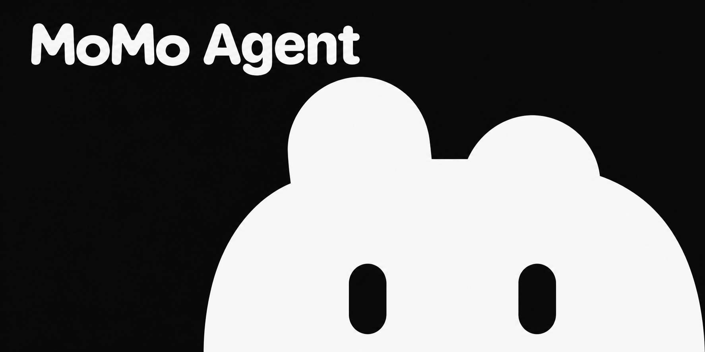
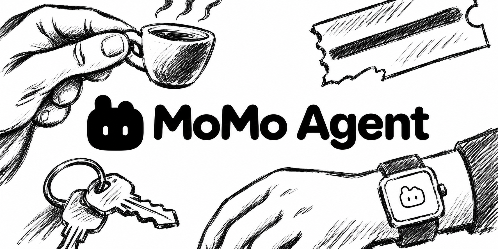

# MoMo Agent 设计指南

MoMo Agent 让用户可以接着生活里发生的事往下聊。手表负责捕捉当下，手机方便随时回看和提问，Mac 承接持续的工作。例如，用户可以从转录回听一段谈话，带着这段上下文问 MoMo「刚才我答应了什么」。[产品定位与设计决定](AGENTS.md)

## 品牌与角色

| 场合 | 使用方式 |
| --- | --- |
| 应用图标 | 用 MoMo 正面、双眼睁开的矢量母版。底色为 `#171717`，角色为 `#F4F4F4`。iPhone 和 Watch 交给系统裁切，Mac 菜单栏使用同轮廓的透明模板。[图标母版](docs/design/brand/avatar-front.svg) · [菜单栏模板](docs/design/brand/avatar-front-template.svg) |
| 产品名与角色名 | 产品写 **MoMo Agent**，角色叫 **MoMo**。两者使用既有 Pebble 矢量字标。应用内复用 `PhoneBrandWordmark`，由底层原生文字提供字号适配与 VoiceOver 名称。页面标题、按钮和正文使用系统字体。[品牌组件](Apps/ClientUI/PersonalAgentBrand.swift) |
| 对话中的 MoMo | 空聊天页给角色留出中央位置，进入对话后缩到顶部，名字在下方。iPhone 两个状态的头像分别为 144 和 84 pt。让眼型、视线与头部动作传达专注、招呼或忙碌，让表情在紧凑尺寸下也容易辨认。角色离屏时暂停动态，尊重「减少动态效果」。[聊天页](Apps/iPhoneApp/Features/RemoteAgent/PhoneRemoteView.swift) · [表情设计](docs/implementation/momo-expressive-motion-20261018.md) |

## 色彩与排版

iPhone 和 Mac 的共享界面以中性纸色承托内容。正文使用墨色，时间和说明退到次一级，细线用于分隔。SwiftUI 直接使用 `MoMoPalette` 的语义名以跟随系统外观。[颜色定义](Apps/Shared/BrandPalette.swift) · [颜色资源](Apps/iPhoneApp/Resources/Assets.xcassets)

| 语义色 | 浅色 | 深色 | 常见用途 |
| --- | --- | --- | --- |
| `canvas` | `#FAFAFA` | `#161616` | 页面底色 |
| `paper` | `#FFFFFF` | `#202020` | 输入框、简报便笺 |
| `surface` | `#F1F1F1` | `#292929` | 设置分组、助手气泡 |
| `ink` | `#252525` | `#F2F2F2` | 正文、字标、主操作 |
| `muted` | `#686868` | `#AAAAAA` | 时间、说明、次级图标 |
| `line` | `#E1E1E1` | `#454545` | 分隔线、细描边 |

Watch 采用固定的暖深色。画布为 `#161512`、控件表面 `#302C26`、文字与点阵 `#F3EEE5`。录音中的红点与「持续录音中」并列，让用户一眼能读出状态。手机和 Mac 的成功、失败反馈可复用 `success`、`failure` 及各自的背景色。[Watch 采集界面](Apps/WatchApp/Features/Capture/CaptureView.swift) · [平台配色](Apps/Shared/BrandPalette.swift)

| 原生文字角色（默认字号） | iPhone | Mac |
| --- | ---: | ---: |
| 页面标题 / 正文 / 导航 | 22 / 16 / 16 pt | 22 / 15 / 13 pt |
| 次标题 / 元数据 / 小字 | 17 / 13 / 12 pt | 16 / 12 / 11 pt |
| 代码（等宽） | 14 pt | 13 pt |

原生界面按角色使用 `.phoneText(...)`。正文、转录和代码有额外行距，导航和标签保持紧凑。WebKit 聊天正文与气泡间距由共享样式表维护。[原生字号定义](Apps/ClientUI/ClientTypography.swift) · [聊天样式](Apps/iPhoneApp/Features/Assistant/Rendering/Web/chat.css)

## 三端界面

- **Apple Watch · 抬腕确认录音。** 顶部保留系统时间，主屏显示采集状态、随真实输入变化的点阵和常用操作。录音中可以静音、标记，从「更多」进入「录音信息」查看时长、同步详情或结束录音。圆钮和下方文字合为至少 44 × 44 pt 的点击区域。[采集界面](Apps/WatchApp/Features/Capture/CaptureView.swift)
- **iPhone · 对话、原始记录与记忆各有入口。** 底部依次为「聊天」「转录」「记忆」。聊天页把录音设备小标放在头像右下角，点开先就地看状态。转录按日期回看，手账贴纸可回到对应来源，原音波形可点按或横拖定位，纵向拖动留给阅读。整理好的内容进入记忆笔记本。[底部导航](Apps/iPhoneApp/Bootstrap/PhoneRootView.swift) · [时间线](Apps/iPhoneApp/Features/Library/LibraryView.swift) · [播放器交互](docs/implementation/player-interactions-20261109.md)
- **Mac · 给阅读和工作留出空间。** 可收起的侧栏承载「首页」「记忆」「转录」，底部放运行状态与设置。保留原生窗口按钮和拖动区域，侧栏与正文各自的底色延伸到窗口顶部。设置采用左侧标签和说明、右侧当前值或控件的开放行。[桌面主界面与设置](Apps/MacApp/Desktop/DesktopViews.swift) · [窗口外观](Apps/MacApp/Desktop/DesktopWindowChrome.swift)

## 可复用的交互

- **聊天反馈跟随真实事件。** 用户气泡靠右，使用墨底反色字。MoMo 的回复居左，气泡使用 `surface`。Mac 将消息存入队列后，最新用户气泡下方显示「已送达」，Agent 领取后原位改成「已读」并显示三点，回复正文出现时收起回执与三点。等待期间仍可输入，失败时在对应消息旁提供重试。[回执规则](docs/implementation/chat-receipts-20261028.md) · [渲染状态](Apps/ClientUI/ChatRenderSnapshot.swift)
- **让阅读内容占主位。** iPhone 聊天页的设置、任务和桌面入口使用 SF Symbols。iOS 26 起，顶部按钮使用交互式 Liquid Glass，开启「降低透明度」时使用不透明纸色与描边。滚动页沿用系统柔和顶边，让首条消息或选中的段落保持可见。[顶部操作](Apps/iPhoneApp/Features/RemoteAgent/PhoneRemoteView.swift) · [页面与滚动表面](Apps/ClientUI/ClientPageSurface.swift)
- **有可操作的建议时再放便笺。** 手机和 Mac 共用 `DreamHomeCardsSection`。左侧彩色点阵保持方形比例，右侧标题和语境各最多两行。窄屏单列，宽屏可并排，单张占满可用宽度。点正文接着聊，右上角可单独收起。纸色、14 pt 圆角与细描边属于这张便笺。[共享组件](Apps/ClientUI/ClientControls.swift) · [明暗与宽窄布局示例](docs/implementation/dream-cards-layout-20261110.md)

## 宣发用图

| 发布预告、分享卡、演示封面 | 功能故事、日常场景 |
| --- | --- |
|  |  |
| **黑底白影**。用大面积黑色衬出角色。裁成方图或竖图时，脸可以出画，保留双眼、一高一低的头顶轮廓，以及左上完整字标。 | **白纸墨线**。围绕一个具体时刻选择物件，从画面边缘画入，把中心留给图标与字标。讲手腕记录时，让腕表在前景，咖啡杯交代谈话的场景。 |

两张横版原图均为 1774 × 887 px。中英文 README 采用同一手绘方向的深色版本「炭纸夜绘」。[宣发原图与使用说明](docs/design/brand/momo-agent.md) · [现用 README 封面](docs/assets/readme-cover.jpg)
