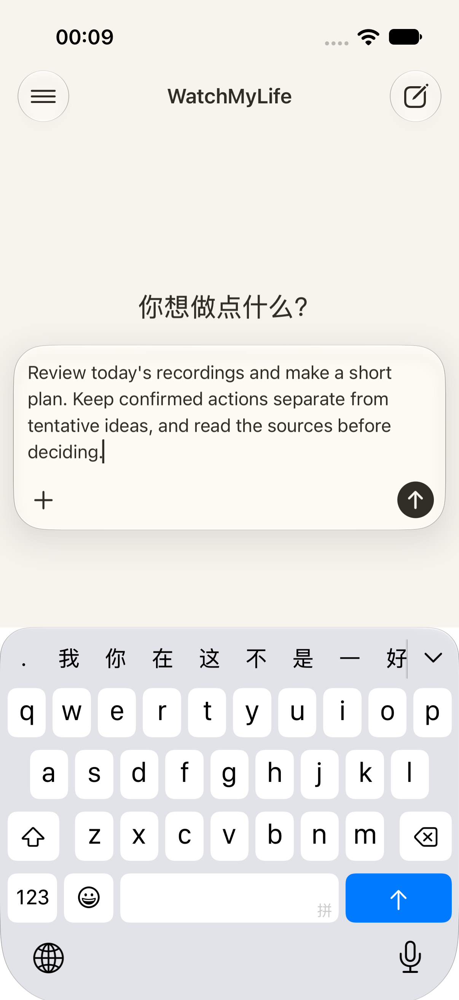
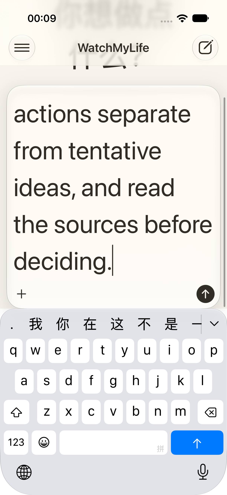
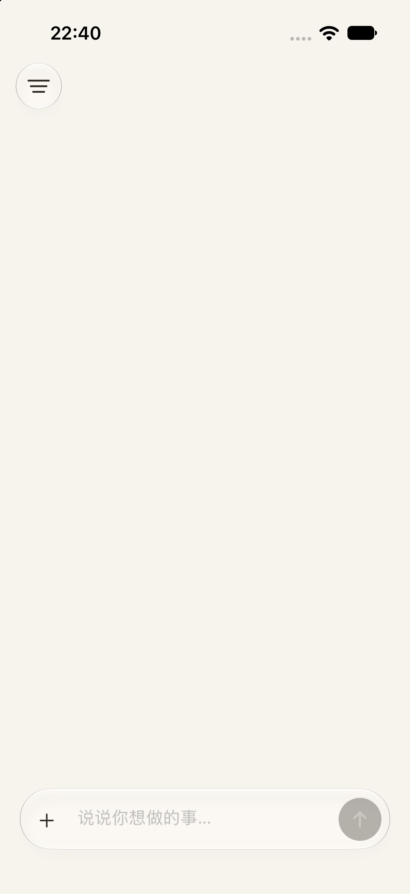
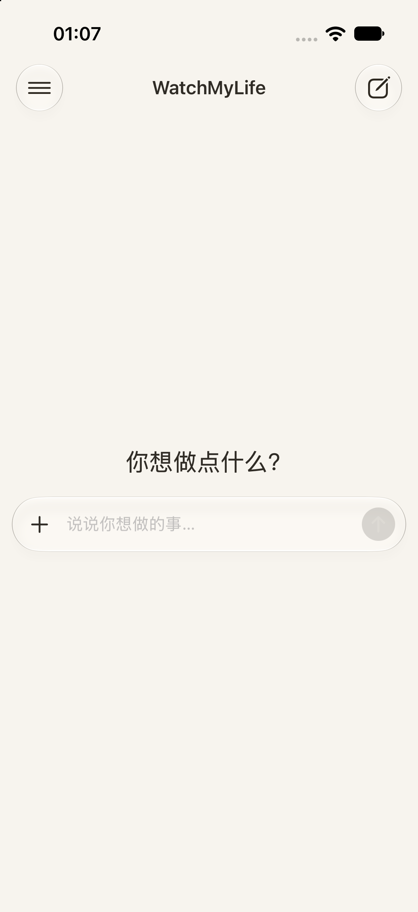
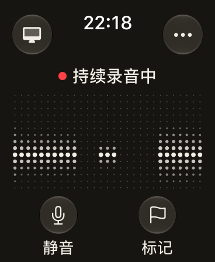
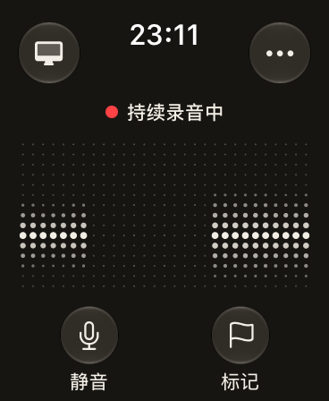

# 移动网页参考与原生排版

2026-10-14，在 [ChatGPT 公共首页](https://chatgpt.com/) 的 `unauth-mweb` 路由，以 **393 × 852 CSS px、DPR 1** 观察首页、侧栏和未发送的输入草稿。这里记录的是匿名移动网页，不是登录后的聊天界面。没有发送消息、调用付费模型或读取用户对话。

本次借鉴文字层级、留白和输入框布局。MoMo Agent 继续使用用户确认的[奶油白／纸白／墨色／夜色调色盘与原图标](README.md)，保留 SwiftUI 系统字体、动态字号和原生 Liquid Glass。

## 实际观察

下表的数值来自浏览器 computed style 与实际元素边界；尺寸均为 CSS px。原始观察保存在本机忽略目录 `tmp_agent_output/chatgpt-mobile-design-20261014/`，不会随 Git 分发。

| 元素或状态 | 实测 | 本机证据 |
| --- | --- | --- |
| `body`、`textarea[aria-label="与 ChatGPT 聊天"]` | 字号 16、行高 24、字重 400；字体栈以 `-apple-system-body, ui-sans-serif, -apple-system, system-ui` 开始 | `home-styles.json` |
| 首页 `h1` | 字号 24、行高 28、字重 400；标题与输入区居中组合 | `home-styles.json`、`home.png` |
| 打开的 `aside` 与导航行 | 面板宽约 298.67；左右内容留白 24；可见导航行高 44；文字 16／24、字重 400 | `sidebar-styles.json`、`sidebar-stable.png` |
| 空输入 `form` | 宽 369、高 48、圆角 28；左右外留白约 12；输入与操作在同一行 | `home-styles.json`、`home.png` |
| 填入单行草稿 | 表单高 112；文字位于上行，操作位于下行 | 页面当次边界测量、`single-draft.png` |
| 填入多行草稿 | 表单高 139.42；文字仍为 16／24；操作保留在下行 | `multiline-styles.json`、`multiline.png` |
| 菜单、添加与发送操作 | 测得交互元素为 44 × 44；多行状态发送按钮仍为 44 × 44 | `home-styles.json`、`multiline-styles.json` |

字体采集的 `fonts` 数组为空。CSS 中存在其他字体候选类，不能据此认定当前页面用了 OpenAI Sans；当前已绑定元素的证据支持 Apple／系统字体栈。也没有从上述匿名首页推定用户气泡、实际助手回答或完整 Markdown 正文的实屏样式。

## 公开源码范围

本次核对 **10 个公开文件，共 2 个 CSS 与 8 个选取的 JavaScript 文件**，不是全部站点代码。两个样式入口是 [initial CSS](https://chatgpt.com/unauth-mweb/assets/stylex-initial-modern-FSzWop7N.css) 与 [remaining CSS](https://chatgpt.com/unauth-mweb/assets/stylex-remaining-modern-5-7VWt_1.css)。全部 URL、采集时刻、字节数与 SHA-256 见[便携清单](mobile-web-reference-assets/bundle-manifest.json)；逐项核对本机文件后仅保存元数据，不把原始 CSS／JS 放入 Git。

`native-conversation-route-stylesheet-CjA2RyPq.js` 从页面的 `data-octane-conversation-route-stylesheets` 读取路由样式入口。本次实际属性指向上述 remaining CSS。文件中存在其他合法入口的匹配规则，不表示那些路由或样式已经显示在本次页面中。

StyleX 原子类只能作为静态候选。例如 remaining CSS 中 `.x1j61zf2` 为 16px 字号、`.x1o2sk6j` 为 24px 行高、`.xo1l8bm` 为 400 字重；是否共同应用于某个元素，仍以其 computed style 为准。静态 Markdown 间距规则及字体候选没有被冒充为登录后聊天页的实测结果。

## iPhone 的原生对应

统一文字入口为 [`PhoneTypography.swift`](../../../Apps/iPhoneApp/SharedUI/PhoneTypography.swift)。下列是 SwiftUI 的基准 pt，随 `@ScaledMetric` 放大；网页 px 与原生 pt 不作逐像素等同。

| 文字角色 | 基准字号／字重 | 用途与依据 |
| --- | --- | --- |
| body、navigation、code | 16／regular | 正文、输入、导航；code 采用等宽字体 |
| title | 24／regular | 空首页标题，对应观察到的轻量标题层级 |
| brand | 18／semibold | 原生品牌导航选择 |
| heading、subheading、section | 24／semibold、20／semibold、17／medium | 原生内容阅读层级，不声称是已观察的 ChatGPT 回答样式 |
| metadata、caption | 13／regular、12／regular | 原生次级信息 |

正文与代码使用随字号缩放的 4pt 附加行距，其他角色为 2pt。SwiftUI `lineSpacing` 是附加行距，并不等于 CSS 的固定 24px 行高。

[`AssistantView`](../../../Apps/iPhoneApp/Features/Assistant/AssistantView.swift) 将空首页标题与输入框放在居中的可滚动容器内；内容超出可用高度时仍可滚动。输入框采用 28pt 连续圆角、左右 12pt 留白和 44pt 操作区域。空白未聚焦时为一行；聚焦或有草稿时，`Grid` 将输入区放在上行、操作放在下行，输入可增长至六行。侧栏采用 24pt 内容留白、16pt regular 导航文字、至少 44pt 行高，导航和历史内容可滚动。

有对话时使用底部输入区与可滚动消息列表；用户气泡的 22pt 圆角、16／10pt 内边距、助手正文无气泡背景，以及 Markdown 的标题层级都是本项目的原生设计选择。此次没有通过发送 ChatGPT 消息观察这些状态，因此不把它们写成网页复刻证据。

## iPhone 分轮验收与实际截图

以下结果截至 2026-10-15，分别保留各自构建与测试范围，不累加为一次新的全量通过。摘要、原报告大小／哈希和便携截图统一列入[本轮证据索引](../../implementation/evidence/2026-10-15-mobile-design/evidence-index.json)。本轮检查未发送模型消息、未调用收费 API。

| 轮次 | 实际结果 | 范围与限制 |
| --- | --- | --- |
| Phone01 | 5 通过、2 失败 | 保留设置校验控件可见性、44pt 触点浮点比较的原失败 |
| Phone02 | 5 通过、2 失败 | 两个键盘用例未满足实际软件键盘高度大于 100pt 的前置条件 |
| Keyboard03 | 0 通过、2 失败 | 同一真实键盘前置条件仍失败，不能作为键盘验收 |
| Keyboard04 | 0 通过、2 失败 | 真实键盘前置条件已通过；随后因测试错误假设返回后的光标必在末尾而失败，实际插入发生在点击位置 |
| Keyboard05 | 2/2 通过 | 普通／最大辅助字号、软件键盘实际可见且高度大于 100pt、输入与发送按钮可达、导航往返草稿保留及实际光标位置编辑 |
| Inline06 | 2/2 通过 | 将 inline 标题 modifier 放到实际页面内容后，导航和计划 CRUD 定向验证通过 |
| Secondary07 | 3/3 通过 | 四个录音次级页统一字号后，系统导出分享与取消、缺稿恢复、真实本地转写录音完整旅程定向验证 |

Keyboard05 保持大于 100pt 的真实软件键盘门槛；45 秒等待只用于系统键盘完成渲染并可点击，没有降低高度或操作断言。该轮 336 个输入哈希稳定、0 runtime warnings；两张实际图已查看，普通字号内容完整，最大字号可滚动到光标及操作区。下图属于 **Debug Keyboard05**，早于之后的 inline 标题和四个录音次级页字体调整，不标为 Release 截图。

| 普通字号与真实键盘 | 最大辅助字号与真实键盘 |
| --- | --- |
|  |  |

Inline06 同样保持 336 个输入哈希稳定、0 runtime warnings，执行墙钟 83.249 秒。它与 Keyboard05 是不同构建、不同用例，不能合称一次 7/7。

**Release12 是已安装、已实看过的紧凑导航历史快照。** 两端安装后 9 个文件哈希与构建快照一致，118 个文件的已授权凭据精确扫描零命中；浅／深首页、侧栏、设置和 Watch 空闲页均实际查看，并经独立视觉复核。设置的 inline 标题已经生效。Release11 的旧大标题页面保留为修正前记录，不作为最终界面证据。

| 调整前的 Release10 首页 | 最终 Release13 首页 |
| --- | --- |
|  |  |

Release12 的其他已验收视图：[深色首页](../../implementation/evidence/2026-10-15-mobile-design/release12-home-dark.png)、[侧栏](../../implementation/evidence/2026-10-15-mobile-design/release12-sidebar-light.png)、[紧凑标题设置页](../../implementation/evidence/2026-10-15-mobile-design/release12-settings-light.png)。这些静态页面不能代替真实键盘、发送后对话或新的 Release 录音验证。

**最终源码产物为已安装的 Release13**，再统一原音保留、覆盖情况、文件恢复、导出四个录音次级页的 `PhoneTypography`，没有修改业务行为。构建成功，368 个输入哈希稳定；19 项静态检查、17 项检查器自检、23 项 Debug 标识扫描和 10 份 UI 编译源码副本核对通过。对应最终源码的 Secondary07 定向 UI 为 3/3 通过、0 跳过、0 runtime warnings，墙钟 158.597 秒，336 个输入哈希稳定。该轮三张选定实际截图也已查看：导出取消和文件恢复后原稿仍可读，覆盖情况页的标题、区间和来源标签完整；既有 ASR 首词误识别保持开放，不把字体验收说成语义质量修复。

Release13 在 iPhone 与 Watch 模拟器均已安装并启动，9 个安装文件哈希与构建快照相符，118 个文件的已授权凭据精确扫描零命中。实际浅／深首页、侧栏、设置和 Watch 空闲页均已查看：居中标题／输入区、配色和侧栏布局保持一致，设置为紧凑 inline 标题，Watch 小字与点阵未裁切。检查后手机恢复浅色首页、Watch 为待录音状态，没有遗留测试或播放器进程。

最终安装视图：[深色首页](../../implementation/evidence/2026-10-15-mobile-design/release13-home-dark.png)、[侧栏](../../implementation/evidence/2026-10-15-mobile-design/release13-sidebar-light.png)、[设置](../../implementation/evidence/2026-10-15-mobile-design/release13-settings-light.png)、[Watch 空闲页](../../implementation/evidence/2026-10-15-mobile-design/release13-watch-idle.png)。Release13 安装检查没有重新执行软件键盘 E2E 或采音；前述 Debug 分轮结果与本轮静态页面证据分别保留。

## Watch 字号与已完成的独立验证

Watch 保留已接受的点阵布局和真实 RMS 显示，只把状态文字改为基准 **12pt medium**（随 `.caption` 缩放），底部按钮标签改为 **12pt regular**（随 `.caption2` 缩放）。几何、44pt 命中区域、录音动作和无障碍标识不变。下面左图复用仓库内已接受的旧图，右图是新字号的实际模拟器截图；公开测试音频的时点不同，点阵轮廓不作逐点比较。

| 调整前 | 调整后 |
| --- | --- |
|  |  |

新图来自 `20261014-mobile-design-watch-01/ui/review/watch-recording-native-capture.png`，SHA-256 为 `955314a1e136d4c8c4c4f1a646f2fe91b0a263f7d73842861fc5f79da93c6410`。对应 `CaptureView.swift` SHA-256 为 `fc3c1c3bd12a2f57ae5a129a9deedd606af21d6aa2ae1fe5052c79488c5a656c`。

本轮新建的 Watch UI 完整旅程 **1/1 通过**，0 跳过、0 runtime warnings，XCTest 用时 **109.822 秒**，保持原有 120 秒期限。实际录音、暂停、更多、结束确认和重启前后资料等七张截图均已查看：文字完整可读，点阵与工具栏未被挤压；重启前后保留两段、38 秒待确认原音。51 个构建／测试输入哈希前后一致。

本轮通过 BlackHole 定向输入公开 fixture，运行结束后停止播放器与测试进程，校验后清理本轮独立 UUID 的原音。两个原生采集用例沿用 `20261014-watch-blackhole-final-01` 的结果，33 个音频、运行时、契约、同步及原生测试输入哈希未变；**本轮没有重跑 65 秒原生用例，也不是一次新的 3/3**。该范围是模拟器受控输入，不代表腕部拾音、真机续航或 WatchConnectivity 验收。原始报告与七图仍留在本机 `tmp_agent_output/20261014-mobile-design-watch-01/`，此文只携带已接受的新录音界面图。
