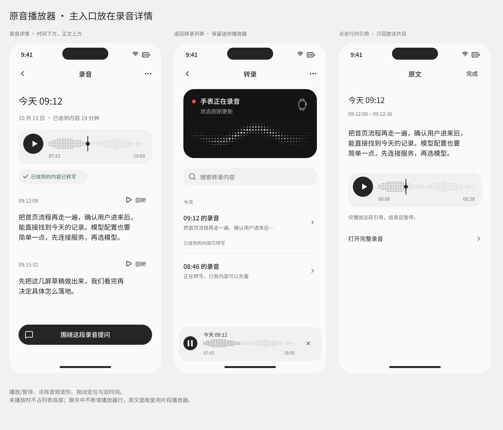

# 原音播放器放置与交互提案

2026-10-15 后续补充：[时间线重构方案](TIMELINE.md) 将主播放器目标从单次录音扩展到一个时间段，可跨多个 session。本文的放置、真实波形、共享控制器和交互规则继续沿用；目标身份、断点和多来源映射以补充方案为准。当前 `main` 已有 pause / resume / seek，文末所述「尚无暂停和 seek」是早期快照，不能作为本轮现状。

2026-10-15。本轮新增设计，用户已于 2026-10-15 在开发对话中确认纳入本轮实施；验证状态见实施记录。视觉参考为用户提供的[点阵播放器](references/audio-player-user-reference.png)，使用当前中性白、黑色按钮和系统字体。

主设计源：[v8 Pen](momoagent-iphone-review-v8.pen)。评审板 **`mxQKw`：播放器放置 · 录音详情、列表与行内引用**。这三处共用一个播放控制器，不是三个独立播放器。

## 放置建议

| 场景 | Pen 页面与节点 | 放置和职责 |
| --- | --- | --- |
| 录音详情 | P07 `momo0260`；主组件 `X4tKdw` | 日期/已收音频信息下方，转录正文上方；主动播放整条录音当前可回听范围 |
| 返回转录列表 | P29 `MoWvu` | 仅有当前播放/暂停任务时显示底部迷你条；暂停/续播、结束回听，点主体回到当前录音 |
| 点击聊天行内引用 | P30 `j8nRM1` | 原文面板内，所引用文字下方；默认只播放该引用片段，可进入完整录音 |

详情中向下阅读时，主播放器吸附在导航下方并保留布局占位；不自动滚动转录正文。底部继续保留“围绕这段录音提问”，不再叠一套底部播放器。列表迷你条固定在安全区上方，列表底部留足滚动空间；默认未播放的列表不出现播放器。

聊天仍使用行内引用打开原文，不在每条回复下面新增音频行，也不在聊天输入区旁常驻迷你条。跨到聊天时回放任务仍归现有共享控制器，用户从同一引用或转录入口找回；不因视图销毁启动第二次播放。系统打断后的恢复见下文。

列表顶部黑色点阵卡继续表达**手表状态**；新播放器的点阵表达**正在回听的原音**。两者的数据、颜色层级和操作语义分开，不能复用装饰波形冒充音频内容。

## 组件与时间

- 主播放器 345 × 88pt，左右 24pt；`surface` 底、约 22pt 圆角。播放/暂停按钮视觉与命中均为 52pt，黑底浅色图形。
- 按钮、波形中轴、位置竖线中心和进度圆点使用同一水平中心线；默认主播放器中心线距卡片顶部 36pt，不把按钮单独相对整张卡片垂直居中。主波形顶边 20pt、高 32pt，按钮顶边 10pt、高 52pt；左右时间同为顶边 58pt、同一字体基线。
- 波形下方左为已播放时间、右为本次可回听总时长；时间 12pt、`muted`，等宽数字，两侧与波形左右边缘对齐。原生实现采用共享控制行和时间行，而不是分别绝对定位后各自居中；Dynamic Type 下仍保持行内对齐。
- 波形拖动区域至少 44pt 高。播放器暂停时显示播放三角；播放时显示暂停双竖线，不能用停止方块代替暂停。
- 列表迷你条 369 × 88pt、左右 12pt；按钮视觉 36pt、命中 44pt。暂停、缩略波形与关闭按钮共用距顶 42pt 的中心线，双时间同一基线；包含录音日期。点主体打开详情，暂停和关闭不触发导航。
- 本轮只包含播放/暂停、定位、时间和收起；不堆附加操作。所有规格随 Dynamic Type 调整，最大字号时允许改为两行控制布局。
- 详情示例为 `07:42 / 19:00`，对应当前已收到的示例音频；引用示例为 `00:08 / 00:28`，是片段内相对时间，另显示实际原文时间范围。不得用整条录音时长标片段进度。

Pen 波形是明确标记的示意。正式波形应来自实际本机音频的降采样幅度/RMS 包络，并缓存，不能播放正弦动画或每次重画随机点。播放指针必须与真实时间对应；绘制随原生音频时钟更新，不用计时器累加猜进度。

## 操作规则

| 操作/状态 | 预期 |
| --- | --- |
| 播放 | 校验当前目标、版本与音频可用性；准备成功后才进入播放态 |
| 暂停/续播 | 暂停保留目标和精确位置，续播从原位置开始；不能调用现有 stop 清空状态冒充暂停 |
| 暂停中拖动 | 松手定位，仍为暂停，不意外响起 |
| 播放中拖动 | 拖动先预览时间，松手提交一次定位，成功后继续；避免每个手势事件重建音频会话 |
| 定位失败 | 保留最近真实可用位置并解释失败，不显示不存在的进度 |
| 点段落回听 | 切换同一控制器的目标至对应片段，清楚表示当前范围，不叠加声音 |
| 播放到结尾 | 停在结尾，按钮恢复播放语义；再按从该目标开头重播，不自动进入别的录音 |
| 引用片段结束 | 在片段末尾结束，不越界播放后面的私人录音 |
| 列表迷你条关闭 | 明确结束回听、收起条并释放资源，不删除录音 |
| 新目标开始 | 终止旧目标并校验新目标；失败不能残留旧的“正在播放”标记 |
| 系统来电、耳机断开、音频服务重置 | 结束活跃播放状态并保留可恢复位置；系统恢复不自动发声，用户明确续播 |
| 文件缺失/已清理/版本变化 | 根据真实范围禁用播放/定位，保留文字；在原操作位置显示原因 |

跨 chunk 定位必须使用真实帧范围、timebase 和 priming 映射，不直接把单文件 `currentTime` 当整条录音时间。缺失范围要有明确断点或不可用区，不把两端拼成连续可播放的原始时间。未知总时长显示 `--:--` 并暂不支持按比例拖动，真实播放/暂停仍可用。

持续接收音频时，本次播放使用稳定的可回听范围；新片段不能在拖动时悄悄改变尺宽或指针比例。结束本次回听或明确刷新后再纳入新范围，范围描述仍为“已收到”，不宣称手表全部同步。

暂停期间保留逻辑位置，不必长期持有所有文件租约；恢复前重验源版本和文件可用性。删除当前录音需停止并清理播放器；迟到的进度/波形任务不能复活已删除目标。波形计算不阻塞 UI 或自动转写，长录音不得为生成波形一次加载全部音频。

## 研发缺口与验收

[AudioPlaybackController](../../../Apps/iPhoneApp/Platform/AudioPlayback/AudioPlaybackController.swift) 已有录音/片段播放、停止、分页和租约；[PlaybackAudioSession](../../../Apps/iPhoneApp/Platform/AudioPlayback/PlaybackAudioSession.swift) 内部有单文件进度。目前没有对 UI 发布连续位置/时长，没有暂停、续播、seek 命令或波形数据。这些都是新增能力，不能只把“停止”换成暂停图标。

复用现有共享控制器，由运行时持有。建议展示快照至少包含 target、generation、范围、position、duration、playing/paused/loading/ended/failed 及可 seek 状态；命令只交给该所有者。波形缓存随音频身份和版本失效，保留现有 lease 与删除屏障，不另建第二套播放器。

VoiceOver 将进度作为可调控件，朗读目标、当前/总时间；支持增减调整并限制在实际可播放范围。播放、暂停、结束回听有独立名称。减少动态效果时取消装饰运动，但真实位置仍更新。深色、高对比和大字号下不能依靠灰度点阵独自表达状态。

验收覆盖 [场景 C215–C230](cases.md)：真实暂停续播、播放/暂停两种 seek、跨 chunk、缺失范围、接收中稳定范围、迷你条、目标切换、引用边界、播放结束、系统中断、真实波形、未知总长、失败与可访问性。需要真实 iPhone 回放和路由/中断验证；Pen 图不是播放测试结果。
