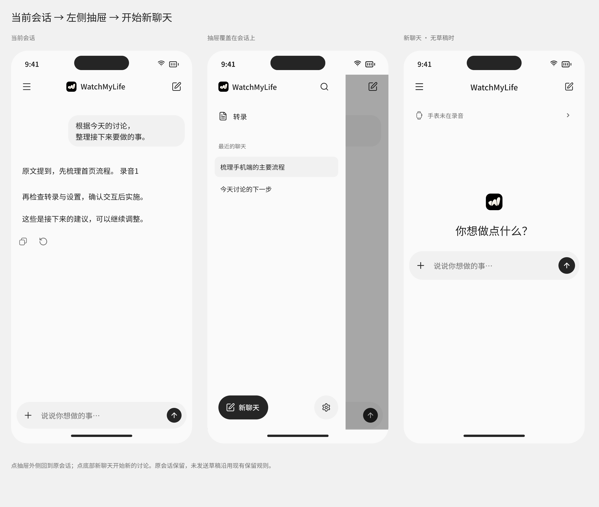

# MoMoAgent iPhone 设计研发交接

**2026-10-17 原音与容量更新：** 原音保留增加“永久”，表示不按天数到期；原有天数选择与已保存的自定义天数保留。储存空间增加原音上限，默认 20 GB，可输入 1–1000 GB 并保存，展示已用容量。达到上限后，后台从最早的可清理原音开始释放空间，保留转录文字。单独标记保留、播放或导出中、尚未确认同步、尚未完成处理的原音不清理；这些资料可能暂时使占用超过上限，录音和同步继续进行。见[实现记录](../../implementation/audio-retention-storage-cap-20261017.md)。

**2026-10-17 回复完成后的过程收起：** 思考与工具在执行期间继续按各自状态展示；整轮回复结束后，同一段连续过程收为一条可展开的摘要，显示操作数量与失败、待核对等状态。点击一次即可读思考内容，工具仍按独立执行 ID 查看详情。完成时只自动收起一次，之后手动展开不会被状态刷新或下一轮回复关闭。恢复历史默认收起；日程、提醒、闹钟等实际行动结果卡仍在摘要外显示。此条更新下文关于工具卡片在完成后仍逐条占位的展示约定，过程与正文的原始顺序保留。实现与验证见[过程收起记录](../../implementation/completed-process-collapse-20261017.md)。

**2026-10-17 点击清晰度补充：** MoMo 的点击弹跳与轻晃只变换内部 SVG，保持承载它的原生网页视口固定；角色大小与点击区域不变。避免通过缩放、旋转整块 WebKit 视图实现点击反馈。见[动效修复与验证](../../implementation/avatar-greeting-crisp-20261017.md)。

**2026-10-17 手表入口更新：** 点击 MoMo 右下角小标，原地显示录音状态、更新时间和上次报告的待确认录音；浮层底部提供“查看录音与同步”。浮层关闭后仍停留原聊天，不清空输入。此条覆盖下文点击小标直接切换转录页的旧行为。

本轮将 iPhone 的聊天、转录、模型服务配置和设置统一为简约、克制的移动界面。研发应保留现有录音、档案、Agent 与本地消息渲染能力，按本文和 Pen 替换导航、配置流程和展示细节。

交接日期：2026-10-15。接收方：iOS、Agent 接入研发与 QA。设计基线：本目录 **v8 Pen 稿**。代码核对：`codex/initial-implementation`，HEAD `b73451f`，含当前工作区修改；该提交号本身不包含完整的最新设计。本次只交接设计，没有实施原生代码。

**2026-10-17 首页与加载更新：** 用户要求空聊天首页将 MoMo 放在中央，首次发消息时将同一个角色连续移动、缩小到顶部；已有会话使用顶部位置。名字与右下角手表小标随角色一起移动。历史恢复只在消息区域显示骨架屏，菜单、底部导航与原生输入框保持挂载，恢复期间允许编辑草稿，完成前暂停发送。正常启动不再切换整屏“正在恢复聊天”。此条覆盖下文关于空首页固定顶部角色的位置决定，保留既有中性背景、程序化 Avatar 和连续鹅卵石思考动效。实现及验证见[读取与回听修复记录](../../implementation/phone-library-refresh-recovery-20261017.md)。

**2026-10-16 顶部角色更新：** 用户提供[参考图](avatar-header-reference.jpg)，要求聊天首页与会话共用顶部中央 Avatar，移除首页中央重复角色与顶部手表长文案。角色右下角显示手表小标和状态点：绿色为新鲜状态且确认录音，黄色为等待、静音、准备、未录音或状态待更新，红色为新鲜状态下的中断或失败。点小标仍打开完整录音状态；读屏保留具体状态。消息中的等待、思考和工具步骤使用原品牌图标动效，保留思考文字 shimmer。此决定覆盖下文的首页中央角色与顶部品牌/手表文案位置；首次体验仍保留品牌图标和 Avatar。

**同日比例与命名补充：** 用户指出旧版头像消失且偏小，要求按参考图测量并在下方显示名字 **MoMo**。参考图头像本体约 80×80 px，占手机画面宽度约 12.7%；旧实现实际本体约 33 pt、占宽约 8.1%。本轮以本体约 53 pt 为目标，名字使用 12 pt 系统字体。头像放在页面自己的固定顶部区域，避免塞入系统导航标题；手表小标仍在右下角。像素验收必须单独确认头像，排除小标与名字。详见 [MoMo 修复记录](../../implementation/momo-header-visibility-20261016.md)。

**2026-10-16 主导航更新：** 聊天与转录并列为底部一级入口，顺序为左「聊天」、右「转录」。使用原生 `TabView`，沿用中性黑白与系统 Liquid Glass。聊天侧栏只保留历史会话、搜索、新聊天与设置，移除转录入口；转录首页没有返回聊天的上级箭头。各标签保留自己的导航状态，从转录发起讨论时切到聊天并携带引用，之后仍可切回原详情。首次体验完成后才出现底部导航。顶部手表状态与输入框加号继续作为切换到转录的快捷入口（后续入口调整见下条）。此决定覆盖旧 P15 的转录行与旧 P06 的返回层级；最新原生页面及验证见[底部导航实施记录](../../implementation/bottom-tab-navigation-20261016.md)，Pen 的 N00–N03 同步这一层级。

**2026-10-17 附件入口更新：** 加号选择照片和文件，采用 Claude 的方形附件卡片、右上角移除与点击预览；不再通过加号引用录音。录音引用保留在转录详情的发起讨论入口。顶部手表小标先显示状态浮层。总结使用独立卡片，更新时保留仍有效的内容。

**2026-10-16 Personal Agent landing 更新：** 以[新版说明](LANDING.md)和[时间线 Pen](momoagent-transcript-timeline.pen)的 **L01–L11** 为最新基线。核心是私人助手拥有完整生活上下文，三段演示分别承接旅行、会议后的工作和妈妈生日；用户无需重述背景。完整体验后才出现「开始使用」。同一个 Avatar 跳进主页中央固定，原图标进入顶部栏。已实施原生欢迎页、连续 Avatar 与首页品牌位置，验证记录见[实施说明](../../implementation/personal-agent-landing-20261016.md)。演示中的全天录音、多来源长期理解和外部执行仍是终局方向。原 v8 的其他流程继续适用；旧 P09 的提前入口由本次完成门槛覆盖。

**2026-10-15 时间线补充（已实施）：** 用户明确保留上半部手表卡片和波形，要求下半部以时间归组，点开阅读转录和播放原音，弱化低字数碎片。见 [转录时间线重构方案](TIMELINE.md) 和另存的 [时间线 Pen](momoagent-transcript-timeline.pen) **T00–T10**，总览节点 `VWdKy`，日期交互节点 `nDDg3`。原 v8 不覆盖，P 系列保留作历史基线；转录列表、详情、处理中及迷你播放器的目标行为以该补充说明为准，2026-10-16 已按用户反馈改为[按说话活动归组](../../implementation/speech-activity-timeline-20261016.md)，长静默不占节点；连续交谈不再按半小时切断。保留 20 个有效字符的短文本规则，纯标点转录直接丢弃。原生代码与验证见[实施记录](../../implementation/transcript-timeline-20261015.md)；旧播放器能力缺口已在补充中按当前 `main` 代码重新核对。

**总结规则已确认：** 时间段总结调用用户配置的 AI 服务 API 和当前模型；未配置则不生成、不展示总结，不提示补配。原文转录与播放器始终可用；总结成功时复用列表预览位置，失败保留原文，不影响转录状态。详细契约见 TIMELINE 的「可选总结」。

**日期浏览已确认：** 左右切换前后一天，上下只看选中日期；点日期使用系统日期选择器。取消跨日期的纵向无限列表。原录音卡在翻日区域之外，仍显示当前手表状态。见 T08–T10 和 TIMELINE 的「左右翻日，上下看当天」。

## 1 设计源与优先级

**2026-10-17 系统与健康更新：** 用户要求区分功能、状态、说明与操作，并在首次连接时完成默认保存位置设置。日历与提醒事项使用“连接 → 系统授权 → 选择可写入的位置 → 完成连接”的流程；最后一步一起保存启用状态和默认位置，取消不启用 MoMo 的访问。已连接行显示当前位置和次级“管理”入口，断开位于管理页；旧连接缺少默认位置时显示“完成设置”。健康使用明确开关，启用前保留读取范围与 AI 数据用途说明；健康明细和行动记录分别进入查看页，设置首页不展开数据流。实现与验证见[连接流程记录](../../implementation/system-connections-onboarding-20261017.md)。

**主设计源：[momoagent-iphone-review-v8.pen](momoagent-iphone-review-v8.pen)。** 下列 29 个页面均来自此文件，给出页面名、节点 ID 和直接从 Pen 导出的截图。服务配置统一采用通用方法，百炼预设和专属地址页已移除。播放器为本轮新增提案，用户已确认本轮实施，见 [播放器补充](AUDIO_PLAYER.md)。请按页面名或节点 ID 在 Pen 中定位，不使用 v1–v7 或已删除的 HTML 预览实施。

| 材料 | 用途 |
| --- | --- |
| [v8 Pen 源稿](momoagent-iphone-review-v8.pen) | 页面构图、图形、留白与组件外观 |
| 本文 | 最终交互、真实状态、实现边界和验收 |
| [220 个场景](cases.md) / [结构化场景](cases.json) | 边界条件和恢复路径，含新增播放器 16 项；是预期，不是测试通过报告 |
| [原音播放器补充](AUDIO_PLAYER.md) / [三屏预览](audio-player-placement.png) | Pen `mxQKw`：详情、列表迷你条、引用片段；用户已确认本轮实施 |
| [新聊天流程](new-chat-flow.png) | Pen `gb86k`：当前会话 → 抽屉 → 无草稿的新聊天 |
| [聊天与行内引用](chat-inline-v8.png) | Pen `WSpNH`：回复操作、停止后展示与行内引用 |
| [品牌与波形](review-focus.png) | Pen `czcJg`：保留原有产品识别 |
| [交互研究](interaction-research.md) | 参考网站和公开 bundle 的观察边界 |

冲突处理：用户本轮明确反馈与本文的最终行为约定优先；几何与外观以本次 Pen 对应节点为准。Pen 的 `prototype.action` 是早期预览说明，部分旧值仍在，**不能据此生成路由**。例如 P01 右上角已是新聊天，其动作必须新建讨论，即使旧元数据仍写着 `sidebar`。

交给研发时保留本目录的 `.pen`、本文、`assets/`、`icons/`、`handoff-screens/` 和场景文件。链接是仓库内文件路径，不是 pen.dev 云端公开分享链接；无需运行 localhost 服务。后续设计变动同步本文和 Pen，不能只更新截图。

### 不得回退的决定

**2026-10-16 聊天体验更新：** 用户要求手机聊天直接对照 Claude.ai 当前加载的前端 bundle 优化。本次聊天的输入区、工具展示、等待与流式状态以这一要求为准，替代下列第 1 条中的 ChatGPT 聊天参考。系统字体、中性配色、原图标与 Avatar 继续使用本项目的定义。工具调用独立展示，不再收进“思考过程”；复制与重新生成图形采用 Claude 当前 DOM 实测的 16×16 px，手机点击范围保留 44×44 px。实现与验证见[手机聊天优化记录](../../implementation/iphone-agent-ui-20261016.md#claude-手机聊天前端优化)。

1. 对齐 ChatGPT 移动网页的整体层级与交互，使用系统字体、中性浅白；不搬入 Claude 的暖纸色或品牌字体。
2. 保留原始品牌图标与黑色点阵波形，不重新画近似 logo，不删除波形卡。
3. 侧栏是覆盖当前会话的左侧抽屉；新聊天在抽屉底部，页头有快捷入口。
4. 移除独立计划页和计划导航入口；聊天中整理下一步仍是普通对话。
5. 本机转写自动进行；移除就绪开关、暂停/继续转写和转写模型管理设置。
6. 首次服务商与模型均为空；国产服务只提供地址/协议预填，不做专属配置流程。
7. 所有服务共用名称、API 地址、密钥、协议和模型 ID；不设地域选择、百炼开关或服务商兼容分支。
8. 聊天页和输入框下方不放模型或模式选择器，统一在设置管理。
9. 模型在事实旁生成行内引用，不追加“参考原文”或固定来源行。
10. 主动停止保留已有内容，不显示可见“已停止”；保留一次读屏播报。
11. 复制和重新生成使用轻量图标；复制采用本轮修正后的轮廓，不用文字字符代替。
12. 设计评审 HTML 已移除；正式 App 的本地 WKWebView 渲染资源继续保留。

## 2 Pen 页面索引

画布均为 393 × 852，截图为 2× 导出，不是已实现的设备截图。P 编号只供交接定位，不进入产品 UI。

| 编号 | Pen 页面名 | Pen 节点 | 页面责任与预览 |
| --- | --- | --- | --- |
| P01 | 聊天首页 | `momo0036` | [空白讨论、状态入口、输入](handoff-screens/momo0036.png) |
| P02 | AI 服务 | `momo0070` | [未连接，不阻断转录](handoff-screens/momo0070.png) |
| P03 | 选择服务商 | `momo0109` | [预设列表，无初始选中](handoff-screens/momo0109.png) |
| P04 | 连接服务 | `momo0140` | [密钥与折叠连接设置](handoff-screens/momo0140.png) |
| P05 | 选择模型 | `momo0180` | [搜索、手填、验证后应用](handoff-screens/momo0180.png) |
| P06 | 转录 | `momo0229` | [状态波形与录音列表](handoff-screens/momo0229.png) |
| P07 | 录音详情 | `momo0260` | [按段阅读、回听与提问](handoff-screens/momo0260.png) |
| P08 | 设置 | `momo0300` | [AI 服务、保留、容量](handoff-screens/momo0300.png) |
| P09 | 首次使用 | `momo0319` | [说明分工，可先看转录](handoff-screens/momo0319.png) |
| P10 | 密钥验证失败 | `momo0354` | [密钥错误，输入保留](handoff-screens/momo0354.png) |
| P11 | 连接详情 | `momo0389` | [保存状态与更换密钥](handoff-screens/momo0389.png) |
| P12 | 高级设置 | `momo0414` | [界面标题为连接设置](handoff-screens/momo0414.png) |
| P13 | 自定义服务 | `momo0445` | [名称、地址、协议、密钥](handoff-screens/momo0445.png) |
| P14 | 带来源的对话 | `momo0481` | [事实旁的行内引用](handoff-screens/momo0481.png) |
| P15 | 侧栏 · 左侧会话抽屉 | `momo0524` | [最终抽屉，替代整页菜单](handoff-screens/momo0524.png) |
| P16 | 转写中的录音 | `momo0551` | [增量正文，不提供暂停](handoff-screens/momo0551.png) |
| P17 | 验证连接中 | `momo0796` | [单次在途，可取消](handoff-screens/momo0796.png) |
| P18 | 网络不可用 | `momo0813` | [保留输入后重试](handoff-screens/momo0813.png) |
| P19 | 还没有录音 | `momo0829` | [从手表开始的空状态](handoff-screens/momo0829.png) |
| P20 | 原音已清理 | `momo0848` | [文字保留，回听不可用](handoff-screens/momo0848.png) |
| P21 | 回答中断 | `momo0876` | [部分回复与恢复](handoff-screens/momo0876.png) |
| P22 | 储存空间不足 | `momo0894` | [受影响能力与容量入口](handoff-screens/momo0894.png) |
| P23 | AI 服务 · 已连接 | `ETA14` | [当前模型与已保存服务](handoff-screens/ETA14.png) |
| P25 | 无法读取模型列表 | `fhHhh` | [重读或手填，不误判密钥](handoff-screens/fhHhh.png) |
| P26 | 等待回复 | `rLlDA` | [首段前可停止](handoff-screens/rLlDA.png) |
| P27 | 流式回复 · 可操作 | `XiGJu` | [增量、停止、回到最新](handoff-screens/XiGJu.png) |
| P28 | 停止后的回复 | `yw6Ro` | [无停止文字与来源尾巴](handoff-screens/yw6Ro.png) |
| P29 | 转录 · 原音播放中 | `MoWvu` | [播放任务的底部迷你条](handoff-screens/MoWvu.png) |
| P30 | 原文 · 引用片段播放器 | `j8nRM1` | [仅回放所引用的片段](handoff-screens/j8nRM1.png) |

推荐先看 Pen 的 `gb86k`、`WSpNH`、`czcJg` 三块评审板，再进入单页；早期审美板和动画对照不是另一套待实现方案。

## 3 导航和新聊天

Pen 引用：P01 `momo0036`、P14 `momo0481`、P15 `momo0524`；流程板 `gb86k`。

| 触发 | 结果 | 状态处理 |
| --- | --- | --- |
| 页头左侧菜单 | 抽屉覆盖当前会话 | 不新建会话、不清空输入、不重发请求 |
| 点右侧遮罩 | 关闭抽屉 | 回到同一会话和阅读位置 |
| 底部新聊天 / 页头右侧新聊天 | 收起抽屉，开启新的讨论 | 旧会话保留；保留未发送文字；清除上次选中的录音草稿来源 |
| 加载、新建或回复中 | 新聊天按钮不可用 | 与 `AssistantModel.isBusy` 一致，不显示可点但静默无效的按钮 |
| 点当前历史项 | 收起抽屉 | 不新建会话 |
| 点其他历史项 | 打开对应会话 | 按 session ID 隔离快照、错误和迟到回调 |
| 点转录 / 设置 | 收起抽屉并进入页面 | 返回原讨论，不重建 Agent |
| 点搜索 | 抽屉内显示搜索输入 | 查标题，清空恢复列表，无结果有简短提示 |

新聊天有草稿时，不强制清空为截图中的空输入框，也不自动发送；第三屏仅代表无草稿情况。连续点击只创建一次，失败保留原会话与草稿并允许重试。

393pt 宽时抽屉 300pt，右侧约 93pt 显示遮罩下的原会话。标准字号宽度约为视口的 76.4%，上限 340pt；辅助功能大字号可用视口宽减 24pt。背景 `bg`、选中项 `surface`、黑色遮罩约 33% 不透明度。

底部新聊天高 52pt、基准宽 108pt、圆角 26pt；设置按钮为 52pt 圆形。字号变大时允许按钮扩展。底部操作固定在安全区内，中部历史滚动。状态栏、动态岛和 Home Indicator 由系统绘制，不照 Pen 重画。抽屉打开后读屏焦点进入抽屉，底层不参与遍历；关闭回到菜单按钮。搜索展开/无结果等未独立出屏的细节按此约定实施后复核。

## 4 视觉规格与资产

### 颜色

以下值直接来自 v8 Pen 变量，不再使用奶黄底。部分历史副本仍有字面浅色值，深色实施以此表的语义映射为准。

| 语义 / Pen 变量 | 浅色 | 深色 |
| --- | --- | --- |
| 页面 `bg` | `#FAFAFA` | `#161616` |
| 气泡、输入、选中表面 `surface` | `#F1F1F1` | `#292929` |
| 正文、主按钮 `ink` | `#252525` | `#F2F2F2` |
| 次要文字、工具图标 `muted` | `#686868` | `#AAAAAA` |
| 分隔 `line` | `#E1E1E1` | `#454545` |
| 额外实色表面 `paper` | `#FFFFFF` | `#202020` |
| 成功文字 / 背景 `green` / `greenbg` | `#35664D` / `#E8EEE7` | `#ADCEB8` / `#26372C` |
| 失败文字 / 背景 `red` / `redbg` | `#A23C32` / `#F6E8E3` | `#F0B6A8` / `#422C26` |

状态同时提供文字和符号，不只依赖红绿。系统导航与材料遵循原生实现，减少透明度后仍可区分；不为填留白新增玻璃卡、渐变和装饰。

### 字体和尺寸

Pen 中文用 Noto Sans SC 代理，正式 App 用系统字体和 Dynamic Type，不打包代理字体。下表为默认字号；原生单位 pt，WebKit 标准 text scale 下对应 CSS px，不能再乘屏幕 scale。

| 位置 | 字号 / 行高基准 | 字重 |
| --- | --- | --- |
| 聊天及抽屉品牌 | 16 / 24 | 常规 |
| 普通详情导航 | 17 / 约 25.5 | 常规至中等，依系统导航 |
| 抽屉菜单 / 最近聊天 / 分组 | 15 / 22.5；14 / 21；12 / 18 | 常规 |
| 用户消息、助理正文、输入 | 16 / 24 | 常规 |
| 回复小标题 | 18 / 约 26–27 | 中等，不套用 24pt 页面标题 |
| 空白首页提示、设置及流程主标题 | 24 / 36 | 常规至中等 |
| 转写正文 | 17 / 约 26 | 常规 |
| 元数据和帮助 | 12–14 / 18–21 | 常规 |

一般页面左右 24pt；聊天正文左右 24pt，输入容器左右 12pt，用户气泡右边距约 16pt。正文段落间隔 16pt。窄屏、键盘和大字号重新排版，不整张缩放 393 × 852 画布；示例中文手动换行不进入运行时文案。

| 组件 | 规格 |
| --- | --- |
| 图标按钮 | 通常图形 20 × 20，命中至少 44 × 44；居中并按实际轮廓检查光学大小 |
| 回复操作 | 每项命中 44 × 44、图形 20、`muted`；沿正文左缘排，组与字形边界分开计算 |
| 主按钮 | 高 52，文字 16；忙碌反馈在原位显示 |
| 表单/菜单行 | 命中至少 44；连接页常规行 64，密钥输入基准高 60 |
| 用户气泡 | `surface`、圆角 22、内距上下 10 / 左右 16；最大约正文可用宽 70% |
| 助理正文 | 无气泡，不套卡片或增加头像底框 |
| 输入区 | 基准高约 58–62；1–6 行，更多内容内部滚动；键盘上方可操作 |
| 发送/停止 | 视觉圆直径 32，外层命中 44；原位切换箭头和方块 |
| 回到最新 | 水平居中、圆形向下箭头、命中 44，位于输入上方；无文字按钮 |

气泡 70% 约束作用于外层，内部文字占满气泡，不能两层重复乘 70%。极大字号可适当放宽以保证可读性，不固定为示例的 253pt。

### 品牌和图标

- [原始品牌图标](assets/momoagent-icon.png)：原图原色；首页 36pt、首次使用约 40pt、抽屉及聊天品牌约 22pt，不换通用波形。
- [复制回复 SVG](icons/copy-reply.svg)：正确的 20 × 20 viewBox 填充轮廓，WebKit 用本地 SVG/path，不用 `⧉`、emoji 或字体字符。[局部核对](copy-button-detail.png) 可看双纸张重叠与同排图标比例。
- Apple Watch 原生继续用 SF Symbol `applewatch`；Pen 是方圆表壳代理，不用普通圆表替代。
- 其他功能图标继续用 SF Symbols；草稿中的 Lucide 是设计代理，来源见 [SOURCE](icons/SOURCE.md)。

### 实施期间用户追加的视觉决定

- 空白首页保持水平居中，整组品牌、问候与输入使用偏上的光学中心。以 P01 的构图为基准随可用高度调整，不再把整组放在整屏的几何中点；键盘和辅助功能字号仍重新排版。
- 手表状态保留在首页清楚可见。导航栏中央保留原始品牌图标，并显示「灰色 Apple Watch 图标＋真实状态」，移除顶部 App 名称，不用红色表达正常录音。状态仍可点击进入转录页查看完整录音与同步详情，不单独占内容区横幅；过期状态不声称仍在录音。依照新版 landing 的位置约定，首页内容区只保留 Avatar，原始品牌图标移到顶部栏。
- 等待回复不使用 `✳` 星芒。用户指定直接复用 [Bible Strong Avatar Lab](https://github.com/smontlouis/bible-strong-avatar-lab) 的程序化代码，用代码定义专属的简洁非圆形头像和轻微动作，不使用其 Studio 创建界面完成设计。首页原品牌资产继续保留。减少动态效果时静止，等待结束或 App 不可见时停止动画调度。固定版本、源码与许可记录见 [Vendor/BibleStrongAvatar](../../../Vendor/BibleStrongAvatar/README.md)。P26 已同步代码生成的静态姿态：不等高波峰、圆角主体和简单双眼；[静态 SVG](icons/momoagent-listening.svg) 仅供设计核对，正式 App 使用本地程序化引擎。模拟器 WebKit 实际截图见实施证据，设计稿不代表真机验证。

## 5 聊天与流式

Pen 引用：P14 `momo0481`、P21 `momo0876`、P26–P28 `rLlDA` / `XiGJu` / `yw6Ro`；局部评审板 `WSpNH`。

| 状态 | 展示 | 操作与收尾 |
| --- | --- | --- |
| 空白 | 品牌、简短问候、输入；未聚焦时显示手表状态入口 | 无模型在需要助理时引导设置，不阻断转录 |
| 等待首段 | 用户气泡和轻量等待 | 首字前即可停止，不显示伪百分比 |
| 正文流入 | 稳定段落不变，只显现新增尾部 | 可阅读、选择、编辑下一条草稿，不并发发送 |
| 完成 | 完整正文和轻量回复操作 | 恢复发送，历史恢复不重播动画 |
| 用户停止 | 立即补齐实际已收到的尾部，保留部分回答 | 不显示“已停止”或通用错误条；播报一次，旧回调不继续追加 |
| 服务中断 | 部分回答和真实错误 | 有明确恢复入口，重试不重复插入用户问题 |
| 达到长度上限 | 已有内容与未完整结束说明 | 不当成正常完成，不编造缺失内容 |

新增尾部默认约 **100ms 短淡入**，逐字模糊不作为生产默认；不为整篇逐字排队。按 grapheme 处理中文、肤色、家庭 emoji、组合重音；积压大时加快排空，完成/停止立即展示已收到内容。减少动态效果时直接更新，历史不播放。

Markdown 稳定块复用，只更新尾部；未闭合格式采用保守、安全的增量呈现，最终提交重新解析必要部分。代码、表格和长公式只在自身容器横向滚动；选中文字时不重建其稳定正文。

### 阅读、输入和工具

- 接近底部才跟随；上滑后解除跟随。新增、完成、停止和字体/公式布局变化都不抢回底部。
- 离开底部才显示向下箭头；点击后回到底部并恢复跟随，不遮正文或输入。
- 生成中可编辑下一条草稿；Enter 不并发启动，停止不清草稿。中文组合输入 Enter 不误发，硬件键盘 Shift+Enter 换行。
- 返回页面不重复请求、不清空草稿；保留同一逻辑消息身份和阅读意图。
- 已有工具过程、失败详情继续保留，以真实调用 ID 和结果为准；完成默认收起，用户主动展开的项不强制折叠。Pen 未逐帧覆盖工具详情，按现有边界实施后交真实页面复核。

复制只取该回复正文 Markdown，不混按钮、隐藏播报、工具 JSON 或其他消息。流式中若允许复制则取当前已显示内容；代码块单独复制原始代码。成功可短暂勾选/轻提示，失败不伪装成功。

失败重试沿用当前 request ID 和恢复语义；重新生成针对指定回答的原问题，目标展示替换该回答，不重复用户气泡。原回答在新尝试建立前保留，发起失败仍可阅读。**当前代码只有失败重试，没有已完成回答的重新生成桥接**，必须补显式命令和身份校验后再交付可用图标，不能接成再次 `send()`。

### 行内引用

示例：`先梳理首页流程。[录音1](momoagent://source/SESSION/SPAN?version=2&generation=3)`。模型决定实际采用的事实及位置，完整使用工具提供的 `citationURL`。普通建议不伪造来源。

链接是正文的一部分，随句子自然换行。Pen 的独立文字框只服务排版，不意味着另加来源行。禁止自动追加“今天 09:12 的录音”“来源 · 09:12”或所有已读资料列表。

点击继续通过现有 `SourceLinksView` 校验 session、span、version、generation 和实时档案版本，再打开原文与回听。修改、删除或过期时说明不可用，不误跳近似片段；原音清理后文字仍可读，回放按真实可用性处理。会话 `sources` 是授权/失效登记，不能为了去掉来源 UI 删除它。

## 6 服务和模型配置

Pen 引用：P02–P05、P10–P13、P17–P18、P23、P25。核心路径：**选择服务预设或自定义 → 编辑通用连接 → 读取/填写模型 → 验证模型 → 保存并使用**。

结构参考 [Cherry Studio 的模型服务配置](https://docs.cherry-ai.com/pre-basic/providers)：服务条目下管理 API 密钥、API 地址和模型。我们复用这种通用结构，不移植桌面布局。预设只负责填值，所有服务进入同一份连接表单、同一模型管理与验证流程；服务名称不触发专用页面或参数分支。

未配置显示连接入口及“录音与转写可以独立使用”。首次服务商、模型无选中；已有配置升级恢复原值，不重置为空。服务列表第一个是 DeepSeek 不等于默认选中。

| 服务预设 | 设计预设基础地址 | 初始协议值 |
| --- | --- | --- |
| DeepSeek | `https://api.deepseek.com` | Chat Completions |
| Kimi | `https://api.moonshot.cn/v1` | Chat Completions |
| 智谱 GLM | `https://open.bigmodel.cn/api/paas/v4` | Chat Completions |
| 硅基流动 | `https://api.siliconflow.cn/v1` | Chat Completions |
| 自定义 | 空，按官方文档填写 | 用户明确选择已支持协议 |

数据及官方依据见 [provider-presets.json](provider-presets.json) 和 [README](README.md)。地址是 2026-10-15 设计基线，发布前复核。Pen 中 DeepSeek Flash、V4 Pro、GLM 等模型名称/ID 是布局样例，**不是已验证的生产目录**。优先使用服务真实返回的 ID；无目录则手填再验权限。

Chat Completions、Responses、Anthropic Messages 是协议，不意味着同一基础地址全部支持。不能重复拼接 `/v1` 或猜端点。自定义字段永久显示名称、HTTPS 地址、协议、密钥标签。继续遵守当前运行时的 HTTPS 约束。

不保留百炼预设、独立地址页、地域选择或兼容模式。需要接入任何未列出的服务时，用户通过自定义填写地址、凭证、协议和模型，使用同一验证流程；不按品牌注入思考格式、模型参数或隐藏的端点修正规则。当前不支持的鉴权方式/协议明确说明，不为某家服务单独扩展。已有配置按保存的地址、协议、模型和凭证作为通用连接迁移，不丢用户数据。

### 草稿、验证和保存

1. 常规连接先填密钥；连接设置默认收起，预设地址/协议通常无需改。
2. 新连接密钥必填。已有连接显示“密钥已保存”；不读取旧密钥回填表单，空的新密钥输入保留旧凭证。只移除首尾空白，关闭自动纠错和大写。
3. “连接并读取模型”只启动一次目录请求。无目录、为空或读取失败可重试/手填，不直接判断密钥失效；目录成功最多证明目录可读。
4. 选模型只改草稿，底部变“验证并使用”。说明小型请求可能产生费用；验证实际调用和助理所需工具能力，不只查格式/枚举。
5. 地址、协议、密钥、模型改变后验证失效。结果绑定草稿版本/身份；返回、换服务、取消后的迟到结果不覆盖新草稿。
6. 通过后才提交正式连接与当前模型。Keychain 或配置保存失败分别说明，不能显示已保存；新配置可用前保留旧连接和当前模型。
7. 返回/取消验证会取消本次请求并保留编辑草稿；切后台恢复真实结果或超时状态，不无限转圈，不无间隔自动重试。
8. 回复中可浏览设置和编辑草稿，当前请求继续旧配置。当前运行时不允许 busy 时切换正式配置，本轮在空闲后由用户明确应用，不静默热切换。

连接详情显示服务、模型、保存状态和真实验证时间。产品文案不用“正式 App 将……”的草稿口吻，采用“密钥保存在此 iPhone 的钥匙串中”。云端边界说明：向助理提问时消息及相关转录文字发送给所选服务；配置后生成时间段总结时，仅将该时间段相关的转录文字发送给所选服务。原音不会自动上传；未配置时不生成总结。

P23 的“已连接的服务”“连接其他服务”要求可保存多个连接并选择当前模型。**现有实现只持久化一份 `provider.json`**，须补连接身份、各自凭证引用、当前选择和旧配置迁移，不能用多服务外观掩盖覆盖旧密钥。重复添加/编辑/移除按 C020–C029；移除连接不删除聊天或录音。

| 失败 | 应表达的原因 | 恢复 |
| --- | --- | --- |
| 离线、DNS、代理阻断 | 网络或主机不可达，不等于密钥无效 | 检查网络/地址，重试 |
| TLS/证书 | 无法安全连接 | 返回检查，不提供关闭校验 |
| 超时 | 请求未按时完成 | 保留输入，重试 |
| 401 | 鉴权未通过 | 检查/更换密钥及官方获取入口 |
| 403/模型权限 | 账号缺少权限 | 开通权限或换模型 |
| 额度不足 | 对应平台用量限制 | 查看平台计费信息 |
| 429 | 被限流 | 有真实 retryAt 则显示时间，不盲目循环 |
| 5xx | 服务暂不可用 | 稍后重试，原连接保留 |
| 404、HTML、无效 JSON | 路径/协议可能不匹配 | 检查连接设置 |
| 无目录 | 未提供可用模型列表 | 重读或手填 |
| 模型不存在/不支持工具 | 该模型不能满足调用 | 改 ID 或换模型 |
| 验证过但保存失败 | 可调用与已保存是两件事 | 重试保存，不伪装成功 |

## 7 转录、录音和设置

Pen 引用：P06–P09、P16、P19–P20、P22；评审板 `czcJg`。

### 手表和点阵卡

P06 保留黑色点阵卡：345 × 178pt 基准、圆角约 28pt，是手表状态及装饰波形，不是手机实时音量。手机不提供伪造的远程录音启停。原生用 `applewatch`。

| 真实情况 | 展示 |
| --- | --- |
| 无观测 | 等待手表状态，提示在手表打开 App |
| 新鲜状态 + 录音 + 近期采样 | 才显示正在录音及动态状态波形 |
| 过期/缓存恢复 | 状态待更新和上次时间，不表现为实时录音 |
| 未录音、准备、静音 | 各自说明，不全部折叠成离线 |
| 中断、失败或无近期采样 | 说明异常及手表端处理方向，停止正常波形反馈 |

复用 `WatchStatusPresentation` 的新鲜度判断，不从“收到文件”反推正在录音。减少动态效果或 App 不活跃时波形静止，文字仍反映真实状态。

### 自动转写和阅读

新增播放器放置见 [AUDIO_PLAYER](AUDIO_PLAYER.md)，Pen 评审板 `mxQKw`。P07 的日期信息下方增加主播放器；返回列表 P29 使用迷你条；行内引用打开 P30 的片段播放器，聊天正文不追加音频行。暂停/续播、拖动、时长和真实波形尚需新增能力，本段提案已获用户确认纳入本轮实施。

- 运行时自动接收/转写，页面只订阅；无“本机转写已就绪”、启停按钮或模型管理。
- 准备、分析、待音频、系统暂缓和失败仅在受影响录音/批次附近表达。暂缓后自动恢复；失败可有针对性的恢复入口，不变成全局转写开关。
- “已收到的内容已转写”不能写成“手表已全部同步”；未知总时长不显示伪百分比。
- 增量时已到正文继续可读、可回听。缺失/重复/乱序/清理按实际覆盖表达，不把缺失算完成。
- 时间入口回听真实片段，切段结束旧播放；无映射不伪造定位，播放失败在发起处说明。
- 原音清理后保留文字与提问，隐藏/禁用不能播放的入口并解释，不把整篇变成错误页。
- 围绕录音提问只添加本次草稿来源；移除草稿引用不删除录音，发送前继续校验版本。
- 空列表说明从 Apple Watch 开始；当前手表离线不阻断已有手机资料。

### 设置、清理与删除

设置保留 AI 服务、原音保留和容量。保留天数读取实际配置，不用 Pen 的“7 天”示例覆盖用户值。既有导出、保留重要原音、文件恢复能力继续从对应页面访问。

删除确认说明录音、转录和关联助理上下文的影响；取消完整保留，失败刷新真实结果并说明未完成。删除成功不被迟到同步/播放/模型回调复活。容量不足时停止不能安全完成的接收/处理，保留已有资料并提供管理入口，不自动删除未确认安全的原音。

移除计划页指移除独立列表/详情/编辑的可达入口与路由，**不等于删除已有计划文件、数据库记录或 Agent 工具**。本轮不做档案清除；聊天仍能整理下一步，历史内容继续可读。

## 8 研发接入和实际缺口

遵守 [代码组织方案](../../plan/code-organization.md) 和 [消息渲染 ADR](../../adr/chat-rendering-boundary.md)。下列当前事实来自本次工作树，不等于通过了新设计验收。

| 接入位置 | 当前事实 | 本轮改动 |
| --- | --- | --- |
| [PhoneRootView](../../../Apps/iPhoneApp/Bootstrap/PhoneRootView.swift) | 已有抽屉、遮罩、动画和路由 | 移除 `.plans`；P15 宽度/层级，busy 状态传入抽屉 |
| [SidebarView](../../../Apps/iPhoneApp/Features/Assistant/SidebarView.swift) | 底部已有聊天按钮，仍有计划和历史气泡图标 | P15 品牌、轻字号、选中行、底部“新聊天”，移除计划 |
| [AssistantView](../../../Apps/iPhoneApp/Features/Assistant/AssistantView.swift) | 1–6 行输入、顶部新聊天及 busy 防护已有 | 品牌资产、字号与空白页对齐，不增加选择器 |
| [AssistantModel](../../../Apps/iPhoneApp/Features/Assistant/AssistantModel.swift) | 新建保留 `draft`、清 `draftSource`；cancel 目前写入“已停止。” | 主动停止不再设可见通用 failure，保留真实失败；补重新生成 |
| [ProviderSettingsView](../../../Apps/iPhoneApp/Features/Settings/ProviderSettingsView.swift) | 仍有百炼默认值/开关和单 Form 保存 | 删除专用开关和默认值；统一表单、空初始选择、预设填值和草稿验证 |
| [PiAgentHost](../../../Packages/MoMoAgentKit/Sources/MoMoAgent/Runtime/PiAgentHost.swift) / [ProviderAccess](../../../Packages/MoMoAgentKit/Sources/MoMoAgent/Providers/ProviderAccess.swift) / [AgentModels](../../../Packages/MoMoAgentKit/Sources/MoMoAgent/API/AgentModels.swift) | 单份配置且有 `.bailianBeijing`/专用参数；configure 不代表真实在线验证 | 清理服务商兼容分支和参数注入，以通用配置读取已有值；补多连接、目录及能力验证，草稿不覆盖正式凭证 |
| [ChatRenderSnapshot](../../../Apps/iPhoneApp/Features/Assistant/Rendering/ChatRenderSnapshot.swift) / [ChatRendererView](../../../Apps/iPhoneApp/Features/Assistant/Rendering/ChatRendererView.swift) | 独立快照及 ready/copy/link 桥接已有 | 重新生成如经桥接，仅传消息/轮次 ID，原生校验后执行 |
| [chat.css](../../../Apps/iPhoneApp/Features/Assistant/Rendering/Web/chat.css) / [chat.js](../../../Apps/iPhoneApp/Features/Assistant/Rendering/Web/chat.js) | 16/24 正文；气泡外层 88%；复制 `⧉`、命中 36；淡入 400ms；显示已停止 | 70% 气泡、正确 SVG、20/44 工具、100ms 增量、停止只播报与重试入口 |
| [SourceLinksView](../../../Apps/iPhoneApp/SharedUI/SourceLinksView.swift) | 行内解析、版本校验、原文回放已有 | 复用，不恢复底部来源列表，不删授权登记 |
| [AudioPlaybackController](../../../Apps/iPhoneApp/Platform/AudioPlayback/AudioPlaybackController.swift) / [PlaybackAudioSession](../../../Apps/iPhoneApp/Platform/AudioPlayback/PlaybackAudioSession.swift) | 仅对外提供播放/停止，内部有单文件进度；无暂停/seek/波形 | 按播放器提案补目标快照、全局时间映射、暂停续播、定位和真实波形；保留分页、租约和删除屏障 |
| [WatchStatusView](../../../Apps/iPhoneApp/Features/Library/WatchStatusView.swift) | 新鲜度、applewatch、点阵 Canvas 已有 | 保留并校准，不删除或换柱状图 |
| [LibraryView](../../../Apps/iPhoneApp/Features/Library/LibraryView.swift) / [SettingsView](../../../Apps/iPhoneApp/Features/Settings/SettingsView.swift) | 自动转写状态已有，设置仍有离线模型信息 | 局部表达、去就绪/模型配置区，保留保留规则和容量 |
| [PhoneTypography](../../../Apps/iPhoneApp/SharedUI/PhoneTypography.swift) / [BrandAssets](../../../Apps/Shared/BrandAssets.xcassets) | 全局 brand 18，不等于抽屉 16 | 按位置定义字体与 iPhone 颜色，不全局压小 Watch/标题 |

页面只拥有展开、焦点、筛选和草稿等展示状态；录音、接收、转写、模型请求与持久化由运行时管理。异步结果核对 session、request 或草稿 generation，不能靠清空页面替代取消语义。

正式消息区继续使用 App 打包的本地 HTML/CSS/JS；导航、输入、错误恢复、来源页仍为 SwiftUI。删除的是设计评审 HTML，不是 `Features/Assistant/Rendering/Web`。渲染器不读取密钥/数据库、不调用模型，资源离线和既有安全处理保持。

实施顺序：先统一 token/资产并完成导航删除项；再补服务草稿、多连接与验证契约并落地配置；接着对齐消息区、停止、引用、重新生成和滚动；最后校准录音状态并提交真实页面。多连接、独立验证、完整重新生成是功能缺口，不能以写死列表、固定延时或只换图标代替；拆期须明确未交付操作。

## 9 验收与设计复核

完整预期见 [cases.md](cases.md)：220 条、15 类，含播放器新增 16 项。编号有历史空缺，不能按最大编号统计总数。

| 场景组 | 数量 | 核心 |
| --- | --- | --- |
| 入口与首次使用 | 7 | 不阻断转录、恢复讨论 |
| 服务商与密钥 | 26 | 空默认、凭证隔离、旧连接保留 |
| 地址与协议 | 14 | 通用字段、基础地址与协议匹配 |
| 连接验证 | 25 | 分型、取消、过期、保存 |
| 模型目录与切换 | 16 | 搜索、手填、busy 与后续请求 |
| 聊天与请求 | 15 | 草稿、隔离、停止、幂等重试 |
| 来源与录音引用 | 8 | 行内引用、版本与删除 |
| 手表状态与波形 | 11 | 新鲜度、设备和减少动态 |
| 音频同步 | 10 | 重复、乱序、缺失和确认 |
| 本机转写 | 12 | 自动、系统暂缓和局部失败 |
| 录音阅读与回听 | 27 | 时间、原音可用性和新增播放器 |
| 更多、导出与删除 | 10 | 分享与真实删除结果 |
| 保留规则与容量 | 8 | 安全清理与恢复 |
| 页面生命周期与可访问性 | 14 | 字号、读屏、键盘与前后台 |
| 流式呈现与阅读 | 17 | Unicode、Markdown、选择与滚动 |

### 合入前必须走通

- [ ] 首次无服务/模型选中，仍可直接使用转录；已有配置升级不重置。
- [ ] 聊天 → 抽屉 → 遮罩返回保持会话/阅读位置；两处新聊天一致，保留文字、清除录音草稿来源；busy 不可新建。
- [ ] 历史切换、返回和迟到快照不串会话，连续点击不重复创建/请求。
- [ ] 无百炼预设/专属页、地域或兼容模式；所有预设与自定义走同一表单及验证，无目录可手填。
- [ ] 模型失败不显示已验证；草稿改变/取消使旧验证失效；保存失败旧连接仍可用。
- [ ] 两个连接的密钥隔离、当前模型切换正确；生成中不改在途配置。
- [ ] 首字前和正文中可停止，部分回复/下一条草稿保留；无可见停止文字及来源尾巴，读屏只播一次。
- [ ] 复制为正确 20pt 图形和 44pt 命中，内容正确；重新生成/重试不重复问题。
- [ ] 上滑不被新增/完成抢回；向下箭头恢复跟随；代码/表格不撑宽，emoji 不拆，历史不重播。
- [ ] 行内引用打开实际原文，修改/删除/原音清理各有正确结果，不回退自动来源列表。
- [ ] 按已确认播放器提案，真实暂停续播、拖动定位、跨 chunk、片段边界与列表迷你条通过验证，不以现有停止命令冒充暂停。
- [ ] 原 logo/点阵卡保留；手表过期不显示实时录音；转写无用户启停、就绪或模型管理设置。
- [ ] 无独立计划入口/可达页，已有档案未被删除，回听/导出/删除保留。
- [ ] 普通及最大辅助功能字号、实际软件键盘、VoiceOver、深色、减少动态效果下操作可达。

设计复核提交真实 App 的首页、抽屉、配置空/成功/失败、流式中/停止后、行内原文、转录波形、原音清理截图，附构建版本和已完成页面。覆盖 393pt、窄屏、深色、大字号，使用固定相同内容与 Pen 对照；另给软件键盘真实可见、停止/重试、上滑及回到底部的交互证据。

既有入口见 [UI 测试说明](../../../Tests/AppUITests/README.md) 和 [ChatRenderer 验证](../../../Tools/ChatRenderer/README.md)。旧计划页旅程随路由变化调整，不能恢复计划入口让旧测试通过。按风险补必要测试，不为设计尺寸机械写单元测试。

本次交接未运行原生构建或 E2E。后续分别记录包/渲染、iPhone UI、配对 iPhone + Watch 模拟器、物理 iPhone + Watch 录制同步；iPhone 截图或 build 不代替 Watch 启动、录制和传输证据。ChatGPT 本次参考为未登录移动网页，第三方 Storybook 与 Claude 节奏不等于我们的真实模型速度，验收以本产品真实事件为准。

**2026-10-19 连接管理简化（覆盖上面的多层连接流程）：** 设置与 onboarding 共用单页六项连接：Gmail、健康、日历、提醒事项、闹钟、到访地点。开关直接操作，保存位置在原行展开选择，移除邮件详情、更多连接、系统与健康、生活信息等中转页。只保留状态、必要的首次授权提示与一句 AI 数据用途说明。健康摘要、行动记录是查看结果的入口，不承担连接管理。Gmail 必须随分发包配置真实的 Google iOS OAuth client ID 与反向回调 scheme；发布校验拒绝缺失或不匹配的配置。同日后续已补齐真实客户端和反向回调，Google Cloud 使用 Testing 状态；真机登录尚未验收。见[单页连接实施记录](../../implementation/flat-connections-20261019.md)与[Gmail OAuth 配置](../../implementation/gmail-oauth-configuration-20261019.md)。

**2026-10-19 用户自备 Gmail 客户端（覆盖上述 Gmail 的内置配置与开关流程）：** onboarding 不配置 Gmail，只提示稍后在设置中连接。设置的 Gmail 行使用「配置 / 管理」按钮，打开原生配置页；使用者填写自己的 Google iOS OAuth client ID，提供四步截图教程和原生放大查看。其他五项连接保持单页操作。见[实施记录](../../implementation/gmail-user-setup-20261019.md)。

**2026-10-19 联网与行动记录调整：** 联网服务统一放在「连接与权限」及共用 onboarding 控件内，总开关直接操作，服务选择和 API Key 配置原页展开，移除设置首页的独立联网入口和联网配置子页。删除「行动记录」入口、独立列表页，以及指向该页面的错误提示；聊天中的操作结果仍可核对。见[实施记录](../../implementation/unified-web-connections-20261019.md)。
