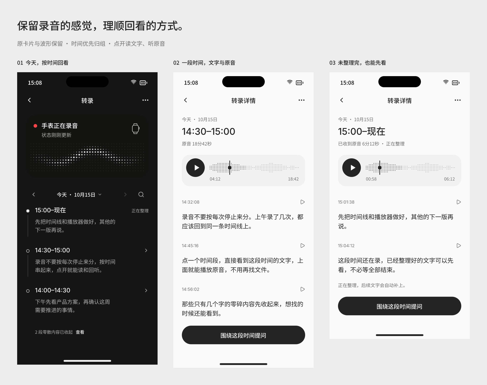
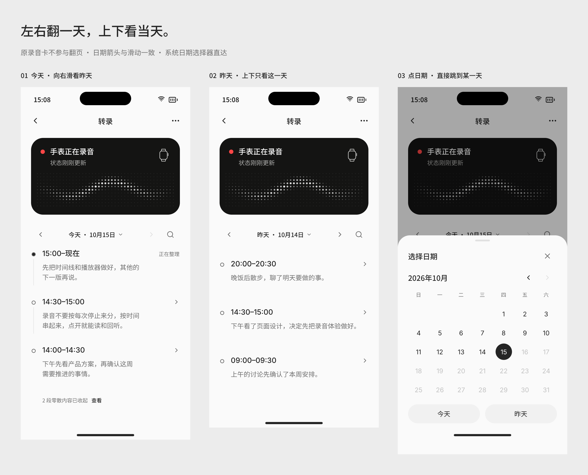

# 转录时间线重构方案

2026-10-15。状态：已按用户批准实施，原生验证见[实施记录](../../implementation/transcript-timeline-20261015.md)。设计基线：`main` / `d45b6d9`。

**上半部保留原有手表卡片和点阵波形，下半部把一天串成时间线。用户点开一个时间段，直接读文字、听原音。**

**2026-10-16 用户修正：当前实现按说话活动归组，长静默不占节点。** 连续交谈跨整点或半小时不再切开，超过约五分钟的间隔分成新段，节点以实际起止、说话时长和疏密点线表达活动。见[活动时间线实施说明](../../implementation/speech-activity-timeline-20261016.md)。下文和 Pen T 系列的固定半小时规则保留为首版历史，不再作为当前分段依据。

用户已确定的方向是保留上半部、时间优先归组、弱化碎片和简化状态。首版采用「半小时窗口」和「20 个有效字符」作为密度规则，阈值效果仍需真实使用反馈。用户随后明确：只有标点或空白的转录结果直接丢弃，不写入正文、搜索或引用；保留原音。

**2026-10-17 用户修正：取消所有短正文的字数收起规则与“零散内容”入口。** 短句仍按说话活动的真实时间归组，只有纯标点/空白的文本直接丢弃。独立原始录音管理及导出、手动保留、文件恢复和存储上限编辑同时移除，时间段回听保留。此决定覆盖下文旧设计及 T05；实施见[修正记录](../../implementation/timeline-content-simplification-20261017.md)。

用户后续确认：时间段总结使用用户自己配置的 API 和当前选中的模型；没有配置就不生成、不展示总结，转录和原音播放照常使用。

日期浏览已按用户反馈确定：**左右切换一天，上下只浏览当天；点日期使用系统日期选择器。** 不将昨天和更早日期串成纵向无限列表。

## 1. 看设计

本次设计源为 [时间线 Pen](momoagent-transcript-timeline.pen)，从当前打开的 v8 设计另存，追加 T00–T10，原 P 系列页面保留供参照，不覆盖原 v8 文件。Pen 内搜索下面的页面名或节点 ID。以下图片直接由 Pen 导出，使用示例内容，不是运行截图。

| 页面 | Pen 节点 | 预览 |
| --- | --- | --- |
| T00 · 时间线重构 · 方案总览 | `VWdKy` | [核心三屏](timeline-screens/VWdKy.png) |
| T01 · 时间线 · 深色 | `Kufir` | [深色时间线](timeline-screens/Kufir.png) |
| T02 · 时间线 · 浅色 | `nGvoR` | [浅色时间线](timeline-screens/nGvoR.png) |
| T03 · 时间段详情 · 文字与原音 | `B16iNN` | [完整时间段](timeline-screens/B16iNN.png) |
| T04 · 时间段详情 · 正在整理 | `R1RSD` | [已有文字先读](timeline-screens/R1RSD.png) |
| T05 · 时间线 · 查看零散内容 | `b4NJg` | [展开零散内容](timeline-screens/b4NJg.png) |
| T06 · 状态与分段规则 · 研发评审 | `DvV0J` | [规则对照](timeline-screens/DvV0J.png) |
| T07 · 时间段详情 · 部分未完成 | `t3bv2w` | [局部失败与重试](timeline-screens/t3bv2w.png) |
| T08 · 昨天 · 左右翻日后 | `z7Ipb` | [昨天的单日时间线](timeline-screens/z7Ipb.png) |
| T09 · 日期选择器 · 系统日历 | `i7MtXA` | [系统日期选择器代理](timeline-screens/i7MtXA.png) |
| T10 · 日期浏览 · 左右翻日上下读 | `nDDg3` | [日期交互总览](timeline-screens/nDDg3.png) |

## 2. 产品取舍

借用用户提出的简化视角：把内部协调留给软件，把时间和内容留给人。这是本次设计取舍，不是对任何人的言论引用。

| 分法 | 判断 |
| --- | --- |
| 每次停止录音生成一条 | 操作次数决定列表条数，不符合全天记录；取消作为列表边界 |
| AI 按话题自动分组 | 意义清楚，但依赖模型、等待和判断，补传后边界容易变；首版不采用 |
| 按固定时间窗归组 | 不依赖 AI，边界稳定，多次录音自然并入；首版采用半小时 |

页面仍叫「转录」，沿用现有导航和视觉语言，不增加新的主导航。列表不增加 AI 标题、独立摘要卡片、进度仪表盘或用户要管理的处理队列。可选的时间段总结复用现有两行预览位置。

## 3. 时间线怎么分

- 一天按当地时间的 `:00`、`:30` 划窗，例如 `14:00–14:30`、`14:30–15:00`，当天最新的节点在上。历史日期通过左右翻日或日期选择器访问，不向下追加其他日期。
- 同一窗口内的不同 session、暂停恢复和技术切片归为一个节点。单个 session 跨过窗口边界时，可以落入多个节点。
- 采用半开区间 `[start, end)`：正好 14:30 开始的内容属于下一个节点，避免重复。
- 没有录音、文字或需要处理的问题的窗口不显示，不为一天生成 48 个占位条目。
- 正在发生的窗口显示 `15:00–现在`；窗口结束后显示完整边界。时钟走过边界不表示音频已收全。
- 同步迟到时补回原采集时间的位置，不按接收时间插到最上方。正在阅读时保持位置，不强制滚回顶部。

例：14:03 开始、14:08 停止；14:18 再录、14:24 停止。列表只出现 `14:00–14:30` 一个节点。14:25 开始、14:40 停止的一次长录音则分别归入两个窗口，停止按钮不参与列表分段。

跨边界的文字优先使用词或句级时间戳分配。缺少可靠细粒度时间戳时，保留完整段落，只按段落开始时间归属一次；允许正文末句略越过窗口，并在回听该段时使用真实范围，不能切掉半句话或伪造时间。主播放器仍只播放窗口内的原音，跨界段落回听是明确的单独目标。

窗口使用录制地点的时区信息和绝对时间确定；身份包含绝对起止和录制时区，不能只用 `14:30` 字符串做 ID。系统时区改变后不静默重分历史；同一时刻不同来源按绝对时间关联，时钟跳变或锚点不可信时保留来源隔离并解释时间不可确定。跨午夜按日期分开，夏令时重复的时间加时区说明。

## 4. 列表只展示时间和内容

上半部直接复用 `WatchStatusView` 与原 Pen 卡片 `momo1398`：尺寸、黑底、红点、Apple Watch 图标和点阵波形保留。卡片仍只表达手表当前状态，不承载播放器和转录队列。其副标题保留真实状态更新时间，去掉片段待同步计数；过期状态与减少动态效果规则继续遵循 HANDOFF。

下半部按日期显示细时间线：节点圆点、时间范围、最多两行内容预览。有当前版本的 API 总结时显示总结；否则显示原文节选。已完成时直接展示内容，不显示「已转录」「已完成」；不显示 chunk 数、批次数或 session 数。整行可进入详情，搜索入口保留。

列表空态为「还没有可读的转录」，说明从手表开始。短内容也直接显示对应时间节点；若仍在等待或处理，显示对应时间节点，不能假装没有资料。

### 左右翻日，上下看当天

- 首次进入显示今天。下半部是单日内容区：向右滑看前一天，向左滑看后一天；日期左右箭头执行同一操作。今天的「后一天」不可用，不翻到未来。
- 纵向滚动只展示选中日期的节点，到当天末尾就结束，不接着出现昨天。每个日期保留独立的阅读位置，从详情返回时恢复日期和位置。
- 日期标题点击后呈现 **SwiftUI 原生 DatePicker**，仅选择日期。Pen 的月历格是系统控件的视觉代理，正式实现复用系统控件，不自行实现一套日历计算和日期网格。采用系统日期选择面板，标准字号可用 graphical 展示；大字号随系统布局扩展。
- 点「完成」确认日期后关闭面板，直接进入该日；取消保留原日期和阅读位置。面板内「今天」「昨天」是快捷操作，最终也只更新同一个选中日期。日期范围为档案已知最早日期至今天，历史范围加载未完成时不错误地禁止更早日期。
- 中间没有录音的日子仍可选择或翻到，显示「这一天没有录音」，不静默跳过日期。短正文直接展示，不显示空录音误导文案。跨年日期带年份。
- 原手表卡片位于日期翻页区之外，外观保持原样，始终表示当前手表状态。翻到昨天也不能把它解释成昨天仍在录音；横向翻页不改变卡片或录音任务。
- 手势限制在下半部内容区，先区分横向翻日与纵向阅读；不覆盖系统返回边缘手势。播放器进度条的水平拖动只定位音频，不触发翻日；辅助操作可用日期选择器和前后一天按钮完成。
- 翻日只查询对应日的时间窗，按日缓存与分页，不一次加载全部历史。处理或补传继续在后台进行，不把正在查看历史的用户带回今天。搜索仍覆盖全部转录，点击结果进入对应日期和节点。
- 翻日不自动停止已有回听。列表迷你播放器始终显示实际播放日期和时间，点击回到对应目标，不把昨天的音频误标成今天。

## 5. 所有正文按时间展示

先按说话活动合并相邻时间范围，再直接展示其中全部有效文字。一个字、短提醒或较短的独立时段也正常显示，不提供“零散内容”分类、计数或展开开关。

- 纯标点或空白的识别结果在 Archive 入库时直接丢弃，不进入正文、搜索或引用；历史结果通过版本修订清理，原音保留。
- 同一时段内的有效文字继续展示，丢弃标点文本不会把整段正文丢掉。整个已完成时段都没有正文时，不额外产生内容节点；有标记、待处理、待同步或失败的状态仍按实际情况展示。
- 较长静默仍按活动时间线规则分段，跨日仍按录制时区归属；无需另建未归组内容池。
- 自动总结保留原有的最小正文长度条件，仅控制模型总结请求，不影响可见性。
- 时间段详情直接阅读、回听和发起讨论；不再提供原始录音管理菜单。原音由 App 按已有规则自动管理，储存空间仅显示占用与当前规则。

## 6. 状态只在需要时出现

列表每个节点最多一个状态词；正常完成无标签。底层仍分别保留接收和转录事实，显示文案由这些事实推导，不能把它们存成一个互相覆盖的布尔值。

| 真实情况 | 列表 | 点开后解释 / 操作 |
| --- | --- | --- |
| 已知有原音尚未接收，未发生失败 | 等待同步 | 等待手表连接；仅在有持久保存证据时写「原音保存在手表」 |
| 已入处理队列但尚未执行 | 等待整理 | 自动开始，不显示旋转的忙碌动画 |
| 实际正在转录或分析 | 正在整理 | 已有文字先读、已收原音先听，后续自动补上 |
| 系统暂缓任务 | 稍后继续 | 系统允许后自动继续，不显示暂停/继续开关 |
| 一部分接收或转录失败 | 部分未完成 | 标出受影响时间及原因；局部重试，已有内容保留 |
| 全部处理失败且无可读文字 | 未能整理 | 说明真实原因及对应恢复操作；原音存在时仍可播放 |
| 已知范围无待处理、失败或缺失 | 无状态词 | 显示文字预览；不把结果夸大为手表全部同步 |

同一窗口出现多个事实时，列表优先级为：需处理的失败 → 等待同步 → 正在整理 → 等待整理 / 稍后继续 → 无标签。详情同时说明实际存在的两种情况，例如「前半段文字已生成，14:52 之后等待同步」，不能只剩一个笼统进度。

删除原来的全局「正在分析语音」与独立批次展示。转录状态只靠近受影响的节点；全局基础能力故障在相关详情解释，并复用设置入口。未知总量不显示百分比；无已知待传范围时不从手表还在录推断某个历史窗口正在同步。未拿到完整范围证据时，至多说明「已收到的内容已整理」，不宣称完整。

## 7. 点开就是这一段时间

详情结构只有日期、时间范围、播放器、按原始时间排列的转录正文。复用现有「围绕这段录音提问」，文案改为「围绕这段时间提问」。

- 播放器复用已确认的 [AUDIO_PLAYER](AUDIO_PLAYER.md) 点阵播放器、暂停续播、定位和单一控制器；返回列表时沿用底部迷你条。
- 标题 `14:30–15:00` 表示墙上时钟的范围，不代表有 30 分钟音频。播放器 `04:12 / 18:42` 表示实际可播放音频的累计进度。
- 跨 session 按采集时间连接可用原音；未录音、未同步和已清理是不同断点。默认跳过未录音的空白，播放经过断点时清楚交代；未同步 / 已清理区不可拖入，不能画成连续的原音。
- 点正文时间或段落回听入口，使用原来源映射定位，不能拿墙上时间简单减去窗口起点当播放器秒数。
- 默认不跟随播放自动滚动文字。主播放器在向下阅读时沿用吸附行为；没有原音时解释「原音已清理」，文字照常可读。
- 还在接收时，本次播放固定使用开始时的范围快照。新增内容只更新阅读，明确刷新播放目标后才扩充时间尺，拖动中不改变总长。
- 局部失败在正文对应位置说明并提供「重新整理这部分」，成功替换该范围；不把整个节点清空重做。重试中禁止重复提交该范围。
- 主播放器不会越过窗口自动播放下一个节点；段落引用目标不会越过真实引用范围。切换目标仍只使用一个播放器。

## 8. 与 HANDOFF 和当前代码的关系

保留 HANDOFF 的原品牌、原波形卡、自动转录、无模型管理开关、真实新鲜度、共享播放器及源版本校验。此次以 T 系列替代原 P06/P07/P16/P29 的「按 session 管理」体验，其余聊天、设置和服务配置不变。

当前代码已核对，HANDOFF 的旧能力缺口不能直接照搬：

| 现有能力 | 需要调整的地方 |
| --- | --- |
| `LibraryView` 按日期排列 `model.recordings`，导航带 sessionID，另有 `TranscriptionBatchSection` | 改为按时间窗口查询与导航，移除独立批次列表，保留搜索与分页 |
| `ChunkManifest` 已有 `wallClockAnchor`、`timezoneOffset`、epoch 与帧范围 | 复用真实时钟映射建立跨 session 的窗口投影，不改 Watch 切片或传输协议 |
| `AudioPlaybackController` 已有 pause / resume / seek；`AudioPlaybackTarget` 仍是单 session 或单来源 | 复用现有播放器，扩展多来源时间窗目标；不是重新实现暂停 / 拖动 |
| `ArchivedPlaybackTimeline` / `PlaybackTimeline` 当前围绕单 session | 组合有序的真实来源与断点，保留每个来源 generation、lease 和删除校验 |
| `TranscriptionBatchCoverage` 已按 session / epoch 保留覆盖范围 | 作为完成、待处理、无语音、删除等事实的来源，不直接作为时间线节点 |

推荐只增加必要的 `TimelineWindow` 读模型：稳定窗口身份、绝对起止 / 时区、预览、展示状态、可展开性和有序来源范围。底层原 session、转录文档和音频文件保持原存储结构；不把新窗口复制成第二份录音档案。

归组与完整日查询在 Archive 层完成，低字数和纯标点规则由读模型提供，页面执行展示过滤；搜索沿用 Archive 的来源搜索。必须先覆盖完整窗口再计算字数与状态，不能只合并当前已加载的一页录音；首版按整日查询、最多缓存七天内容，不使用原录音列表的 50 条分页截断窗口；边界节点不重复、不被误判为短内容。LibraryModel 订阅结果，页面只管理展开、搜索和阅读位置；接收、转录、重试和播放继续由运行时持有。

多来源播放器快照保留每个 session / epoch / frame range / generation，按顺序映射累计进度。已知缺失或清理范围保留为不可定位的断点。播放期间任何成员删除或换代时，保守地使整个冻结目标失效，重新进入可加载剩余来源，避免正在拖动时更改累计时间尺；迟到回调不得复活旧目标。围绕时间段提问传递来源集合及各自版本，不把多来源伪装成单个 SourceReference。现有行内引用仍指向原始来源，不因列表归组改变旧引用。

第一版不提供「删除这个时间段」动作：一个时间窗可能只覆盖某个 session 的一部分，现有删除 API 以 session 为单位。详情更多菜单提供明确的「管理原始录音 · 时间」入口，进入原单次录音页面处理导出、保留、Files 恢复和删除，并沿用原始录音确认语义。保留现有设置中的原音保留 / 容量管理；时间范围删除如要恢复为产品入口，须补范围删除、引用失效及确认语义，不能把整次录音删除冒充删除半小时。此次短内容收起不调用删除。

### 可选总结：只使用用户配置的 API

- 复用用户已保存的 AI 服务连接、凭证和当前选中的模型，不增加总结专用服务配置，不使用内置或隐藏的云端 API 兜底。
- 没有可用服务 / 模型配置时，不发送总结请求，不显示总结区、占位、错误或要求配置的提示。现有 Pen 列表的原文节选就是此时的完整界面。
- 有配置时，在窗口转录的已知范围处理完成后，后台生成一段简短总结。列表复用原来的两行预览位置；详情若有总结，在时间信息下用普通文本展示并标明「总结」，完整转录仍在播放器下方，不替代原文。没有总结就直接省略这一行区域。
- 只向用户选定的服务发送当前时间段相关的转录文字，不发送原音。未配置时本机转录、时间归组、阅读和播放完全独立运行。
- 总结请求按窗口、转录版本和连接 / 模型身份去重并缓存，不因打开页面重复调用。补传导致正文变化时使旧总结失效，先显示当前原文节选，再对稳定的新版本生成总结；删除、取消或切换配置后的旧结果不能写回。
- 请求失败时继续显示原文节选，不把已成功的转录标成「整理失败」，不无限自动重试。配置删除后不再发起新请求，也不据此清除已保存的历史总结。
- 低字数收起仍依据归组后的原始转录，不能拿总结字数判断。时间边界仍由时间窗决定，不让模型改变归组。

## 9. 实施顺序与验收

1. 先做跨 session 时间窗查询、稳定身份、完整窗口分页和低字数展示规则，验证不修改原始档案。
2. 替换列表与状态映射；保留原手表卡片、波形、搜索和阅读位置。
3. 增加时间段详情、多来源回放目标、断点和多来源提问；复用已有播放器。
4. 验证真实录音、跨 session 回听、补传、局部失败和大字号，然后分别做 iPhone / Watch 模拟器与物理设备验收。

| 必须验证的场景 | 预期 |
| --- | --- |
| 半小时内反复停止、恢复录音 | 仍只有一个时间节点 |
| 连录跨半小时 / 午夜 | 按时间拆分，不漏字、不重复，跨界整句规则明确 |
| 录制时区改变、夏令时、时钟回拨 | 窗口身份稳定，异常时钟不伪造归组 |
| 许多短片段合起来超过阈值 | 合并后显示，不逐片段丢弃 |
| 一句短提醒被收起 | 原音 / 原文还在，查看或搜索可直达 |
| 无字但仍待同步、排队或失败 | 节点保留，不能当作无内容收起 |
| 后到、乱序、重复音频 | 归回原时间，幂等更新，不重复节点 |
| 阅读或拖动时收到新片段 | 保持阅读位置与本次播放尺宽 |
| 跨 session 播放 / seek / 暂停恢复 | 顺序正确、真实映射、单一播放任务 |
| 未录音、缺失和已清理范围 | 分别说明，无法定位的范围不可拖入 |
| 部分转录失败后重试 | 已有文字 / 音频保留，只重试受影响范围 |
| 源版本变化、删除、提问与旧引用 | 校验每个来源，不复活删除对象或发送过期来源 |
| 未配置用户 API / 模型 | 不发总结请求，不出现总结区域或配置提示，转录 / 播放正常 |
| 已配置用户 API / 模型 | 使用所选连接生成总结，复用预览位置，不上传原音 |
| 总结失败、重复打开或补传修改正文 | 保留原文，去重调用，旧版本总结不覆盖新正文 |
| 翻页恰好截在窗口中间 | 完整归组，不重复、不错误收起 |
| 左右切日期、上下浏览内容 | 一次翻一天；纵向末尾不接上其他日期；每一天位置独立 |
| 系统日期选择器选择、取消、今天 / 昨天快捷操作 | 选择后进入正确日期；取消不变；未来日期不可选 |
| 空日期、跨月 / 年、历史未加载完 | 不静默跳日，不误报无历史，不丢失选中日期 |
| 翻日时正在回听、拖动播放器或返回 | 单一回听继续；进度拖动不翻日；系统返回手势正常 |
| 大字号、读屏、深色与减少动态效果 | 时间 / 状态可读、整行可点，波形遵循现有替代规则 |

本次已完成 Pen 构图、深浅色和主要恢复状态的截图目视复核、源节点复用及设计导出。Pen 的动态布局几何检查对部分可见节点报告剪裁，已用渲染截图逐屏复核；不能把它报告成自动检查全部通过。原生实现与后续实际检查独立记于[实施记录](../../implementation/transcript-timeline-20261015.md)，不把设计渲染当作 App 验收或物理设备验证。
