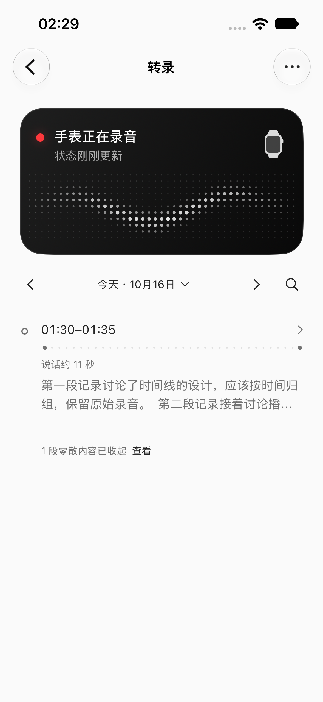
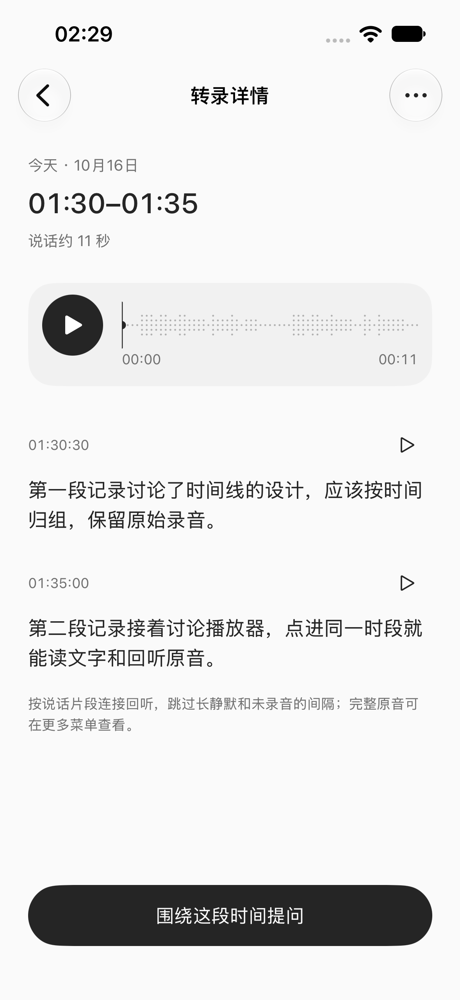

# 按说话活动组织时间线

用户修正：固定半小时仍会包含很长的无人说话时段。此次改为复用已保存的本地 VAD / 转录时间范围，按说话活动归组。

- 约五分钟以上的间隔分开；连续交谈跨过整点、半小时也不强行切开，跨日期仍分开。
- 已确认静默不生成节点。处理中、未同步和失败范围仍保留，不把未知当作无人说话。标记过的静默保留原音入口。
- 节点显示真实起止、说话时长和疏密点线；长间隔压缩展示，不按静默时长撑开列表。
- 回听跳过长静默，十秒以内的自然停顿和片段边缘原音保留；完整原音仍从“原始录音管理”访问。
- 活动归组更新时按来源范围恢复详情与阅读位置。已开始播放的快照继续冻结，不能因补传改变正在定位的声音。
- 保留顶部波形卡、左右翻日、系统日期选择器、短文本规则与用户 API 总结条件。无需额外模型调用或新的配置项。

首版五分钟归组间隔是产品默认值，需要真实使用反馈；本地 VAD 表示检测到可能的说话，不等于音量或内容重要性。

原 Pen T 系列仍作为布局参考，固定半小时规则由本补充替代。

## 实现与检查

复用 `ArchiveStore` 的 `analysis_coverage.no_speech`、语音窗口和原文帧范围，不重新分析原音，不调用外部模型。历史档案缺少 VAD 范围时，只按现有原文时间范围粗略展示；未处理的范围没有活动图，避免把未知当作安静。

有语音的范围先连接十秒以内的停顿，保留自然节奏，再按五分钟间隔形成阅读节点。播放器每端保留最多一秒原音上下文，并限制在该日与已知 epoch 的帧范围内。说话时长合并重叠区间，只累计语音本身；点线按时间分布表达密度，不代表响度。

确认静默后没有普通节点；标记和意外缺失的文件仍显示，分别保留回听或修复入口。合并 / 拆分用原来源与 generation 匹配恢复阅读位置，详情优先保留已读来源；播放器继续冻结所有成员的快照。

- Archive 120 项、Agent 64 项通过，包含一段十分钟原音中的长静默、全静默、未知尾部、静默中标记、静默文件意外缺失、十秒内自然停顿、跨半小时合并、跨午夜裁切及纯标点丢弃。
- 长静默单元测试使用合成 WAV 和明确的 VAD 范围验证投影；真实本地 ASR 旅程另行通过，不将注入的范围当作实际 VAD 精度验收。
- iOS `build-for-testing` 成功。初轮四项时间线 UI 和真实 ASR 自动转录 / 搜索均通过；播放器发现墙钟浮点换算可能多出一帧，已恢复帧边界上限，并新增小数音频尾部检查。初轮失败记录保留，最终复验独立记录。
- 本轮不改变 Watch 采集、文件传输、原音保留或服务配置；没有增加模型请求。未补做真机同步、佩戴场景 VAD 准确性或能耗验收。

证据目录：[2026-10-16 speech activity](evidence/2026-10-16-speech-activity/)。

最终复验 **23 项通过、0 失败**：时间线 UI 4 项、原生播放器 19 项。日期选择、横向翻日、大字号 / 零散内容、多录音文字与提问、真实波形 / 暂停 / seek、跨成员删除失效均通过。最终源码哈希一致，结果摘要中的 runtimeWarnings 为空。

| 活动疏密与真实起止 | 单个说话时段详情 |
| --- | --- |
|  |  |

截图中的固定中文内容属于 DEBUG 示例档案；这两张图不作为真实 VAD 精度证明。
