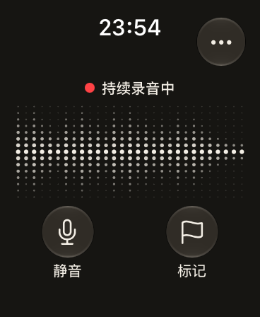
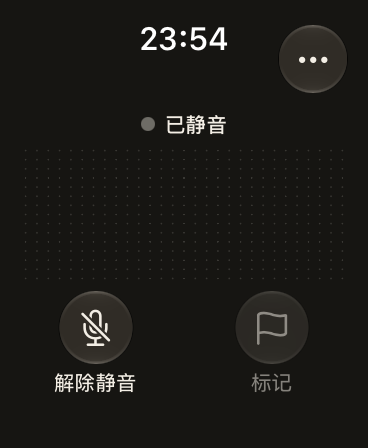
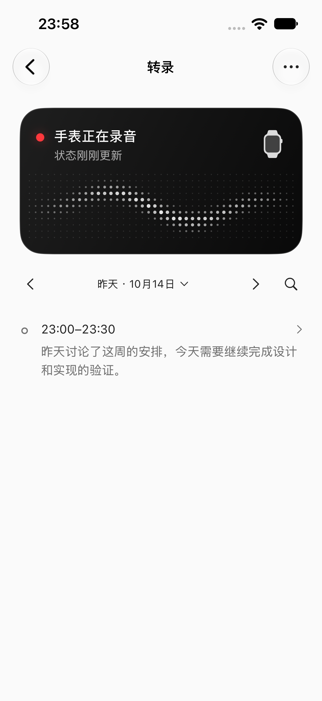
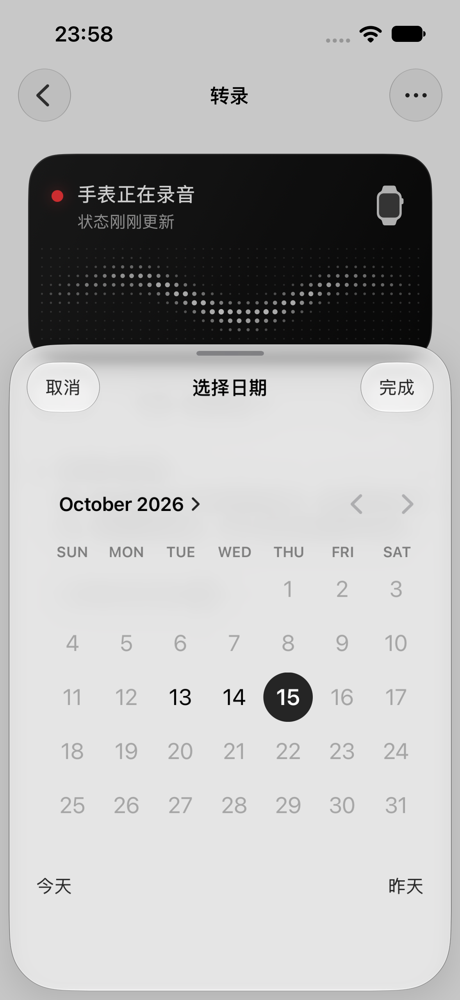
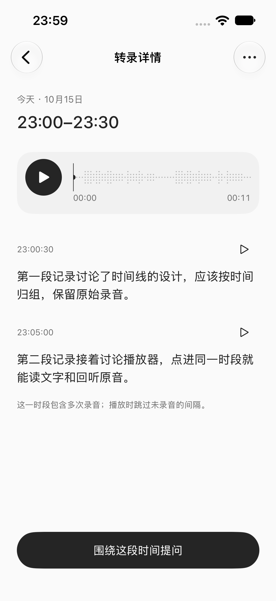

# 单日转录时间线

2026-10-15 设计实施，10-16 凌晨完成验证。对应[已批准方案](../design/iphone-review-20261015/TIMELINE.md)及 Pen T00–T10。任务分支 `codex/daily-transcript-timeline`，基于 `ed0997d`。

2026-10-17 修正：短正文收起与独立原音管理已移除，当前行为见[时间线内容简化](timeline-content-simplification-20261017.md)。下文保留首次交付记录。

## 交付行为

- 保留顶部手表状态卡的黑底、图标和点阵波形；仅移除片段计数，保留真实更新时间和原过期规则。
- 下半部按录制地点当地时间每半小时归组。同窗内多次停止、恢复或不同 session 合并成节点。日期左右翻，上下只浏览当天，点日期打开系统 DatePicker；「完成」确认，取消不改变日期。
- 跨半小时音频按真实帧范围裁切。缺少可靠词级时间戳时，完整段落按开始时间只归属一次；段落单独回听使用真实来源范围。
- 完成且无标记、合并后不足 20 个有效字符的内容默认收起，可展开或搜索。用户补充的纯标点 / 空白转录在入库时直接丢弃，不写入正文、搜索或引用；历史纯标点稿件按原版本修订机制清理，旧引用失效，原音保留。已丢弃的结果不占零散内容。待处理、失败、未结束的窗口不会被字数规则隐藏。
- 完成后直接显示文字，不再显示「已转录」；等待同步、等待整理、正在整理、稍后继续或失败仅显示在受影响节点。已收到的范围与未知尾部区分，不把时钟走过窗口边界当作同步完成。
- 详情包含时间、共用原音播放器、按时间排列的文字和「围绕这段时间提问」。提问上下文、重试、历史恢复、重新生成与请求前来源校验均保留来源集合。
- 有已保存并激活的用户 API / 模型配置才生成可选总结。只发送该窗转录文字，无工具，无原音。无配置没有请求、占位或配置提示；失败保留原文，不改变转录状态。窗口内容版本与连接版本参与去重、缓存和取消校验。

## 复用与取舍

`ArchiveStore.timelineDay` 查询完整日期，不依赖录音列表当前页。测试覆盖 51 次录音合并，避免原来 50 条分页截断归组。没有另建录音数据库或复制音频。页面按日懒加载，最多缓存七天正文；历史日期标识从最早记录生成。

`AudioPlaybackController`、原生音频会话、原音 lease、波形解码、暂停 / 续播 / seek 继续共用。多来源目标为每个成员保留 generation、epoch、帧范围；所有成员都校验，不能只校验第一条。实际音频累计尺跳过未录音间隔，已知缺失 / 清理区保留不可定位断点；不凭墙上时钟生成 30 分钟的假音轨。

播放开始后使用冻结目标。补传文字不扩展正在拖动的时间尺。任一成员被删除或换代时，保守地使冻结目标失效；重新进入可加载剩余来源。这比原方案的动态局部修复更简单，避免旧坐标跳到别的声音。

不把现有按 session 删除接口冒充「删除半小时」。详情更多菜单明确列出「管理原始录音 · 时间」，保留原导出、原音保留、Files 恢复与删除确认。正常阅读只需时间线和时段详情。

多来源提问沿用原上下文预算（最多 20 段 / 10 KB，单录音候选最多 12 段）；超预算保留省略标识，模型可通过已有原文工具继续读取。不会无界上传整日内容。

## 验证

所有检查使用 Xcode 27.0 / iOS 27 / watchOS 27 Simulator。所有固定时间线文案来自隔离 DEBUG 测试档案；这些界面检查不冒充真实语音识别。原有录音旅程另行运行真实本地 ASR，播放检查使用实际 WAV 与原生播放器。

| 检查 | 结果与范围 |
| --- | --- |
| iOS `build-for-testing` | 成功，最后构建包含直接丢弃纯标点的入库规则 |
| Archive 包 | 112 项通过；覆盖完整日归组、跨窗 / 午夜、源版本、范围重试、两种入库路径丢弃纯标点与历史清理幂等 |
| Agent 包 | 64 项通过；含无配置不调用总结、多来源上下文、提交与重新生成保留两个来源 |
| 原生播放器 | 19 项通过；实际 AVAudioPlayer / 解码波形、seek、间断、成员删除与 lease 清理 |
| 时间线 UI | 最终入库规则后 6 项通过：时间线 4 项、真实 ASR 自动转录 / 搜索与 Files 恢复 2 项 |
| 旧功能 UI | 录音旅程 5 项及导出 1 项通过，真实本地 ASR / 搜索 / 播放 / Files 恢复 / 删除重启 / 原生分享取消重开；顶部状态卡另 4 项通过 |
| Watch UI | 录音、静音、重启、恢复、停止确认、待确认原音重启保留的完整旅程 1 项通过；截图已目视检查 |
| Watch 原生采集 | 串行复查 1 项通过；1,094,400 帧 / 16 kHz = 68.4 秒，60 秒 + 5.2 秒尾段及恢复后 3.2 秒，2 epoch、1 mark、3 片原音，哈希 / 解码与重开账本校验通过 |

第一轮详情失败原因是横向懒加载保留了相邻日期的辅助功能元素，测试点到了昨天。当前日期以外的页面已从辅助功能树隐藏，修复后今天两次录音的正文、原音和多来源提问均通过。

SwiftUI audit 检查 51 个文件，报告 high=2 / medium=42 / low=1，逐项阅读新改动命中；两个 high 是 actor 内的执行 UUID 和原有、会随录音状态及 Reduce Motion 暂停的波形 TimelineView 时钟，均不属其提示的 View 身份 / 无约束动画问题。未把启发式审计报告成零告警。

Watch 源码未改动。首次并行回归在采样期间遭遇宿主音频设备失效，测试中断记录保留于 `/tmp/momo-timeline-watch.xcresult`。后续先通过独立 3 秒探针确认 144,000 帧、RMS 0.133，再使用既有 BlackHole 指定输入、公开 WAV、有限次播放，串行复查原生链路；未改 Mac 全局音频路由。首次失败不计为通过。

尚未验证物理 iPhone / Watch 同步、真实佩戴、跨时区旅行及夏令时回拨。可选总结使用 Faux Provider 验证无配置不调用与工具禁用请求，未消耗用户真实 API 进行端到端调用。


运行证据见[证据目录](evidence/2026-10-15-transcript-timeline/)。其中原生采样统计不含声音；只保存本次实际截图、结果摘要和源码哈希。Watch 三个明确归属本轮的隔离目录已在宿主停止后清除，保留文件大小 / 哈希与清理确认，不保留测试原音。

复现命令（既有 Simulator UUID，关闭并行和失败 sysdiagnose 收集）：

```sh
swift test --package-path Packages/MoMoAgentKit -j 4 --filter 'MoMoArchiveTests|MoMoAgentTests'
xcodebuild build-for-testing -project MoMoAgent.xcodeproj -scheme MoMoAgent -destination 'platform=iOS Simulator,id=9AE9C811-BD01-46AD-875E-8F2DD444E09F' -derivedDataPath DerivedDataTimeline CODE_SIGNING_ALLOWED=YES CODE_SIGN_IDENTITY=-
xcodebuild test-without-building -project MoMoAgent.xcodeproj -scheme MoMoAgent -destination 'platform=iOS Simulator,id=9AE9C811-BD01-46AD-875E-8F2DD444E09F' -derivedDataPath DerivedDataTimeline -only-testing:MoMoAgentUITests/PhoneTimelineJourneyTests -only-testing:MoMoAgentIntegrationTests/AudioPlaybackIntegrationTests -parallel-testing-enabled NO -collect-test-diagnostics never CODE_SIGNING_ALLOWED=YES CODE_SIGN_IDENTITY=-
```

Watch 复查遵循[既有受控输入说明](../../Tools/WatchCaptureProbe/README.md#受控虚拟输入)，采样与 UI 两项串行、各自新结果包；它们不验证 Simulator 不支持的 WatchConnectivity `transferFile`。


| Watch 实际录音中 | Watch 实际静音后 |
| --- | --- |
|  |  |


| 昨天的时间线 | 系统日期选择器 | 多录音时段详情 |
| --- | --- | --- |
|  |  |  |

最终六项 UI 结束后只调整了 DEBUG 固定样本的时钟下界，保证午夜后运行仍在所选日生成三个示例窗口，不改正式时间归组。调整前后源码哈希分别保存；午夜后用大字号 / 零散内容旅程单独复验。
