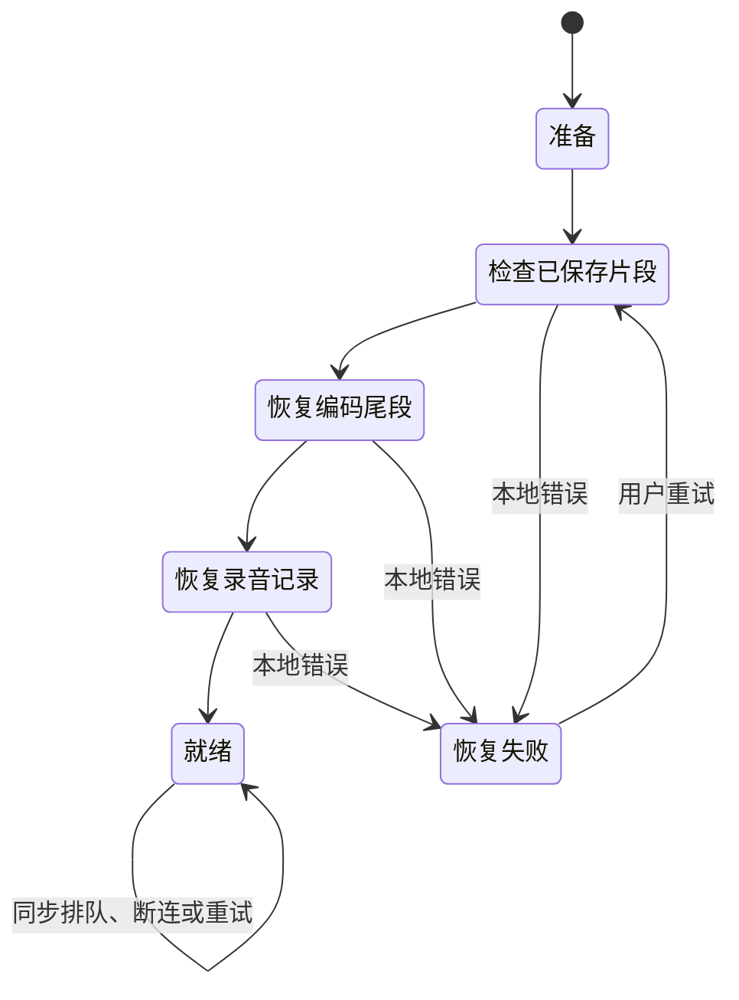
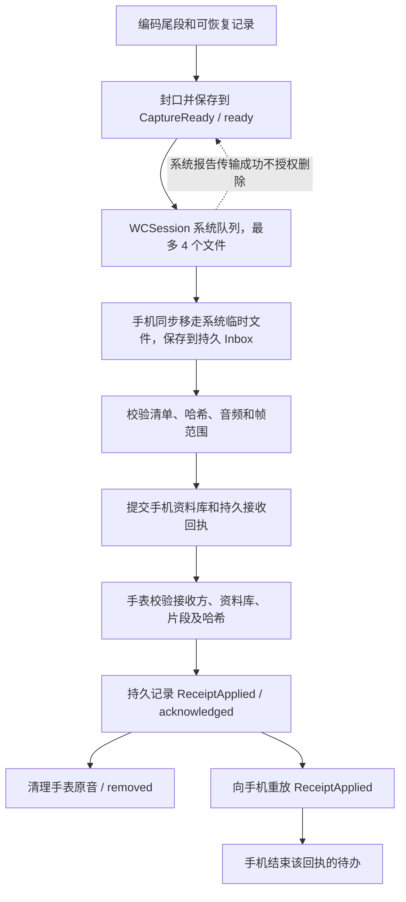

# 手表录音与传输：状态机和边界

本轮基线为 `1366c30`。用户报告手表冷启动停在“恢复录音资料”、出现 `error 0`，并要求梳理传输、积压和边界处理。当前没有取得该次故障的手表日志，不能仅凭错误数字确定原始异常。

## 录音和同步分别推进

网络不可达、手机未打开、系统传输排队、手机转写积压及回执等待，都不能成为录音操作的等待条件。录音操作只等待自己的麦克风、编码器关闭、封口和本地持久化。麦克风权限、系统音频中断、空间不足和本地资料无法安全打开，需要明确停止或拒绝启动。

启动仅完成本地恢复：检查账本和已保存片段 → 恢复编码尾段 → 恢复录音意图及诊断 → 就绪。同步处理另起运行时任务。上次录音被中断时保留中断状态，不由同步任务自动打开麦克风。

录音的 `intent` 是用户意图（recording / paused / stopped），`activity` 是实际采集状态（starting / recording / interrupted / failed 等）。两者不能合并。例如重启后的 recording 意图并不证明麦克风正在工作；手机绿标仍需新鲜状态和实际采样。

## 一个片段如何安全离开手表

`ready`、`acknowledged`、`removed` 是持久状态。系统排队和系统传输完成是另一层状态，不能用它们替代持久接收回执。删除会话还有自己的删除指令、停止采集屏障和删除确认，不能直接复用普通传输成功。

平台约束见 Apple 的 [transferFile 文档](https://developer.apple.com/documentation/watchconnectivity/wcsession/transferfile(_:metadata:)) 和 [接收文件代理文档](https://developer.apple.com/documentation/watchconnectivity/wcsessiondelegate/session(_:didreceive:))：实际传送由系统安排；接收端必须在代理返回前将临时文件移到应用自己的位置。模拟器测试不能替代真实设备的文件传输验证。

即时控制消息和后台控制消息进入同一个持久 inbox，按消息 ID 和完整内容去重。本轮即时回复新增 `control_preserved`：只有同步持久保存成功才返回 true。这只证明控制消息已保存，不等于音频已接收、转写已完成或允许删除原音。旧版返回空回复时，新版按未取得该确认处理，后台副本仍保留。

## 为什么会一次出现很多待同步片段

- 默认每 60 秒封口一片。500 个完整片段约为 8 小时 20 分钟；短尾段会使片数更多。
- “待确认”包含尚未入队、系统正在传送，以及已到手机但回执尚未完成的片段。不能把这个数字解释为手机上完全没有这些文件。
- 断连、系统后台调度、手机尚未接收完成，以及任一回执阶段丢失，都可能使待确认数量增长。
- 手机的“等待转写”是另一条队列。文件持久接收后即可发回执，不需要等 ASR。当前后台 ASR 的启用约束没有改变。

这解释了积压的形成机制，不能证明用户本次积压具体属于哪一种。现场确认需要对比双端片段账本、持久回执和系统队列。

## 有限队列与自动恢复

音频保留原有每次最多 4 个系统文件传输，失败片段单独退避，不挡住健康片段；控制消息最多 32 条且合计不超过 16 KiB。对账每页最多 16 项，持久记录当前请求和游标；收到匹配响应并落实效果后才推进。只有明确缺失的片段进入补传，不定期重传全部音频。

本轮控制消息也按内容独立采用 30 / 60 / 120 / 240 / 300 秒退避。重复恢复和可达性变化不能绕过冷却。手表重试覆盖只有控制消息失败、原音已清空的情况；手机在仍有持久回执、删除或对账响应待办时也自动重试。待办清空后取消重试，待办数量减少后恢复短间隔。

App 内计时器仅在系统允许进程运行时执行，不使设备常驻。手表原有 WatchKit 后台刷新仍由系统决定实际唤醒时间，不能承诺一分钟内传完或固定时间清空积压。

## 进度如何展示

手表“录音信息”分别显示连接／传送／等待手机确认／自动重试／接收方待确认，显示未确认片数、时长及当前系统文件队列数量。录音主页保留采集状态，不将同步失败改成“录音失败”。本地恢复显示具体步骤，避免只有一句“恢复资料”。

手机状态卡补充手表最近报告的未确认片数和字节数，沿用状态的新鲜度检查。转写状态继续在录音资料中展示，不混为文件传输百分比。

持续录音会不断产生新片段，系统队列也没有可靠的剩余时间，所以当前不显示固定百分比。未来若提供“某次已结束录音的同步进度”，应以该会话固定片段清单为分母、手机持久回执为分子；新增录音不得让该进度倒退，也不能把系统入队计作完成。

## 边界检查表

| 边界 | 应有行为 | 本轮处理或已有验证 |
|---|---|---|
| 启动时 WC 先送来回执或删除 | 先持久保存，等本地恢复就绪后处理 | 新增 ready 准入门，避免与尾段恢复交错 |
| 本地恢复完成、积压同步仍慢 | 录音可用，不再显示恢复中 | 独立恢复状态机和运行时同步任务 |
| 标记、暂停、结束录音 | 本地提交后返回，不等整个同步队列 | 移除采集操作对整轮对账的等待 |
| 启动恢复被系统取消 | 停止继续扫描，下次允许重试 | 扫描检查取消，恢复状态回到准备 |
| 本地片段或目录损坏 | 保留修复材料，区分局部损坏与无法安全打开 | 既有隔离和文件校验；本轮补具体错误文案与阶段日志 |
| 手机不可达、未装伴侣 App | 保留原音，后台有条件恢复 | 保留 WC 后台队列语义，不以即时可达性阻止文件入队 |
| 文件已传到手机、接收回执丢失 | 对账重放回执，不重传健康音频 | 既有 503 片积压测试 |
| ReceiptApplied 丢失 | 手机重放仍待办的回执，手表幂等回复 | 补手机无新事件自动恢复测试 |
| 原音已清空但控制消息失败 | 继续重试控制消息，不能因片数为零而停止 | 重试准入覆盖控制消息 |
| 控制消息立即失败 | 单条退避，其他消息可继续 | 新增内容级退避测试 |
| 重复、迟到或乱序消息 | 不重复写入，不错误推进游标或删除原音 | 保留消息 ID、哈希、请求身份和资料库检查 |
| 即时路径保存失败 | 不返回已持久保存确认，后台副本仍可恢复 | 新增成功／磁盘满确认测试 |
| 回执先于接收方身份 | 保存等待身份，不报永久错误，不删原音 | 保留 Watch 宿主用例 |
| 手机重装、切换资料库 | 等手表确认新接收方；旧回执无清理权限 | 保留身份和资料库绑定检查 |
| 删除与正在编码交错 | 先停止相应采集并释放写入器，再清理 | 保留删除屏障和损坏文件隔离测试 |
| 同步时继续录音，队列大量增长 | 有限并发，公平扫描，不一次读入整队原音 | 保留分页、文件并发和控制预算 |
| 手机／手表被挂起或杀进程 | 从持久 inbox、outbox 和对账游标恢复 | 真实 SQLite／文件恢复测试；无线后台仍需真机 |
| 存储不足或麦克风中断 | 明确暂停／中断录音，保留已封口原音 | 保留采集状态机与容量保护，不能靠 UI 假装继续 |

## 验证记录

本轮共通过 114 项相关测试：

- Swift Package：MoMoRecording 60 项、MoMoLink 28 项。包含 503 个片段的积压对账、回执重放、删除与文件恢复路径；最终增加重试状态只读属性后，另复跑 MoMoLink 28 项通过。
- iPhone 模拟器：16 项宿主测试。新增无连接事件也能自动重试待确认回执、收到 ReceiptApplied 后停止重试，以及即时控制消息持久保存成功／磁盘满失败的确认测试。
- Watch 模拟器：9 项宿主测试、1 项 UI 测试。新增恢复完成前不应用回执、后台同步未完也结束恢复状态的测试；同步状态和说明的截图已检查。
- 双端最终相关模拟器构建通过。上述宿主测试使用实际 SQLite、文件系统及原生框架；受控计时器用于验证退避，不代表已经测过真实无线链路。

证据保存在本工作树的 `tmp_agent_output/20261016-transfer-robustness/`：`package-tests.log`、`link-tests-final.log`、`phone-recovery-verified.xcresult`、`watch-recovery-final.xcresult` 和 `watch-final-attachments/`。

用户选择本次先提交代码、稍后安装。本机设备签名构建因 Xcode 未登录账号且缺少签名证书未能完成，没有更新手机或手表应用。用户所见 `error 0` 尚未在真机复现；实际无线传输、熄屏后台录音和长时耗电仍需真机验证。
