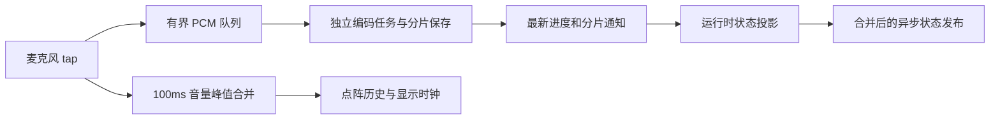

# 手表波形与录音持久化解耦

基线为 `58b1669`。用户反馈波形流畅一段后短暂停住，并要求检查保存与展示之间的系统边界。本轮使用 standard 视觉配置，保留点阵尺寸、配色、横向宽度和减少动态效果行为。

## 发现的等待链

上一轮虽然增加了独立显示时钟，波形的真实音量仍来自 `CaptureEncoder` 的进度回调。这个回调在 AAC 编码、分片封口、校验、账本写入之后发出；编码器还会等待主线程消费回调，而回调内又等待状态摘要持久化及 WatchConnectivity 发布。显示插值无法消除这条链路中的停顿，主线程繁忙也可能反向阻塞 PCM 消费。

## 现在的边界

- tap 已有的 RMS 计算直接产生显示音量，最多每个 100ms 桶通知一次。通知不携带 PCM，不等待编码器或页面处理；旧录音代次及已关闭的麦克风门禁不能更新新波形。
- 编码进度通过一个有界通道投影到主线程，只保留最新值和一个唤醒信号。主线程繁忙时不积累待重放的进度队列，也不阻塞编码。分片已保存的通知单独合并，不能被后续普通进度覆盖。
- 页面控制区只观察活动与录音意图的阶段投影；逐帧计数仍由 `CaptureState` 唯一持有，阶段投影在其同步变更时派生。计数更新不再令整个导航、状态与按钮重算，音量更新保持在点阵子树内。
- 看门狗读取编码线程实际发布进度的时间，避免把页面消费延迟判断成编码停滞。结束和暂停仍等待编码器完成，并排空最后一次进度，再保存结束边界；录音持久化失败继续按原有路径报告和恢复。
- 状态摘要发布使用单个任务合并请求，阻塞或失败不会拖住启动、编码和暂停。持久化录音、诊断及控制消息仍保留各自的真实错误处理。
- `TimelineView` 保持身份，按录音、页面可见性、场景活跃状态、可见能量及减少动态效果设置暂停，而不是来回替换显示时钟和静态视图。

这次没有把真实音频保存改成可丢弃的 UI 消息，也没有扩大 PCM 缓冲或掩盖溢出。存储本身不可用仍会按既有规则停止采集并保留可恢复原音。WatchConnectivity 文件传输和物理手表体验需单独验证。

## 验证与证据

本机证据目录：`tmp_agent_output/20261017-watch-waveform-continuity/`。使用专用 Apple Watch SE 3 44mm / watchOS 27 模拟器和系统默认字号，输入为现有 BlackHole 虚拟设备。

新增回归覆盖 70 秒音量峰值合并、异常/过期时间、新采集重置、没有编码消费时的真实 tap 音量、千次进度合并与分片通知保留、结束排空，以及状态发布刻意挂起时录音与暂停继续完成。原有显示插值、隐藏/唤醒、整屏宽度、跨默认 60 秒 AAC 分片及完整录制 UI 流程一并验证。

早期 `watch-regression.xcresult` 为 14/15：13 项宿主和整屏宽度通过，完整 UI 流程停止时出现 `AudioCaptureError.bufferOverflow`，失败截图已检查；该轮尚未完成进度和状态发布解耦，不能标记为通过。另保留磁盘耗尽、清理期间 SwiftPM 缓存失效以及模拟器启动等待的环境失败记录。最终结果另列，不覆盖旧证据。

静态审计中 `TimelineView(.animation(...))` 被启发式规则报为 unscoped animation；实际是显式控制暂停的时间表，不是隐式视图动画。其余既有布局及玻璃提示不属于本轮时序修复。未执行大字号测试，遵循仓库约定；未把模拟器构建或刷新目标值表述为物理手表实测帧率或功耗结论。

两端和 Widget 版本统一从 `Config/App.xcconfig` 读取，交付版本及最终产物校验随合并结果记录。

### 最终验收

`watch-acceptance.xcresult` **6/6 通过，0 失败、0 跳过**：5 项宿主用例包含真实 tap、70 秒峰值合并、千次进度合并、暂停时状态发布挂起、阶段投影不受帧数更新影响，以及实际跨默认 60 秒分片的录音；完整原生 UI 旅程为第 6 项，112.140 秒内完成录制、标记、静音、重启、恢复、结束和重启保留两片原音。验收源码哈希保存于 `acceptance-source-hashes.json`，从构建到测试结束一致。

较早扩大运行的输入溢出保留于 `watch-pipeline.xcresult`。同时段 CoreAudio 记录主机负载过高跳过 I/O 周期，录音账本记录 `inputOverflow`；采样显示 XCTest 在处理失败时等待，而非新进度通道死锁。相同代码的跨分片用例单独重跑通过；最后阶段投影修改后又在上述最终验收中通过。最终 UI 不再错过短暂的标记反馈，未放宽超时或修改 UI 用例。

已实际查看最终录音、静音与旧失败截图。模拟器输入处于静音时，点阵静止是预期状态；不能用这些静态截图证明物理手表的动态帧率。四帧非零包络插值使用控制输入的原生渲染测试另行验证。

提交前同步远端总结修复 `e23fa63`，不改动验收通过的 Watch 代码。远端已交付 `1.3.1`，本次在共享配置中递增为 **1.3.2**，内部版本递增为 19。

Release iPhone、内嵌 Watch 与 Widget 均构建通过，`verify-release-bundle.py` 检查通过。未安装到物理设备，未宣称真机帧率或全天耗电已验收。
