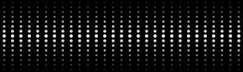

# 抬腕后波形连续性修复

2026-10-15。此前 `CaptureDots` 将 29 列历史保存在 View 的 `@State` 中，并在 `isRecording && scenePhase == .active` 变化时清空。持续录音时抬腕会重新累积整幅波形，容易被误认为重新开始录音。

**2026-10-16 真机反馈补修：** 本页保留当时验证范围。用户仍看到两侧内缩和唤醒重入；整页安全区、inactive 空绘制及长回调间隔清空已在[后续修复](watch-waveform-screen-and-wake-20261016.md)中继续处理，以下旧行为描述不作为最新契约。

现在由 `WatchRuntime` 持有独立的 `CaptureMeter`，只有通过录音代次检查的采样进度才更新历史。显示仍为 29 列、100ms 时间桶，保留现有 RMS 映射与衰减；时间桶依据采样 uptime 推进，不增加后台定时器。真实采样间隔超过整个显示窗口时丢弃旧历史，不把旧声音填成最近采样。

`CaptureDots` 只绘制运行时历史，不再持有历史或执行轮询任务；非活跃界面停止订阅波形变化，恢复活跃时读取当前历史。新建录音会重置历史，前台切换不重置。本项连续性修复不改变录音、AAC 编码、文件账本、同步、按钮与点阵几何。

本轮使用独立、未配对的 watchOS 27 / SE3 44mm 模拟器，不启用麦克风、不运行原生采音或模型。`MoMoAgentWatchTests` 测试构建成功；4 项定向宿主测试通过、0 失败/跳过，xcresult 无 runtime warnings：

- 原有安静、轻声、说话与高音量映射。
- 连续回到前台三次保持同一波形对象和完整历史，采样更新仍可推进。
- 同一时间桶保留峰值、按时间推进衰减、拒绝异常/倒退时间、长采样间隔清除旧历史。
- 新录音重置历史与时间基准。

51 个构建输入从构建到测试结束哈希一致。静态 UI 扫描无 high 问题、无新增问题；既有 medium 提示从 9 项降至 8 项。原始命令、构建与测试日志、xcresult、哈希和清理报告保留在本机忽略目录 `tmp_agent_output/20261015-watch-waveform-wake-01/`。

本轮验证了显示状态逻辑，没有执行真实抬腕、物理后台录音或能耗测试，也没有覆盖安装现有手机/手表 App。

## 点阵横向铺满

用户随后确认手表两侧留白过大。原实现用横纵较小的点距同时绘制两个方向，遇到偏扁的可用区域时，29 列点阵随高度一起缩窄并居中。

横纵点距现分别按 Canvas 宽度／29 和高度／15 计算；圆点半径仍取较小点距，保持圆形并避免超出边界。页面原有 8pt 左右内距保留，手机端不改。

新增用例直接使用 `ImageRenderer` 渲染正式 `CaptureDots`，验证 200×60、184×70、162×54pt 三种区域的左右可见点距 Canvas 边缘均小于 8pt。采用确定性满幅 meter 数据，不代表实录音频或真实手表截图。

先对未修的横向布局运行同一用例，实际失败：200×60pt 时左侧留白为 42.5pt。只改点距布局后重新构建，新增渲染用例及前述四项连续性／映射用例共 **5/5 通过**，0 跳过，xcresult 无 runtime warnings。两轮构建和测试各自保持 51 项输入稳定；红绿两轮之间仅 `CaptureView.swift` 改变，测试源码和断言未改。

| 修复前：Canvas 居中收窄 | 修复后：Canvas 横向铺满 |
| --- | --- |
|  |  |

[便携证据](evidence/2026-10-15-watch-waveform/evidence.json)包含原报告路径、大小、SHA-256 与允许字段；原始证据分别保留于 `tmp_agent_output/20261015-watch-waveform-width-before-01/` 和 `…-after-01/`。三张修后渲染图已实际查看。测试使用独立未配对模拟器，结束后已移除，不操作现有手机／手表或麦克风权限。

用户要求将两项手表修复合入现有 `codex/initial-implementation` 分支；本记录随修复保存。真实手表上的效果仍需更新 App 后验证，本次不重跑采音、后台与耗电验收。
