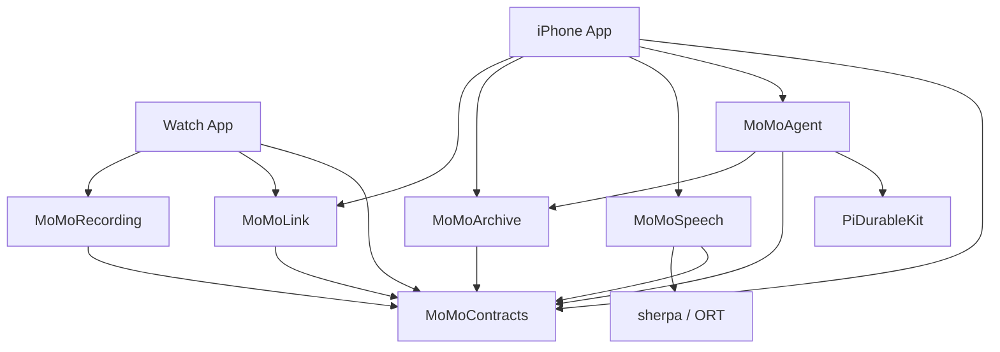

# MoMo Agent 代码组织方案

日期：2026-10-13。状态：实施中。本文定义代码位置、模块依赖和状态所有权；功能范围与执行顺序见[开发计划](v0.1-execution-plan.md)，验收用例见[验证计划](device-validation.md)，实际进度见[实施记录](../implementation/status.md)。

## 1. 组织方式

采用一个仓库、一个 Xcode 工程、一个本地 Swift Package。两个发布 App target 分别负责 iPhone 和 Watch，手表另带一个只读录音状态的 Widget Extension；Package 内设六个业务 target：契约、手表录音、设备通信、手机档案、语音处理、Pi Agent。测试和开发工具 target 另计。

手表 Widget 的入口与界面在 `Apps/WatchWidget/`，App Group 文件访问在 `Apps/WatchShared/`，录音状态投影与 URL 契约在 MoMoContracts。Widget 只依赖契约模块，录音与持久队列继续由 Watch App 单独管理。实现与验证见[手表 Widget 记录](../implementation/watch-widget-20261017.md)。

界面按功能组织，业务模块按数据所有者和依赖划分。一个页面通常只对应目录，不单独建立 Package。六个业务模块分别导出产品，不建立将它们全部聚合的总产品。

这份结构需要满足以下条件：

- Watch 依赖树中没有 Pi、sherpa 或 ONNX Runtime。
- 修改 Pi 接入只影响 Agent 模块及其装配；不改录音协议和档案格式。
- 更换 ASR 实现不改变资料服务、文件布局和 Agent 工具。
- 关闭页面不停止录音、收件或持久任务，也不重建 Agent harness。
- 一个状态只有一个写入所有者；事务、文件恢复和取消条件可以定位到具体模块。
- 用固定输入验证共享逻辑，用真机验证系统能力，测试来源明确。

## 2. 仓库目录

以下是逐步形成的目标结构，不要求第一天创建所有空目录或占位类型。

```text
MoMoAgent/
├── MoMoAgent.xcodeproj/             两个 App、宿主测试与开发工具配置
├── Apps/
│   ├── iPhoneApp/
│   │   ├── MoMoAgentApp.swift
│   │   ├── Bootstrap/
│   │   │   ├── PhoneComposition.swift
│   │   │   └── PhoneRuntime.swift
│   │   ├── Application/
│   │   │   ├── Receiving/             收件、校验、入库及确认协调
│   │   │   ├── Transcribing/          领取任务、调用 Speech、条件提交
│   │   │   ├── Deleting/              档案与 Pi 派生内容删除协调
│   │   │   └── Background/            系统任务登记与收尾
│   │   ├── Platform/
│   │   │   ├── Lifecycle/             UIApplicationDelegate 等系统入口
│   │   │   └── AudioPlayback/         播放会话与系统路由
│   │   ├── Features/
│   │   │   ├── Assistant/
│   │   │   ├── Library/
│   │   │   ├── RecordingDetail/
│   │   │   ├── Plans/
│   │   │   └── Settings/
│   │   ├── SharedUI/                  已有两个以上使用处的展示控件
│   │   └── Resources/                图标、本地化、能力与隐私说明
│   └── WatchApp/
│       ├── MoMoAgentWatchApp.swift
│       ├── Bootstrap/                WatchComposition、WatchRuntime
│       ├── Application/              录音启停、传输、对端删除协调
│       ├── Platform/                 麦克风、音频会话、Watch 后台入口
│       ├── Features/
│       │   ├── Recorder/
│       │   └── TransferStatus/
│       └── Resources/
├── Packages/MoMoAgentKit/
│   ├── Package.swift
│   ├── Sources/
│   │   ├── MoMoContracts/
│   │   │   ├── Identity/             稳定 ID
│   │   │   ├── AudioTime/            帧范围、epoch、时钟映射
│   │   │   └── Transfer/             清单、消息、版本和校验契约
│   │   ├── MoMoRecording/
│   │   │   ├── Capture/              用户意图、采样状态、有界缓冲
│   │   │   ├── Segments/             编码、封口、Ready 文件
│   │   │   ├── Ledger/               Watch 本地账本、migration、outbox
│   │   │   └── Recovery/             重启扫描、确认后清理
│   │   ├── MoMoLink/
│   │   │   ├── Transport/            通道的小接口与事件
│   │   │   └── WatchConnectivity/    激活、delegate、系统传输句柄
│   │   ├── MoMoArchive/
│   │   │   ├── API/                  业务命令、查询与不可变结果
│   │   │   ├── Database/             私有 SQL、migration 与短事务
│   │   │   ├── Inbox/                同步保全与可恢复校验登记
│   │   │   ├── Documents/            JSON / Markdown 投影与外部修改
│   │   │   ├── Search/               时间、中文关键词与分页索引
│   │   │   ├── Workspace/            计划、笔记、写操作去重
│   │   │   └── Retention/            保留、删除、文件引用与修复
│   │   ├── MoMoSpeech/
│   │   │   ├── API/                  输入、分析增量、结果与配置
│   │   │   ├── Analysis/             解码、重采样、跨文件 VAD、锚点
│   │   │   ├── Engines/Sherpa/       唯一接触 sherpa / ORT 的适配代码
│   │   │   └── Runtime/              原生句柄与串行执行器
│   │   └── MoMoAgent/
│   │       ├── API/                  App 使用的会话与状态接口
│   │       ├── Runtime/              PiAgentHost、SDK 类型转换
│   │       ├── Context/              近期上下文、预算、版本与引用
│   │       ├── Tools/                搜索、读稿、回放、保存计划
│   │       ├── Prompts/              版本化提示片段和工具说明
│   │       ├── Providers/            模型配置、Keychain、网络策略
│   │       └── Lifecycle/            暂停、恢复、资料失效与清理
│   └── Tests/
│       ├── MoMoContractsTests/
│       ├── MoMoRecordingTests/
│       ├── MoMoLinkTests/
│       ├── MoMoArchiveTests/
│       ├── MoMoSpeechTests/
│       └── MoMoAgentTests/
├── Tests/
│   ├── iPhoneIntegrationTests/        跨模块与真机测试
│   ├── WatchIntegrationTests/         Watch 系统能力测试
│   ├── AppUITests/                    少量关键用户流程
│   └── Fixtures/                     可公开短样本、标注、协议样本
├── Tools/CaptureReplay/               Mac 宿主开发工具 target 的源码
├── Experiments/MacReceiver/           独立实验，不进入发布 App 的依赖
├── Config/                           xcconfig、模型清单、依赖说明
├── scripts/                          确有需要的构建、资源与约束脚本
└── docs/
    ├── plan/                         产品、技术、代码组织与验收方案
    ├── research/                     调研来源与推断
    ├── design/                       界面参考
    └── adr/                          后续架构决定
```

`MoMoAgentKit` 是本地 Package 的容器名称，不是可被 App 一次性导入的总模块。此前计划中的 `MoMoAgentCore` 由上述六个明确模块替代。

## 3. 编译依赖与平台边界

| Target | 自有模块依赖 | 平台与第三方边界 |
| --- | --- | --- |
| `MoMoContracts` | 无 | Foundation 值类型，无 UI、数据库或 SDK |
| `MoMoRecording` | Contracts | Watch 采集流程与本地账本；可在 Mac 用固定输入测试公共逻辑 |
| `MoMoLink` | Contracts | WatchConnectivity 适配用于 iOS / watchOS；Mac 仅测试公共通道契约 |
| `MoMoArchive` | Contracts | iPhone 档案；可在 Mac 测真实 SQLite 与文件 |
| `MoMoSpeech` | Contracts | iPhone / Mac；只在此接入 sherpa / ORT，不依赖 Archive |
| `MoMoAgent` | Contracts、Archive | iPhone / Mac；只在此接入 PiDurableKit，不依赖 Speech |
| iPhone App | Contracts、Link、Archive、Speech、Agent | SwiftUI、系统入口与跨模块协调，不依赖 Recording |
| Watch App | Contracts、Recording、Link | SwiftUI、麦克风与 Watch 后台入口 |

箭头表示允许的编译依赖。外部 SQLite 封装、Pi 和语音运行库未全部画出。



在 Package 中为六个业务 target 分别导出 library product。Watch App 只链接表中三个产品；不用通配式依赖。`platforms` 指定部署平台起点，不能代替目标依赖隔离。平台条件依赖与源码条件需要一致，iOS 新 API 在平台入口做可用性处理。[SwiftPM PackageDescription](https://docs.swift.org/package-manager/PackageDescription/PackageDescription.html)

跨平台测试不等于所有模块在所有设备运行。P01 必须分别验证 Watch、iPhone、模拟器和选用的 Mac 宿主产物；模型及原生库切片也需要逐平台匹配。Watch 链接检查需证明没有 Pi / sherpa / ORT，不能只看源码有没有 import。

## 4. 每个模块拥有的数据与接口

### 4.1 Contracts 保持小而稳定

Contracts 保存已知有多个消费者的稳定语义：session / epoch / chunk ID、半开帧范围、时钟映射、清单与传输消息。类型本身验证范围和版本约束，网络边界验证字段完整性。

档案查询结果归 Archive，语音模型结果归 Speech，Agent 消息归 Agent，页面状态归各自 feature。只有出现明确的跨模块共同语义，才将其提升到 Contracts。它不演变成 `Models/`、`Utils/` 或任意服务的容器。

跨设备的 Codable 消息与仅供进程内使用的类型分别命名。不能直接把数据库行或 Pi 消息编码后当成录音传输协议。协议版本、SQLite schema、正文版本、提示版本和模型版本分开登记。

### 4.2 Recording 与 Archive 分别拥有两端存储

| 状态 | 唯一写入所有者 | 对外接口示例 |
| --- | --- | --- |
| Watch 录音意图、epoch、封口文件、待传及确认 | `RecordingStore`，位于 Recording | `startSession`、`registerSealedChunk`、`applyReceipt`、`applyDeletion` |
| 手机音频、正文、修订、处理任务、确认 outbox | `ArchiveStore`，位于 Archive | `commitReceivedChunk`、`claimAnalysisJob`、`commitTranscript`、`deleteSession` |
| 手机 JSON / Markdown 投影 | `DocumentProjector`，位于 Archive | 根据已提交正文版本更新文件，不发明另一份正文真源 |
| 本地计划、笔记与重复写防护 | `WorkspaceStore`，位于 Archive | `savePlan(operationID:...)`、读取与修订 |
| Agent 会话、模型与工具步骤 | `PiAgentHost`，位于 Agent | 调用 Pi 的公开 API，由 Pi 写其存储 |
| Agent 使用了哪些资料及清理进度 | Archive 中的派生引用与清理记录 | 只保存关联标识和版本，不复制 Pi 的调度器 |

这里的接口名是设计意图，不是已有 SDK 的方法。接收成功时，chunk、分析任务和 receipt outbox 必须由 `commitReceivedChunk` 的一次短事务提交。上层不能分别调用三个 `save` 再拼成业务成功。

Watch 账本与手机档案分别拥有 migration 和恢复规则，可以复用验证过的 SQLite 驱动，但不共用一个包含两端全部业务表的数据库服务。数据库封装和连接不从模块公开；上层只得到已物化、不可变、可跨任务传递的结果。

### 4.3 Speech 只处理音频，不拥有档案数据库

Speech 接受明确的音频输入范围、格式、配置及恢复位置，返回分析增量、窗口、时间范围和识别结果。Phone 的 TranscriptionCoordinator 从 Archive 领取任务，调用 Speech，再转换成 Archive 的提交命令。

VAD 规则与恢复锚点计算归 Speech；锚点、窗口及覆盖的原子提交归 Archive。Phone 协调器执行这套顺序，不重新实现 VAD 或 SQL。语音计算内部不接触 Pi，不负责业务确认、资料删除或用户界面。

### 4.4 Link 只拥有通道状态

Link 管理 WCSession、delegate、激活状态和系统传输句柄。Recording / Archive 才知道音频是否有效保存、能否清理以及哪些控制消息尚未确认。

App 中的 TransferCoordinator 将本地持久任务提交给 Link，并把事件交还数据所有者。系统 `didFinish` 不等于手机业务接收确认，Link 不能据此删除 Watch 文件。

## 5. App 装配与 SwiftUI 功能目录

### 5.1 依赖只在应用入口组装

`PhoneComposition` 创建 Archive、Speech 原生执行器、PiAgentHost、Link 和具体协调器；返回持有它们的 `PhoneRuntime`。Watch 有对应的 `WatchComposition` 与 `WatchRuntime`。Runtime 由应用生命周期持有，系统 delegate 也由它保留。

Composition 只构造和连接对象。收件、删除和转写顺序分别放在 `Application/` 的具体协调器中，不把所有动作写进 Composition 或一个数千行 AppRuntime。页面只得到所需的具体 facade，不拿到整个容器再自行查找服务。

不建立全局 service locator。首次启动、前台恢复、系统后台任务都复用同一 Runtime，不重复打开 Archive 或 pi harness。进入后台不等于结束应用运行；页面消失也不等于用户取消任务。

### 5.2 页面内部按功能收拢

例如 Assistant 目录可以随实际实现形成以下文件：

```text
Features/Assistant/
  AssistantView.swift             页面布局与交互
  AssistantModel.swift            MainActor 展示状态、输入与命令
  AssistantRoute.swift            导航数据，复杂后再独立成文件
  Components/                    仅本功能使用的消息、来源与工具状态控件
```

展示模型采用 `@MainActor @Observable`，管理输入框、筛选、导航和渲染快照。它通过明确依赖发送命令，订阅服务状态。页面可以取消自己的订阅，不能顺带取消 Agent 的实际工作。只有用户“停止”动作才调用任务取消接口。Observation 的可用范围覆盖当前 iOS / watchOS 基线。[Apple Observation](https://developer.apple.com/documentation/swiftui/managing-model-data-in-your-app)

View 不直接访问 SQLite、WCSession、PiDurableKit 或原生 recognizer。UI 使用自己的只读展示类型，避免 SDK 更新导致全部页面一起改。新增一个功能先建立目录；只有出现独立平台或依赖要求，才拆新 target。

## 6. 三条关键调用链

### 6.1 Watch 文件到手机档案

1. Recording 完成音频封口，持久登记待传文件。
2. Watch TransferCoordinator 调用 Link 提交文件。
3. 手机 Link delegate 调用预先注入的同步收件入口，保存清单并搬移系统临时文件。
4. Phone ReceiveCoordinator 在获得运行时间后执行校验，调用 Archive 的原子接收命令。
5. Phone 的发送协调器读取 receipt outbox，经 Link 发出确认。
6. Watch RecordingStore 在同一事务保存 Receipt 与 ReceiptApplied 待发项，事务提交后再清理副本。

第三步是刻意保留的同步小入口。Link 接受一个同步闭包，参数只使用 Foundation 与 Contracts 类型；PhoneComposition 将闭包连接到 Archive 的 `InboxCustodian`。Archive 不导入 Link，也不实现 Link 内定义的协议。这个入口只负责文件保全和必要格式检查，不跑 ASR 或数据库业务；Watch 端按需要注入自己的接收处理。

不能把收件步骤简单包成 `Task { await receive(...) }` 后马上返回 delegate，临时文件必须先得到保全。重计算留给后续可恢复任务；同步入口本身要有大小限制、错误路径和故障测试。

### 6.2 音频到正文和资料文件

`TranscriptionCoordinator → Archive 领取票据 → Speech 解码 / VAD / ASR → Archive 条件提交 → DocumentProjector 更新资料文件`。

领取返回的工作票据包含 attempt、内容代次、输入哈希与模型配置。Speech 返回之后，再由 Archive 在事务内检查票据有效性。正文提交同时登记投影任务；文件更新失败后可继续，不回滚已持久保存的识别事实。

Agent 检索通过 Archive 获取当前版本。工具读 JSON / Markdown 前核对投影版本；投影尚未完成时报告准备中。不能让路径或文件修改时间代替资料身份。

### 6.3 用户派活到 Pi 和文件工具

`AssistantModel → AgentService → ContextBuilder → PiAgentHost → 模型 API → Swift Tool → Archive → Pi → 带出处的回答或计划`。

ContextBuilder 在短查询中取得文字和来源版本，持久登记该会话将使用的来源，并检查资料代次后，才把正文交给 Pi。先登记引用，即使随后请求失败也能查到可能产生的副本；不能等 Pi 已保存正文后才补记来源。工具继续读稿时执行相同规则并限制条数与大小。网络等待期间不持有档案数据库事务或文件读取句柄。

Pi 本身负责模型—工具循环。AgentService 负责应用入口、配置、资源与状态适配；不再实现另一套循环或独立的工具重试调度器。`write_plan` 使用稳定操作 ID，写入经过 WorkspaceStore，不能直接让 Pi 任意改录音目录。

## 7. 并发与生命周期

| 执行域 | 所有者与约束 |
| --- | --- |
| SwiftUI | MainActor；只更新展示状态和发命令 |
| 麦克风回调 | 平台采集适配；有界、短时复制或交付音频块，不逐帧创建 Task，不等待 actor / SQL / 网络 |
| 编码与封口 | Recording 的专用顺序处理流程；缓冲有上限，溢出形成明确缺口 |
| Watch 账本 / 手机档案 | 各自串行数据库执行环境；事务闭包内无 await |
| 原生 ASR | Speech 的单一执行器；句柄和输入内存活到原生调用返回，不占 MainActor |
| Pi | 遵守 PiDurableKit 的实际串行运行环境；同一存储单一 harness owner |
| 长任务与取消 | App 协调器持有运行句柄；系统到期和用户取消调用同一服务入口，原因分别保存 |

Actor 能隔离内存访问，但方法在 await 处可能被其他操作插入。取消、删除或版本变更之后，旧工作仍可能返回。因此票据、代次检查和短事务条件不能被一个 actor 声明替代。[Swift Actor 重入说明](https://forums.swift.org/t/accepted-with-modification-se-0306-actors/47662)

跨执行域传递 Sendable 值类型，不直接传数据库行对象、JSContext 或 C++ 句柄。不用 `@unchecked Sendable` 隐藏未知的线程安全问题；SDK 的句柄只在所属执行器内使用。

Native ASR 的执行器与 Swift 任务寿命分开。`Task.cancel()` 后停止领取并使票据失效；底层尚未返回时不能释放模型句柄或启动重叠推理。其真实停止能力按既有 F09 等用例验证。

没有需要保存的长工作不使用无主的 fire-and-forget Task。可丢弃的 UI 订阅属于页面；需要完成或恢复的工作归 Runtime 和持久队列。内存事件流只通知状态变化，丢失一次通知后仍可从存储恢复事实，不把事件流当唯一任务队列。

## 8. Pi、工具与模型 API 的代码位置

### 8.1 将 SDK 类型收在 Runtime

`MoMoAgent/Runtime` 是 PiDurableKit 的主要接触点：打开存储、安装扩展、创建和恢复会话、订阅流、发起和取消任务。转换后向 App 暴露少量自己的类型，如 AgentSessionID、AgentSnapshot、SourceReference 和 UserTask。

只封装 App 确实需要的操作，不复制 Pi 的全部 API。Pi 的会话、步骤、工具结果和恢复状态仍由 Pi 持久化；应用只记录资料使用关联、代次、写计划操作 ID 和清理状态。不能用一份 UI 快照回写覆盖 Pi 的执行事实。

### 8.2 业务工具保持可独立测试

`Tools/` 按能力放文件，例如 SearchTranscriptsTool、ReadTranscriptTool、PlayAudioTool、WritePlanTool。参数校验和业务函数使用我们的类型，工具注册处将其适配为 Pi Tool。工具经 Archive 读取或保存资料，不能自己写 SQL。

播放工具注入 App 的播放命令，不让 MoMoAgent 导入 SwiftUI 或拥有 AVAudioSession。工具可回传来源引用和播放请求状态；具体播放会话归手机平台层。用户指令与转录资料的边界由提示和工具授权条件共同表达。

### 8.3 提示和 provider 配置可审查

提示片段与工具说明随源码版本管理，动态内容由 ContextBuilder 生成。测试固定输入资料、生成的上下文和允许出现的来源；不把庞大预期答案直接写成逐字快照。

人格与长期资料采用 [文件化助理上下文](../adr/file-backed-assistant-context.md)：MoMoAgent 的 Prompts 目录拥有 SOUL/USER/MEMORY 加载、条件保存、限额与请求快照；Runtime 只负责按固定顺序接入 Pi。设置页面通过 Agent 文档 API 编辑，不能组装提示或读写 Agent 私有文件。每条新消息捕获最新内容，同一 request ID 的模型循环与重试沿用持久快照。记忆工具仅写 USER/MEMORY；录音仍保留 Archive 来源和删除语义。

Providers 仅管理 provider / base URL / 模型 ID、经过验证的能力、Keychain 与网络策略。模型调用继续使用 Pi 的 provider 能力；只有实际 API 差异需要时才加适配，不能为每家模型复制一套请求和工具循环。

请求总时限、流空闲期限、输出及轮次上限在这里集中配置，再交给 Pi 适配层执行。密钥不作为 prompt、普通配置文件或日志字段。当前没有本地文本模型执行目录，也没有自建 API 代理服务。

固定上游 PiDurableKit 未公开结构化 HTTP 失败，且请求超时不能覆盖完整流读取。当前在 `Vendor/PiDurableKit` 保存固定 commit 的源码与传输补丁，通过本地 Swift Package 依赖接入。原始版本、改动清单、许可证与 JS bundle 的重建方法由 `Vendor/PiDurableKit/UPSTREAM.md` 管理。MoMoAgent 仍使用 Pi 的模型与工具循环；补丁只补传输期限、有限重试、取消和安全诊断。升级时先复查上游是否已提供相同能力，再决定移除补丁。

Pi 的诊断保留原 submission 身份。MoMoAgent 按完整请求及重试次数匹配诊断，向页面暴露 `AgentRequestFailure`，其中只有失败类别、状态码、允许重试时间及超时阶段。App 的 `session.json` 保存这个恢复状态；如果 Pi 已提交失败但 App 尚未提交，重开时从对应 Pi 记录补回。接口不能依赖全局“最近一次 HTTP 结果”或错误字符串匹配。

## 9. 文件、数据库与删除的一致性

运行时目录与源码目录分开。Documents 放用户资料和 workspace，Application Support 放档案数据库、Pi 存储及内部状态，Keychain 放密钥。文件布局沿用[执行计划第 14 节](v0.1-execution-plan.md#14-已确认的手机-agent-方案)，不因拆模块另设一份资料库。

Archive 的 DocumentProjector 负责从正文生成文件；DocumentReconciler 负责接收文件 App 的修改、移动和删除，再转换成档案命令。投影更新与外部修改用版本及操作记录识别，避免将一次内部写入误当用户修订，或把用户删除的文件悄悄重建。

手机的 DeletionCoordinator 负责跨 Archive 与 Pi 的删除流程：先由 Archive 持久登记删除及清理任务、失效旧工作，再暂停关联 Agent run 并拒绝迟到写入，随后请求 Pi 适配层清理相关历史，最后提交清理进度。清理未完成的会话不得恢复、继续执行工具或发送旧历史；启动时先检查清理状态，再允许 Pi 恢复。已经发送的外部请求仍不可能靠本地删除撤回。

两个存储没有共同事务；失败保存待清理状态并重试，不提前显示全部完成。来源登记在正文交给 Pi 之前完成，使应用重启后仍能识别待清理的会话。

Archive 不直接改 Pi 的内部表，Pi 不直接改档案表。当前 Pi 缺少的细粒度删除能力仍是需解决的适配问题，模块组织不能把它隐藏成空实现或成功占位。原音按保留期清理与用户删除整次录音继续使用不同状态。

## 10. 抽象、错误与扩展规则

### 10.1 只在真实边界放协议

首版适合小协议或类型明确闭包的边界包括：实时采样输入与固定输入、设备传输、原生推理、播放动作、Pi 接入所需能力。其目的是隔离平台、SDK 或两种真实执行方式。

ArchiveStore、RecordingStore 和页面模型先用具体类型。不要对每个类生成一个同名 Protocol，也不预建 Repository / Service / UseCase / Manager 四层。不存在第二个消费者的便利函数先留在所属模块，不因为可能复用就放入 Shared。

默认 internal。App 必须使用的业务门面才 public；数据库实现、SDK 类型、迁移步骤和具体文件路径不成为公开协议。跨模块需要一个稳定业务命令时再扩 API，不开放通用数据库句柄作为捷径。

### 10.2 错误在发生边界定义

Contracts 负责协议不兼容或无效范围，Link 负责传输状态，Archive 负责版本冲突 / 缺文件 / 存储错误，Speech 负责模型与音频错误，Agent 负责 provider / 工具 / 取消结果。应用协调器把它们映射成 UI 状态和恢复动作。

业务状态使用枚举与明确字段，不从错误文案猜测“可重试”。不要静默换模型、吞掉投影失败或把未知删除结果当成功。诊断携带 session / chunk / run / operation ID 和耗时，不默认记录正文、音频和密钥。

### 10.3 常见扩展放在哪里

| 新需求 | 修改位置 | 通常不需要修改 |
| --- | --- | --- |
| 新 ASR 实现 | Speech 的 Engines 与对应配置、测试 | Agent、传输协议、正文存储接口 |
| 新模型 API 提供方 | Agent 的 Providers 与兼容性测试 | Watch、Speech、资料目录 |
| 新 Agent 工具 | Agent 的 Tools；必要时增加 Archive 业务查询 | Pi 循环和已有采集代码 |
| 调整录音分片策略 | Recording 的 Segments 与配置 | Agent、页面和模型 API |
| 新增资料页面 | iPhone Features 与小型查询门面 | Watch 与原生推理器 |
| Mac 接收实验 | Experiments；复用 Contracts / Archive / Speech | 发布 App 的默认依赖 |
| 新的资料表示或跨设备消息 | Contracts 的显式版本与两端适配 | 不假定属于无影响的局部修改 |

只有独立平台、原生依赖、分发方式、编译成本或生命周期形成实际隔离需要时，才增加 target。一次 SDK 升级或普通页面改动不触发全仓重构。

## 11. 依赖、资源与测试组织

### 11.1 可复现依赖

提交 Package.swift、Xcode 工程的共享配置和对应 Package.resolved；不提交 xcuserdata、密钥、私人音频或运行数据库。Pi 上游与适配层版本分别登记，JS bundle 与 native library 的来源、哈希和 notices 一同记录。若维护适配 fork，明确 fork commit 与必要差异。

ASR / VAD 权重使用版本化资源清单，保存哈希、tokens、许可与验证样本信息。大权重不直接堆进源码目录，由可复现的构建资源步骤准备，并按计划随 App 交付。Watch 资源复制阶段不包含模型、Pi bundle 或手机档案样本。

SQLite 驱动在 P01 固定，需验证 Watch 支持和短事务接口。驱动可以共享，两端 schema 和业务命令仍分别维护。当前不再增加一套自研通用持久化框架。

### 11.2 测试跟随所有者

端到端的测试分层、真实依赖、证据与运行组见 [E2E 测试总方案](e2e-test-plan.md)。[E2E 用户旅程](e2e-scenarios.md)把下表测试串成完整用户流程；各模块仍拥有自己的状态与测试，不另建一套业务实现供 E2E 使用。

| 位置 | 主要测试 | 既有验收关联 |
| --- | --- | --- |
| ContractsTests | 编解码、版本、帧范围、清单身份 | S02、S04、R19 |
| RecordingTests | 封口、重启扫描、确认后清理、删除期间的旧写入 | S02～S04、F04、F15～F16 |
| LinkTests | 激活状态转换、事件与传输接口契约 | R11、F13；平台行为另用真机 |
| ArchiveTests | 真实 SQLite / 文件、接收事务、投影、版本和清理 | F01～F08、F17～F18、A07 |
| SpeechTests | 边界、VAD 重放、真实短样本推理、原生取消 | F06、F09～F12、T01～T03 |
| AgentTests | 上下文预算、来源、工具参数、计划幂等、Pi 恢复 | A02～A07、A09～A12 |
| iPhone / Watch IntegrationTests | 系统入口、真机后台、收件与取消 | R / T / A 系列的设备部分 |
| AppUITests | 派活、引用回放、取消、删除等少量关键流程 | G5 与 P10 / P13 |

纯规则测试可以注入确定输入；数据一致性用真实 SQLite 和文件；实际模型与 API 集成另跑真实依赖。脚本化 provider 适合故障注入，不能代替 A02 的真实模型工具调用。发布证据继续区分软件逻辑、模拟器、iPhone 与 Watch。

Package 单测需要打包的短样本放在对应 test target 的 Fixtures 中，按 SwiftPM 资源规则登记；根目录 Tests/Fixtures 用于宿主集成和工具输入，传入明确路径。不要依赖测试进程恰好运行在仓库根，也不要声明越出 Package 边界的资源路径。

### 11.3 结构检查也是交付物

在 P01 建立最小结构检查，并随模块加入收紧：

1. 检查声明的 target / product 依赖没有环、没有违反第 3 节。
2. 分别构建两端，检查 Watch 链接及打包资源未包含 Pi / ASR。
3. 检查 Pi 与 sherpa 的 import 只出现在对应适配模块；App 只通过业务 API 使用。
4. 检查测试资源不进入发布包，私有资料与凭据不进入 Git。
5. 运行受影响模块的检查与测试；涉及边界协议时再加入调用方和接收方验证。

源文件路径和 import 检查是辅助约束，真实构建和链接检查才证明平台依赖隔离。架构规则的例外需说明具体原因、影响和退出条件，不用跳过全部检查解决。

## 12. 落地顺序与维护方式

| 工作包 | 结构交付 |
| --- | --- |
| P01 | 创建 Xcode 工程、本地 Package 与明确产品依赖；建立 Composition 和最小结构检查 |
| P02～P03 | Contracts、Recording 公共逻辑、Archive 和固定输入工具；先做文件与持久化测试 |
| P04～P05 | Speech 与手机转写 / 后台协调器；页面只订阅持久状态 |
| P07～P08 | Watch 平台采集与 Link 真机适配；接入已有业务命令 |
| P10 | Library / RecordingDetail / Settings 等功能目录，复用 Archive |
| P12 | Agent 的 Pi Runtime / Providers，固定版本并验证模型 API |
| P13 | Context / Tools / Assistant / Plans，以及跨档案和 Pi 的删除协调 |

不预先生成全部样板文件，也不为尚不存在的第二实现建插件系统。优先交付一条真实调用链；发现边界中混入了另一模块的状态，再按所有权移动。

后续代码评审检查四件事：这段状态由谁拥有，调用会跨过哪个 await，是否新增编译依赖，失败后由哪里恢复。涉及模块边界、正文真源、传输协议或 Pi 存储的决定，写入 `docs/adr/` 的短记录，并同步本方案。当前文档已确定的规则无需另写重复 ADR。
