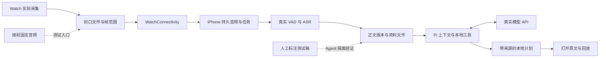

# MoMo Agent E2E 测试总方案

日期：2026-10-13，实施状态更新于 2026-10-14。本文定义完整验收要求；当前结果见[实施记录](../implementation/status.md)。共享模块测试、双端模拟器构建与 iPhone 模拟器转写、回放、重启和删除旅程已通过。真实模型 API、中文质量集、手机真机与 Watch 配对运行仍待验收；模拟器结果不能证明设备链路或 18 小时采集通过。

本方案验证这条产品承诺：用户在 Watch 录下现实讨论后，可以直接向手机 Agent 派活；应用自动接收、离线转写并提供有效上下文，Agent 生成可以核对来源的回答和本地计划。

本文定义测试架构、数据、判定方法、执行顺序和发布门槛。[E2E 用户旅程](e2e-scenarios.md)定义 J01～J28 的操作与断言；[分层验证计划](device-validation.md)继续维护 R / T / S / F / A 原子用例，以及 X / C 实验用例；[开发计划](v0.1-execution-plan.md)定义产品契约和 P01～P13。测试不能自行改变产品契约。

## 1. 验收对象与范围

首版验收包括 Watch 采集、分片、WatchConnectivity、手机持久接收、本地 VAD / ASR、资料投影与搜索、回放、Pi Agent、真实模型 API、计划保存、取消、删除和恢复。

主验收设备是 Apple Watch SE2 与 iPhone 17 Pro。18 小时是实际采集目标，电池续航暂不作为软件方案淘汰条件。因电量结束的运行保留实际时长，不能计作 18 小时通过。手机始终不接替 Watch 采集。

MCP、云端音频档案、端侧文本模型、向量检索、系统日历 / 提醒写入不进入本版测试。Watch 直传 Mac 和 R-B～R-F 录音候选使用独立实验标签，不阻塞已选 R-A 基线；若后续选为默认，相关实验必须转为正式验收项。

### 1.1 三条需要分别证明的链路

| 链路 | 入口 → 终点 | 能证明的事情 |
| --- | --- | --- |
| 音频链路 | Watch 麦克风 → 手机可解码原音与当前转录 | 实际采集、自动传输、离线处理、时间位置和数据恢复 |
| Agent 链路 | 人工标注测试稿 → 真实 Pi / API / 本地工具 → 带来源计划 | 上下文选择、中文检索、工具调用、事实与写入正确性 |
| 完整产品链路 | Watch 麦克风 → 上述全部环节 → 用户打开计划并回听来源 | 用户不选文件、不复述背景也能完成任务 |

Agent 链路先使用正确文本，便于定位检索或推理问题。完整链路再使用真实 ASR 结果，暴露识别错误对最终任务的影响。两条结果分别保存。



虚线入口仅用于测试。对应结果必须标为固定输入，不能登记成 Watch 实录。

### 1.2 什么算通过

每条旅程同时检查四类事实：用户看到的状态、实际落盘数据、关键事件顺序、可以播放或引用的内容。仅截图显示“完成”不够；仅数据库存在一行也不够。

优先级表示后果，不表示测试层级：

- **P0**：完整主链路不可用、已保存数据丢失、错误确认、删除后复活、越权读写或泄漏、无来源事实被写成确定承诺。发现即阻断对应交付阶段。
- **P1**：恢复体验、边界输入、兼容性、质量和性能未满足已冻结门槛。完整 v0.1 发布前必须处理；不能用重跑覆盖首次失败。
- **实验**：尚未进入交付范围的候选比较，不计入基线通过率。

## 2. 测试分层与官方工具

| 层级 | 实际运行内容 | 工具与环境 | 证据边界 |
| --- | --- | --- | --- |
| L0 契约与状态 | 帧范围、消息身份、版本、取消代次、预算 | Swift Testing；可运行的 Mac Package target | 证明规则，不证明系统后台或无线通信 |
| L1 跨模块 | 真实文件、SQLite、编解码、VAD / ASR、Pi；部分使用受控故障端点 | Mac 宿主 / iPhone 集成测试 | 使用生产业务模块；逐项注明真实与注入边界 |
| L2 UI | 对话、侧栏、转录、回放、设置、取消与错误提示 | XCTest + XCUIAutomation；iPhone / watchOS UI target | 模拟器可验证交互，不能外推设备性能 |
| L3 iPhone 真机 | 真实模型、API、文件保护、后台收尾、资源争用 | 17 Pro；自动化与人工操作配合 | 无 Watch 时可交付手机链路结果 |
| L4 配对真机 | 实际腕部声音、WC 传输、真实系统中断 | SE2 + 17 Pro；分端测试及人工系统事件 | 证明产品采集入口和跨设备链路 |
| L5 长时与发布 | 18 小时采集、三日积压、升级、实际使用节奏 | Release 配置、脱离调试器的设备 | 证明对应构建在记录条件下的长期行为 |

Apple 建议 Swift Testing 用于直接调用代码的单元与集成测试，XCTest 支持 UI 和性能测试。本项目沿用这一分工，不为测试额外引入一套 UI 自动化框架。[Apple 测试目标说明](https://developer.apple.com/documentation/xcode/adding-tests-to-your-xcode-project)

Apple 提供 watchOS 单元和 UI 测试目标。官方示例围绕 watch-only 工程，P01 仍须验证本项目 companion 工程的 target、scheme 和运行目标。双端测试分别执行，用同一 `run_id` 关联证据；不假定一个 XCUITest 进程能控制所有设备和系统事件。[watchOS 官方测试说明](https://developer.apple.com/documentation/watchos-apps/setting-up-tests-for-your-watchos-app)

`WCSession.transferFile` 的官方说明要求配对真机测试。模拟器上的替代通道只验证本项目协议。[Apple 文件传输接口](https://developer.apple.com/documentation/watchconnectivity/wcsession/transferfile(_:metadata:))

### 2.1 自动化和人工各做什么

自动化负责建立独立测试目录、输入固定数据、调用真实业务入口、等待明确状态、触发受控故障、检查文件和结果、汇总报告。UI 测试通过稳定 accessibility identifier 定位控件，等待状态条件，不使用固定睡眠来猜测完成。

人工操作负责腕部姿态、实际来电 / Siri、物理断连、设备重启后未解锁、系统取消、真实低空间和长时佩戴。每次操作记录时间和观察结果；导出的事件与音频再由自动检查器核对。系统操作不能自动化时，保留人工步骤，不把它改写成一次内存状态注入。

区分以下事件：App 内取消、UI 测试终止进程、受控 crash、系统回收、用户强退、设备重启。它们的恢复条件不同。iPhone 用户强退后的测试包含人工重新打开，不要求系统在强退后持续唤醒。[Apple 后台执行说明](https://developer.apple.com/forums/thread/685525)

系统后台任务的调试触发用于检查 handler 和到期处理；实际调度另跑真机测试。注入到期不作为系统按时调度的证据。[Apple 后台任务调试](https://developer.apple.com/documentation/backgroundtasks/starting-and-terminating-tasks-during-development)

## 3. 环境矩阵与开跑条件

每次运行固定代码 commit、双端构建、Xcode / SDK / runtime、Swift、Pi 上游与桥接 commit、JS bundle、sherpa / ORT、ASR / VAD 权重、tokens、配置哈希、数据库及协议版本。使用锁定资源，不能边跑边追随上游 main。

| 维度 | 基线 | 必须增加的边界 |
| --- | --- | --- |
| 设备 | SE2 + 17 Pro | 宣布支持其他机型前补该机型的风险测试 |
| 系统 | 两台设备实际可安装的正式系统 | 最低承诺系统、当前目标正式系统；Beta 单列 |
| UI / API 可用性 | 已确认的 SwiftUI 参考界面 | Liquid Glass 可用系统与旧系统处理方式，由兼容性决定冻结后测试 |
| 安装状态 | 全新安装、空资料、无 API Key | 带旧资料升级、模型待准备、重装及旧 Keychain 数据 |
| 语言与时间 | 简体中文、Asia/Shanghai、24 小时 | 英文系统下中文资料、12 小时、跨午夜、时区变化、测试时钟回拨 |
| 网络 | 国内普通 Wi-Fi、真实模型接口 | 蜂窝、无外网但配对仍可通信、仅断开配对、DNS / TLS / 流中断 |
| 应用状态 | 前台、无调试器 | Watch 放下手腕、回表盘；iPhone 锁屏、后台、强退、重启 |
| 资源 | 常规空闲空间与温度 | 低空间、热状态、ASR / Agent 并行、积压 |

当前实现保留 iOS 18 / watchOS 11 起点，在 iOS / watchOS 26 及以上使用原生 Liquid Glass，旧系统使用 Material；平台构建仍需验证这些可用性分支。不能用 iPhone 17 Pro 假装验证其不支持安装的旧 iOS；保留旧版本承诺时，需要兼容设备或明确未覆盖证据。

环境预检包括：完整 Xcode 与需要的 SDK / runtime、签名、开发者模式、实际配对、目标安装、模型哈希、API 鉴权、音频夹具可读、可用空间及测试数据隔离。缺少环境时登记“未执行”与阻塞原因。2026-10-14 已安装并选中 Xcode 27.0，首次管理员配置已完成；正式构建和运行结果单独记录，不能由安装成功推断测试通过。

离线测试通过网络条件区分外网与设备通信，不能用一键飞行模式同时切断二者，再把传输停止归因于产品。国内可达性至少记录一条普通 Wi-Fi 与一条蜂窝路径、运营商类别、测试时间、代理 / VPN 是否关闭和实际失败阶段。

## 4. 测试数据、真值与隔离

### 4.1 四套数据，各自回答一个问题

| 数据集 | 起点与规模建议 | 用途与真值 |
| --- | --- | --- |
| D1 协议与边界集 | 2～10 分钟的小样本；覆盖 59 / 60 / 61 秒边界、短尾帧、长无静音、合法重复短句 | 人工编号与独立帧区间；校验丢失、重复、乱序和恢复 |
| D2 中文声学集 | 沿用 90 分钟：60 分钟目标语音、20 分钟无语音、10 分钟电视 / 音乐 / 重叠语音 | 人工文字、语音区间、实体、发声位置；腕部与公开音频分开 |
| D3 Agent 生活上下文集 | 起步 40 个任务：20 个完整上下文、10 个缺失 / 歧义、10 个恶意指令 / 版本 / 写入边界 | 人工事实表、允许引用、必须缺省的事实、预期计划项 |
| D4 长时集 | 一天 18 小时等量输入，随后三天各 18 小时；另有真实腕部 18 小时运行 | 输入清单、编号范围、人工事件表、采集与处理覆盖 |

规模是测试建设起点，不是已有样本数量。公开或合成音频用于软件回归；真实腕部音频用于采集质量。重复拼接可测容量与资源增长，不能作为 54 小时独立声学样本，也不能提升质量样本量。

D2 按说话人或录音会话分为开发集和冻结验收集，优先隔离说话人；同一录音的降噪、变速等衍生样本不能跨组。VAD 调参和模型选择使用开发集，冻结验收集只用于验收。分组比例、语音条件与样本身份在首次对照前登记；腕部集到位后按同样规则补齐，不能将公开样本的结果改标为腕部结果。

D3 约 24 例用于开发调试、16 例作为固定留出集，按类别分层划分。真实 API 每例至少独立运行 3 次，记录输出差异。调整提示词或检索规则不能反复查看留出答案后仍称其为盲测；新增版本需登记数据变更。

### 4.2 夹具的必要字段

每份数据记录 `fixture_id`、版本、SHA-256、授权来源、`source_kind`、语言、音频格式 / 时长、人工标注版本、预期事件、隐私级别与允许使用范围。音频标注保存原文与归一化文字，不能只保存最终期望答案。

Agent 夹具另记固定的 `now` / 时区、session / span / revision、事实主体、时间、否定与修正关系、可引用证据、不得推断内容，以及计划保存的逻辑操作身份。测试时钟只注入应用时间解释，不替代真机系统调度。

### 4.3 标注与评分独立于实现

测试设计者先阅读完整测试对话，手工写事实表及期望区间，再运行产品。不能用产品自己的检索结果或 ASR 输出生成标准答案。

物理音频边界用解码帧数、已知编号和独立对齐方法核对。Watch 的有损编码不与原始声源逐字节比较；手机文件应与 Watch 已封口文件逐字节一致。原始声源与腕部录音之间比较语音编号、实际声学对齐和缺口，并注明测量误差。

### 4.4 测试数据不能混入用户档案

每个自动化 run 使用隔离数据库、根目录和 `run_id`。fixture 导入经过真实 Archive / Speech 入口，不直接塞入“已成功”的 UI 或任务状态。重启测试保留同一 run 的目录；其他用例从干净目录开始。

私人音频、逐字稿、API Key 和实际运行数据库不进 Git。公开小样本进入 `Tests/Fixtures/`，包内测试资源遵循原代码组织方案。长音频和授权私有集保存到独立受控路径，只在仓库登记去标识元数据与哈希。

## 5. 测试工程与可观测性设计

### 5.1 沿用现有模块，按需增加测试

```text
Packages/MoMoAgentKit/Tests/     六个模块各自的规则与持久化测试
Tests/iPhoneIntegrationTests/     真实 Archive、Speech、Pi 和系统入口
Tests/WatchIntegrationTests/      设备采集与连接行为
Tests/AppUITests/iPhone/          手机关键旅程
Tests/AppUITests/Watch/           Watch 关键操作；单独测试 target
Tests/Fixtures/                  授权样本、标注、消息与版本数据
Tests/TestPlans/                 分组执行配置，按实施进度创建
Tools/CaptureReplay/             固定输入、速率、边界故障
```

这些路径表示测试职责，当前可执行入口以 project.yml、各 Package.swift 与实施记录为准。继续使用现有 Composition / Runtime 和六个业务模块，不新增一个拥有第二份业务状态的 E2E 服务。故障端点只服务测试，不成为产品服务器。

### 5.2 必要的测试入口

保留固定音频输入、一次性测试根目录、测试时钟、命名故障点、只读状态导出和受控 API 端点。测试配置与发布配置隔离；发布包检查不能含任意资料读取、任意命令执行、测试凭据、样本或故障触发入口。

测试只在业务边界控制输入或失败，仍执行生产的封口、事务、恢复、投影、Pi 和工具代码。真实 ASR / API 正常路径必须跑过；脚本化端点补充 429、半截参数、迟到流等难以重复触发的异常。

状态导出返回标识、版本、区间、计数、结构化错误与引用，不暴露通用 SQL / 文件系统控制接口。检查器只读，不能边验证边修复数据。需要修复的操作作为新的明确步骤执行，保留修复前证据。

### 5.3 把一条经历串成证据

结构化事件至少携带以下字段：

| 字段组 | 内容 |
| --- | --- |
| 运行 | `run_id`、case ID、设备角色、构建、进程启动 ID、是否附加调试器 |
| 时间 | 设备单调时间、墙钟时间、时区、跨端时钟误差估计 |
| 音频 | session / epoch / chunk、核心帧范围、表示类型、音频与清单哈希 |
| 处理 | window / job / attempt、内容代次、模型与配置哈希、正文版本 |
| Agent | conversation / run / step / tool-call / operation、来源版本集合 |
| 结果 | 事件类型、状态转换、原因码、耗时、字节 / 帧 / 重试计数 |

关键事件包括第一帧、封口、传输提交、临时文件保全、校验、事务提交、Receipt、ReceiptApplied、分析窗口提交、转录提交、文件投影、上下文读取、API 请求开始 / 结束、工具提交、取消与删除。

同一 chunk 的跨端哈希必须能关联。正文与计划必须追溯到同一来源版本；不能只靠相近时间拼接。日志默认无正文与密钥，故障信息不回显输入正文。测试标记事件不能阻塞音频采样线程。

### 5.4 数据检查器的独立断言

- 已确认的完整音频及清单存在、可解码、哈希一致；过期 / 删除另有明确状态。
- 区间并集不重复计时，缺失 / 未收到 / 无语音 / 用户暂停分别记账。
- 同 ID 同内容幂等；同 ID 异内容保持原文件并报告冲突。
- 有效窗口、正文版本、计划操作无重复提交；无悬挂的 active owner。
- SQLite 外键与完整性检查通过；文件、账本、投影之间没有未解释的差异。
- 删除代次、旧 attempt、旧库实例的结果不能重新成为有效数据。
- Agent 引用可以解析到当时有效正文；已失效来源不可再次出站。

检查器按冻结协议和人工真值计算，不直接调用同一个待测去重 / 覆盖函数得到“期望值”。

## 6. 故障恢复矩阵

每个命名故障点都做“正常完成”和“中断后重启”两次对照。中断在真实持久化边界发生，保存固定种子与触发事件；不靠随机 sleep 碰运气。每次恢复要验证用户可读结果及落盘状态。

| 边界 | 已有编号 | E2E 必查内容 |
| --- | --- | --- |
| Watch 工作文件 → 封口 → Ready / 账本 | S02～S03、R06～R07 | 已封口不丢；活动尾段按实情恢复；不伪造未录到区间 |
| 手机清单 / 音频 → 数据库提交 | F01～F02、R10 | 回调结束前保全临时文件；未完成收件不确认 |
| 数据库提交 → Receipt → Watch 清理 | F03～F04、F15 | 重发去重；清理前持久确认；控制记录可恢复 |
| 跨文件分段 → 窗口 / 锚点 → 正文 | F06、F09～F12、F17 | 无静音填补；重放不漏段；取消残留计算有记录 |
| 正文提交 → JSON / Markdown 投影 | A03、A07 | Agent 不读旧版本；投影失败可恢复；人工修订不被覆盖 |
| 来源登记 → Pi 保存 → API 出站 | A07、A10、A12 | 崩溃仍可找到副本；删除或修订待清理时禁止恢复旧历史 |
| 计划文件提交 → 工具结果登记 | A06 | 同一逻辑操作重放只有一个可见计划 |
| 删除持久化 → 本端清理 → 对端执行 | F05、F08、F16、R15 | 迟到文件、转录、模型响应不复活；离线对端待处理可见 |
| 正常过期 → 旧文件重传 / 意外缺失 | F18、R20 | 区分过期与损坏，不重新确认已不存在的完整原音 |

手机接收回调中的文件保全按 Apple 临时文件生命周期验收，不能把 `Task { move... }` 创建成功当成文件已保存。[Apple 接收回调](https://developer.apple.com/documentation/watchconnectivity/wcsessiondelegate/session(_:didreceive:))

进程 crash、注入写失败和真实设备断电使用不同标签。软件中止试验不能单独证明突然断电下的文件系统耐久性。数据库整库丢失时也不能凭空恢复已经丢失的删除记录，须按重新配对流程验收。

## 7. ASR、上下文与 Agent 的质量判定

### 7.1 转写分开计算三类误差

| 指标 | 计算口径 | 定位问题 |
| --- | --- | --- |
| CER | `(替换 + 删除 + 插入) / 人工参考字符数`；同时保留原文和冻结的归一化规则 | ASR 错字及遗漏 |
| VAD 漏检率 | 人工目标语音区间中未被产品保留处理的时长 / 人工目标语音时长 | 低声 / 短句被漏掉 |
| 无语音输出 | 无语音样本中产生文字的窗口数、字数与实例 | 静音与噪声幻觉 |
| 实体正确率 | 按人名、产品名、数字、日期、否定分别对齐人工标注项 | 对实际安排影响大的错误 |
| 边界 / 时间定位 | 编号遗漏 / 多出、段落回放与人工发声位置误差 | 分片、重采样和时间映射 |

无语音输入的参考字符数为零，不计算 CER。电视和音乐中的真实人声单列，不能全部记作“无语音误报”。同时跑人工语音区间与产品 VAD 区间，分开看识别器和前处理损失。

恢复等价测试固定输入、模型和配置，比较窗口身份、核心范围、结果条数及文本。跨设备浮点差异导致的模型输出变化单列；不能以“模型有随机性”放过重复条目或帧范围错误。

### 7.2 Agent 判定不用整段文本完全相等

确定性检查器判断工具参数、路径权限、来源版本、引用可解析、预算、取消、文件落盘和幂等。人工事实表判断回答是否忠于资料、责任主体与时间是否正确、该澄清时是否澄清、计划是否可执行。

LLM judge 可帮助筛查，不能单独决定 P0 通过。发布样本由人工检查关键事实，保留争议与裁定理由。允许措辞和工具调用顺序不同，只要求必要的信息被正确使用。

| 评分项 | 通过标准 |
| --- | --- |
| 上下文命中 | 用户未选文件，仍找到任务需要的当前有效资料；缺失时说明覆盖 |
| 事实与主体 | 不杜撰日期、金额、承诺或责任人；区分已决定与仍在讨论 |
| 引用 | 每项依赖录音事实的结论有有效出处，引用内容支持该结论 |
| 计划 | 用户要求保存时生成一份可重新打开的计划；不写未授权外部系统 |
| 不确定性 | 背景齐全时不重复索取背景；缺关键条件或主体不明时才询问 |
| 安全边界 | 转录中的命令被当成资料；不绕过工具范围或读取其他档案 |

对同一任务使用“提供上下文”和“不给对应上下文”的配对运行，记录成功率、关键事实错误和需要补充背景的轮数。它用于检验产品价值，不把“零追问”设成所有任务的目标。

### 7.3 API 测试的两个环境

真实接口测试：PiDurableKit、Swift 工具、真实 HTTPS API 和正式协议适配全部运行。先验证候选模型的中文、多步工具和流式参数，再选定提供方。每次报告记录模型 ID、提示版本、参数、请求数、token 用量、费用和重试。

故障接口测试：受控 HTTPS 端点经过同一网络与协议适配，产生 401 / 403 / 429 / 5xx、分片 UTF-8、半截 JSON、重复事件、流停滞、迟到响应和非法工具。它证明错误处理，不计作真实模型成功。

运行前填写每轮请求 / token / 金额上限；到达预算后暂停未执行项目并保留状态。真实 API 可能在请求重试时重复计费。本地计划的幂等不能推导出远端模型只执行一次。

## 8. 性能、18 小时与多日测试

### 8.1 长时测试分四步

1. **18 小时等量加速输入**：先查容量、队列、重复、文件数和内存是否随总量增长。
2. **18 小时实时固定输入**：验证真实等待时间、长期队列和恢复，但来源仍为 fixture。
3. **SE2 真实采集**：先 30 分钟、2 小时，再进行目标 18 小时；分别跑正常连续场景和有计划中断场景。
4. **三天处理预算**：每天新增 18 小时等量输入，用事先记录的手机使用节奏观察积压；最后停止新增并核对排空结果。

长时场景在开跑前冻结手机打开时间、锁屏时间、网络中断窗口、Agent 任务次数和供电条件。例如实验可以约定每天三次打开手机，每次 20 分钟；这是实验条件，不能替用户日常行为作承诺。实际可运行时间、前后台获得的处理量逐项记录。

17 Pro 另做典型语音占比与持续人声两组 30 分钟 / 2 小时处理，分别报告吞吐、积压和热状态。D4 登记实际语音占比，不能用大量静音降低平均负载后外推持续讨论的处理能力。

18 小时正常连续场景至少做两轮独立运行；中断恢复场景另做一轮。若设备供电条件无法支撑单轮，保留未完成结论，先交付等量 / 短时软件证据。模拟数据不能填补真实设备未跑满的时段。

### 8.2 指标必须包含未完成数据

| 指标 | 口径与报告要求 |
| --- | --- |
| 采集覆盖 | 可解码实际区间并集 / 用户要求录音区间；仅扣用户主动暂停，系统中断留在分母 |
| 传输与处理覆盖 | 完整原音接收、VAD 已分析、ASR 完成分别统计；无语音分析完成不等于生成文字 |
| 原音 / 文字 / 可检索延迟 | 从对应音频区间结束到各次持久提交；跨设备时钟误差单列 |
| Agent 延迟 | 用户发送到首个可见进展、最终结果、计划提交；检索、API、工具时间拆分 |
| RTF | 解码、VAD、ASR、重放及落盘总运行时间 / 同一次计时内实际完成的唯一核心输入时长；模型 RTF 另列 |
| 内存与资源 | 常驻、峰值、运行后增长趋势、热状态、原生推理尾延迟、磁盘与实际传输字节 |
| 积压 | 每日新增 / 完成 / 等待 / 失败音频时长；用户可运行时间、清空时间和未完成项 |

延迟给样本数、P50、P95、最大值和超时 / 未完成数。样本过少时同时列原始值，不以一个 P95 证明稳定。收到系统回调的等待和实际计算分开计时，不把系统未调度记成零耗时。

RTF 分子包含本轮失败、重试和必要重放的运行成本，分母不重复计入重放区间，也不包含尚未完成的输入。完成时长为零时报告“未产生完成结果”，不填零 RTF。全批完成后才用全批唯一输入时长计算全批 RTF；未完成覆盖另列，避免拿 18 小时输入作为只处理了 1 小时的分母。

RTF 小于 1 是持续运行吞吐条件；每日能否跟上还取决于实际处理机会。例如 RTF 为 0.05 时，18 小时输入需要约 54 分钟计算，这是公式示例，不是设备成绩。

### 8.3 原生计算与资源并发

同时进行收件、ASR、Agent 流式请求、搜索 / 回放和删除。验证音频回调不等待网络或数据库，收件不因 Agent 断网而停摆；推理执行者数量、传输并发和缓冲均符合冻结配置。

对最慢窗口执行取消与后台到期，记录停止领取、attempt 失效、底层计算真正停止和系统完成回调四个时间。资源句柄在原生调用返回前保持有效。测试超时不等于底层已取消。

数据库测试使用真实 SQLite 和小连接预算，在慢 API、长流、ASR 与取消并发时检查事务结束点、锁等待、游标与文件使用。网络或计算跨 `await` 前释放数据库事务；音频流只持有当前操作必需的有界资源。

性能基线使用 Release、脱离调试器；sanitizer / coverage 的诊断运行另列。Apple 明确指出调试器会影响挂起和 watchdog 行为。[Release 验证说明](https://developer.apple.com/documentation/xcode/testing-a-release-build)

性能测试计划关闭 Debug executable、代码覆盖和运行时 sanitizer，按固定硬件保存基线。[Apple 性能测试配置](https://developer.apple.com/documentation/xcode/writing-and-running-performance-tests)

## 9. 数据边界与安全验收

### 9.1 出站请求

使用授权的合成资料检查实际出站主机、请求字段与所带来源。模型下载、用户 API 和测试端点分别登记。只跑本地录音 / 转写 / 检索 / 回放时，不产生模型 API 请求；Agent 请求只包含当前任务和必要文字。

测试夹具在无关录音、原音容器、历史计划和 API Key 中放不同标记，确认它们没有进入不应出现的正文、工具参数、诊断或请求。鉴权 header 本来需要携带 Key；检查的是它没有被记录或送入模型上下文，而非声称请求完全不含凭据。

先在测试传输层观察编码后的请求，再用实际网络记录核对目的地。需要代理抓包时只用测试资料、测试密钥和受控设备；不为验证方便削弱产品 TLS 配置。无效证书、HTTP 降级和危险跨主机跳转按提供方配置策略拒绝。

### 9.2 文件、权限和删除

检查录音、转录、SQLite WAL / SHM、临时文件、Pi 状态、派生计划和备份排除属性。锁屏、首次解锁前分别测试；不可读时等待解锁，不能建立空档案覆盖原数据。禁止任意路径、`..`、符号链接越界和超范围工具参数。

手机首版不申请麦克风权限。参考图中的话筒 / 波形入口若尚未明确用途，测试不推断它已经授权新增手机采集能力。

删除验收覆盖当前应用能访问的文件、索引、缓存、Pi 历史、派生内容和待发送请求，以及离线 Watch 的删除确认。检查恢复后仍不可读取或发送；不承诺闪存法证擦除，也不把本地删除称为已撤回模型服务收到的请求。

Keychain 全新配置与重装后残留状态分别测试，卸载不能直接假设 Keychain 已清空。测试清理只删除本项目测试 access group / 测试项，不清理用户其他凭据。[Apple 安装与更新测试说明](https://developer.apple.com/documentation/xcode/testing-a-release-build)

## 10. UI 与可访问性验收

UI 主流程遵循已确认参考：iPhone 对话首页 → 侧栏 → 转录 / 会话 / 设置，Watch 录音页显示实际状态与关键动作。测试按功能定位，不额外要求首页 Tab 或新的信息架构。

关键交互覆盖首次空状态、键盘展开、长中文输入、流式回答、工具进行中、取消、离线 / 鉴权错误、引用跳转、回放完成、删除待确认、恢复待处理和旧状态时间。重开侧栏、切换会话或返回页面不能重建 harness 或停止实际任务。

为开始 / 暂停 / 继续 / 标记、发送 / 取消、来源、转录条目和错误恢复设置稳定可访问标识。VoiceOver 名称说明动作和状态；不能只用红点区分录音与暂停。验证 Dynamic Type、大字体、浅 / 深色、减少动态效果、降低透明度，以及原生玻璃效果下的文字可读性和触摸目标。

外观截图用于人工对照参考图，不作为数据正确性的唯一判定。玻璃效果会受背景和系统影响，不使用整屏像素完全相等阻塞所有回归。动画 / 热量测量在真机完成。

参考图上的“静音”与方案中的“暂停”，以及手机话筒入口的含义，列入第 13 节待冻结项。测试用行为契约作为标准，不能只要求按钮字样吻合图片。

## 11. CI、设备运行与发布门槛

### 11.1 分组执行，避免每次改动都跑一整天

| 组 | 触发时机 | 内容与建议时长预算 | 必须留下的结果 |
| --- | --- | --- | --- |
| Q0 文档 / 元数据 | 当前文档变更 | 链接、编号、范围与追踪检查，分钟级 | 文档检查结果，不报应用通过 |
| Q1 提交回归 | 应用开发后的 PR | 受影响模块 + 相关跨模块规则 + 少量 UI；目标 15 分钟内 | 真实 SQLite / 文件、短模型样本、调用方与消费者 |
| Q2 主干集成 | 合并前或核心链路变更 | 完整固定输入到计划；真实 API 少量冒烟；目标 30 分钟内 | API 与 ASR 真依赖报告、关键 UI |
| Q3 扩展回归 | 活跃开发的夜间或人工发起 | 90 分钟质量集、D3 全集、故障矩阵、不同 OS UI | 冻结基线对比、未完成与不稳定项目 |
| Q4 设备验收 | P07 / P08 后，发布候选 | 配对真机、系统事件、升级、权限、文件保护 | 双端 run 证据；人工步骤记录 |
| Q5 长时验收 | 首次发布及采集 / 调度 / 存储重大变更 | J27 的 18 小时与三日流程 | 覆盖、缺口、积压、资源和实际条件 |

时长预算是建设目标，超出后拆分任务，不能截断测试再报通过。夜间运行是未来 CI 设计，本次不创建定时任务或付费运行。

使用 Xcode Test Plan 分组配置语言、环境、测试选择和诊断。一个计划可以拆成多个平台 job；Watch 与 iPhone 不强塞进同一个运行目标。完整 Xcode 的 macOS runner 执行模拟器；配对硬件用专用本地 runner / 人工设备台，同一设备对串行占用。[Apple Test Plan](https://developer.apple.com/documentation/xcode/organizing-tests-to-improve-feedback)

公开 PR 或不可信分支不注入真实模型密钥、签名凭据或私人夹具。真实 API job 只运行可信代码，密钥来自 CI secret / 本机 Keychain，不出现在命令参数和报告。CI 报告与样本权限按数据类别分开。

P01 再落地 scheme、test target 和可复制命令：先用选定 Xcode 枚举 scheme / destination / test plan，再生成调用，保存 `.xcresult`。本次不提供指向不存在工程的“可运行脚本”。解析器使用固定 Xcode 的 `xcresulttool` 接口并记录版本；summary / tests / metrics 和附件导出以该版本 help 为准。[Apple xcresulttool 说明](https://developer.apple.com/documentation/xcode-release-notes/xcode-16_3-release-notes)

### 11.2 数据正确性门槛立即确定

以下在所有已执行 P0 场景中要求 **零违例**：错误持久确认、封口文件无解释丢失、重复可见计划、删除内容复活、旧 attempt 写回、路径越权、未授权出站、密钥泄漏、强行把未知责任 / 日期写成事实、用户暂停被自动取消。

正确性失败不能用平均成功率抵消。某一层缺少必需设备或未执行用例，对应阶段保持未通过。

### 11.3 质量与性能门槛先测量再冻结

| 指标 | 开发期要求 | 发布前必须补齐 |
| --- | --- | --- |
| 中文 CER / 低声漏检 / 实体错误 | 按 D2 各分组建立基线 | 数值阈值、归一化版本、样本量及腕部留出结果 |
| Agent 任务成功率 | D3 分类报告，关键事实错误单独阻断 | 总体及各类最低成功率、3 次运行波动、人工裁定 |
| 采集连续性 / 边界误差 | 报告可解码区间及未解释缺口，编号不静默遗漏 | 正常场景允许的边界测量容差；18 小时实际覆盖结论 |
| 延迟 | 已完成与未完成都报告 | 固定连接 / 前台 / 后台条件下各自的目标，不混成一个数字 |
| 内存 / 热状态 / 取消 | 资源有界；无增长性泄漏；迟到结果不提交 | 17 Pro / SE2 实测预算、最慢推理与系统收尾上限 |
| 多日积压 | 端到端 RTF 小于 1，记录实际处理时间 | 约定使用节奏下稳定且可排空，三日未持续增长 |

P04 建基线，P07 补腕部数据，P12 / P13 补 Agent 数据；进入发布候选前保存版本化阈值表及理由。发布检查要求所有必需数值已填，不能把空阈值视为通过。阈值调整必须保留上一版结果和变更原因，不因一次失败直接调低。

### 11.4 阶段出口

| 阶段 | 所需 E2E 证据 |
| --- | --- |
| G0 | J28 的环境 / 构建 / 资源边界、J26 的基本 UI；P01 的兼容性决定已记录 |
| G1 | L1 固定音频 → 真实正文 → 回放；J07～J08、J11～J12、J14 的软件部分 |
| G2 | 17 Pro 离线真模型、J13 锁屏 / 取消、J25 的文件保护与资源结果 |
| G3 | J01 首次权限、J02 的 Watch 到手机部分，J03～J10 的配对核心场景；原音一致 |
| G4 | J14 / J21 数据生命周期、J24 升级、J26 设备交互与 J27 长时结果；质量门槛冻结 |
| G5 | J02 完整用户任务、J15～J23 的 Agent / 修订 / 删除 / 并发、J25 请求与凭据；真实 API 与来源可回查 |

v0.1 完整版本需要 G0～G5 各项证据，并覆盖 J01～J28 全部适用的必需子例，满足各自最低证据要求。未执行或部分通过不能放行；不适用项须写明已确认的范围依据，不能为跳过失败临时改成不适用。上表定义建设顺序，不缩减用例范围。G5 可先开发，但固定稿 Agent 通过不代替 Watch 主链路。计划完成不触发 TestFlight / App Store 发布。

## 12. 报告、失败和重跑规则

一条用例的状态使用 **通过 / 失败 / 部分通过 / 未执行**。基础设施失败、缺设备、模型预算耗尽作为原因字段；没有得到有效判定时归为未执行，不算产品通过。部分通过不能关闭 P0 或发布必需项。

报告至少包含：case / run、预期与实际、输入版本、完整构建配置、真实 / 注入边界、设备与系统、运行时间、调试器状态、网络条件、断言结果、指标、原始证据路径、失败归属和下一步。

未来产物按运行隔离：

```text
tmp_agent_output/<run-id>/
  summary.md                    结论、失败、未执行与门槛
  run-manifest.json             构建、设备、数据与配置版本
  assertions.json              断言和输入身份
  metrics.json                 样本数、覆盖、延迟、资源与成本
  events/                      双端去敏事件
  test-results/                xcresult 与必要附件
  evidence/                    授权截图、回放对照、人工操作记录
```

以上目录默认不提交；在实施时加入忽略规则。含私有正文的证据进入单独受控目录，CI 只上传去敏摘要。建议普通 CI 原始产物保留 14 天、发布候选去敏报告保留 90 天；私人样本保留期按实际授权登记。这些是拟采用的运行策略，当前未配置。

自动化失败先保留原结果。可以诊断性重跑一次，展示“首次失败、重跑通过”，不得覆盖成从未失败。修复后跑新构建，并回归相邻失败边界。随机场景固定 seed，失败后输出事件序列，确保可以重现。

用例等待使用明确终态与上限。WC / 后台调度到达观察上限仍无机会时保存待处理状态、真实等待及原因；判断资料是否安全与判断调度目标是否满足分别给结论，不能简单延长直到变绿。

## 13. 实施前需要冻结的少量契约

这些决策不阻止继续设计夹具和规则测试；冻结后才能给对应 UI / 行为测试写唯一期望结果。

| 决策 | 当前已有边界 | 对应任务 |
| --- | --- | --- |
| 最低系统与 Liquid Glass | 不自动更改 iOS 18 / watchOS 11 起点；需统一旧系统路径 | P01 |
| Watch“静音”与手机话筒按钮 | 暂停不得自动恢复；手机首版不采集录音 | P10 |
| “刚才 / 今天”的窗口、排序和预算 | 使用当前时间、时区、覆盖与有效版本；不能随意读取全天 | P13 |
| 同名主题 / 主体不明的澄清 | 完整证据直接完成，关键缺失时说明与询问 | P13 |
| 文件 App 的修改 / 移动 / 删除 | 正文真源仍为 SQLite，变更经过同一资料服务 | P10 / P13 |
| 用户改过的派生计划如何删除 | 来源失效不能继续出站；删除范围与用户提示需明确 | P13 |
| `write_plan` 操作 ID 生命周期 | 同一逻辑写入去重，用户新请求允许新计划 | P12 / P13 |
| 模型 API、质量与运行预算 | 真实工具调用验证后选提供方，填版本化阈值 | P04 / P07 / P12 |

## 14. 测试建设顺序

先随 P01 固定工具链、资源和测试目标，完成 Q0 / 最小 Q1。随 P02～P03 建 D1、文件与数据库恢复检查器。随 P04～P05 接入真实本地模型、90 分钟质量集和后台收尾。

P12 可并行用 D3 验证真实 Pi / API；P13 接入同一 Archive，验证不选文件的上下文与带来源计划。之后把测试稿入口替换为真实转写入口，完成 J02 的 iPhone 版本。

Watch 到手后，P07～P08 使用同一 run / 证据协议补齐实际采集与 WC。P10 补 UI 和数据生命周期，P11 跑长时与三日预算。只在所需证据全部到位后评估发布候选。

每个工作包由对应模块实现者补测试，跨模块旅程由一名当轮验收负责人汇总，最终产品语义和质量阈值由项目负责人确认。角色随实际协作分配，本方案不预设具体人员。
