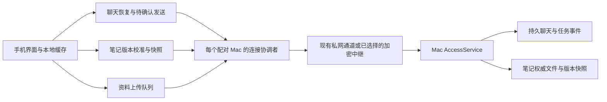

# MoMo Agent Mac 与手机连接升级方案

日期：2026-11-14。状态：两轮 Gemini review 后，P1/P2 首批代码已在独立工作树实现并通过主机与模拟器测试，P0 保留现场版本差异；[实现与验证](../implementation/connection-upgrade-p1-p2-20261114.md)。P3/P5 保持后续独立阶段，P4 真机验收未完成。

源码基线：`origin/main` 的 `4af63c1aaa7c047136a0527f531feae67379a209`。实施前先合并同时进行的连接修复，并重新核对已安装版本，避免重复实现已经进入主线的修复。

## 1 目标与技术决定

用户离开手机、切换网络或 Mac 从休眠恢复后，MoMo 自动恢复可用连接，继续原任务，并把聊天、笔记和任务状态追到服务端当前版本。用户无需重新扫码、杀进程或反复下拉刷新。Mac 真实离线时保留本地内容，并如实显示最近一次同步状态。

本方案选择 **可替换的连接通道、持久业务状态、各类数据独立恢复**。首轮保留现有 HTTP API、聊天 SSE、SQLite 事件记录和设备配对；重点修复生命周期、失败分类及同步调度。随后把已存在的加密中继接入完善为可交付的公网通道。

| 决策 | 本次选择 | 原因 |
| --- | --- | --- |
| 实时传输 | 保留聊天 SSE，发送仍用独立 HTTP 请求 | 已具备持久游标、快照和幂等键；更换 WebSocket 不能修复本地自检误判或笔记刷新被上传阻塞 |
| 连接所有权 | 每个已配对 Mac 一个连接恢复协调者 | 合并前台、网络变化、请求失败和手动重试的恢复意图，避免多个业务模块同时重建网络 |
| 数据恢复 | 聊天事件重放；笔记按内容版本读取一致快照；任务独立校准 | 连接成功不等于每类数据已经同步 |
| 默认接入迁移 | 第一阶段沿用用户已选通道；第二阶段验证加密公网中继 | 先解决所有通道共用的恢复问题，再降低手机访问 Mac 的部署复杂度 |
| 现成实时组件 | 首轮不新增 broker；后续集中订阅场景优先验证 Centrifugo | 当前单个 Mac 与少量手机不需要再叠一套事件系统；Centrifugo 可作为未来适配器，不能替代业务持久层 |
| 数据归属 | Mac 持有权威数据，手机持有缓存及待确认操作 | 保持当前产品结构，公网中继默认只转发加密载荷 |

交付范围覆盖 Mac—手机的聊天、笔记、任务、资料上传及关联通知。Watch—手机录音传输和远程桌面视频继续使用各自链路，不随本次更换协议。

## 2 现状与证据

### 已有能力

- [ConversationSubscription](../../Packages/MoMoAgentAgentClient/Sources/MoMoAgentClient/ConversationSubscription.swift) 已支持快照、按 cursor 续订、退避、冲突后重新取快照，以及流失败后的快照探测。
- [SharedConversation](../../Packages/MoMoAgentAgentClient/Sources/MoMoAgentClient/SharedConversation.swift) 与 [RemoteTaskStore](../../Packages/MoMoAgentAgentClient/Sources/MoMoAgentClient/RemoteTaskStore.swift) 拥有聊天状态、回执和待确认发送；继续保留原 operation ID 和业务去重责任。
- [EmbeddedTailnet](../../Apps/ClientUI/Network/EmbeddedTailnet.swift) 已有节点 generation、连接池失效处理、路径监测和前台预热。
- [EmbeddedAccessHealth](../../Apps/MacApp/Desktop/EmbeddedAccessHealth.swift) 已把服务上报与真实身份探测分开：上报间隔 6 秒、身份探测间隔 30 秒；访问服务的上报租约为 15 秒。该改动已在基线中，实施时核对实际安装版本是否包含。
- [PhoneContextSync](../../Apps/iPhoneApp/Features/RemoteAgent/PhoneContextSync.swift) 已持久化笔记缓存和同步时间，前台约每 10 秒发起刷新；完整分页成功后才替换缓存。
- [MoMoMemory.list](../../Apps/MacApp/Context/momo_memory.py) 已按笔记清单计算内容 revision，并校验分页 revision。一致性基础可以复用。
- [RelayTransport](../../Packages/MoMoAgentAgentClient/Sources/MoMoAgentClient/RelayTransport.swift) 与 [relay_access.py](../../Apps/MacApp/Access/relay_access.py) 已存在加密中继实现。历史文档中的“未合并”属于当时记录，当前基线已有代码；部署和真机验收仍需重新核实。

### 本次需要解决的缺口

| 观察 | 能得出的结论 | 改造要求 |
| --- | --- | --- |
| 现场曾记录身份自检 `NSURLErrorDomain -1022`，随后节点关闭和重建；检查时安装的 Mac 为 0.6.20，而本地基线已有后续保护 | 自检的本地策略错误可能进入过度恢复；安装版本与源码版本必须分开记录 | 对照真实安装确认修复生效；策略拒绝不能直接成为重建节点的证据 |
| 手机报告仍在重连，笔记显示上次同步约 42 分钟前 | 用户看到的数据确实没有近期刷新确认；不能只凭 Mac 有几条 200 判断手机已恢复 | 按同一请求编号核对客户端落盘与各数据域进度 |
| `synchronizeArchive` 先处理说话人修正、等待 `uploadSources()`，再 `downloadMemories()`；上传包含整库遍历和待传队列 | 长上传与积压可以拖慢笔记刷新。这是代码层耦合，尚不能单独解释现场全部故障 | 拆分下载与上传的任务、进度和重试预算 |
| `AgentTransportFailure.isSocketOrLinkFailure` 将多数非取消 URL 错误宽泛归入连接失败 | 配置、策略和真实网络故障的恢复动作区分不足 | 共享结构化错误分类，按层恢复 |
| 聊天、资料、健康、通知等各自拥有前台任务 | 启动、取消、重连与错误回调需要统一代次边界 | 连接生命周期统一协调，业务同步仍由各业务所有者管理 |

首次触发本次断联的完整因果链仍以主排查取得的手机日志为准；本方案不把结构性风险写成已经确认的唯一根因。

## 3 目标结构与所有权



连接协调者负责通道可用性、身份验证、生命周期代次和有限的恢复动作；它不处理聊天正文、不写笔记、不重新执行 Agent 任务。优先收敛 [PhoneRemoteAgent](../../Apps/iPhoneApp/Features/RemoteAgent/PhoneRemoteAgent.swift) 的现有职责，只有状态和依赖确实需要隔离时才提取独立类型。

`EmbeddedTailnet` 继续拥有 Tailscale 节点、代理和连接池。`RemoteTaskStore` 继续拥有发送幂等、已应用事件游标及聊天缓存。`PhoneContextSync` 继续拥有笔记和资料状态，但拆开各自的在途任务。各业务模块上报结构化失败，只请求连接协调者恢复，不直接退出账号或关闭共享节点。

每次配对身份改变、通道替换、前后台恢复周期建立新 generation。回调必须同时匹配配对身份、连接代次和本业务请求代次；旧请求的成功或错误都不能改写新状态。等待中的任务支持取消并保证完成清理后才释放运行标记。

## 4 连接恢复规则

### 状态与事实

连接内部状态采用 `suspended`、`connecting`、`reachable`、`retrying`、`authenticationRequired`、`configurationRequired`。`reachable` 表示当前代次成功访问了预期 Mac 的已鉴权服务；本地网络路径可用、Tailscale Running 或成功连接中继均不足以单独产生这个状态。

数据域分别保存 `cached`、`syncing`、`current`、`stale`、`failed`，以及已应用版本、最后确认时间、最近错误类别。数据域达到 `current` 只代表在一次已验证的服务端版本边界上完成同步，不承诺服务端之后永远没有新变化。

连接与数据状态不组合成几十种枚举，也不把它们全部展示给用户。

### 唯一恢复入口

前台唤醒、网络路径变化、Mac 唤醒、有效请求的连接失败和手动重试进入同一个恢复入口。相同身份与代次的并发请求共享一次恢复；后台转前台和新的网络路径可中止旧退避，主动触发一次恢复。网络监测仅提供触发信号，成功以真实请求为准。

恢复顺序为：检查当前节点和代理 → 必要时替换失效连接池 → 请求已鉴权能力与身份 → 启动聊天续订和可见数据刷新 → 在剩余预算中恢复上传。已存在的成功业务请求可以提供可达证据，无需每次发送前都串行自检。peer 预热、路由优化不得挡住可用路径上的业务请求。

| 失败类别 | 恢复动作 | 明确边界 |
| --- | --- | --- |
| 当前任务取消、旧代次回调 | 结束本任务 | 不修改当前连接健康，不发起重建 |
| 请求超时、连接丢失、暂时不可达 | 淘汰受影响池、重试安全读取，按预算恢复通道 | 单个数据域慢不能使其他健康数据域失效 |
| SSE 失活或事件缺口 | 重新订阅；必要时取快照 | Mac HTTP 仍可达时，不重建整个节点 |
| 429、可重试 5xx | 遵守 `Retry-After`，退避重试 | 不退出登录；服务过载不等于私网失效 |
| 401、明确撤销或凭据失效 | 现协议无自动凭据刷新；确认已绑定通道返回业务 401 后停止自动轮询，显式重试必须重新验证 | 不删除配对、缓存或未确认操作；不自动重新扫码 |
| ATS 拒绝、证书或端点配置错误 | 保留详细原因，进入配置故障处理 | 不通过全局放开 ATS、忽略 TLS 校验或重启循环掩盖问题 |
| 协议不兼容、损坏响应、业务 revision 冲突 | 按明确错误码处理兼容或重新取快照 | 不用错误文案关键词猜测状态；不把所有 4xx 都判成鉴权失败 |

Mac 的“本地转发探测”“节点状态”“手机业务请求成功”分别记录。自检被 ATS 拦截时，修正精确的请求路径或网络配置；已有成功证据只能在有限有效期内支持可达判断。过期后显示未知或检查失败，不永久伪装在线，也不据此反复销毁仍在服务的节点。

初始参数作为待测默认值：恢复退避采用 equal jitter，延迟为 `min(30s, 0.5s × 2^attempt) × U[0.5, 1]`；成功接收并校验业务响应后重置。遵守更长的 `Retry-After`。长时间前台故障继续低频尝试，同时明确展示恢复失败及重试入口。

节点重建只在节点 API、代理 listener 或同代次多条真实连接证据支持时执行。每 60 秒最多重建一次，随后至少冷却 60 秒；配置和鉴权错误不计入该预算。手动重试合并到当前恢复，不并发启动第二次重建。

## 5 聊天与任务恢复

继续使用现有 `snapshot`、`subscribe?after=N` 和消息 POST。每个前台会话最多一条 SSE 订阅，快照与事件读取共享同一权威数据边界。快照之后新增的事件必须能由该快照的 cursor 续读，不能出现“取快照—建订阅”窗口漏消息。

- 事件顺序采用服务端持久 cursor；业务状态与已应用 cursor 原子落盘后才推进位置。
- 重复事件按稳定事件或业务 ID 去重；发现缺口、服务端重建或游标过期时，通过明确响应进入快照恢复。
- 心跳继续初始采用 15 秒、无数据失活阈值 45 秒。心跳用于证明流仍活跃，不推进业务游标，不标记笔记已同步。
- 服务端持久接纳消息后才显示已送达；执行组件真正领取后才显示已读；正文到达后按现有 UI 契约收起回执。
- POST 回执丢失时，先按原 operation ID 查询或对账；仅在现有去重保证和有效期限内重投同一操作。不得生成新 ID 重新执行原任务。
- 历史事件保留与客户端幂等重试期限有独立契约。事件保留期外可恢复最终快照，无法继续自动重投的旧写入要显式保留为待核对。
- 任务列表可独立读取和校准，不等聊天历史、笔记或上传完成；后台任务继续由 Mac 执行。

快照恢复成功仅确认该会话状态，不能自动清除其他数据域的失败。客户端本地存储写入失败时保留旧游标，并显示本地存储问题；不能进行网络重建循环。

## 6 笔记与资料同步

### 拆开调度与持久状态

将 `synchronizeArchive` 拆成笔记读取和资料投递两个可独立等待、取消与重试的任务。共享账号和网络恢复，分别保存 `inFlight`、请求意图、错误及进度；所有状态提交仍回到同一状态所有者合并，避免两个任务各拿一份旧 `State` 后覆盖对方的进度。

笔记打开、前台恢复、确认恢复可达、笔记版本变化及用户刷新，都可触发一次笔记校准；合并重复触发。资料积压不能成为它的前置依赖。上传任务保留已接收回执，只推进已确认的条目。

初始调度上限：每个配对 Mac 一条聊天 SSE；交互读取最多 2 个在途请求；资料上传最多 1 个；文件下载最多 1 个。任务列表与笔记按可见性公平排队，连续上传按条目或有限时间片让出调度。每个 HTTP 请求有连接和读取截止时间，批量任务按页检查取消和预算。

### 复用内容 revision，补齐一致快照

笔记继续复用 `MoMoMemory.list` 的内容清单 revision。该值来自哈希，**只能比较相等与否，不能当递增序号比较大小**。Context 数据库的全局 revision 与笔记文件内容版本不是同一概念，不能代替笔记版本。

第一步先完成独立刷新，并持久化最后应用的笔记 revision。第二步通过能力协商新增轻量版本接口，例如 `memory_manifest_v1`：

```json
{
  "instance_id": "paired-mac-instance",
  "memory_revision": "opaque-content-version",
  "item_count": 120
}
```

该字段是拟议接口；名称以实现评审后的契约为准。新客户端对旧服务端继续使用现有分页读取；新服务端继续支持旧参数和返回结构。

版本相同时只更新最后确认时间；变化时拉取笔记快照。服务端一次生成有界、不可变的快照，返回随机 `snapshot_id`，后续页绑定同一快照。首版每个已配对设备最多一个待完成快照，TTL 120 秒，总缓存上限按实例设置为 32 MiB；超过上限返回明确资源限制错误并保留客户端旧缓存，不能静默截断。测试集覆盖上限边界；实际正常笔记库超过预算时，在扩大支持范围前补磁盘快照与分页方案。

快照 revision 必须由实际捕获的正文及元数据计算，不能先计算清单版本、再读取另一时刻的正文。进程内写入与快照捕获采用统一的短临界区或不可变版本；外部文件编辑通过捕获前后清单与内容摘要核验发现变化。构建按次数和时间预算有限重试，仍无法取得一致结果则返回明确的暂时失败，不发布混合版本。外部多文件编辑不具备数据库事务语义，不能宣称它们天然原子完成。

分页过程中不持有数据库事务或文件句柄跨网络等待。快照完整下载、校验并原子写盘后才替换界面数据和版本。网络中断可在 TTL 内续页；快照失效则重新开始，避免持续写笔记导致每一轮分页都冲突。

一次请求的 generation 与快照 ID 防止旧快照覆盖新请求结果。发生删除后，旧快照不得重新恢复已经被用户确认删除的笔记；删除流程提高本域代次并触发重新校准。

### 变化通知与兜底校准

Mac 的笔记变更在权威写入完成后生成“版本可能变化”通知。变化通知只触发拉取，不替代权威内容和版本查询。它可通过能力协商后的现有事件通道扩展发送；未订阅的页面和错过通知的客户端仍能靠版本查询恢复。

笔记可能由 Agent 工具、Dream、删除入口及外部文件编辑产生。版本索引必须覆盖所有写入来源：原子写入完成事件为主，文件变化监测和前台校准时的实际清单核验补漏。不能只监听手机“忘记”按钮，也不能只靠文件修改时间断言内容没变化。

健康连接时停止每 10 秒重拉完整笔记库。初始策略：笔记页可见时每 60 秒检查轻量版本；其他前台页面每 5 分钟检查一次，并在任何连接恢复后立即校准。后台不依赖该定时器。若轻量索引未能完整覆盖外部修改，先保留有界的实际清单核验，不提前启用长期缓存。

## 7 iOS 生命周期与 Mac 睡眠

普通手机应用进入后台后可能被挂起，长连接不能被当作永久驻留条件。APNs 可提示新结果或触发获准的后台刷新，但后台推送不保证必达，必须保留前台补同步路径。[Apple 后台通知说明](https://developer.apple.com/documentation/usernotifications/pushing-background-updates-to-your-app)

- 前台：从本地缓存立即展示内容，启动连接恢复；聊天和可见笔记并行恢复，后台资料上传按预算执行。
- 后台：保存已应用游标和待确认操作，结束前台订阅。已有系统授予的有限后台工作完成后释放资源；不为保持连接开启虚假录音、定位或无限后台任务。
- 推送：提示域版本失效或任务结果就绪；获得执行时间时做有限读取。收到推送不等于内容已经持久保存。
- Mac 睡眠：保留运行与投递状态；手机在证据不足时显示暂不可达。没有经过验证的唤醒能力时，不承诺自动唤醒睡眠中的 Mac。
- Mac 唤醒：恢复 listener、确认服务身份、恢复中继或私网，再允许业务投递。旧 socket 和旧任务回调受 generation 隔离。

## 8 公网接入升级

第二阶段目标拓扑为：**手机通过 WSS 连接稳定中继，Mac 主动向同一中继建立 WSS 出站连接；两端保持端到端加密和现有设备授权。** 现有 Tailscale 继续作为用户已选的私网方案。

已有 [中继实现记录](../implementation/relay-access.md) 可复用。第一版加固保留当前每个交换的有界资源和取消语义；是否合并为多路复用连接，以握手成本、并发和耗电测量决定，不为追求“一条长连接”提前重写。

| 发布条件 | 要求 |
| --- | --- |
| 稳定入口 | 正式域名、TLS、Mac 主动出站；真实 Wi-Fi、蜂窝、系统代理与目标地区测量通过 |
| 身份与加密 | 中继路由标识不充当授权；二维码、端点绑定、设备撤销及加密协议继续验证；密钥不交给中继 |
| 数据边界 | 默认中继不持久存储聊天、笔记正文和离线任务；Mac 离线时手机明确显示离线；若将来增加云端密文队列另行设计 |
| 故障恢复 | 注册、心跳、断线、重试和旧连接替换有清晰代次；代理变化及中继重启均能自动恢复 |
| 传输完整性 | 解决当前请求体 512 KiB 限制，采用分块、总长度、摘要、取消和有界缓冲；超过单次业务上限明确失败 |
| 并发隔离 | 慢上传不能阻塞聊天和笔记；限制每设备并发、每交换缓冲、最大帧与握手速率 |
| 切换与回滚 | 已配对身份和业务 ID 保留；切换前验证目标 Mac；旧路由的迟到响应不能污染新路由 |

不能把普通 HTTPS 隧道等同于端到端加密中继。Cloudflare Tunnel 的成熟能力是通过出站连接提供可达入口；其 TLS 终止与内容可见性需按真实部署单独界定。[Cloudflare 文档](https://developers.cloudflare.com/cloudflare-one/networks/connectors/cloudflare-tunnel/)

新公网通道先由用户主动选择，达到验收门槛后才评估新安装默认值。既有用户不静默从私网迁往公网。支持多个预先授权通道后，才设计自动故障切换；所有通道必须绑定同一 Mac 身份并共享业务幂等键，不能并行重复提交写请求。

## 9 状态呈现与诊断

界面保留已缓存内容和可编辑输入框。连接页表达 Mac 是否可达；笔记页表达笔记是否已确认同步。任务仍在 Mac 执行时，即使手机断线，也不能将任务直接标为失败。

笔记页显示“正在更新”“上次同步 X 分钟前”或具体可恢复失败；只有正在运行或已安排的真实重试存在时，才显示“稍后自动重试”。区分“内容最后修改时间”和“最后确认与 Mac 一致的时间”。不可恢复配置错误提供简短处理入口，底层错误码留在诊断中。

沿用两端随机 request attempt ID，增加稳定的恢复周期 ID、代次、数据域、触发原因、阶段、耗时、错误类别及恢复动作。记录本域最新已应用版本是否匹配、积压数量、最后成功时间及后台取消原因；诊断日志不含消息正文、笔记内容、录音、凭据或可反推出笔记内容的完整哈希。

每次事件能回答：请求是否发出、是否到 Mac、Mac 是否完成、手机是否接收、是否成功落盘。一次 200 不能代替最后两个步骤。保留断线起点、最近错误、动作次数及结束证据，避免滚动日志只剩重复重试。

## 10 实施拆分

| 阶段 | 修改位置与产物 | 完成门槛 |
| --- | --- | --- |
| P0 基线与现场对齐 | 两端版本、构建提交、通道、错误分类；核对主线已有 `EmbeddedAccessHealth` 修复 | 安装包与源码对应，保留能跨两端关联的断线证据；本次唯一根因未知时明确保留未知 |
| P1 连接恢复 | `AgentTransport.swift`、`EmbeddedTailnet.swift`、`PhoneRemoteAgent.swift`、`DesktopModel.swift`、`EmbeddedAccessHealth.swift`、`tunnel.py` | 单一恢复协调、错误分层、代次隔离、重建预算；ATS 与单流错误不再制造全链路重启 |
| P2 笔记解耦 | `PhoneContextSync.swift`、`RemoteMemoryView.swift`、资料同步调用方 | 下载不等待上传，状态提交不丢对方进度，缓存与时间准确；保留旧服务端兼容 |
| P3 版本恢复 | `ContextClient.swift`、`momo_memory.py`、`context_server.py`、能力声明及变化通知生产者 | 轻量 revision、一致快照、外部写入覆盖、删除与过期恢复；降低全库轮询 |
| P4 真机与灰度 | 两端现有客户端、Runtime 与集成测试；真实设备断线矩阵 | 达到下表门槛后交付，真实构建回读；必要时独立回滚 P3 而保留 P1、P2 |
| P5 公网中继 | `RelayTransport.swift`、`relay_access.py`、中继配置与部署文档 | 分块、身份、限流、真实跨网、耗电与中继重启验收完成，再评估默认接入 |

P1、P2 是第一份可交付的可靠性升级；P3 在其后独立上线。所有首轮恢复规则同时适用于私网和中继，不要求等公网服务部署后才改善现有用户。Centrifugo 选型不阻塞以上阶段。

版本协商采用可选 capability；新旧客户端和服务端混装时继续走旧接口。新增本地字段可缺省读取；数据库迁移只做兼容增加，回滚不清空缓存、设备身份或原有事件。协议错误可降级到双方支持的旧版本，但鉴权、证书、身份和加密失败禁止降低安全要求。

## 11 验收目标与故障矩阵

以下数字为拟定验收门槛，不是已经测得的性能。测试前记录网络 RTT、丢包、数据规模、版本和测量起止点；服务端确实离线的时长单独报告。

定义 `T0` 为当前代次下设备网络及 Mac 服务已经具备可达条件的时刻，用独立对照探测判定；只收到系统 `path satisfied` 不算 T0。`T_connected` 为客户端收到并验证配对服务响应的时刻；`T_synced` 为客户端完成目标数据版本原子落盘的时刻。

| 指标 | 初始验收门槛 |
| --- | --- |
| 打开应用后的缓存展示 | 不依赖网络；默认字号真机验证输入与阅读可用 |
| 前台或网络恢复至可用连接 | 健康网络、Mac 已醒、RTT ≤ 300 ms、无主动丢包条件下，`T_connected − T0` 的 P95 ≤ 5 秒 |
| 笔记恢复 | 100 条、正文合计 ≤ 1 MiB、有效吞吐 ≥ 5 Mbps 的固定数据集，`T_synced − T_connected` 的 P95 ≤ 10 秒 |
| 任务列表恢复 | 相同网络条件、20 条任务的固定数据集，内容成功应用的 P95 ≤ 3 秒 |
| 长离线 | 后台 45 分钟、2 小时后回到前台，自动完成快照或版本校准，无重新扫码 |
| 资料积压 | 500 条待传资料时，聊天可用且上述笔记目标仍通过；记录队列等待、HTTP 与落盘耗时 |
| 写入正确性 | 回执丢失、重复投递、切路由情况下，测试范围内每个逻辑操作只被业务接纳一次 |
| 恢复稳定性 | 每场景至少 30 次，共至少 100 次切网/前后台循环；报告全部失败，P95 不移除超时样本；超时单列为失败 |
| 长时运行 | 两端连续 24 小时，包含实际睡眠与唤醒；无无界任务、连接、文件句柄或内存增长，无静默永久停刷 |
| 耗电与流量 | 相同设备、同一数据、同一时间窗对比升级前后；健康空闲时无周期性全库下载、无反复节点重建 |

必须覆盖：

1. Wi-Fi → 蜂窝 → Wi-Fi、短时无网、系统代理启停及配置变化。
2. 手机后台 45 分钟及 2 小时、App 被系统终止后重开；推送丢失仍能前台补齐。
3. Mac 锁屏、睡眠、唤醒、服务重启；分别判断锁屏与真实不可达。
4. SSE 断开但 HTTP 正常、心跳停止、事件重复、事件缺口、cursor 过期。
5. ATS 拒绝、TLS 错误、401、429、503；每种错误触发正确恢复动作。
6. Mac 已提交写入但手机没收到回执、旧失败晚于新成功返回、恢复期间切换配对。
7. 500 条上传积压、单条上传超时、持续新增资料；笔记和任务仍能刷新。
8. 笔记分页期间持续修改、删除、外部编辑、快照过期、磁盘满及受保护数据不可读；旧缓存保留，游标不越过未落盘数据。
9. 手动重试连点、多个页面同时刷新、后台取消恰好发生在恢复完成时；在途数符合上限。
10. 中继重启、Mac 重复注册、大附件、错误密钥与撤销设备；错误数据不得交给其他配对，取消释放资源。

按故障注入测试、真实 HTTP 集成、模拟器生命周期、真机跨网顺序验证。模拟器和单元测试不能代替真实后台挂起及跨网结果。测试只使用默认字号。

交付记录必须包含实际设备版本与提交、场景结果、P50/P95/失败次数、恢复日志与资源趋势。安装后再次复现原用户场景，确认笔记时间真正更新且版本吻合。完成后清理本轮不用的构建和测试目录，保留必要证据及当前交付。

## 12 业界参考与适用边界

- **ChatGPT／Dots 客户端**：此前的 [对话订阅调研](../implementation/conversation-live-20261027.md) 记录 topic、offset、resync、去重和订阅代次。2026-11-14 只读核对本机 ChatGPT `app.asar` 中 `907538.0572f09d40.js`、`956370.aff5cce818.js`，再次发现恢复 token、offset、`acknowledgeEvent`、随机退避，以及重复 stream item 与 parent 缺口检测。它支持本方案的客户端原则，不证明 OpenAI 服务端拓扑、可用性或性能。
- **Centrifugo**：[history/recovery](https://centrifugal.dev/docs/server/history_and_recovery) 通过 position 补发，失败以 `recovered: false` 明确要求业务重新取状态；短期 history 不替代数据库。其 [客户端规范](https://centrifugal.dev/docs/transports/client_api) 描述重连和 jitter，[SDK 列表](https://centrifugal.dev/docs/transports/client_sdk) 包含 Swift 与 Python。若未来需要集中连接、多设备频道或服务端扇出，优先验证该方案。
- **Ably**：[连接恢复](https://ably.com/docs/connect/states) 有限时连续性恢复，过期后需历史或业务校准；[幂等说明](https://ably.com/docs/platform/architecture/idempotency) 说明重试与稳定消息 ID 的关系。托管组件仍需要业务端正确落盘和去重，目标地区质量与成本需单独实测。
- **Socket.IO**：[连接状态恢复](https://socket.io/docs/v4/connection-state-recovery/) 不保证每次成功，[默认投递语义](https://socket.io/docs/v4/delivery-guarantees/) 不自动补齐所有断线消息。仅迁移到 Socket.IO 不满足本方案验收。
- **MQTT／EMQX**：[持久会话与 QoS](https://docs.emqx.com/en/emqx/latest/get-started/messaging/mqtt-concepts.html) 适合设备消息。消息层的投递保证不能直接推导为 Agent 外部操作只执行一次；当前阶段不新增 MQTT 业务协议。
- **Firestore**：[离线缓存与恢复同步](https://firebase.google.com/docs/firestore/manage-data/enable-offline) 说明数据同步可以由平台承担，但会改变数据模型和云端依赖。本方案继续以 Mac 为权威数据端。
- **Tailscale**：[连接类型](https://tailscale.com/docs/reference/connection-types) 包含直连与中继。其网络可达性与 MoMo 的业务恢复分层验证，不能将 DERP 路由本身判为错误。

方案评审通过后的第一步是实施 P0–P2；P3 和公网中继分别按其兼容性与真机验收门槛推进。

## 13 两轮 review 后冻结的首轮边界

复审记录：[第一轮逐条处理](../implementation/reviews/connection-upgrade-round1-response.md)、[第二轮结论](../implementation/reviews/connection-upgrade-gemini-round2.md)。接受第二轮三项实施边界；原文中已撤回的判断不作为实现依据。

- 保留当前 CGNAT CIDR ATS 例外与专用代理端点限制；不全局关闭 ATS。明确的 ATS/TLS/配置失败不能重建节点；已验证端点上的 SOCKS5 `badURL` 保留有界兼容，覆盖带与不带 underlying error。Mac 自检的成功证据过期后报检查失败，不伪装重连。
- 节点 generation、连接池/proxyCheck 生命周期与手机 sceneGeneration 分开。挂起同步取消 probe；取消及旧代次失败不标记节点损坏。手动、路径和前台恢复共享协调入口。聊天和可见笔记独立恢复；Health、Sources、Notifications、插画与批量上传在当前代次的真实可达证据后启动，不用固定 2.5 秒等待代替证据。
- 笔记缓存采用独立文件、原子写入与原文件同等保护；兼容读取旧 `context.json` 字段，保留旧缓存的回滚路径。上传状态提交不重赋笔记观察属性。保留完整 Source.spans，确保录音引用验证、修正与重投仍可工作。
- `applySpeakerCorrections` 只在上传通道、`uploadSources` 之前执行。笔记通道读取笔记及整理状态但不执行说话人修正；整理状态读取失败不能取消独立笔记读取。每次 await 后从最新 State 合并单条来源和回执，旧响应不得覆盖新版本。
- 上传按有限批次保存检查点；瞬时网络故障、429/可重试 5xx 立即终止本轮余下上传。单条永久错误保留可见状态，不影响其他条目；后台重试不能无限围绕已知永久错误运行。
- 后台按系统授予的剩余预算取消内层同步，再释放传输与 OS grant；不等待无界网络清理。前台新请求不得复用已取消任务，旧清理不得清除新任务。
- 首轮回归分别落在 MoMoAgentClientTests、Tailnet 编译探针、RemoteContextSyncTests/PhoneContextDeliveryTests 和 Python Runtime 测试。明确区分 host 测试、模拟器、真实 HTTP 与真机验收；Relay fixture 缺失的 skip 不算验收通过。新增 P3 接口需同步接入层 permitted_route 和 Context /v1/status 能力声明。
