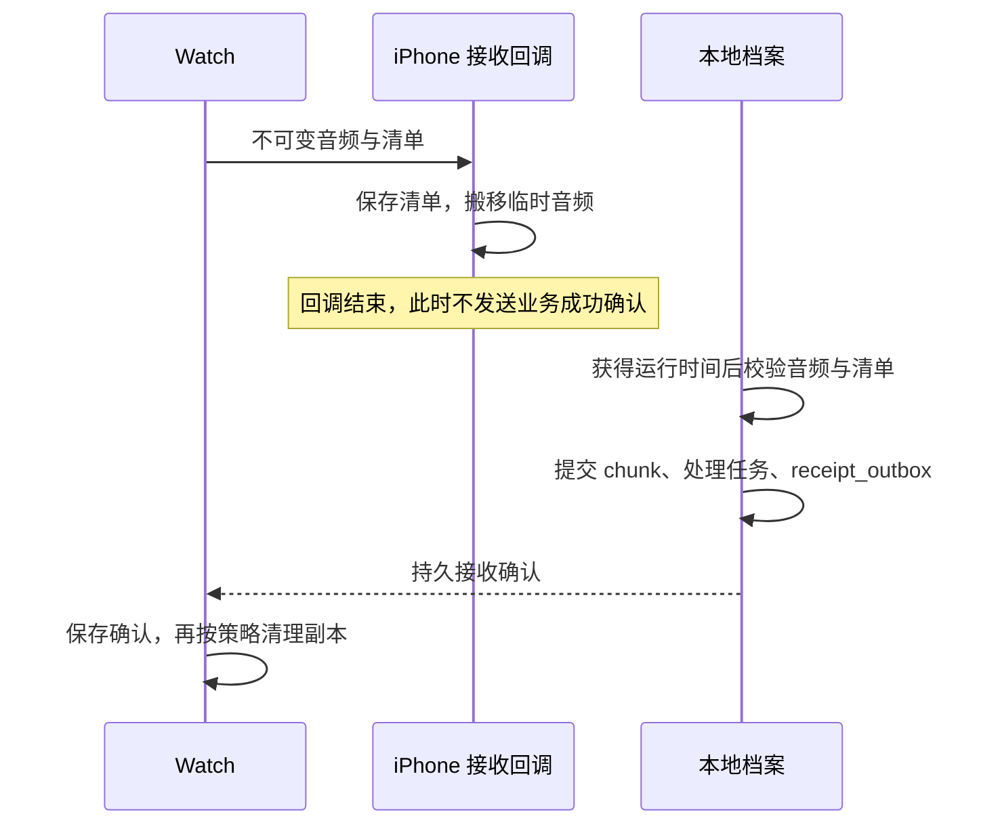
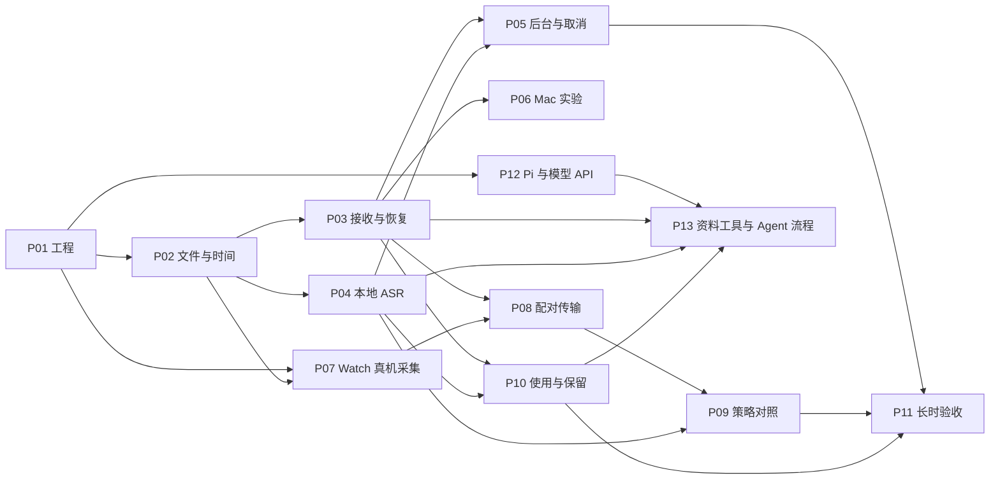

# MoMo Agent v0.1 详细开发与验收计划

日期：2026-10-13，进度更新于 2026-10-14。状态：实施中，实际进度见[实施记录](../implementation/status.md)。本文将已讨论的技术方案拆成接口、持久化规则、开发任务和验收条件。已有 iPhone 17 Pro 模拟器结果，尚无 SE2 或 iPhone 真机运行成绩。

[产品与技术方案](v0.1-plan.md)负责说明范围、架构和候选取舍；本文负责具体实施顺序与契约；[验证计划](device-validation.md)保存测试编号与操作条件。开发时同时更新三者，不能只修改一份文档中的默认参数。

具体代码位置、target 依赖、装配与状态所有权以[代码组织方案](code-organization.md)为准。

跨模块完整验收采用 [E2E 测试总方案](e2e-test-plan.md)及 [J01～J28 用户旅程](e2e-scenarios.md)。现有测试编号保持不变；测试工程、质量基线和设备证据随 P01～P13 逐步落地。软件验证结果见实施记录，设备验收仍待执行。

## 1. 首版交付目标与当前条件

交付流程：用户在 Watch 开始录音，Watch 保存原音并自动传给配对 iPhone，手机离线转成中文，统一管理录音与转录资料。用户可以阅读、回听，也可以直接向手机 Agent 派活；Agent 自动获得近期上下文，按需搜索原稿并生成带出处的回答或计划。用户无需每天导出、搬文件或操作同步目录。

设备基线为 Apple Watch SE2 与 iPhone 17 Pro。每天 18 小时为采集目标；续航暂不作为选型门槛。采集始终由 Watch 完成。手机 Agent 以 pi / pi-durable 作为开发 Kit，iOS 接入路径为 PiDurableKit，文本模型通过外部 API 调用。已固定依赖版本，产品预设为阿里云百炼；正式 SDK 27 构建已通过。真实 OpenRouter 的 5 项上下文流程在 live04 direct 复跑通过，百炼服务仍待独立验收，不再将其他 Agent 框架作为并列选型。

本版不开发端侧文本模型。MCP、外部 Agent 插件、全天自主执行、自动写入系统提醒或日历、健康与位置、语义向量索引和云端档案仍不进入本版。录音、转写、搜索和回放可离线使用；Agent 推理需要联网，发送本轮所需的文字上下文。具体契约见第 14 节。

目前已有共享软件链路、双端应用源码和真实本地转写回放。用户暂时没有 Watch，当前选择先验证模拟器；本机 Xcode 已完成首次配置。共享包第 19 轮 189 项命名测试中 188 项通过，1 项真实百炼 API 因缺密钥跳过。`ios-build-29` 构建通过；iPhone 模拟器第 16 轮共 60 项，55 通过、5 项收费 Live Agent 测试跳过、0 失败，包含 ad-hoc 签名后的 Keychain 与 9 项回放验证。Release 第 8 轮构建与 10 项产物检查通过。具体范围、日志限制和独立真实模型结果见[实施记录](../implementation/status.md)。60 分钟公开朗读的 CER 基线为 8.9683%，尚未确定发布质量达标；4,320 个分片的单批 18 小时及三批各 18 小时等量存储检查通过。单文件中文错字仍有记录。

录音详情页新增[产品设计提案](recording-detail-product-design.md)，回应用户对当前页面难以理解的反馈：先展示正文，再提供回听和围绕该录音提问的入口，技术状态进入次级页面。这是待实施方案，UI 尚未改动。

持久冻结批次、后台系统入口、计划编辑删除、异常尾部协议、主动导出、容量诊断与 Watch 低空间暂停已实现并加入软件验证。显式设备对账、匹配重传修复和状态快照已接入，两端协议的软件验证见[对账实施说明](../implementation/device-reconciliation.md)。后台策略仍为 foregroundOnly；真机预算通过后才启用系统后台处理。真实时序崩溃注入和剩余质量分层仍待完成。无 Watch 阶段先交付软件原型与手机侧验证；Watch 后台采集、WatchConnectivity 和真实 18 小时覆盖留到配对设备阶段。

| 交付阶段 | 用户能看到的结果 | 通过条件 |
| --- | --- | --- |
| G0 工程准备 | Watch / iPhone 模拟器能启动空壳应用 | 构建可复现，目标平台和模型依赖明确 |
| G1 无 Watch 原型 | 固定测试音频变成可回放的文字 | 使用真实文件、SQLite 和本地模型，异常退出可恢复 |
| G2 手机处理验证 | 17 Pro 无外网转写，并可暂停后继续 | 有真实质量、内存、热状态和后台运行报告 |
| G3 配对设备闭环 | Watch 实际录音后自动出现在 iPhone | 原音完整，断连补齐，确认和删除规则正确 |
| G4 长时版本 | 日常开始、暂停、标记、查看、回放和清理 | 18 小时测试与多日积压结果满足第 12 节门槛 |
| G5 手机 Agent | 不重新复述背景即可询问近期交流、生成并保存计划 | pi 在 App 内调用真实模型 API 和本地工具，来源、取消、删除与恢复测试通过 |

Mac 直传作为 P06 独立实验，不阻塞 G1～G5。决定交付 Mac 版本前，再执行真实 Watch 的 HTTPS 和后台验证。G5 可先用固定资料与 iPhone 开发，不等待 G3 / G4 的 Watch 测试；完整版本仍须分别通过采集转写与 Agent 验收。

## 2. 第一个原型采用的参数

为避免开发时每处自行选参数，先采用下面的起点。配置随测试报告保存；改变参数即生成新的配置哈希。这些数值不是 Auday 的内部参数，也不是性能承诺。

| 项目 | 原型起点 | 后续对照 |
| --- | --- | --- |
| 工程支持起点 | iOS 18、watchOS 11；以实际 SDK 构建检查为准 | 新后台 API 单独检查版本与可用性 |
| 采集 API | AVAudioRecorder 做能力对照；AVAudioEngine 做连续分片原型 | 按 SE2 边界与中断测试选择 |
| 原音编码 | 单声道 AAC，目标 32 kbps；记录实际采样率与编码结果 | 48 / 64 kbps，不以请求参数当作实际结果 |
| 物理文件 | 60 秒封口一次；停止时封口尾段 | 30 秒 / 300 秒 |
| 提交传输 | 文件封口后进入可提交队列 | 15 分钟批次作为对照 |
| 采集缓冲 | 最多约 2 秒实际格式音频 | 测高负载；溢出记录缺口并显式处理 |
| 已登记文件传输 | 最多 4 个未完成的 WC 文件传输；其余留本地队列 | 测吞吐、等待与恢复，不无限入系统队列 |
| iPhone 识别 | SenseVoiceSmall INT8，CPU，单任务、2 线程 | 1 / 4 线程与其他模型 / 运行库 |
| 分析音频 | 16 kHz 单声道，按小窗口解码和转换 | 原始采集格式另外保存 |
| VAD | Silero；阈值 0.5、最短语音 250 ms、结束静音 500 ms | 对低声、远场与噪声调整；实际支持字段按固定版本核对 |
| 语音上下文 | 前后各最多 300 ms，并受相邻语音位置限制 | 比较边界漏字与重复，不直接套用全局字符串去重 |
| 连续语音上限 | 20 秒；强制切分初期不重叠 | 30 秒；测切词损失和最慢推理时间 |
| 恢复锚点 | 已检测到至少 1 秒连续静音、段落闭合且所需上下文已齐时建立 | 重启比较结果；未满足条件保留旧锚点 |
| 原音保留 | 初始 7 天，用户可保留指定录音 | 自动清理仍需满足处理覆盖与读取引用条件 |
| 识别结果 | 先做点段落回放 | 逐字高亮等待时间戳精度验证 |
| Agent Kit | pi-durable；通过 PiDurableKit 接入 iPhone | 固定可构建 commit，验证桥接、恢复与删除能力 |
| Agent 文本模型 | 手机直连可配置 HTTPS API；使用用户密钥；当前默认阿里云百炼北京按量接口 qwen-plus | 真实验证模型的中文、流式工具调用和来源计划 |

模型从 sherpa 官方 SenseVoice INT8 示例产物起步。现有调研中的 sherpa v1.13.8 仅是候选版本；P01 必须固定实际可构建的 tag / commit、ORT、权重与许可证，再登记为本项目基线。不得把“官网最新”作为不可复现的依赖配置。[sherpa iOS 文档](https://k2-fsa.github.io/sherpa/onnx/ios/index.html)、[SenseVoice 示例](https://k2-fsa.github.io/sherpa/onnx/sense-voice/pretrained.html)

## 3. 工程结构与职责

使用一个 Xcode 工程、一个本地 Swift Package 和六个业务模块；两端 App 按功能组织界面与平台入口。以下为目录概览，完整结构与依赖见[代码组织方案](code-organization.md)。应用与六模块已创建，当前实现与验证状态见[实施记录](../implementation/status.md)。

```text
MoMoAgent.xcodeproj
Apps/WatchApp/                Watch 装配、平台入口、录音与传输状态页面
Apps/iPhoneApp/               手机装配、跨模块协调、资料与助理页面
Packages/MoMoAgentKit/
  Sources/MoMoContracts/       稳定 ID、音频时间和传输契约
  Sources/MoMoRecording/       采集流程、封口、Watch 账本与恢复
  Sources/MoMoLink/            平台通信，不拥有业务数据库
  Sources/MoMoArchive/         手机档案、正文、投影、检索与计划
  Sources/MoMoSpeech/          音频分析与 sherpa / ORT 适配
  Sources/MoMoAgent/           Pi Kit、上下文、工具与模型 API 配置
Tools/CaptureReplay/          固定音频输入、速率控制、故障注入
Experiments/MacReceiver/      可选 HTTPS 接收端
Tests/                       跨模块、真机与 UI 验证
docs/plan/                   产品、技术、代码组织与验收方案
docs/research/               调研来源与推断
docs/design/                 界面参考
docs/adr/                    后续架构决定
```

| 所有者 | 输入 | 输出与边界 |
| --- | --- | --- |
| CaptureController | 用户意图、系统事件 | 实际采集状态、格式与音频块；不等待网络 |
| SegmentWriter | 有序音频块 | 不可变音频文件及清单；不在采集回调内编码、查库或发网络 |
| TransferCoordinator | 封口文件、持久确认 | 传输任务与本地确认记录；不替 ASR 判断完成 |
| InboxReceiver | 传入文件及 metadata | 可恢复收件目录；回调结束前完成必要文件操作 |
| ArchiveStore | 清单、校验结果、删除请求 | 短事务、档案记录、任务与确认待发项 |
| AnalysisCoordinator | 连续音频范围 | VAD 窗口、已分析覆盖、恢复锚点 |
| ASRWorker | 已持久保存的窗口 | 识别结果与完成覆盖；同一时间只运行一个原生推理 |
| BackgroundCoordinator | 前台、系统任务、用户继续处理 | 统一调用任务执行者，管理取消与系统收尾 |
| AgentService | 用户任务、pi 会话、模型 API | 单一持有 pi harness，管理网络请求、取消与恢复；不承担 ASR |
| ContextService / ArchiveTools | 资料版本、搜索条件、读取范围 | 有界上下文与带来源的文字；读取经 ArchiveStore 校验，写入仅限计划目录 |

上表是业务职责，不是一行对应一个 target。职责分配到六个模块及 App 协调器；Watch 只链接 Contracts、Recording、Link，Pi 和原生 ASR 不进入 Watch。Speech 不拥有 Archive 数据库，Phone 协调器负责领取与提交；Agent 经 Archive 读取当前资料。Swift 数据协议使用 Codable，不主动增加 C++ JSON 依赖。

## 4. Watch 采集实现

### 4.1 用户意图与采集事实分开

保存 `user_intent = recording / paused / stopped`。实际状态单独为 `idle / starting / recording / interrupted / stopping / stopped / failed`。

| 事件 | 处理动作 | 对外状态 |
| --- | --- | --- |
| 用户开始 | 申请权限、检查空间、配置会话、启动采集 | 收到第一批有效采样前显示启动中 |
| 收到音频块 | 更新最后采样单调时间和累计帧数，交给有界缓冲 | 此时才确认录音中；低能量不等于故障 |
| 用户暂停 | 先更新意图，再结束当前采集段并封口 | 已暂停，不被系统恢复事件重新启动 |
| 用户停止 | 停止采集、封口尾段、持久记录 session 结束 | 停止录音；待传文件继续保留 |
| 中断开始 | 保存最后确认采样位置、中断类型与时间 | 已中断，不继续增长已保存时长 |
| 中断结束 | 检查意图、系统恢复条件、路由、权限和空间 | 成功收到采样后恢复；否则给出重新开始入口 |
| 输入格式或媒体服务重置 | 结束当前采样段，重建会话与格式 | 新建 capture epoch，保留缺口或不确定范围 |
| 进程重新启动 | 扫描文件与上次状态，标记未能确认的尾段 | 不把上次录音意图当作当前已开始录音 |

`session_id` 表示用户发起的一次录音；`capture_epoch_id` 表示其中一个连续采样段。中断恢复后生成新 epoch。每个 epoch 保存原始帧时间基准、墙钟锚点和时区；时长按帧与单调时钟核对。

### 4.2 文件封口协议

每个 chunk 使用本机生成的 UUID。先在 `CaptureWorking/<chunk_id>/` 写草稿清单和音频；编码完成后关闭文件，记录实际字节数、哈希、帧范围和编码延迟信息，生成最终清单，再在同一卷内把目录改名到 `CaptureReady/<chunk_id>/`。

转移到 Ready 只说明文件已封口。数据库索引可由最终清单恢复；音频本身不能推导出 session、帧位置与采集时钟。工作目录内未封口的文件只做实际可解码范围恢复，不能补造缺失声音。

文件轮换保持采集会话运行。编码器与容器的首尾 padding 需要写入映射或由验证得到；“两个文件都能播放”不足以证明连接处无缺口。采集回调不能等待前一个文件封口。

### 4.3 录音期间必须记录的诊断

记录实际输入路由、实际格式、最近采样、累计帧数、最后封口、缓冲峰值、写入错误、空间不足和中断事件。诊断默认不保存文字或音频内容。

通知、触觉反馈、Siri、来电和耳机路由进入独立对照。`setAllowHapticsAndSystemSoundsDuringRecording` 只是一项候选配置，不能据此保证所有提醒出现或录音不受影响。[Apple 音频中断](https://developer.apple.com/documentation/avfaudio/handling-audio-interruptions)、[触觉反馈接口](https://developer.apple.com/documentation/avfaudio/avaudiosession/setallowhapticsandsystemsoundsduringrecording(_:))

## 5. 传输协议与接收确认

### 5.1 连接生命周期

双端启动时保留 WCSession delegate 并执行激活。只有会话已激活才提交文件；`isReachable` 仅约束即时消息，不能被用来禁止所有后台文件排队。iPhone 处理 inactive / deactivate，并按系统要求重新激活。

重启后先核对 `outstandingFileTransfers` 与本地清单，避免把同一个文件反复登记。待传音频以本地数据库为真源，系统传输对象只是当前运输状态。[激活](https://developer.apple.com/documentation/watchconnectivity/wcsession/activate())、[重新激活](https://developer.apple.com/documentation/watchconnectivity/wcsessiondelegate/sessiondiddeactivate(_:))

### 5.2 最小消息类型

| 类型 | 通道 | 必须包含 |
| --- | --- | --- |
| AudioFile | `transferFile` | 音频文件、清单 JSON 的 Data、协议版本、发送设备和文件 ID |
| Receipt | `transferUserInfo` | 接收端、库实例、chunk ID、音频哈希、清单哈希、表示类型 |
| ReceiptApplied | `transferUserInfo` | Watch 已持久保存的 receipt 身份；用于手机自动保留策略 |
| CaptureEvent / Mark | `transferUserInfo` | 事件 ID、session / epoch、事件序号、源时间位置 |
| DeleteSession | `transferUserInfo` | 删除 ID、session、删除代次、作用范围 |
| DeleteApplied | `transferUserInfo` | 删除 ID、已持久执行的对端设备 |
| ReconcileRequest / Response | 有运行机会时使用持久消息；可达时即时查询 | 有界文件 ID 列表、每项接收状态与有效确认 |
| StatusSnapshot | `updateApplicationContext` | 状态版本、来源构建、采样与队列摘要、更新时间 |

metadata 外层只使用 property-list 兼容类型。我们自己的控制消息初始限制为每批最多 32 项、编码后最多 16 KiB，超出则分批；这是应用预算，不是 Apple 的接口上限。状态快照可以覆盖，事件和确认必须可恢复。[文件接口](https://developer.apple.com/documentation/watchconnectivity/wcsession/transferfile(_:metadata:))

每条持久控制消息有稳定 `message_id`；重复接收先查处理记录。未知协议版本返回不兼容状态，不发送持久接收确认。传入标识和路径必须校验，不能直接把任意 metadata 字符串拼成文件路径。

### 5.3 文件清单

清单采用版本化 JSON。最低字段如下：

| 字段组 | 字段与约束 |
| --- | --- |
| 身份 | `manifest_version`、`source_device_id`、`source_build`、`session_id`、`capture_epoch_id`、`chunk_id` |
| 采集位置 | `sequence`、`start_frame`、`frame_count`、`timebase_hz`；帧范围为半开区间 |
| 日期 | `wall_clock_anchor`、`timezone_offset`；时钟变化用新锚点表示 |
| 格式 | `codec`、`sample_rate`、`channels`、`decoded_frame_count`；记录已知的 priming / padding |
| 校验 | `byte_count`、`sha256`、`sealed_at`；仅对最终不可变音频计算 |
| 表示 | `representation_kind`、`source_ranges`；首版只接受 `full` 为完整原音 |

传输保存最终清单的原始 UTF-8 字节，并对这些字节计算 `manifest_sha256`；哈希放在外层 envelope，不放回被哈希的对象。重传沿用相同字节，避免 JSON 重排导致内容身份漂移。

### 5.4 接收事务与持久待发确认



回调内先用本机随机收件 ID 建目录、保存已通过基本格式检查的清单，再同步搬移临时音频。两项完成后才能返回。若清单落盘后音频搬移失败，留下待修复收件，不确认成功。Apple 会清理未及时搬走的临时文件。[接收回调](https://developer.apple.com/documentation/watchconnectivity/wcsessiondelegate/session(_:didreceive:))

回调外的校验也是持久任务，不能假定普通异步任务在回调返回后必然获得运行时间。校验成功后，一个短事务提交 chunk、分析任务与 `receipt_outbox`；事务结束后再发确认。确认发送失败不撤销接收事实，重启可以补发。

同 ID、同内容重复到达，查已有状态并补确认；同 ID、不同哈希进入冲突，禁止覆盖。原音和清单必须均可找到，才能重发成功确认。接收库重建或恢复到旧备份后使用新 `library_instance_id`。

Watch 在一个短事务中保存有效 Receipt 与 ReceiptApplied 待发记录，之后即可清理已确认副本。ReceiptApplied 可重发，清理音频不清理控制记录；iPhone 幂等保存它，不增加下一层确认。若未送达，通过后续对账补发。手机自动清理原音前需要收到它，避免 Watch 尚未记录确认，手机就先按保留期删除了唯一已接收副本。此条件不限制用户明确删除。

对账实现每页最多 16 个完整文件身份，给响应中的完整回执保留空间，仍受 16 KiB 外层预算限制。手机每次重放成功响应前重新核对原音与清单。Watch 收到 missing、unknown、conflict 或 expired 后保存独立回执屏障，迟到的旧普通回执不能授权清理；只有后续新请求的有效 received 响应能解除。原音仍保留时可重传修复缺失文件，用户删除的整个目录仍需预览确认恢复。具体状态、重试和验证见[实施说明](../implementation/device-reconciliation.md)。

### 5.5 Watch 后台收尾

实现 `WKApplicationDelegate.handle(_:)` 中的连接刷新任务处理。对每个 `WKWatchConnectivityRefreshBackgroundTask` 保留明确状态，在本次消息处理结束、会话条件满足且无当前待收内容时恰好完成一次。不等待未来连接，不等待 ASR。

Apple 的示例明确指出未完成的后台任务会消耗预算；Xcode 调试也会影响系统挂起。因此后台验收必须脱离调试器，从设备正常入口启动，再读取持久日志。[WatchConnectivity 官方示例](https://developer.apple.com/documentation/watchconnectivity/transferring-data-with-watch-connectivity)

## 6. SQLite 与文件生命周期

### 6.1 最小数据模型

Watch 保存采集、文件、待传和确认所需的子集；iPhone 保存完整档案与分析表。SQLite migration 从版本 1 开始，开启外键，写入串行化。事务外只携带普通数据，不持有游标进入网络或推理。

| 表 / 实体 | 必要字段与约束 |
| --- | --- |
| `sessions` | 主键 session ID、来源设备、用户意图、实际状态、`content_generation`、`deleted_at` |
| `capture_epochs` | epoch ID、session 外键、时间基准、墙钟锚点、已确认尾位置与结束原因 |
| `chunks` | chunk ID、epoch、帧范围、两项哈希、表示类型、相对路径；保留状态为 present / expiry_pending / expired / missing_unexpected；同 ID 内容不可变 |
| `capture_events` | event ID 唯一、来源事件序号、类型、时间与结构化原因；事件不依赖文件先到达 |
| `receipts` / `receipt_outbox` | 绑定接收库与完整文件身份；档案提交时同时登记待发确认 |
| `analysis_cursors` | epoch、模型 / 配置、最后持久恢复锚点、`replay_floor_frame`、已登记窗口覆盖 |
| `analysis_windows` | 稳定 window ID、核心范围、上下文范围、输入清单哈希、模型与配置哈希、状态 |
| `transcription_jobs` | window 外键、`attempt_id`、`expected_generation`、状态、错误码、取消原因 |
| `transcript_spans` | window / 结果版本唯一、原始结果、展示文字、真实可用的时间信息 |
| `marks` | mark ID 唯一、session / epoch、采集位置；录音保留开关另设字段 |
| `deletions` / `control_outbox` | delete ID、session、代次、对端执行状态；首版删除标记不自动过期 |

用户时刻标记与“长期保留这次录音”是两个不同动作。时刻标记本身不使整天原音永久免于清理，避免无意中取消保留策略。

### 6.2 首版删除单位与并发规则

首版允许删除整次 recording session，或按保留策略仅清理其原音；暂不实现任意时间段音频裁剪。删除整次录音时，先在短事务中递增 `content_generation`、写删除标记、使旧任务失效并登记对端删除消息，随后取消计算和清理音频、文字及缓存。

ASR 领取任务时记录 `expected_generation` 和新 `attempt_id`。提交结果时，事务内重新检查 session 未删除、代次一致、attempt 仍有效、输入版本一致。任何条件不符，丢弃迟到结果。仅调用取消不能保证内容不复活。

删除标记覆盖同一 session 尚未传来的文件。删除时正在收件的音频先进入暂存区，最终接收事务仍检查删除代次。已完成删除的对象到达时，只回复删除状态，不重新建档案。

删除当前还在录制的 session 时，手机明确显示对端处理状态。Watch 收到 DeleteSession 后先持久记录删除，再停止该 session 的采集和写入、取消待传项并清理本机内容，最后回复 DeleteApplied。已经交给系统的文件仍可能到达，手机继续拒收。Watch 离线期间不能保证立刻停止；用户再次开始采用新 session ID，旧回调不能写入新 session。

### 6.3 自动清理与恢复扫描

自动清理需要同时满足：超过保留期、未被用户固定保留、已收到 ReceiptApplied、对应完整有效范围已完成分析与转写流程、没有活动读取者或尚需原音的任务。`replay_floor_frame` 到当前分析尾部的原音也属于恢复所需输入，锚点未推进前不能清理。`no_speech_detected` 是带版本和覆盖范围的分析结果，不能伪装成不存在音频。

自动清理前将原音状态改为 `expiry_pending`，确认没有活动读取者后移除文件，再提交 `expired`。整次录音的明确删除使用第 6.2 节的删除记录跟踪。重启后重复清理必须安全。SQLite 记录、实际文件和待发消息分别对账；磁盘空间不足时停止接收确认或新采集，不能删未确认 Watch 文件或未处理 iPhone 原音。

恢复扫描分批执行，优先处理收件目录和上次运行中的任务。没有清单的孤立音频进入待修复目录，不能猜测归属。已确认对象的文件丢失要显示档案损坏并停止重复确认；有残留 Watch 副本时可请求修复，否则如实显示丢失。

正常按策略过期的文件标为 `expired`，区别于意外缺失 `missing_unexpected`。已过期原音的迟到重传不自动恢复文件，只返回明确的过期状态；不能把“曾经收到过”重新描述为“当前仍持久保存”。

## 7. iPhone 转写与恢复

### 7.1 模型包与输入验证

一套模型包同时固定 ASR 权重、tokens、VAD 权重、输入采样率、语言与 ITN 设置、sherpa / ORT 构建和许可证。包 ID 由各文件哈希与配置决定。只有权重、tokens 和运行库通过同一组短样本，才标为可用。

首版随 App 提供一套模型，避免核心流程依赖首次外网下载。若测试独立下载，先下载到暂存目录，校验全部文件后原子切换，失败保留旧包。手机后台不自动替换正在使用的模型包。

首轮分别报告纯识别结果和开启 ITN 的结果。展示层保留原始结果；无法获得格式化前完整文字时，保存该构建提供的 token 与原始输出，不虚构两份结果。

### 7.2 跨文件分析

解码器按 epoch 内连续帧范围读取，只对已持久校验的完整原音推进。物理文件结束不等于说话结束：保留重采样器、VAD 状态、不满分析帧的尾部及尚未闭合语音。

右侧文件先到达而左侧缺失时，登记等待范围，不补零。收到明确的采集缺口或 epoch 结束事件时，才关闭当前分析段。普通传输等待不能被解释成结束。

Silero 本身维护状态；首次接入要核对固定模型所需分析帧长度，不能把任意长度 PCM 直接当作一帧。[Silero 实现](https://github.com/snakers4/silero-vad/blob/master/src/silero_vad/utils_vad.py)

### 7.3 窗口归属、重复与长语音

每个 VAD 语音段生成稳定的核心采集范围；前后静音上下文另存。相邻段间静音不足两侧 padding 时，在静音中点收缩，避免把同一段语音放入两个最终结果。

超过 20 秒的连续语音按固定规则切成不重叠窗口，单独测试切词损失，再比较 30 秒上限。首版不依赖尚未验证的逐字时间裁剪，也不按文本相似度删除重复内容：用户确实可能连续说两次相同短句。

window ID 由 session / epoch、核心与上下文范围、实际输入清单哈希、分析规则版本、模型及参数哈希生成。预览音频与完整音频必须产生不同输入身份。只有完整原音结果可贡献首版最终处理覆盖。

### 7.4 VAD 恢复锚点

不尝试序列化未公开的内部模型状态。先采用以下可重放协议：

1. 持续处理，直到 VAD 判定的静音达到阈值，语音段已闭合，所需右侧上下文已读到。
2. 将该点之前的全部窗口及无语音分析覆盖持久登记；ASR 可以尚未运行。
3. 在同一短事务中保存锚点的确切源帧位置与规则版本。
4. 正常运行也在该锚点按固定规则 reset VAD 和重采样器，再处理后续原音。
5. 进程恢复后从最近锚点按同一解码与 reset 规则重放；已登记窗口与已提交结果按 ID 去重。

未闭合语音不推进恢复锚点。重采样输入与输出位置的取整、AAC priming / padding 和短尾帧处理必须固定，并通过不中断与恢复对照验证。只有 VAD 判定静音，不代表已经排除低声讲话，因此原音继续保留。

长时间无可用静音锚点时，允许最坏从当前 epoch 起点流式重放 VAD，已完成 ASR 窗口不重复识别。报告重放成本；如果反复后台到期导致无法推进，就不能通过后台处理验收。届时评估有界分析块或可持久模型状态，并记录对边界结果的影响。

### 7.5 原生推理取消

前台、后台和用户重试共用一个原生执行者。取消后立即停止领取新窗口，使本次 attempt 失效。底层推理返回后重新检查 attempt 和内容代次，再决定是否提交；原生调用返回前不释放 recognizer 或输入内存。

Swift `Task.cancel()` 不保证停止同步 C++ 推理。调研时 sherpa master 的 SenseVoice 推理没有直接提供可用的 Swift 取消入口；ORT 有终止接口也不代表当前封装已暴露它。P04 要核对所选 tag，再决定使用有界窗口还是补齐运行库取消。[sherpa 推理实现](https://github.com/k2-fsa/sherpa-onnx/blob/master/sherpa-onnx/csrc/offline-sense-voice-model.cc)、[ORT RunOptions](https://onnxruntime.ai/docs/api/c/struct_ort_1_1_run_options.html)

系统到期回调中不能等待未知时长的原生调用。实测最慢窗口、取消残留计算时间和系统收尾；无法及时停止的构建先限制为前台转写，后台方案继续验证，不把逻辑取消描述成计算已经结束。

## 8. 手机后台调度

| 入口 | 允许的工作 | 收尾 |
| --- | --- | --- |
| 前台打开 | 有限并发处理待接收校验、分析和 ASR | 前后台变化走统一执行者 |
| WC 文件接收 | 保存清单、搬移文件、登记可恢复收件 | 不在回调内跑整段 ASR |
| BGProcessingTask | 系统给予时间时处理队列 | 到期停止领取、使 attempt 失效、完成系统任务 |
| 用户继续处理 | 固定一批输入，在系统支持时申请 Continued Processing | 展示持久进度，用户可取消 |
| 强退或重启后 | 根据数据库恢复任务 | 不依赖一定会执行的结束回调 |

用户点击继续转写时，只冻结已经准备好的闭合语音窗口和已确认无语音覆盖。尚未完成分段的音频显示准备中；未闭合语音和缺右侧上下文的尾段留给后续批次，不能把批次边界当作采集结束。之后收到的音频进入下一批，进度分母不会持续增长。进度按持久完成的音频区间并集计算，不按文件数或文字条数；本批完成不等于全天全部音频已处理。

前台和普通 BGProcessingTask 可推进收件校验与分段准备。界面显示当前可转写量；没有待识别的闭合窗口时，不创建空的 Continued Processing 批次。无语音分析覆盖由分析任务直接提交。

App 内用户主动取消时记录明确意图，等待用户再次继续。系统的 expiration 回调也可能来自系统界面的用户取消；接口无法区分时记为 `system_ended_unknown`，保留进度，不自行推断原因或立即循环重启。没有运行机会时显示待处理，保持原音。`BGContinuedProcessingTask` 只在支持的系统、由用户操作发起；旧系统保留前台和可用的系统后台处理。[Apple 长任务说明](https://developer.apple.com/documentation/backgroundtasks/performing-long-running-tasks-on-ios-and-ipados)、[到期处理](https://developer.apple.com/documentation/backgroundtasks/bgtask/expirationhandler)

App 内取消以及 Continued Processing 原因未知的结束，均使对应批次进入 `paused`；前台自动处理和 BGProcessingTask 也不能领取这些窗口，直到用户继续。普通 BGProcessingTask 的系统到期按该入口的恢复规则重调度，不把它误记成已知用户取消。

CPU 基线不申请后台 GPU / ANE 能力。实际获得的后台时长、处理量和残余队列进入每日报告；不能只凭一次快速识别就宣布可全天后台处理。

## 9. 用户流程与本地数据边界

本节定义状态与操作，不指定视觉样式。实际 UI 设计另按项目适用设计规范执行。

| 位置 | 必须显示 | 用户操作 |
| --- | --- | --- |
| Watch 录音页 | 真实录音状态、已保存时长、待传时长、必要的中断 / 空间提示 | 开始、暂停、继续、停止、时刻标记 |
| iPhone 今日页 | 最近一次 Watch 状态时间、已接收与已处理覆盖、队列状态 | 查看当天录音、继续处理 |
| 录音详情 | 分段文字、采集缺口、未收到 / 待处理 / 无语音判定的差别 | 点段落回放、查看标记、保留原音、删除整次录音 |
| 助理页 | 正在检索的资料、模型与网络状态、带出处的回答 | 派活、取消、继续任务、定位原文 |
| 计划页 | Agent 生成的本地计划及来源 | 查看、编辑、保存或删除计划 |
| 设置 | ASR 模型、Agent API 配置、空间与保留天数 | 配置 API、修改保留期、主动保存重要资料、查看诊断 |

手机不申请录音权限。原音、SQLite 及相关 WAL / SHM、清单与临时文件采用一致的保护与备份策略。首轮测试使用首次解锁后可供后台访问的候选保护级别，验证锁屏与重启后未解锁的差别。

默认不使用 iCloud 档案同步；明确设置系统备份排除属性，并检查临时目录、数据库附属文件与导出文件。提供用户主动保存重要音频及文字的入口，但不把导出作为每天使用产品的步骤。整库加密备份与跨设备自动同步仍为后续范围。

原音和转录档案留在手机。Agent 请求会将用户消息、近期上下文及工具读取的必要文字发送给所选模型 API；不自动上传音频或整库。对外描述为“本地录音与转写，Agent 联网推理”，不宣称整个产品完全离线。

国内使用验证覆盖：无外网但保留配对通信、中文与中英混说、全新安装已有模型、系统语言中文、模型包完整性。随 App 交付权重时记录各自许可与 NOTICE；源码开源与模型权重许可分开说明，不能将所有组件笼统声明为同一许可证。

## 10. 开发任务与依赖

保留 P01～P11 的采集转写工作包，新增 P12～P13 实现手机 Agent。每个工作包完成后记录实现 commit、参数、测试证据和剩余问题；当前状态集中维护在实施记录。测试编号涉及 Watch 行为时，前期只完成软件故障注入，真机结论留到 P07 / P08，不因软件验证通过而提前关闭。



### P01：工程与可复现依赖

- 安装并选择完整 Xcode，准备 iOS / watchOS runtime；记录实际版本与平台 SDK。
- 创建两端 target 与本地 Package，配置 companion 标识、签名与所需能力；无需的 App Group、HealthKit、定位、后台 GPU 不引入。
- 按代码组织方案定义六个业务产品和两端依赖，建立 Composition / Runtime 与结构检查；验证 Watch 未链接 Pi 或 ASR。
- 固定 sherpa / ORT 和模型包；确认 iPhone 真机、Apple Silicon 模拟器的构建产物；Watch 不链接 ASR。
- 将可公开短样本与人工答案纳入测试输入，私人录音保持在仓库外。
- 交付：构建步骤、依赖与模型清单、最小工程。验收：S01；损坏权重或不匹配 tokens 不被标记为模型可用。

### P02：时间、分片与测试输入

- 实现 session / epoch / chunk / event 契约与配置哈希。
- 实现 CaptureReplay 的按实际时间和加速两种模式，均显式标记 `fixture` 来源。
- 已验证：65.25 秒实时 AAC、20 倍 AAC/PCM 均保存 1,044,000 帧，60 秒分片及 5.25 秒尾段准确；源流哈希一致，PCM 重开解码一致。SIGTERM 保留采样前缀与缺失范围，退出 143；`verify-storage` 11 项通过。入口与边界见 [CaptureReplay](../../Tools/CaptureReplay/README.md)。18 小时实时模式尚未运行。
- 实现工作目录、草稿 / 最终清单、封口、Ready 目录及启动扫描。
- 实现缓冲上限、实际采样范围、跨文件映射、时刻标记与时钟变化处理。
- 交付：固定输入分片产物与边界报告。验收：S02、S03、S06；同输入和配置可重建相同范围，已封口文件不因尾段损坏而失效。

### P03：收件、档案、确认和删除

- 建立 SQLite migration、InboxReceiver 和 ArchiveStore，使用真实文件与 SQLite 测恢复。
- 实现清单落盘、音频搬移、可恢复校验、档案提交与 receipt outbox。
- 实现重复 / 冲突判断、接收库实例、控制消息去重和有界对账。
- 实现 session 删除代次、迟到写入拒绝、删除待发与文件清理恢复。
- 交付：接收协议与故障报告。验收：S03～S04、F01～F05、F08、F15～F18；没有可验证完整文件时不生成有效接收确认。

### P04：本地 ASR 与可恢复分析

- 先在 Mac 固定输入上验证真实模型，再在 17 Pro 运行相同样本。
- 实现连续解码、跨物理文件 VAD、窗口登记与恢复锚点。
- 实现稳定输入身份、单原生执行者、原始结果与回放范围；不以字符串相似度消除重复。
- 核查原生取消能力，测试最长窗口与热状态下耗时；保持推理句柄生命周期。
- 交付：模型清单、90 分钟质量集报告和断点对照。无 Watch 时先使用可公开样本，腕部集到 P07 补齐。验收：S05、F06、F09～F12，以及 T 系列相关项目。

### P05：后台与取消

- 前台与所有后台入口共用队列执行者，消除重复领取。
- 实现系统到期、App 内用户取消和原因未知的系统结束；每个系统任务恰好收尾一次。
- Continued Processing 固定已准备好的闭合窗口与进度；未闭合尾段和后来收件进入后续批次。
- 测强退、锁屏、未首次解锁、推理迟到返回和模型不可用；记录实际运行时间。
- 交付：真机后台报告及明确可用范围。验收：T01～T10 中相关项、F05、F09、F13～F14；不满足原生取消要求时，明确保持前台模式并保留后台阻塞项。

### P06：Mac 直传独立实验

- 复用 chunk、清单、接收库与确认规则，实现局域网 HTTPS 接收。
- 实现一次可信配对、证书 / 公钥验证与本机凭据保存。
- 用 Mac / 模拟器测试发送端验证真实上传、重试、休眠和接收库重建。
- Watch 到手后再验证真实 HTTPS 与后台网络；记录是否借助 iPhone 网络代理。
- 交付：C01～C07 报告。BLE 的 C08 后置；实验成功也不自动把 Mac 加入首版产品发布范围。

### P07：SE2 采集

- 分别运行 AVAudioRecorder 与连续分片原型，记录实际音频格式和所有能力配置。
- 使用编号声源检查真实音频，测试手腕放下、返回表盘、切 App、系统提醒、Siri、来电与路由变化。
- 比较 30 / 60 / 300 秒文件与 32 / 48 / 64 kbps；优先按单变量实验排除问题，不一次跑完所有组合。
- 录制腕部中文质量集，覆盖距离、走路、衣袖、低声和多人环境。
- 交付：采集 API 决策、编码配置与腕部样本标注。验收：R01～R08、R17～R19。后台结果必须脱离调试器取得。

### P08：WatchConnectivity 真机闭环

- 接入双端会话激活、变化、待传对账和确认持久化。
- 实现 Watch 连接刷新任务的完成条件，检查所有退出路径。
- 分别测试断连两小时、双端退出、确认丢失、空间不足及双端不同构建版本。
- 在 iPhone 到达时验证原音，ASR 完成后再验证文字，两类结果独立记录。
- 交付：配对链路报告。验收：R09～R15、R19、F01～F08、F13；最终每个已封口文件均有明确去向。

### P09：录音策略对照

- R-A 作为完整保存的基线。
- R-B 先验证即时通道在目标状态下是否可达，再投入实时路径；失败时原音仍按文件补传。
- R-D 先验证 Watch 上 VAD 成本与漏检，再测试人声优先队列、完整文件公平调度和最终覆盖。
- 固定编码和 ASR 比较 X01～X05；仅当质量收益或延迟收益有证据时改变默认。
- R-C、R-E、R-F 及确定静音省略后置，分别按 X06～X08、S08 执行；不要求所有实验都实现才交付 R-A。
- 交付：一页默认策略决策、原始指标及未解决问题。某个候选失败不使已通过的 R-A 失效。

### P10：使用流程与原音保留

- 接入第 9 节所列开始、暂停、继续、停止、标记、阅读和点段回放。
- 显示三个独立覆盖值，以及离线状态的更新时间。
- 实现原音保留期、固定保留、明确删除与原音已清理的回放状态。
- 验证无语音、未接收、转写失败、缺口与已删除内容不会混为同一种空白状态。
- 交付：资料阅读与保留流程、容量说明和主动保存入口。验收：R04、R15、R20、T07～T09 和 F05；助理与计划页由 P13 接入同一资料服务。

### P11：采集转写长时验收

- 先运行 18 小时等量数据测试，再做脱离调试器的真实 SE2 长时录音。
- 长时测试分别安排连续采集场景和含断连 / 中断的场景；两种报告不能互相代替。
- 连续三天输入每天 18 小时等量音频，按真实手机使用节奏记录处理与积压；腕部日常集另报告识别质量。
- 执行删除竞态、低空间、断网和恢复回归，生成构建对应的验收记录。
- 交付：第 12 节门槛表及明确通过 / 失败项。TestFlight / App Store 提交属于后续发布动作，不因写完本计划而自动执行。

### P12：Pi Agent Kit 与模型 API

- 使用 pi-durable 作为 Agent Kit，通过 PiDurableKit 接入 Swift；固定上游、适配层 commit 与依赖。先验证 iOS 构建，适配问题通过修复或维护桥接解决，不自行换成另一套 Agent 底座。
- App 内由一个 AgentService 持有 harness；恢复前装入同一组工具。pi 管理 Agent 循环和持久执行状态，应用负责 iOS 生命周期、资料和网络策略。
- 配置 provider、HTTPS base URL、模型 ID 与协议；原型使用用户提供的密钥并存入 Keychain，不内置共享密钥，不增加自建中转服务。
- 验证真实模型的中文、完整流式工具参数、工具结果回传和多步推理。设置请求、空闲等待、轮次和输出上限。
- 当前证据：iPhone 模拟器通过 OpenRouter 的 `anthropic/claude-sonnet-4.6` 执行 5 项真实上下文流程；模拟器真实 Keychain 写入、重开取钥及生产请求鉴权头由本地传输探针验证。百炼及 iPhone 真机分别待验收。
- live04 的 5/5 是自动断言结果。人工复核仍发现最终回答复述已取消地点/口令、完整读稿后误判截断并重复搜索；计划本体无旧值污染。两项仍需修复并验收，具体证据见[实施记录](../implementation/status.md)。
- 实现鉴权错误、限流、断网、有界重试和取消；旧 attempt 的迟到响应不得执行工具或写回结果。
- 交付：可运行的 Pi 手机原型、API 配置与实际调用报告。验收：A01～A02、A05、A09～A12；模型 API 已选定路线，具体提供方与模型仍由实测确定。

### P13：统一资料目录、上下文工具与 Agent 使用流程

- 建立第 14 节的手机资料目录和版本化正文投影，搜索与读文件复用 ArchiveStore；资料进入目录无需用户手动导入。
- 实现近期上下文注入、中文搜索、分页读稿、定位回放和保存计划；所有回答及计划保留来源引用。
- 接入助理、资料与计划入口，完成“把刚才谈的事整理成明天的计划”的真实流程；暂不增加系统日历、提醒与外部通信动作。
- 实现文件修改 / 删除后的索引刷新、会话资料引用失效和派生内容清理；Pi 历史删除能力不足时先修复该能力，不能略过验收。
- 验证与 ASR 同时运行、模型不可用和无网络时的基础功能；Agent 不阻塞收件、确认与原音保存。
- 交付：G5 手机 Agent 闭环和所有 A 系列结果。验收：A03～A12；可先用授权测试稿开发，正式连通 P04 后再验证自动转写到 Agent 的更新。

## 11. 故障验证如何执行

使用真实文件系统、SQLite 和模型。测试工具在明确的持久化边界终止自身或被测试进程；不通过只改变内存中的“成功”变量来模拟已经落盘。

每个故障点至少执行一次正常路径及一次中止恢复路径。恢复后核对文件与清单哈希、档案条数、有效任务数、删除状态、确认内容和实际音频范围。新故障用例 F01～F18 位于[验证计划第 9 节](device-validation.md#9-持久化分析恢复与后台收尾故障用例)。

涉及采集与传输的测试按层推进：固定音频 → 官方模拟器 → iPhone 真机 → 配对 Watch 真机。`transferFile` 不受模拟器支持。调试器连接状态必须写入报告；模拟器、注入中断与实际系统事件使用不同标签。[Apple 文件传输限制](https://developer.apple.com/documentation/watchconnectivity/wcsession/transferfile(_:metadata:))

每份结果记录：输入样本与授权、设备 / 系统、双端构建、模型与配置哈希、是否附加调试器、操作条件、期望结果、实际结果、日志路径、失败原因和下一步。运行日志默认只记录标识和统计量，不附私人音频正文。

## 12. 验收指标与停止条件

### 12.1 数据正确性门槛

这些条件不等待质量调参，出现违例即不能通过：

- 持久接收确认指向实际存在、哈希一致的完整音频及清单。
- 已封口文件不会因为重复、乱序、确认丢失或普通进程退出而永久丢失。
- 优先片段、预览或不完整表示不能授权清理完整原音。
- session 删除后，迟到文件、旧 ASR 结果与缓存不会使内容重新出现。
- 用户暂停不被自动恢复；录音状态与实际采样状态一致。
- 缺失区间与未知区间不被填成静音；用户可以看到采集覆盖的实际限制。
- 后台任务在允许的时间内收尾；过期 attempt 不提交结果；未解决的原生取消问题不得标成通过。

### 12.2 覆盖、延迟与性能口径

| 指标 | 计算方式 | 验收方式 |
| --- | --- | --- |
| 采集覆盖 | 实际可解码采集区间并集 / 用户要求录制的时间区间 | 用户主动暂停可扣除；系统中断仍计为缺口，不能从分母隐藏 |
| 传输完整性 | 每个完整 chunk 的有效确认与真实文件 | 已封口文件均有最终状态；失败、删除和未到达分别列出 |
| 处理覆盖 | 当前有效版本已完成分析与识别的核心区间并集 | 无语音判定计分析完成，缺文件不计完成；重叠不重复计时 |
| 到达 / 文字延迟 | 音频区间结束至持久接收 / 结果提交 | P50、P95、最大值和未完成项；跨设备时钟误差单列 |
| 端到端 RTF | 解码、VAD、ASR、保存和必要重放计算时间 / 同次计时实际完成的唯一核心输入时长 | 重放不重复计分母，未完成另列；冷启动另列，同时报告有效语音占比和模型 RTF |
| 内存 | 应用峰值、模型常驻、解码缓冲与长时增长 | 不随录音总时长持续线性增长；实际预算按真机结果固定 |
| 积压 | 每日新增、已处理、待处理、失败音频时长 | 在约定使用节奏下，连续三天不持续扩大未处理队列 |

18 小时连续场景中，实际采集不足 18 小时就报告实际值与原因，不写“已验证 18 小时”。系统中断场景另外验证可观察缺口、恢复和补传，不能仅凭恢复成功替代持续覆盖结果。

计算是否跟得上，要同时满足实际可用计算时间。例如端到端 RTF 若为 0.05，18 小时音频仍约需 54 分钟实际计算；这是公式示例，不是本机测量。只有 RTF 小于 1，不能证明手机日常后台机会够用。

### 12.3 质量门槛怎样确定

先使用约 90 分钟标注集建立基线：目标语音、无语音与电视 / 音乐 / 重叠语音分别统计。普通话 CER、人名 / 数字错误、低声漏检、无语音编造、边界遗漏与重复分别报告。

P04 完成后填写拟采用的质量与性能阈值；P07 用腕部集复核并固定发布阈值。任何调整必须记录采用理由。未测量前不写“中文最好”，也不让只提高速度而明显漏掉低声内容的配置自动胜出。

发布候选必须满足：数据正确性项目全部通过、18 小时目标有明确结论、实际使用节奏下积压可控制、质量阈值已填写且通过；手机 Agent 的 A 系列验收也须通过。未达标时继续开发或缩小明确承诺的可用范围，不能将未知项标为默认通过。

## 13. 当前未决事项与对应任务

| 未决事项 | 由哪项工作解决 | 在此之前的做法 |
| --- | --- | --- |
| SE2 后台采集 API 与分片边界 | P07 | 保留两种 API 原型，不作连续性承诺 |
| 容器异常退出可恢复范围 | P02、P07 | 短文件封口，工作文件不进入已保存统计 |
| 精确模型构建、量化产物与 tokens | P01、P04 | 以固定模型包为单位验收 |
| 原生推理能否及时取消 | P04、P05 | 有界窗口、单任务、attempt 失效；必要时仅前台处理 |
| 无静音时重放能否在后台推进 | P04、P05 | 统计重放成本，不假定暂停后零成本恢复 |
| 日常手机运行机会是否足够 | P05、P11 | 显示积压，允许用户继续处理 |
| 长时采集中的提醒与中断关系 | P07 | 分开验证通知、音频和恢复 |
| Mac 路线是否值得产品化 | P06 | 保持独立实验，不增加日常用户步骤 |
| PiDurableKit 的构建、网络取消与历史删除 | P12、P13 | Pi 底座已确定，固定版本并补齐 iOS 适配，不以 README 代替验证 |
| 模型 API 提供方与具体模型 | P12 | 可配置接口，用真实中文多步工具任务比较 |

下一次开发从 P01、P02 开始，随后推进可独立开展的 P03 与 P04；P12 在 P01 后即可用固定资料并行验证。第一个完整手机演示是“测试音频自动转写、资料落盘、向 Agent 直接派活、得到带原文出处的计划”。Watch 到手后替换采集入口和传输入口，复用档案与分析流程。

## 14. 已确认的手机 Agent 方案

### 14.1 Kit、模型与应用的分工

| 层 | 选择 | 负责内容 |
| --- | --- | --- |
| Agent Kit | pi / pi-durable | 模型与工具循环、会话、持久状态和恢复 |
| iOS 适配 | PiDurableKit，固定验证后的版本 | JavaScriptCore 与 Swift 的网络、存储、工具桥接 |
| 文本模型 | 手机直接调用外部 HTTPS API | 根据本轮文字上下文推理并提出工具调用 |
| MoMo Agent | SwiftUI、资料服务、上下文与工具 | 产品流程、数据版本、权限范围、API 配置和生命周期 |

Pi 是开发 Agent 所用的 Kit，不是需要部署的模型服务。模型 API 与 pi 分开配置。MCP、Cloudflare Durable Object、自建录音服务器和本地文本模型都不是当前实现的一部分。组件依据与已知适配问题见[调研](../research/iphone-agent-2026-10-13.md)。

### 14.2 文件目录与正文版本

```text
Documents/
  recordings/<date>/<session-id>/
    manifest.json
    audio/<chunk-id>.m4a
    transcript.json
    transcript.md
  workspace/plans/
  workspace/notes/
Application Support/
  archive.sqlite
  agent/                         pi 的持久状态与应用侧资料引用
```

保留原计划的 SQLite 转写结果为正文真源；JSON / Markdown 是自动更新的资料文件。转写事务同时登记待更新文件，事务后原子替换文件，并保存正文版本。Agent 读取前核对当前有效版本；尚未投影完成时返回准备中，不能把旧文件当作最新稿。

文件 App 中的修改、移动与删除交给同一资料服务对账。用户修订保存为明确的新版本；删除须同步撤销索引、引用及待发上下文，不能通过自动生成文件将删除意图覆盖。Agent 对录音与转录只有读取能力，只能在 workspace 写计划和笔记。

### 14.3 上下文与工具

用户提交任务时，注入当前时间、时区、最新转写位置、资料覆盖与少量近期文字，附稳定来源 ID 和版本。在把正文交给 Pi 前持久登记会话与来源关联并检查资料代次；工具读稿执行相同规则，使崩溃后仍能定位可能保存的副本。按提供方模型限制设置上下文预算，先缩短片段或分页检索，不一次读取整天或整库原文。

工具包括 `get_context_status`、`list_recordings`、`search_transcripts`、`read_transcript`、`play_audio` 和 `write_plan`。读稿按段落或时间范围返回；回放只在 App 执行，不将音频送入模型。计划按稳定操作 ID 保存，重试不生成重复文件。具体字段在 P13 固定。

转录稿是资料，不作为执行指令。用户派活决定任务范围；来源不足、说话者或承担者未确认时如实说明。回答与计划引用 session、段落、时间和正文版本，可返回原始文字与仍被保留的原音。

### 14.4 API 请求、恢复和数据边界

- 保存 provider、base URL、模型 ID、协议和已验证能力。先验证 OpenAI-compatible 路径，但不能把兼容聊天请求等同于兼容流式工具调用。密钥只进 Keychain，不写入资料、上下文或诊断日志。
- 发送用户任务、有限近期上下文、相关历史和工具读出的必要文字。模型 API 可见这些内容；不自动发送录音、密钥或整库，也不将普通日志变成正文副本。
- 同一 Agent 会话单一执行者。持久保存 run / step / tool-call 身份和资料引用；流式参数完整且通过 schema 校验后才执行。应用自己的记录引用 pi 状态，不再自行实现第二套模型工具循环。
- 请求总时限、流空闲时限、工具轮次、输出与重试次数均有上限。401 / 403 进入待配置；429 与暂时错误有界退避，尊重可用的 Retry-After。发生结果未知的写操作时先对账，不盲目重放。
- 用户取消同时终止网络请求、停止领取新工具并使 attempt 失效。恢复前核对取消、资料版本和删除状态；取消后的迟到响应不触发工具。断网保留任务，明确显示等待网络；不影响本地录音链路、转写、搜索与回放。
- 删除或修订资料时，使相关本地上下文快照失效，并清理对应 Agent 历史及生成内容。删除清理未完成的关联会话不得恢复、执行工具或发送旧历史；启动时先核对，再允许 Pi 恢复。已发送给模型提供方的请求不受本地删除控制，不承诺可以从手机撤回。

首版以用户前台发起的有限任务为主，继续沿用 iOS 可运行时间约束。Pi 的持久化不等于系统会一直运行它。当前不下载本地文本模型，不把 Apple Foundation Models 可用性设为前置条件。
