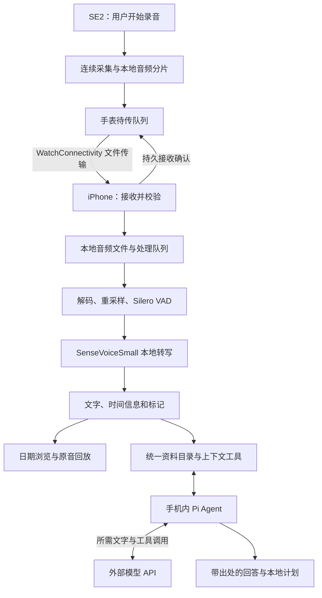

# MoMo Agent 首版产品与技术方案

2026-10-17 补充：[全天录音、持续整理与积压恢复](continuous-recording-processing.md) 明确持续采集不依赖录制结束，覆盖旧文档中相关歧义。以下保留首版历史方案，实际实现与验收以实施记录为准。

更新日期：2026-10-13。状态：详细开发方案，尚未开始应用实现。

准备开始开发时，按[详细开发与验收计划](v0.1-execution-plan.md)执行。该文细化原型参数、消息契约、文件恢复、VAD 断点、原生推理取消与 P01～P13 的完成条件；手机 Agent 的 Kit、文件工具与模型 API 见该文第 14 节。

代码目录、模块依赖、装配与状态归属见[代码组织方案](code-organization.md)。

阅读入口：第 1～9 节定义首版基线，第 10 节列开发顺序，第 11 节比较六种录音策略。新增的[第 12 节](#12-没有-watch-时的开发与验证)说明无手表开发方式，[第 13 节](#13-watch-直连-mac-的候选方案)说明 Mac 直连候选，[第 14 节](#14-模块数据协议与恢复规则)定义模块和协议，[第 15 节](#15-任务拆分与交付条件)给出可执行任务与交付条件。

## 1. 本次范围

首版完成 **Apple Watch SE2 录音 → 配对 iPhone 自动接收 → iPhone 17 Pro 本地中文转写 → 统一资料目录 → 手机 Agent 使用上下文处理任务**，同时提供日期浏览和原音回放。

每天 18 小时是软件采集目标。全部声音由手表采集，手机不接替录音。本轮不以电池续航作为方案门槛，但保留系统中断、进程终止、容量和后台调度的处理要求。

手机 Agent 确定使用 pi / pi-durable 作为开发 Kit，iOS 通过 PiDurableKit 接入，文本模型调用外部 API。首版完成近期上下文注入、资料搜索与读取、带出处的回答和本地计划保存；提供方和模型尚未选定，适配层需编译与真机验证。

MCP、外部 Agent 插件、跨设备档案同步、云端档案、端侧文本模型和语义向量索引暂不进入实现。全天自主执行、自动写入系统提醒或日历、健康与位置关联、说话人身份识别留待后续评估。

本次增加两个开发方向：使用 Apple 官方 watchOS 模拟器推进无手表开发；研究 Watch 直接传给 Mac 并在 Mac 转写的候选链路。iPhone 转写仍是首版基线。Mac 测试工具用于验证公共逻辑；是否把 Mac 接收端作为产品交付，由真机结果与后续范围决定。

| 项目 | 当前决定 | 实施状态 |
| --- | --- | --- |
| 采集设备 | 产品只使用 Watch 麦克风 | 待实现、待 SE2 验证 |
| 录音目标 | 用户开始后尽量覆盖每天 18 小时 | 尚未测得，续航暂不作为选型门槛 |
| 主处理端 | 配对 iPhone，离线中文转写 | 待实现、待 17 Pro 验证 |
| 电脑候选 | 局域网 HTTPS 分片上传优先，BLE 后续研究 | 待原型验证，不替换主处理端 |
| 录音策略 | R-A 建基线，比较 R-B、R-D | 六个候选均无胜出结论 |
| 当前开发条件 | 用户暂时没有 Watch，先用官方模拟器、Mac 与现有 iPhone | 需准备完整 Xcode 环境 |
| 数据位置 | 录音与转录档案在手机；Agent 将本轮所需文字发给模型 API | 无云端录音档案服务 |
| Agent Kit | pi / pi-durable；iOS 通过 PiDurableKit 适配 | 底座已确定，适配版本待验证 |
| Agent 模型 | 手机直连外部 HTTPS API，原型使用用户密钥 | 提供方与模型待实测选择，不运行端侧文本模型 |

Auday 是录音与本地转写体验的参考产品。其组件清单见[首次调研](../research/auday-2026-10-10.md)，开发者新披露和实现推断见[10 月 13 日补充调研](../research/auday-2026-10-13.md)。开发者已明确使用 WatchConnectivity，但未公开具体传输方法。本方案中的录音 API、分片参数和队列设计属于 MoMo Agent 的实现建议。录音与传输方式仍需比较，候选见[录音方案讨论](#11-录音方案讨论)。

## 2. 用户每天怎样使用

首次使用时，手机检查配对状态，并安装转写模型。手表在用户第一次开始录音时申请麦克风权限。

日常流程：

1. 用户在手表点击开始。
2. 手表持续采集并在本机保存录音。
3. 用户遇到重要时刻时点击标记。
4. 系统在设备可通信时向手机传送已保存的录音。
5. 手机在获得处理时间后转写录音。
6. 用户在手机按日期阅读文字，点击文字片段回听录音。
7. 用户直接给 Agent 派活，App 自动带入近期上下文，Agent 按需检索原稿，生成带出处的回答或计划。

打开手机 App 后，用户能直接看见今天已收到的录音和转写进度。用户不需要导入文件或选择同步目录。后台处理未完成时，App 显示剩余音频时长，并允许用户启动一次可见的继续处理任务。

首版必须区分三个状态：

| 状态 | 含义 | 展示方式 |
| --- | --- | --- |
| 已录音 | 手表已经保存音频 | 已保存时长、最近一次状态更新时间 |
| 已接收 | 手机已经持久保存并校验音频 | 手机可回放的时长 |
| 已转写 | 手机完成对应音频的文字处理 | 完成时长、剩余时长、可重试的失败项 |

手机显示的手表状态带时间。手表离线后，手机保留“最后于某时确认录音中”，不能把旧消息当作当前状态。

助理页展示任务、检索来源和模型网络状态；计划页保存生成结果。原型在设置中配置模型 API 与密钥，密钥存入 Keychain。无网络时录音、转写、搜索和回放照常可用，Agent 显示等待网络。

## 3. 设备职责与数据流

以下数据流作为完整录音、文件传输的开发基线。第 11 节讨论改变音频留存、传输优先级和实时通道的候选方案，最终选择以真机结果为依据。



Watch App 和 iPhone App 使用原生 Swift / SwiftUI。共享代码包含协议、时间定位、音频分片元数据与队列规则，平台音频会话和后台调度留在各端。转写运行库链接到 iPhone，以及有需要的 Mac 实验 target；Watch 基线不加载转写模型。模块边界见第 14 节。

录音转写链路不依赖自建账号、公网录音服务或常驻网络连接。Agent 在 App 内通过 pi 调用模型 API，使用模型服务所需的凭据；文件工具和 Agent 状态仍在手机。Mac 候选在用户电脑上运行局域网接收服务。ASR / VAD 模型和应用更新的分发渠道只提供软件文件。

## 4. 手表录音

### 4.1 后台能力

Apple 的文档明确记载：watchOS 支持前台开始、转入后台后继续录音。该文档属于归档 API 说明，开发时仍需核对当前 SDK，并在 SE2 的实际系统版本上验证熄屏和切换应用的行为。[Apple UIBackgroundModes](https://developer.apple.com/library/archive/documentation/General/Reference/InfoPlistKeyReference/Articles/iPhoneOSKeys.html)

录音使用符合目标系统要求的音频会话与后台配置。用户在前台发起录音。实现不借用健身、定位、静音播放等无关功能维持进程，也不假定后台任务可以在重启后自行恢复麦克风采集。

同时验证系统提醒与录音的关系。Apple 提供 `setAllowHapticsAndSystemSoundsDuringRecording`，但提醒可用性、采集是否受影响以及振动噪声都需在 SE2 测试后决定配置。录音状态至少核对最近一次采样回调与文件写入，不能只依靠界面计时器。[Apple 录音期间的系统声音与触觉反馈](https://developer.apple.com/documentation/avfaudio/avaudiosession/setallowhapticsandsystemsoundsduringrecording(_:))

### 4.2 先确定采集 API，再确定分片方式

先用 `AVAudioRecorder` 建立最小后台录音对照，验证权限、音频会话、真实输入路由和系统中断。

连续分片原型优先研究 `AVAudioEngine` 输入回调配合串行文件写入。采集回调只把音频交给有容量上限的缓冲区。编码、文件关闭、数据库写入和传输在采集回调之外执行。缓冲区溢出必须生成缺口事件。

文件轮换时保持采集会话运行。若选择 `AVAudioRecorder` 轮换文件，则必须测量停止再开始产生的空隙，不能把多次录音拼接后宣称为连续采集。最终 API 选择由真机结果决定。

初始实验参数：

| 参数 | 初始方案 | 决定依据 |
| --- | --- | --- |
| 文件时长 | 原型从 1 分钟开始，再测 30 秒与 5 分钟 | 崩溃损失、文件数量、传输开销；起点不等于最终胜出 |
| 自动传输批次 | 约 15 分钟提交作为对照参数；另测每个短文件封口后提交，停止时提交尾段 | 比较传输延迟、队列开销与恢复行为；提交时间不等于到达时间，候选见第 11 节 |
| 编码 | 先比较单声道 AAC 32 / 48 / 64 kbps | SE2 编码可用性、远场识别、回放质量 |
| 采样率 | 读取实际硬件格式；需要时再转换 | 不假定系统一定接受指定采样率 |
| 重模型 | 手表不加载 ASR 或 Embedding 模型 | 把计算集中到 iPhone |
| 静音处理 | 首版完整保存已采集音频 | 为 VAD 调试、漏字排查和重新转写保留原音 |

AAC 文件需要正确封口。原型要比较容器在异常终止后的可恢复性；若当前写入片段无法恢复，应缩短片段或更换写入格式。已封口片段必须独立可解码。文件数量可以增加，已保存数据不能因最后一个文件损坏而失效。

### 4.3 标记与时间

一次用户发起的录音使用 `session_id`。每个文件有稳定的 `chunk_id` 和递增序号。文件中保存采样率、实际帧数、采集起始时间、持续时长和编码信息。

时长以采集帧数和单调时钟核对。日历显示使用 UTC 时间与录制时的时区。修改系统时间或跨午夜不能造成音频顺序倒退、重复或被归为缺失。

标记保存用户点击的时间，并关联当时的采集位置。标记只帮助用户回放附近音频，不自动产生摘要。

### 4.4 中断处理

录音状态至少包括 `idle`、`recording`、`paused_by_user`、`interrupted`、`stopped`、`failed`。

收到音频中断事件后，记录原因和最后成功保存的位置。中断结束时检查系统状态、恢复条件及用户此前的录音意图。只有恢复采集成功后才显示“录音中”。不满足恢复条件时显示重新开始入口。[Apple 音频中断](https://developer.apple.com/documentation/avfaudio/handling-audio-interruptions)

进程被系统终止时，结束回调可能不执行。再次启动时需要扫描未封口文件和录音日志，恢复能解码的部分，并把其余区间标为“中断 / 无法确认”。无法确认的区间不能显示成静音。

## 5. 手表到手机的自动传输

### 5.1 使用 WatchConnectivity

通过 `WCSession.transferFile(_:metadata:)` 发送封口文件，通过 `transferUserInfo` 传递持久接收确认和必要的控制事件。`sendMessage` 只用于双方可达时的即时交互。最新状态快照可以使用 `updateApplicationContext`；需要逐条保存的事件不能放在会被覆盖的快照中。

Apple 会异步传输文件，并可能按性能和电量情况限制传输速度。系统要求在配对真机上测试文件传输；模拟器无法证明此链路可用。[transferFile 文档](https://developer.apple.com/documentation/watchconnectivity/wcsession/transferfile(_:metadata:))

发送队列只有一个调度入口。提交前检查未完成传输，避免 App 重启或前后台切换时重复入队。失败按结构化错误分类重试，并设置并发上限和退避。

### 5.2 手机确认持久保存后，手表才清理

接收过程：

1. 手机在 `didReceive file` 回调返回前，同步保存文件清单，再把临时音频移动到持久接收目录。
2. 手机在回调之外校验大小、内容哈希和音频可解码性。
3. 手机在同一短事务中提交文件元数据、处理任务与持久待发确认。
4. 手机发送包含 `chunk_id`、内容哈希和接收库标识的持久接收确认。
5. 手表保存确认结果。
6. 手表按本地保留策略清理已经确认的副本。

手表持久保存确认时，同时登记 ReceiptApplied 待发消息。手机用它确认手表已记录接收结果，再允许手机自动过期清理；手表不必等待这个消息送达才释放已确认副本。该消息可重发且不随音频删除。协议见[详细计划](v0.1-execution-plan.md#5-传输协议与接收确认)。

Apple 会在接收回调返回后删除未移动的临时文件，因此第一步不能放进一个尚未执行的异步任务。[接收文件的生命周期](https://developer.apple.com/documentation/watchconnectivity/wcsessiondelegate/session(_:didreceive:))

文件搬移与数据库提交不构成跨资源原子操作。手机启动时扫描接收目录，把已搬移但未入库的文件重新登记。数据库中没有对应文件的项目进入待修复状态。确认发送失败时可以重发；手表没有收到确认时继续保留文件。

重复收到同一 `chunk_id` 和哈希时，只补发确认。同一 ID 的内容哈希不同则进入冲突状态，不覆盖原文件。手机接收成功不等于转写成功，手表无需等待转写完成才释放已确认空间。

### 5.3 断连、容量和删除

手机不在附近时，手表继续保存并累计待传时长。接通后补传已保存文件。传输不能阻塞采集。

手表不能静默淘汰尚未确认的录音。可用空间不足时应提示并结束采集，记录结束原因。容量阈值通过真机写入开销确定。

用户删除一段录音后，手机保存删除标记，并在后续连接时通知手表。重试文件到达时先检查删除标记，避免内容重新出现。未传输完成的删除操作显示待同步状态。

手机的自动保留策略与手表副本清理分开。过期音频只有在对应区间成功完成转写流程、手表已应用确认且没有活动任务或重放恢复依赖后，才可自动清理；失败或等待中的原音继续保留。若存储不足，提示用户处理或暂停新任务，不把未转写音频当作普通缓存淘汰。用户明确删除立即进入删除流程，不必等待识别。

## 6. iPhone 本地转写

### 6.1 第一条开发基线

使用 **SenseVoiceSmall INT8 + Silero VAD + sherpa-onnx + ONNX Runtime CPU** 完成第一条链路。CPU 路线减少对额外后台 GPU / 神经引擎能力的依赖，但仍受 iOS 的执行时间限制。

sherpa-onnx 提供 iOS 接入资料和 SenseVoice INT8 权重示例。其文档中 `model.int8.onnx` 约 228 MB；这是模型文件量级，不是手机峰值内存或最终安装体积。[iOS 接入](https://k2-fsa.github.io/sherpa/onnx/ios/index.html)、[SenseVoice 模型与示例](https://k2-fsa.github.io/sherpa/onnx/sense-voice/pretrained.html)

2026-10-10 调研记录的 release 为 [v1.13.8](https://github.com/k2-fsa/sherpa-onnx/releases/tag/v1.13.8)，作为原型候选版本。原型应从可编译的 iOS 示例起步，完成验证后记录运行库 tag / commit、权重 SHA-256、VAD 版本和解码参数。ONNX Runtime 由同一依赖构建管理，避免重复链接不同版本。

运行流程：

```text
已接收的音频文件
  → 分段解码为 16 kHz 单声道 PCM
  → Silero VAD 找出需要识别的语音区间
  → SenseVoiceSmall 识别
  → 保存原始识别结果、展示文本和时间信息
  → 更新可浏览、可回放的文字片段
```

Silero 只决定哪些音频送入 ASR，首版不依靠 VAD 删除录音。VAD 可能漏掉低声讲话，原音必须可用于重跑。[Silero 项目](https://github.com/snakers4/silero-vad)

VAD 语音区间先试前后各 300 ms 的上下文。物理文件边界不作为句子边界，同一连续采样段保持分析状态。相邻语音的上下文在静音中点收缩，避免重复送入同一段语音。长语音初期按 20 秒不重叠切分，再比较 30 秒上限与切词损失。按稳定输入和窗口身份消除重复任务，不按文本相似度删除真实重复说话。恢复锚点见[详细计划第 7 节](v0.1-execution-plan.md#7-iphone-转写与恢复)。

### 6.2 保存可追溯的结果

每个结果关联原音片段、模型版本、VAD 参数、音频起止位置、原始 token 和展示文本。开启数字格式化时，保留格式化前结果或足够的原始识别信息，以便排查数字、人名和中英混说错误。

当前 sherpa 示例已经展示 SenseVoice 的 token 时间信息。首版可以先用语音区间起止位置实现“点段落回放”；逐字高亮在验证具体构建的时间精度后开启。文本格式化不能自行推算每个字的时间。

状态至少区分 `queued`、`running`、`completed`、`no_speech_detected`、`retryable_failure`、`blocked`。VAD 未发现语音是一种分析结果，不等于已证实原音完全无声。

### 6.3 控制内存与积压

初始只运行一个转写任务，以 2 线程开工，再比较 1 / 4 线程。按语音区间提交结果，取消或到期后重建 VAD 状态，继续尚未提交的窗口。Swift 取消不代表底层推理已经停止；需要有界窗口、失效 attempt 和原生句柄生命周期管理。

不把整天 PCM 一次性载入内存。16 kHz、单声道、16 bit PCM 的 18 小时音频约 2.07 GB；转成 Float32 后仅样本就约 4.15 GB。流水线应按小窗口读取并及时释放。

队列容量以音频时长和字节数统计。手机报告已处理时长、剩余时长、最近进度和阻塞原因。温度过高或系统要求停止时，保存进度后暂停。

### 6.4 同机对照，决定是否替换

| 候选 | 本轮用途 | 主要验证点 |
| --- | --- | --- |
| SenseVoiceSmall INT8 / sherpa / CPU | 首条完整链路 | 中文腕部音频、内存、持续速度、时间信息 |
| SenseVoice / FluidAudio / Core ML | 同模型的运行库优化对照 | 转换一致性、神经引擎运行条件、后台可用性 |
| Apple SpeechAnalyzer + SpeechTranscriber | 系统方案对照 | 国行设备中文资产、离线处理、长录音与时间信息 |
| Paraformer 中文模型 | 普通话质量补充对照 | 中英混说、人名、与基线的实际质量差异 |

FluidAudio 在 2026-10-10 查阅的 SenseVoice 文档中要求 FP16 编码器使用神经引擎，并记录 CPU / GPU FP16 路径可能出现 NaN。这条路线要单独验证，不能只把运行库替换后沿用 CPU 成绩。[FluidAudio SenseVoice](https://github.com/FluidInference/FluidAudio/blob/main/Documentation/ASR/SenseVoice.md)

Apple 将 SpeechAnalyzer 定位于设备内的长语音处理。使用前检查 `SpeechTranscriber.isAvailable`、`supportedLocales`、`installedLocales` 和语言资产。模型在系统中运行，不能只比较应用进程内存就判定其总体资源消耗更低。[Apple 技术介绍](https://developer.apple.com/videos/play/wwdc2025/277/)、[SpeechTranscriber](https://developer.apple.com/documentation/speech/speechtranscriber)

Fun-ASR-Nano、Qwen3-ASR 等保留为后续质量候选。本轮不把多模型选择器或大模型下载管理加入首版。默认模型由同一组 SE2 音频和 17 Pro 测试决定，公开桌面成绩只用于筛选候选。

## 7. iPhone 后台调度

本地转写意味着数据在手机上处理，不等于手机可以一直执行计算。接收录音、完成转写是两个独立阶段。

| 运行机会 | 工作内容 | 产品行为 |
| --- | --- | --- |
| App 前台 | 处理待转写队列 | 展示持续更新的文字与进度 |
| 收到 Watch 文件的后台回调 | 保存文件、登记任务和短小的后续处理 | 尽快结束回调，不直接跑完整批次 |
| `BGProcessingTask` 获得运行时间 | 批量处理已保存任务 | 可以延迟，进度持久保存 |
| 用户主动启动批处理，系统支持 `BGContinuedProcessingTask` | 前台启动后继续在后台完成该批任务 | 展示系统进度，支持取消和恢复 |
| 没有运行机会 | 保留原音与队列 | 明确显示待处理，而非空白文字 |

`BGContinuedProcessingTask` 要由用户操作发起。它不能因为每次后台收到文件就被当成无限循环的计算服务。系统可以终止任务，用户也可以取消任务。[Apple 长任务说明](https://developer.apple.com/documentation/backgroundtasks/performing-long-running-tasks-on-ios-and-ipados)

Core ML 加速作为单独实验。GPU 和神经引擎的后台访问分别检查目标系统、设备和 entitlement。2026-10-10 查阅的 Background Inference 文档带 Beta 标记，首版基线不依赖该能力。[后台 GPU](https://developer.apple.com/documentation/bundleresources/entitlements/com.apple.developer.background-tasks.continued-processing.gpu)、[后台神经引擎](https://developer.apple.com/documentation/bundleresources/entitlements/com.apple.developer.background-tasks.continued-processing.inference)

不通过静音播放、假录音或无关定位延长手机后台时间。手机不申请麦克风作为保活手段。

## 8. 七个组件如何取舍

| 组件 | 首版决策 | 使用位置 |
| --- | --- | --- |
| SenseVoiceSmall | 保留 | iPhone 中文与混合语言识别基线 |
| Silero VAD | 保留 | iPhone 划分语音区间，减少无语音识别 |
| sherpa-onnx | 保留 | iPhone 的 ASR / VAD 接入层 |
| ONNX Runtime | 保留，随统一依赖构建 | 执行 ONNX 模型 |
| EmbeddingGemma | 暂缓 | 语义检索不属于本轮录音转写主流程 |
| llama.cpp / ggml | 不进入当前实现 | Agent 文本模型走 API，无需端侧文本推理运行库 |
| JSON for Modern C++ | 不主动引入 | Swift 数据结构使用 Codable；传递依赖按实际构建保留 |

代码许可证与模型权重条款分别登记。SenseVoice 的权重许可不能用 sherpa 的 Apache-2.0 或 ONNX Runtime 的 MIT 许可代替。分发模型前保存对应许可、NOTICE 和权重来源。[SenseVoice 项目](https://github.com/QwenAudio/SenseVoice)、[Auday 指向的 FunASR 模型许可](https://github.com/modelscope/FunASR/blob/58830eca4012644aac0c3218c3ccc7d98f003fda/MODEL_LICENSE)

Agent Kit 另外使用 pi-durable 与 PiDurableKit，不改变本地 ASR 组件。由 Kit 管理模型与工具循环，我们实现 Swift 工具、上下文、界面和 iOS 生命周期。实现分工见[详细计划第 14 节](v0.1-execution-plan.md#14-已确认的手机-agent-方案)。

## 9. 本地存储、隐私与国内使用

### 9.1 数据结构

手机使用 SQLite 保存元数据、转写结果、标记和队列。音频以独立文件保存。首版按日期、录音段和标记浏览；中文关键词查找使用明确支持中文子串的方案。若采用 FTS5，需要验证 tokenizer，不能默认英文分词设置能正确处理中文。

手机统一资料目录自动生成每次录音的音频、清单、转录 JSON 与 Markdown。SQLite 转写结果为正文真源，文件是带版本的投影；Agent 读取当前有效版本。Agent 状态与索引留在私有目录，计划和笔记写入 workspace。无需用户每天导出或重新选文件。

建议的最小实体：

| 实体 | 核心字段 |
| --- | --- |
| RecordingSession | ID、设备、开始时间、时区、录音状态 |
| AudioChunk | ID、session ID、序号、采集位置、时长、格式、字节数、SHA-256、文件位置 |
| CaptureEvent | 中断 / 恢复 / 存储不足 / 用户停止等事件及时间 |
| TransferReceipt | chunk ID、哈希、接收库 ID、确认时间 |
| TranscriptionJob | 输入片段、模型版本、参数哈希、状态、已提交进度、错误码 |
| TranscriptSpan | 音频引用、起止位置、识别文字、展示文字、原始 token 信息 |
| Mark | 录音 ID、时间或采集位置、用户备注 |
| DeletionRecord | 被删除对象、删除时间、对端确认状态 |

同一音频、模型和参数组合只对应一个有效任务结果。模型重跑生成新版本，不能覆盖用户修改后的文字而不保留原始识别结果。

### 9.2 容量预算

以下只按编码码率计算，采用十进制 MB / GB。每天录音 18 小时，不扣除静音，不含模型、索引、容器开销和临时副本。

| 编码码率 | 每小时 | 每天 18 h | 7 天 | 30 天 |
| --- | ---: | ---: | ---: | ---: |
| 32 kbps | 14.4 MB | 259.2 MB | 1.81 GB | 7.78 GB |
| 48 kbps | 21.6 MB | 388.8 MB | 2.72 GB | 11.66 GB |
| 64 kbps | 28.8 MB | 518.4 MB | 3.63 GB | 15.55 GB |

计算式：`码率 × 秒数 ÷ 8`。手表需能缓存离线时段，手机需另外预留模型、待处理文件和写入余量。实际值以产物字节数为准。

首次使用建议选择原音保留天数。初始产品默认可从 7 天开始验证；自动清理只作用于已完成转写且没有固定保留设置的音频。时刻标记与固定保留是两个动作。待转写和失败音频不因到期而静默删除。删除原音后，文字显示“原音已清理”。用户主动删除整次录音时，同时删除对应音频、文字和检索数据，并使迟到处理结果失效。

### 9.3 锁屏与备份

手机需要锁屏处理的队列和输入文件，候选保护级别为 `completeUntilFirstUserAuthentication`；首次解锁后仍可供后台任务访问。它与“每次锁屏都不可读取”的保护目标存在取舍，应在产品说明中写清楚。文件、SQLite 数据库及 WAL 文件使用一致策略。

`completeUnlessOpen` 可用于某些持续写入场景，但文件关闭后锁屏期间不能重新打开，不能直接作为全部后台转写输入的保护级别。[Apple 文件保护说明](https://developer.apple.com/documentation/foundation/fileprotectiontype/completeunlessopen)

首版不默认同步到 iCloud。应用档案与缓存明确设置备份策略，提供用户主动保存重要音频与文字的入口。该入口用于备份，不作为日常使用流程。完整加密备份与恢复可在核心链路通过后实施；在其上线前，必须说明卸载或丢失手机可能导致本地资料丢失。

### 9.4 国内模型交付

开发阶段从维护者提供的模型来源获取产物。发布阶段优先随 App 交付一个验证过的 ASR / VAD 组合；需要独立下载时，使用国内可达的静态分发渠道，并验证模型哈希、版本与许可证。

首次模型安装完成后，断开外网，仍应完成录音、设备间传输、转写、阅读和回放。测试时保留 Watch 与 iPhone 的近距离通信，不能把关闭全部无线连接误当成“无外网”。

日志只记录状态、耗时、大小和错误码，默认不含音频、转写正文或密钥。Agent 调用模型时发送用户任务、近期上下文与检索所得的必要文字，不自动上传原音或整库。Mac 候选只向用户明确配对的局域网接收端发送数据。本地删除需覆盖 Agent 历史等派生副本，但不能据此承诺撤回模型提供方已经收到的请求。

## 10. 实施顺序与验收

| 阶段 | 产物 | 通过条件 |
| --- | --- | --- |
| M0：开发环境 | 完整 Xcode、watchOS / iOS 模拟环境、最小工程 | Watch 与 iPhone target 能在官方模拟器启动 |
| M1：公共录音与文件流程 | 文件输入、分片、持久队列、恢复日志 | 固定输入可重复验证；异常退出后已封口文件可恢复 |
| M2：iPhone 本地转写 | 真机 ASR / VAD、时间定位、后台队列 | 无外网处理测试音频；取消与重启后恢复进度 |
| M3：Mac 直传实验 | 真实 HTTPS 接收、持久确认、补传与去重 | Mac / 模拟器发送端通过协议故障测试；结果标为软件实验 |
| M4：Watch 真机接入 | SE2 采集、WatchConnectivity、可选 HTTPS 对照 | 完成真实后台录音、连接、中断与分片验证 |
| M5：录音策略比较 | R-A、R-B、R-D 的同机报告 | 根据覆盖、延迟、质量和积压选择默认策略 |
| M6：采集转写验收 | 日期浏览、回放、删除、容量处理及长时报告 | 18 小时目标和连续积压测试有明确结果；阻塞项不能用模拟器成绩替代 |
| M7：手机 Agent | Pi Kit、模型 API、本地资料工具与助理界面 | 用户无需复述近期背景即可获得带出处的回答和计划；A 系列通过 |

三个优先验证问题：SE2 能否按目标方式持续分片；WatchConnectivity 能否可靠补齐文件；17 Pro 获得的运行时间能否消化每天新增录音。详细步骤与记录字段见[真机验证计划](device-validation.md)。

本轮交付为方案、来源调研和验证计划。所有真机项目均为未执行；尚未实现 Watch / iPhone App，也没有测得连续 18 小时或 17 Pro 转写性能。

M1 与 M2 可在环境准备后独立推进。M3 是候选实验，不阻塞 iPhone 基线；M4～M6 的 Watch 部分需要实际设备。M7 可用固定资料与现有 iPhone 并行开发，不等待 Watch；完整版本须同时通过采集转写与 Agent 验收。详细任务见第 15 节。

## 11. 录音方案讨论

讨论日期：2026-10-10。状态：六种工程候选均待原型验证，尚未据此选定最终方案。

### 11.1 讨论目标与边界

目标是让现实交流成为 Agent 执行任务时可用的背景，减少主人复述。本节保留对 Watch 录音、iPhone 本地转写这条采集链路的比较；新增手机 Agent 以第 1 节及详细开发计划为准。

固定条件：全部声音由 SE2 采集，配对的 iPhone 17 Pro 执行转写。每天 18 小时是采集目标，电池续航暂不作为选型门槛。用户在 Watch 开始录音后，系统负责保存和自动传输。Agent 使用采集结果，不改变以下录音候选的测试条件。

需要分别选择三个环节：持续采集后的音频如何保存、Watch 如何把音频交给 iPhone、iPhone 获得运行时间后先处理哪些音频。约 15 分钟提交只是其中一种调度参数。以下候选有些可以组合，不是六套互斥的产品。

### 11.2 六种候选

#### R-A：持续录音，短文件封口后提交

```text
Watch 持续采集 → 连续生成短音频文件 → 封口后提交后台传输 → iPhone 排队转写
```

比较 30 秒、1 分钟等文件时长，并与现有约 15 分钟批次提交方式对照。保持采集会话运行，只轮换输出文件。编码、文件封口和传输均在采集回调之外执行。

这条路线保留完整原音，手机断连时手表继续保存。短文件限制了单次异常可能影响的范围，也增加了文件数量和传输任务数量。实验需要测量边界漏采、封口开销、队列积压以及崩溃后的可恢复范围。

`transferFile` 由系统异步调度。短文件提交更频繁不保证实际到达更频繁，具体延迟需要在配对设备上测量。[Apple 文件传输](https://developer.apple.com/documentation/watchconnectivity/wcsession/transferfile(_:metadata:))

#### R-B：边录边传，Watch 同时留存

```text
                   → Watch 本地保存，等待持久接收确认
Watch 同一次采集 ──┤
                   → 对端可达时发送短音频块 → iPhone 接收并尝试转写
```

即时通道用于尽快交付近期音频，本地文件用于断连补传和失败恢复。手机确认持久保存后，手表才能清理对应副本。通道不可用时，采集继续运行。

先研究 `sendMessageData` 传递短音频块。测试消息大小、持续吞吐、顺序、确认、重试与背压。发送队列必须有上限；即时通道拥塞时，未确认音频保留在文件队列，不能拖住采集。手机根据采集区间识别即时音频和补传文件中的重叠内容。

该 API 要求对端可达，Apple 没有承诺它能作为全天连续音频通道。双端锁屏、切后台和手机进程终止必须分别测试。[WCSession 通信方式](https://developer.apple.com/documentation/watchconnectivity/wcsession)

如进一步研究 WebSocket 或自建网络连接，需先验证 watchOS 低层网络的适用条件和 iPhone 接收进程的生命周期。Apple 的流媒体播放示例不能直接证明麦克风上传、手机常驻接收可行。[watchOS 低层网络限制](https://developer.apple.com/documentation/technotes/tn3135-low-level-networking-on-watchos)

#### R-C：人声触发音频保存

```text
Watch 持续采集 → 短时滚动缓存 → VAD 检测 → 保存人声及前后音频 → 传输、转写
```

检测到人声后，保留前面的缓存和随后录到的人声。人声结束后再保留一段尾音，避免截掉句子边界。前置缓存 1～2 秒、结束后延续数秒均属于待测参数。

该路线可以减少静音文件和待处理音频，但漏判可能造成永久损失。质量集必须覆盖低声讲话、远场、短回应和多人重叠。电视和播客中的真实人声应单独统计，不能当作 VAD 错把噪声识别成人声。

这里由人声触发的是保存动作。麦克风仍需持续采集，不能先关闭麦克风再等待普通应用检测到说话。

Watch 侧 VAD 单独验证运行库兼容性、实时处理速度、缓冲占用和热状态。现有 Silero / ONNX Runtime 的 iPhone 配置与桌面性能不能直接证明 SE2 可用。原型对照阶段另外保留完整测试原音，测量丢弃区间中实际漏掉的语音。[Silero 项目](https://github.com/snakers4/silero-vad)

#### R-D：完整保存，人声片段优先传输

```text
Watch 持续采集 → 完整音频保存在手表
             → 检测疑似人声，优先传输这些片段 → iPhone 优先转写
             → 随后补传完整音频 → iPhone 检查尚未处理的区间
```

VAD 决定传输和转写的优先级，完整原音负责保留漏判区间。手机收到完整音频后，用手机侧检测或复核流程检查尚未处理的区间，再补充结果。只有保存原音而不检查遗漏区间，不能解决漏转写。

该路线需要维护采集、持久接收和转写覆盖区间。优先片段已确认，不代表包含它的完整文件已确认；手表清理依据仍是完整文件的持久接收确认。手机通过音频位置对应优先片段与完整文件，避免重复文字和重复时长。

调度器要给完整音频补传保留处理机会，防止持续人声使旧文件长期积压。优先片段和完整文件可能重复传输同一段音频，因此需报告实际总传输量。这条路线的目标是更早得到语音文字，同时保留可补救的完整输入。

#### R-E：全程低码率，人声部分另存较高质量

```text
Watch 同一次采集 → 全程低码率录音
                → 检测人声后，另存较高质量片段 → iPhone 优先转写
```

低码率录音保留完整时间线，较高质量片段用于主要转写。Watch 需要缓存尚未丢失细节的采样，才能在检测到人声后保留其开始前的较高质量音频。

实验比较远场、噪声和低声条件下两种音质的中文识别率，并测试 VAD 漏判后低码率录音还能恢复多少文字。已经丢失的音频细节不能通过后续转码补回。

双路编码、缓存和额外文件会增加运行开销。只有实际总字节数下降且质量满足要求，才能认为该路线改善了存储或传输。比较值包括两路音频及其重叠部分，不能只报告低码率一路。

#### R-F：先传低码率版本，手机按需请求原音

```text
Watch 保存较高质量音频 → 生成并传输低码率版本 → iPhone 初步转写
          ↑                                      ↓
          └──── 手机请求可疑时间区间的较高质量音频 ──┘
```

补传由 iPhone 触发。候选条件包括音频质量异常、识别失败、复核抽样和用户回听核对。手机保存请求队列，Watch 在获得通信机会后处理请求。

ASR 可能给出看似确定但实际错误的结果，低置信度不能作为唯一补传条件。实验必须统计没有触发补传却识别错误的片段。

该路线需要新的原音保留协议。低码率副本接收成功，只确认这一表示已收到，不能触发手表删除较高质量原音。原音释放条件、复核完成条件和离线容量上限需在实现前确定；不能为了节省空间提前删除尚可能请求的原音。

### 11.3 取舍对比

| 候选 | 主要目标 | 关键代价或风险 | 建议实验顺序 |
| --- | --- | --- | --- |
| R-A 短文件提交 | 建立完整、可恢复的录音传输基线 | 文件数量与系统调度延迟 | 第一组 |
| R-B 边录边传并留存 | 降低近期音频的到达延迟 | 双端后台可达性、背压、重叠补传 | 与 R-A 对照 |
| R-C 人声触发保存 | 减少无语音音频 | VAD 漏判可能永久丢失内容 | 先评估漏检，不直接用于日常删除 |
| R-D 完整保存、人声优先 | 优先得到语音文字，并可补转写 | 重复传输、覆盖计算、完整文件积压 | 与 R-A 对照 |
| R-E 双音质保存 | 在保留底稿的条件下控制数据量 | 低码率准确率、双路编码成本 | 后续质量实验 |
| R-F 低码率先传、按需补原音 | 由手机判断需要补充的音频 | 漏触发、请求协议、原音保留压力 | 后续协议与质量实验 |

共同约束：

- 所有依赖人声触发或前置缓存的候选，都需要此前已经开始采集。系统中断后的音频缺口按第 4.4 节处理。
- Watch 录音持续运行、iPhone 接收音频、iPhone 执行转写分别验证。数据已经收到时，手机仍可能等待计算机会；后台任务遵循第 7 节。
- R-B 至 R-F 中，同一采集区间可能有多个文件或不同音质表示。协议需要分别标识音频区间和文件表示；同一个文件 ID 不得对应不同内容哈希。
- 即时片段、预览音频和较高质量原音的接收确认分别记录。表示切换与片段重叠不能重复计算覆盖时长。
- 首版基线仍采用完整原音保留。涉及选择性丢弃或降质的候选，通过对照实验后再决定是否采用。

### 11.4 原型比较顺序

先建立共享的持续采集、时间定位、本地文件和中断日志模块。第一组比较 R-A、R-B、R-D，只替换传输与处理策略，沿用相同的编码参数、iPhone ASR 和质量集。R-B、R-D 的实现投入以各自即时通道与 Watch 侧 VAD 的可行性实验为前提。

先用固定封口文件比较调度策略，再用连续编号的受控声源验证实时采集。R-D 另用人工标注语音的录音集验证优先级和漏检。随后进入真实腕部收音测试，最后执行目标 18 小时长时测试。各测试分别记录，不用短时受控结果代替全天结果。

| 指标 | 统计口径 |
| --- | --- |
| 录音覆盖与边界缺口 | 以实际采样区间并集和受控声源核对，重叠不重复计时 |
| 音频到达延迟 | 从对应音频区间结束到 iPhone 持久接收，报告 P50 / P95 / 最大值；未到达项单列 |
| 文字生成延迟 | 从对应语音区间结束到结果持久保存；调度等待与实际计算分别报告，未完成项单列 |
| 断连恢复 | 断连期间的已保存时长、重连后的补齐时间和最终缺失区间 |
| 识别质量 | 同一标注集的 CER、关键数字与人名错误、语音漏检和重叠重复文字 |
| 资源与积压 | Watch 编码 / VAD 开销、双端内存与热状态、实际总字节数、文件数、未确认及未转写时长 |

这些实验用于选择实现方式，尚无性能结果或方案胜出结论。执行记录见[真机验证计划中的方案对照](device-validation.md#5-录音方案对照)。

Auday 的“确定极安静区间省略存储”另列为后续存储实验。它可能保留非语音声音，不等同于 R-C。先在独立保留完整原音的条件下，检查低声、远场、短句和标记保护区；本轮不改变完整保存的默认方案。[补充调研](../research/auday-2026-10-13.md#23-静音存储与时间轴)

## 12. 没有 Watch 时的开发与验证

### 12.1 使用 Apple 官方工具

主要工具是完整 Xcode 附带的 watchOS Simulator 和 iOS Simulator。Apple 当前模拟设备文档提供 Mac 声音输入配置；具体 watchOS runtime 是否支持我们的录音调用，仍要在工程里验证。模拟器运行成功只能确认该环境中的逻辑。[Xcode](https://developer.apple.com/xcode/)、[模拟设备环境配置](https://developer.apple.com/documentation/xcode/configuring-the-environment-of-a-simulated-device)

2026-10-13 本机检查：`xcode-select` 指向 `/Library/Developer/CommandLineTools`；`xcodebuild` 提示需要完整 Xcode，`simctl` 不可用。在 `/Applications` 和用户的 `Applications` 中未找到 Xcode。这一轮没有安装开发工具，也没有启动模拟器或采集麦克风。

准备步骤：安装兼容当前 macOS 的完整 Xcode；安装 iOS / watchOS 平台与模拟 runtime；选择完整 Xcode 作为开发目录；创建 Watch 和 iPhone 最小 target；分别构建并启动。真实 iPhone 安装还需开发签名与设备开发模式。

### 12.2 先做哪些可验证的工作

| 环境 | 输入 | 可以验证 | 留到真机验证 |
| --- | --- | --- | --- |
| Mac 公共模块测试工具 | 固定音频按采样速度回放 | 分片、编码、哈希、持久队列、乱序、崩溃恢复 | Watch 音频会话、硬件输入、系统后台限制 |
| watchOS Simulator | 固定输入；runtime 支持时使用 Mac 音频输入 | Watch 界面、权限流程、状态切换、平台构建 | 腕部音质、熄屏录音、实际中断和 BLE |
| iPhone 17 Pro | 开发测试入口导入固定样本 | 真实离线转写、内存、温度、取消和后台调度 | WatchConnectivity 的配对文件传输 |
| Mac 局域网接收端 | Mac 测试发送端 / 模拟器 HTTP 上传 | TLS、真实文件传输、确认、去重、接收端恢复 | SE2 的网络可用性、后台上传与持续录音共存 |

Apple 明确要求在配对真机测试 `transferFile`，该方法不在 Simulator 中工作。因此模拟器里的测试输入不能被命名为“WatchConnectivity 测试通过”。[transferFile](https://developer.apple.com/documentation/watchconnectivity/wcsession/transferfile(_:metadata:))

Mac 的可选麦克风入口仅用于开发测试，使用前明确启动。正式产品仍只由 Watch 采集。测试样本导入同样只用于开发与性能评估，不进入日常使用流程。

### 12.3 输入与结果如何标识

每轮测试保存 `source_kind`：`fixture`、`mac_test` 或 `watch`；同时记录设备、系统、构建、模型哈希与参数。固定测试音频按真实采样时间推进，允许在指定位置注入断连、进程终止、磁盘不足和重复送达。故障注入验证软件恢复，不证明系统自然中断具有完全相同行为。

将三类长时测试分开：加速处理 18 小时等量数据验证容量和吞吐；运行 18 小时的测试工具验证软件长期状态；SE2 真实录制 18 小时验证设备采集。报告必须写明属于哪一类。

未完成真实设备测试前，能交付的是可运行原型和软件验证结果。后台录音、实际文件传输与全天覆盖仍是发布前置条件。

## 13. Watch 直连 Mac 的候选方案

### 13.1 连接结构与适用场景

候选流程为 Watch 本地保存 → 局域网 HTTPS 上传 → Mac 持久接收 → Mac 本地转写。适合用户在电脑附近、电脑运行接收端的场景。离开局域网或 Mac 休眠时，Watch 保留录音，稍后补传。日常流程不要求主动导出或选文件。

这里的“直连”指应用数据发送到 Mac 的接收地址。Watch 的底层网络可能借助配对 iPhone，也可能使用已知 Wi-Fi；要另测 iPhone 无法充当网络代理时的行为。不能把一次成功请求解释为完全摆脱手机。[Watch 网络更新路径](https://developer.apple.com/documentation/watchos-apps/keeping-your-watchos-app-s-content-up-to-date)

这个实验不需要公网服务器。Mac 上运行的是用户本地接收进程。首轮每个录音 session 固定一个主接收端：iPhone 基线或 Mac 实验。切换从下一次录音开始，不在首版引入双端自动归档与多主同步。

### 13.2 为什么先试 HTTPS 分片

Apple 允许 watchOS 使用 URLSession 的 HTTP / HTTPS。低层网络、WebSocket、Bonjour 等存在特定使用场景限制，模拟器又可能放宽这些限制。因此首个实验采用 HTTPS 文件上传，不把模拟器上的 WebSocket 成功作为真机架构依据。[TN3135](https://developer.apple.com/documentation/technotes/tn3135-low-level-networking-on-watchos)

发送已封口、不可变的文件，先测前台请求，再测后台 URLSession 文件上传。后台是否及时执行是实验结果，不作为协议保证。文件被系统传输任务引用期间保持可用；传输失败时原文件仍在本地。

BLE 保留为第二候选：Mac 提供 GATT 服务，Watch 作为 central。watchOS 不支持将自身作为可广播服务的 peripheral；后台扫描和及时提醒还有预算约束。Apple 文档中的每 24 小时五次限制针对相应后台扫描 / 提醒机会，不能解释成所有 BLE 数据包只能发五次。持续音频写入是否可用，必须另做真机实验。[Core Bluetooth peripheral](https://developer.apple.com/documentation/corebluetooth/cbperipheralmanager)、[Watch 后台任务](https://developer.apple.com/documentation/watchkit/using-background-tasks)

### 13.3 一次配对，之后自动传输

原型先配置一个明确的 Mac 地址，不依赖尚未验证的自动发现。Mac 生成接收端 ID、库实例 ID 和配对材料。用户在配对 iPhone 上完成一次配置，经配对通道交给 Watch；之后音频请求直接面向 Mac。配置手机不承担录音。

局域网传输使用 TLS，验证已配对接收端的证书或公钥，并使用独立随机凭据鉴权。凭据保存在 Keychain。证书更新与重新配对有明确入口；不关闭全局证书校验或全局 ATS。是否能在目标 watchOS 的后台会话可靠完成证书验证，是原型通过条件之一。

更换 Mac 数据库、重装接收端或重建资料库时生成新库实例 ID。旧库确认不能授权清理新录音。首版无需自动发现所有电脑，也无需公网穿透。

### 13.4 最小接收协议

以下 API 是 MoMo Agent 的候选协议，不是 Auday 的接口。

| 请求 | 作用 | 结果 |
| --- | --- | --- |
| `GET /v1/capabilities` | 确认协议版本、接收端与库实例 | 已鉴权的能力信息 |
| `POST /v1/sessions` | 登记录音时间锚点与来源设备 | 幂等返回 session |
| `POST /v1/chunks` | 登记不可变文件的元数据 | 返回上传位置或已有持久确认 |
| `PUT /v1/chunks/{chunk_id}/content` | 上传音频文件 | 校验中状态或持久确认 |
| `GET /v1/chunks/{chunk_id}` | 重连后查询接收状态 | 缺失、校验中、已接收或已删除 |
| `POST /v1/sessions/{session_id}/events` | 保存中断、标记和停止事件 | 按事件 ID 去重 |

接收端流式写入临时文件，完成大小与哈希校验后搬到档案目录，再提交元数据与转写任务。完整接收确认必须在这些操作完成后生成。只收到请求、只登记元数据或只保存预览音频，都不满足清理完整原音的条件。

同 ID、同哈希重复请求返回相同状态；同 ID、不同内容返回冲突。鉴权失败、协议不兼容、已删除对象与空间不足分别使用可识别错误。429 和暂时性服务错误允许退避重试；永久格式错误等待修复。不能只依据 HTTP 200 删除本地文件，还需验证确认中的 ID、哈希和库实例。

Mac 默认一条上传写入与一个 ASR 任务。Mac 休眠或退出后不接收新文件；重新运行后恢复未完成任务。接收端不隐式阻止电脑休眠。HTTPS 预览传输若以后增加，必须有独立表示类型和确认条件。

## 14. 模块、数据协议与恢复规则

### 14.1 最小代码组织

使用一个工程、一个本地 Swift Package 和六个业务模块，不为每层建立独立仓库。以下是概览，详细目录与依赖以[代码组织方案](code-organization.md)为准：

```text
Apps/WatchApp/             Watch 装配、系统入口与功能页面
Apps/iPhoneApp/            手机装配、跨模块协调与功能页面
Packages/MoMoAgentKit/   Contracts、Recording、Link、Archive、Speech、Agent
Experiments/MacReceiver/   可选的 HTTPS 接收与 Mac 转写
Tools/CaptureReplay/       固定输入与故障注入测试工具
Tests/                    跨模块、真机与 UI 验证
```

| 模块 | 负责内容 | 边界 |
| --- | --- | --- |
| CaptureController | 音频会话、采集启停、中断与路由 | 不等待传输或 ASR；状态必须来自实际采集事件 |
| SegmentWriter | 有界缓冲、编码、封口、音频位置 | 回调之外写文件；只发布封口完成的文件 |
| TransferCoordinator | 未确认清单、提交、确认与重试 | 平台通道独立实现；不改变采集状态 |
| ArchiveStore | 文件接收、校验、元数据、删除标记 | 所有清理决定经过同一入口 |
| ASRWorker | 解码、VAD、识别、结果与进度 | 单任务运行；支持取消和失效任务恢复 |
| RecordingViewModel | 展示状态、执行用户操作 | 不用界面计时器构造“持续录音”的事实 |
| AgentService | pi harness、模型 API、取消和恢复 | 同一存储单一 owner；网络和推理不阻塞收件 |
| ContextService / ArchiveTools | 近期上下文、检索、分页读稿与计划 | 来源可追溯，只写 workspace，不改原始档案 |

Watch 的音频会话和后台平台入口留在 Watch App，采集与账本逻辑归 MoMoRecording；iOS 后台调度留在 iPhone App。ASR 和 Pi 均不链接到 Watch。共享的是数据契约与可恢复流程，不强迫所有平台共用一套音频 API。

### 14.2 时间定位与文件契约

每个文件附带一个可版本化描述。关键字段如下：

| 字段 | 含义与约束 |
| --- | --- |
| `protocol_version` | 接收端先检查兼容性，不支持时不确认接收 |
| `source_device_id` / `source_kind` | 安装生成的来源标识与测试 / 真机类型；不依赖硬件序列号 |
| `session_id` | 一次用户录音的标识 |
| `capture_epoch_id` | 连续采样段；中断恢复或采样格式变化后更新 |
| `chunk_id` | 一个不可变文件表示的唯一标识；重新编码生成新 ID |
| `start_frame` / `frame_count` / `timebase_hz` | 在采集段中的音频位置，采用半开区间 |
| `wall_clock_anchor` / `timezone_offset` | 用于日期显示；与该采集段的帧位置关联 |
| `codec` / `sample_rate` / `channels` | 实际编码格式，采样率与时间基准可以不同 |
| `byte_count` / `sha256` | 校验实际封口文件 |
| `representation_kind` | `full`、`priority`、`preview` 等；不同表示不能互相冒充 |
| `source_ranges` | 表示覆盖的原始采集区间；识别结果同样引用这些区间 |

编码器延迟和尾部 padding 单独记录或通过解码校验确定，不把压缩文件时长机械当作精确采集时长。标记存为事件，并关联当时的采集段与位置；无采集时只保留真实墙钟时间。

用户调整时间时增加新的墙钟锚点，不能让已录内容倒序。跨设备延迟测量需要估计时钟差并记录误差；未校准时分别报告各设备内部耗时，跨端时间差标为估算。

### 14.3 文件与任务状态

采集状态为 `idle → starting → recording`，之后可进入 `paused_by_user`、`interrupted`、`stopped` 或 `failed`。中断恢复必须先检查用户意图、权限、系统是否允许和存储空间；用户主动暂停不被自动恢复。

文件状态为 `writing → sealed → queued → submitted → durable_receipt → cleanup_eligible`。传输通道回调的完成状态只描述运输，不直接等于 `durable_receipt`。失败保持可重试文件，清理以完整原音自己的确认为准。

手机 ASR 状态为 `queued → running → completed / no_speech_detected`，另有 `retryable_failure`、`blocked` 与用户取消状态。取消结束本次计算，已提交结果保留，后续可以继续。`no_speech_detected` 记录模型版本与实际分析范围，并保留“可能漏检”的语义。

ASR 任务身份包含原始范围、上下文范围、实际输入清单哈希、模型哈希与参数哈希。恢复时从持久锚点重建 VAD 与转换状态，已经登记的窗口不重复建任务，已有有效结果不重复提交。提交时检查内容代次与 attempt，防止取消或删除后的迟到结果写回。替换模型建立新结果版本，不能静默覆盖原始记录。具体规则见[详细计划](v0.1-execution-plan.md#7-iphone-转写与恢复)。

### 14.4 接收与恢复的一致性

重启后执行有界扫描：

1. 找到已封口但未登记的文件，补建元数据。
2. 找到校验未完成的收件，重新校验。
3. 将上次进程遗留的运行中 ASR 任务恢复为可继续状态。
4. 核对已登记文件是否存在；缺失时标记修复需求，不补造成功状态。
5. 对未确认文件查询或重新提交，接收端按 ID 与哈希去重。
6. 应用删除标记，避免离线重试恢复已删除内容。

搬移文件、数据库事务和对端确认不是一笔原子事务。实现必须覆盖各相邻步骤之间的异常退出。数据库提交与文件写入策略要支持崩溃恢复；没有断电试验时，不宣称对所有突然断电都无损。

主接收端的确认至少包含 `receiver_id`、`library_instance_id`、`chunk_id`、`sha256` 与确认时间。Watch 收到后先持久记录，再清理。Mac 预览或 R-D 人声片段的确认不能授权删除完整文件。

### 14.5 资源与重试

采集线程只交付有界内存块。达到上限后，记录缺失范围与原因；编码无法持续跟上时显式结束或降为事先验证的配置，不静默丢弃再显示成功。

HTTP 原型默认一条活动上传，WatchConnectivity 设置有限的待提交数量，并在重启时核对系统已登记任务。初始重试可用 2 秒起步、逐次翻倍、上限 5 分钟并带抖动；这些是运行期间的参数，不能保证系统在后台按此时刻唤醒。

数据库事务只用于领取任务和提交结果。领取后释放事务，再执行解码、推理或网络请求。音频读取使用小窗口；系统上传使用文件 URL，由系统管理传输期间的读取。不得在慢任务期间持有数据库事务，也不能将一天的解码样本留在内存。

### 14.6 用户能看到的失败状态

首版应能区分：麦克风权限被拒绝、采集已中断、等待设备连接、等待手机运行、模型不可用、存储不足、文件校验失败。状态有更新时间与恢复动作；系统没有提供中断原因时，显示“录音已停止，原因未知”，不要编造原因。

诊断包保存双端构建、音频配置、采样活动时间、封口和确认时间、队列长度、结构化错误。默认不含录音或逐字稿。测试音频与生产中的私人录音分开管理。

## 15. 任务拆分与交付条件

以下任务均为待执行。顺序以解决设备能力和数据完整性为先，不代表已经排定工期。

| 任务 | 依赖 | 交付物与检查 |
| --- | --- | --- |
| P01 环境与工程 | 完整 Xcode | Watch / iPhone 模拟 target 可启动；保存构建命令与系统版本 |
| P02 时间与文件契约 | P01 | 固定输入经过分片后，音频范围无遗漏、ID 与哈希稳定 |
| P03 接收与恢复 | P02 | 真文件搬移、校验、数据库和确认；逐个故障点检查重启恢复 |
| P04 iPhone 本地 ASR | P02、现有 iPhone | 真实模型跑中文样本；报告分阶段耗时、CER、内存和温度 |
| P05 后台与取消 | P03、P04 | 前台、锁屏、任务取消与过期后进度一致；无执行机会时不丢任务 |
| P06 Mac 候选实验 | P02、P03 | TLS 配对、真实上传、电脑休眠后补传、重复与冲突处理 |
| P07 SE2 采集 | Watch 到手 | 熄屏、中断、路由、提醒与实际声音检查；确定采集 API |
| P08 配对文件传输 | P03、P07 | 断连补传、丢失确认、双端退出与空间不足测试 |
| P09 R-A / R-B / R-D 对照 | P04、P07、P08 | 同输入、同编码、同模型的结果表；选择默认录音策略 |
| P10 使用流程与保留 | P03、P04 | 日期阅读、点段回放、标记、明确删除、自动保留与容量说明 |
| P11 长时验收 | P05、P08～P10 | 18 小时真实采集报告；连续多日新增与积压变化 |
| P12 Pi 与模型 API | P01 | 固定 Kit 与适配版本；真实中文流式工具调用、API 错误、取消与恢复 |
| P13 资料工具与 Agent 流程 | P03、P04、P10、P12 | 自动上下文、读稿检索、来源回放、保存计划、派生数据删除；A 系列通过 |

P06 不阻塞 iPhone 版本；只有决定交付 Mac 时，才将真 Watch 到 Mac 的网络与后台测试加入该版本发布门槛。P04 可先用开发输入验证，不必等待 Watch，但腕部质量报告必须等 P07。

首版必须满足的数据条件：已确认完整文件能找到且哈希一致；重复传输不产生重复档案；确认前不清理 Watch 原音；用户删除不会被补传撤销；中断和未到达区间可见；失败或未处理的音频不被自动过期淘汰；无外网仍能用已有模型转写。

性能与质量分两步验收。先测持续计算时能否跟上输入，以及日常实际运行机会是否足以处理新增录音；再依据标注集确定可接受的 CER、延迟、峰值内存和积压门槛。正式使用前要记录这些门槛和测量结果，不能以“有文字输出”代替准确率验收。

下一步从 P01～P04 准备环境、文件流程与本地转写；P12 在 P01 后即可用固定资料验证 Pi 和模型 API，P13 接入自动更新的转录资料。Watch 到手后接入 P07～P09，设备特有的不确定性由对应真机实验解决。

每个 P 编号的开发步骤、依赖与验收编号见[详细任务表](v0.1-execution-plan.md#10-开发任务与依赖)。持久化故障与迟到结果等新增测试见[验证计划第 9 节](device-validation.md#9-持久化分析恢复与后台收尾故障用例)。
