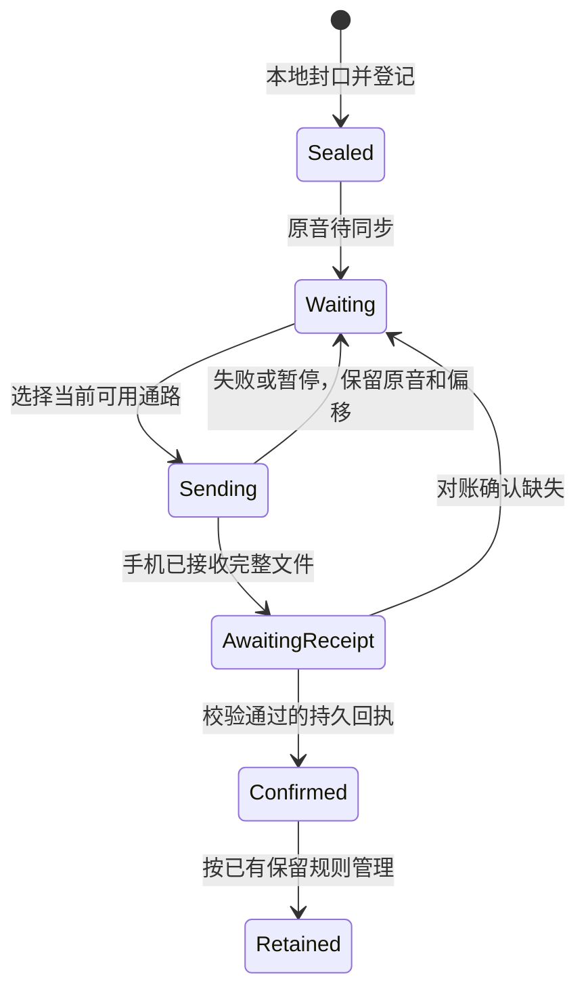

# 手表与手机传输策略重新核对

2026-10-19。基线 `a0f1acc`，两端已安装 1.9.1。本文件区分真机事实、外部参考、代码缺口和待实现方案；不是同步验收记录。

## 结论

1.9.1 没有解决同步问题。继续增加同一种后台发送的重试次数，不能提供可靠的恢复路径。需要分别设计最新配置、可靠事件和原音传输，用持久账本决定还缺什么，用传输机制决定这次怎样送达。

当前先保持本地设备间同步。不得因 WatchConnectivity 失败就把原音自动上传新服务器或 iCloud。云中转会改变资料流向、账户与运维要求，需要单独确定。

## 真机事实与尚未证明的原因

- 用户报告 13:46 再次发生 `WCErrorDomain/7001`，底层 `com.apple.identityservices.error/200`，当时两端可达。7001 是通用错误；没有找到 Apple 对这个私有底层 200 的公开原因映射。
- 13:40:48 与 13:43:26 的手表快照里，同样四个系统文件传输均为 0/100。后一次 `reachable=true`。`isTransferring=true` 只表示尚未完成，不能证明正在发送字节。
- 手机当次 SQLite 与 WAL 副本通过 `quick_check`，有 1669 个片段，四个排队片段均不在手机中。15 日 236、16 日 729、17 日 704、18 日 0；已收到范围的转录与分析均完成。
- 已读取的一个占位文件 manifest 属于 17 日，AAC 原音 265181 字节。它不是已接收回执的重复文件；只回收已确认副本不能解除这类阻塞。
- 13:46:33 的手机缓存已收到手表构建 47 的新状态，待确认 926 片。这只能证明状态通路有投递，不能代替原音接收。
- 两个实际安装包的开发团队、application-identifier、手机伴随 ID 及 profile 绑定一致，没有发现静态签名配置不匹配。没有因此排除系统配对或 IDS 服务状态异常。
- 新一轮 Mac 设备读取返回 CoreDevice 4016。开发连接错误与应用内的 7001 分开记录，不以重启或重新配对替代协议诊断。

上述原始结果在相邻任务 `sync-retirement-20261019/tmp_agent_output/20261019-sync-retirement/`；本轮资料在 `tmp_agent_output/20261019-sync-strategy/`，不提交用户数据。

## 一手资料与适用范围

| 来源 | 实际核对内容 | 对本项目的结论 |
| --- | --- | --- |
| [Apple WCSession](https://developer.apple.com/documentation/watchconnectivity/wcsession) 与 [官方样例](https://developer.apple.com/documentation/watchconnectivity/transferring-data-with-watch-connectivity) | 最新 context 覆盖旧值；userInfo 顺序排队；即时消息使用回复；后台唤醒及时完成 | 可替换配置不应无限进入可靠事件队列。后台交给系统调度，不能当成立即吞吐通路 |
| [Apple WWDC21 数据传输](https://developer.apple.com/videos/play/wwdc2021/10003/) | Watch→iPhone 即时消息可唤醒手机；Watch 端的可达条件不同；文件必须在 delegate 返回前保存 | 可达时可以用带回复的小数据传输；`reachable` 只是当时条件，不是持久投递证明 |
| [Apple transferFile](https://developer.apple.com/documentation/watchconnectivity/wcsession/transferfile(_:metadata:)) 与 [进度对象](https://developer.apple.com/documentation/watchconnectivity/wcsessionfiletransfer/progress) | 文件后台排队、按资源调度、Progress、真实配对设备测试 | 不能用四个永久占位任务和单测通过，推定积压可以排空 |
| [Omi 音频实现](https://github.com/BasedHardware/omi/blob/501f906eaca2dae31eec9ccd5f98ed0df7c59dbd/app/ios/omiWatchApp/WatchAudioRecorderViewModel.swift) | 约 1.5 秒缓冲，可达时 sendMessage，失败或不可达时 transferUserInfo | 借鉴小块和按条件选路。其当前发送没有持久接收回复，不能直接承担我们的离线原音保全 |
| [Omi 接收改动](https://github.com/BasedHardware/omi/blob/501f906eaca2dae31eec9ccd5f98ed0df7c59dbd/app/ios/Runner/WatchAudioChunkRelay.swift) | 已移除等结束后汇总整段音频的内存持有，源码指出长录音会导致进程被杀 | 流式处理、封口后逐片传输，不能等待录制结束，也不能整小时装入内存 |
| [OpenClaw iPhone 通道](https://github.com/openclaw/openclaw/blob/fe15736afeaf113415ab978a58212be81e3d0ed3/apps/ios/Sources/Services/WatchConnectivityTransport.swift) 与 [Watch 接收/发送](https://github.com/openclaw/openclaw/blob/fe15736afeaf113415ab978a58212be81e3d0ed3/apps/ios/WatchApp/Sources/WatchConnectivityReceiver.swift) | 可达时先即时投递，失败后入队；快照用 context；持久 journal 的业务回执独立于 SDK 成功 | 不对每条消息无条件同时发送两个副本。回包丢失后先复核业务状态再重试 |
| [Loop 当前设置同步](https://github.com/LoopKit/Loop/blob/e959503b18a3138890cd4a91d66a5af654eb543f/Loop/Managers/WatchDataManager.swift) | 只发送变化的配置，并撤销已被新配置替代的旧设置传输 | 对配置合并、去重和淘汰。不能把这种淘汰权限扩大到录音和删除事件 |
| [Communicator](https://github.com/KaneCheshire/Communicator/tree/d56a35cd3dec97b6ee8de6d2b87648f9dd45899b) | 明确区分即时、可靠消息、Blob 和 Context；最后提交为 2023 年 | 可参考语义划分；它包装的仍是 WCSession，不会修好系统 IDS 故障，也不提供我们的持久回执协议 |
| [Apple TN3135](https://developer.apple.com/documentation/technotes/tn3135-low-level-networking-on-watchos) | 普通 Watch 应用使用 URLSession；底层 TCP、WebSocket、Bonjour 受限制 | 不承诺随便换成自建蓝牙或 WebSocket。额外网络通路需要按真机及后台条件验证 |
| [Apple 可恢复 HTTP 传输](https://developer.apple.com/videos/play/wwdc2023/10006/) 与 [Watch 后台请求](https://developer.apple.com/documentation/watchos-apps/making-background-requests) | 文件上传、恢复偏移、后台 URLSession 的进程外执行及调度 | HTTP/CloudKit 可作为另一个架构选项，仍有系统调度和资料去向约束，不能声称无条件实时或零维护 |

以上参考未证明我们的底层 200 原因。较早的公开 7001 个案涉及不同系统和功能，仅能说明该通用码有多种触发条件，不能直接套用“重装即可”。

## 当前实现的策略缺口

1. `PhoneReceiveCoordinator.reconcile` 每轮都调度同一个 receiverIdentity；自动恢复又允许重播。资料库身份属于可替换的当前配置，且现有手机状态本来已经携带手机设备 ID 和资料库 ID，却仍消耗 FIFO 控制消息。
2. `transferControl` 对同一条消息先入后台队列，再同时发送即时副本。成功的即时回复还不会撤销同一内容的后台副本。失败的旧任务因而继续占位、产生回调和恢复工作。
3. 文件只有 `transferFile` 通路。四个未确认任务不结束时，后续日期没有准入机会；原有等待回执超时只覆盖“SDK 已结束、应用未确认”，未覆盖“SDK 长期不结束”。
4. 即时控制发送的 errorHandler 丢弃了真实错误，只留下 failed=true。故障诊断因此偏向后台回调，缺少各通路独立的失败原因和延迟。
5. 暂停、重新激活、游标和通道退避分散在多个对象。重新进入 App 不应清除尚在执行的通道冷却，也不能重放全部历史回执。

这些是已核对的代码缺口，不等于已确定 Apple 7001 的起点。

## 确定采用的结构

### 最新状态与配置

录音状态、接收资料库身份和能力声明作为有版本的当前快照，共用一个 context 发布入口，防止互相覆盖。只保留最新配置，可达时附加即时刷新。旧版本仍能读现有状态格式；新能力须显式协商，不能通过版本文案或错误字符串判断。

接收资料库变更仍走现有明确确认流程，不能静默换接收方。绑定状态只能确认该配置值，不得据此确认任何原音已保存、删除已完成或其他指令已执行。

### 可靠控制事件

可达时优先走带持久收件回复的即时发送。未收到回复时才创建一个去重后的后台副本；已有系统副本不阻止即时恢复，但不能因此再创建相同后台副本。持久收件回复到达后，撤销同一内容的多余系统副本，继续等待相应业务回执。

统一由一个状态所有者管理路由选择、在途、退避和取消。通道连续失败进入冷却，到期只放一个探测请求，成功后恢复吞吐。单条坏消息不应永久挡住别的类型；同一通道失效时也不能用换消息 ID 的方式继续灌入积压。

### 原音传输

保留现有 AAC 封口文件和持久账本，不再次压缩有损原音。后台使用 transferFile；可达并协商支持时，增加带偏移回复的小块即时补传。补传不依赖四个后台任务释放名额，先补早期缺片，再继续后续数据。

新路径只读取封口文件，每次持有一个有界数据块；等待回包前关闭文件句柄。手机将块写入临时接收区后回复已保存偏移，完整文件通过 hash 和长度校验后进入原有接收 Inbox。转录继续按现有接收流程触发。

两条路径共享 chunkID、manifest hash 和既有接收账本。同一文件经两条路径到达必须幂等。块偏移、SDK 成功和完整临时文件都不能授权手表清理原音；仍须收到手机持久接收回执。

这是 WC 内部的路由选择，能绕过某类后台排队故障，不能保证跨越整个 IDS 服务失效。若两条 WC 路径都失败，保留原音、明确展示停滞，按受限探测恢复；独立 HTTP/云通路另行验证和确定。

### 录音和手机消耗

录音采样、封口与保存不等待同步。同步只能降低发送并发或延迟整理，不能反向阻止录音。后台唤醒只做有界收件和调度；继续遵守真机已发现的短 CPU 预算。

不新增高频轮询或持续保活。正常录音、可达变化、回执和已有退避唤醒驱动推进。长期未前进时按实际字节/回执进展显示停滞，不用反复弹相同的 7001 横幅制造“正在恢复”的假象。

## 状态及恢复边界

进程死亡后，从持久的封口文件、手机接收偏移和业务回执恢复；系统队列只是一种在途观察。失联、回包丢失、重复块、乱序块、坏校验、接收库更换、磁盘不足、后台过期和设备切换都不能把 Waiting 推进到 Confirmed。

## 验收条件

本地单测和模拟器只验证协议与恢复边界。完成同步修复必须有真实配对设备证据：

- 在两端不同前后台组合下，身份配置收敛，可靠队列不随重进 App 或连续失败无界增长。
- 长期占位的文件仍能通过补传进入手机；原始队列、补传与重启后重复投递只保留一条有效录音。
- 已知 18 日 852 个 chunkID 逐项在手机账本中找到，校验对应 manifest 和原音回执；同步处理数量与转录完成数量分开报告。
- 中途断开或杀进程后继续推进，原音不丢；不依赖 Mac 导入用户原音，不依赖调试器维持后台。
- 记录开始/结束时间、接收字节、完成回执数、通路和最后进展时间。只有这些实际结果达标，才写“同步恢复”。

## 本轮已落地的控制通道改动

- 可达时先使用即时通道，最多四条在途。正常窗口占满只延后，不向后台溢出；即时失败或不可达时才准入后台副本。
- 同一消息收到持久收件回复后，撤销相同编码内容的后台副本。系统副本在实际退出前仍计入预算，不提前释放容量。
- 通道退避结束后，只允许一个恢复探测。旧批次的迟到成功不能开放全部队列；探测从 SDK 快照消失而未回调时重新退避，避免永久占住探测位置。
- 普通前台恢复保留已取得的持久收件证明；业务明确要求重发某条消息时，才清除该条证明。
- 当前选中手表的非恢复报告已确认绑定本机资料库时，停止重发同一 receiverIdentity，并撤销其已满足的旧配置副本。未绑定、其他库、恢复缓存和其他指令都不适用此规则。
- 即时发送的真实错误域、错误码及底层错误进入诊断日志，不再丢弃 errorHandler 的错误。

本地 MoMoLink 回归 45 项及 iPhone 原生策略测试 5 项通过，Watch 原生编译通过。原生测试使用实际协调器与 SQLite，构造传输回调顺序，没有冒充配对设备成功投递。专用模拟器在验证后清理。

## 原音小块补传实现

- 手机在现有状态载荷中声明 `audioBlockVersion=1`。该字段为可选项，旧版状态仍能解码；手表只对已绑定设备、同一资料库且声明支持此能力的手机启动补传。
- 可达时独立启动一个原音补传任务，不等待四个系统文件名额。每次请求最多 16 KiB 原音，编码预算 48 KiB；一个回包后再发送下一块。原音保持已有 AAC 格式，不再做有损压缩。
- 首次发送空探测，手机回复已保存偏移。每个实际块都有偏移和 SHA-256。手机同步文件写入，再原子保存并同步偏移；重启时截去未取得偏移检查点的尾部，重复或乱序请求只返回现有偏移。
- 手机只保留四份部分接收文件。回收部分副本不会影响手表持有的未确认原音。当前补传支持单文件不超过 64 MiB；更大文件继续使用原有后台文件通道。
- 完整文件通过长度、SHA-256 及现有音频格式、采样范围和录音一致性检查后，进入同一个 Archive 提交流程。最终即时回复携带事务提交后的正式 Receipt；手表将其保存到已有 ControlInbox，再按原有校验与清理规则处理。
- 系统文件与补传共享 chunkID 和 manifest hash。普通文件先到、补传先到及丢失最后回复后重试，都归并为同一份原音和同一条正式回执。偏移本身不能授权清理原音。
- 文件读取句柄在等待回包前关闭，Archive 在每个请求内同步完成文件与 SQLite 操作。发送一次只占用一份小块，失败使用既有 30/60/120/240/300 秒退避；独立公平游标防止一个坏文件反复独占补传。单轮任务最多运行约两分钟，再从手机持久偏移继续。
- 即时请求设 25 秒截止时间，取消、超时及迟到回调只完成同一个等待一次。切换接收库或收到已验证回执时取消当前补传。后台 WC 唤醒不启动新的补传循环；已有后台文件路径继续承担系统调度下的离线传输。

本地最终回归通过 247 项：MoMoLink 48、MoMoArchive 188、录音对账 11。其中新增接收与发送测试 10 项、回包截止与取消测试 3 项，覆盖多块续传、重启、最后回复丢失、未取得检查点的写入、乱序与重复、坏校验、错误接收库、删除、双通路去重和旧版本能力协商。

本轮正在构建和安装 1.10.1。合并了最新 main 的记忆和设置改动。完整配置快照迁移和独立网络通路仍未实现。7001 的底层原因及 18 日原音是否全部补齐，以本次安装后的真机证据为准。
