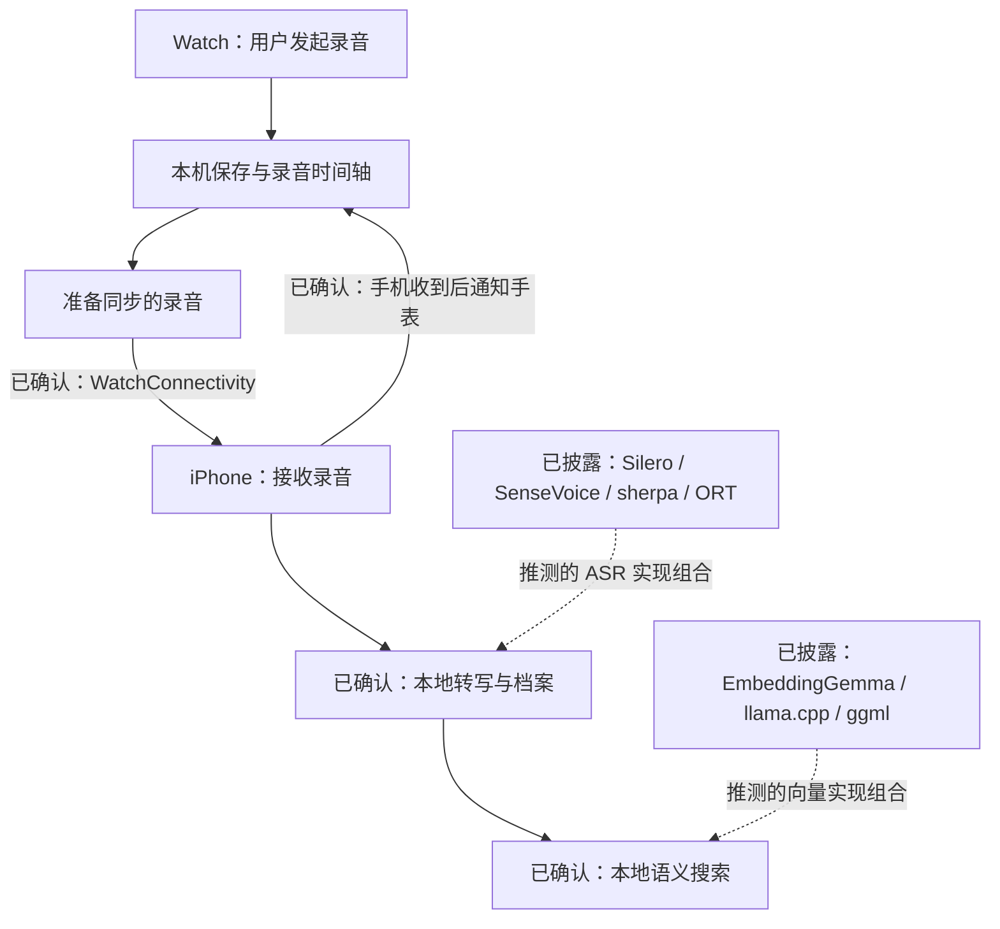

# Auday 实现方式：补充调研与推断

调研日期：2026-10-13。补充[10 月 10 日的调研](auday-2026-10-10.md)，重点查实现线索。此次读到开发者长文、官方更新公告和近期回复，并重新核对 FAQ、许可清单、隐私政策和中国区 App Store。

本轮没有运行 Auday，也没有取得安装包内部文件或源码。下面的“确认”指开发者公开披露，不代表我们已独立验证运行行为。公开 GitHub 账号的九个仓库中未发现 Auday 源码；这只能说明本次检索没有找到。

## 1. 比上一轮多确认了什么

| 发现 | 来源与时间 | 对实现的判断 |
| --- | --- | --- |
| Watch 与配对 iPhone 使用 WatchConnectivity 传录音 | 开发者 BaiFu，10 月 10 日长文第 3.1 节 | 框架已经明确；具体使用哪个传输方法仍未披露 |
| 音频自动过期清理以成功转写为前提 | 长文第 3.4 节；隐私政策第 9 节 | 手机档案的音频保留需要关联转写状态 |
| 当前模型优先速度、资源占用和多款 iPhone 的响应表现 | 官方 10 月 7 日公告 | 当前选择包含准确率取舍，不宜直接称为最佳中文模型 |
| 正在准备可选的更高精度本地模型；10 月 12 日又提到可选降噪等级 | 官方更新公告与回复 | 属于开发计划，未公布模型名称，也未证明已上线 |
| 1.0.1 修复部分 Ultra 用户的无声录音，并改进传输和本地存储 | 官方公告；中国区商店版本说明 | 录制状态、实际音频内容、双端版本要分别验证 |

原始来源：[开发者长文](https://x.com/whoisbaifu/status/2108877558175654224)、[官方转引](https://x.com/auday_ai/status/2108887768336306444)、[1.0.1 公告](https://x.com/auday_ai/status/2107777284128059774)、[10 月 12 日模型回复](https://x.com/auday_ai/status/2109610718513238060)、[隐私政策](https://auday.ai/privacy)、[中国区商店](https://apps.apple.com/cn/app/id6814210373)。

开发者长文比官方账号的零散回复更适合确认架构。长文还说明，官方账号的部分互动交给了 Dot；因此回复中模糊的未来计划不能升级为已交付事实。商店本轮仍显示 1.0.1，不能据此认定更高精度模型已经包含在安装包中。

## 2. 能还原到什么程度

这个图没有确定音频编码格式、采集 API、模型量化方式或数据库。现有资料只足以确认设备职责与通信框架，再结合依赖判断可能的实现。

### 2.1 Watch 采集与后台

FAQ 说明录音由用户在 Watch 开始，系统中断可能使其停止，并可能需要手动重新开始。它没有承诺进程被终止后自动恢复。[FAQ](https://auday.ai/faq)

合理推断是：Auday 使用 watchOS 的音频录制能力，在允许的音频会话期间持续采集，另行处理文件、同步和界面。Apple 提供前台开始后继续后台录音的能力，但并不因此保证全天无中断。[Apple 后台模式说明](https://developer.apple.com/library/archive/documentation/General/Reference/InfoPlistKeyReference/Articles/iPhoneOSKeys.html)

尚不能确认它使用 `AVAudioRecorder`、`AVAudioEngine` 还是更底层的音频接口，也不能确认是否无缝轮换文件。许可清单无法回答这些问题。

### 2.2 文件准备与传输

FAQ 描述约每 15 分钟准备同步，整点、暂停或结束可能提前触发；到达时间取决于连接和系统调度。Watch 保存待接收录音，等待手机确认。[FAQ](https://auday.ai/faq)

结合已确认的 WatchConnectivity，`WCSession.transferFile` 是很合适的实现候选：Apple 提供异步文件传输和系统调度。但 Auday 没有公开方法名，可能混合多种消息与文件通道。**不能把“使用 WatchConnectivity”写成“已确认使用 transferFile”。**[Apple 文件传输](https://developer.apple.com/documentation/watchconnectivity/wcsession/transferfile(_:metadata:))

这里至少有三个独立时间点：录音文件封口、提交传输、手机收到。15 分钟没有直接定义物理文件长度，也没有定义 ASR 输入窗口。对 MoMo Agent，这三个参数必须分开调节。

### 2.3 静音存储与时间轴

FAQ 明确区分极安静时段和“没有人声”：前者可以省略音频、保留时间位置；不确定的声音和标记附近的时段保留。省略的区间可以按时长播放为静音，但无法恢复原来的声音。[FAQ](https://auday.ai/faq)

由此可以推断，它的逻辑录音时间轴与实际音频文件长度不必相同。实现可能用分段清单，也可能用其他容器或数据库结构；公开材料不能确定。

我们可以复现其思路，而不假定它的内部实现：

1. 先完整采集，保留短时缓存。
2. 单独判断哪些区间足够安静，并保留前后缓冲。
3. 将确定可省略的区间表示为时间段，其余区间引用真实音频。
4. 回放按时间段还原连续时间轴。
5. 标记保护区覆盖相邻音频，避免刚标记就丢掉上下文。

以上五步是我们的候选算法。省略发生在 Watch、传输前，还是 iPhone 入库后，目前未知。不能因为看到 Silero 许可，就断定它在 Watch 上用 Silero 删除静音；能量门限、VAD 和静音存储是不同职责。

MoMo Agent 先以完整保存建立质量基线。后续可将“确定静音省略”作为 R-A 的存储优化实验，与 R-C 的人声筛选分开测。任何有损实验都保留独立参考原音。

存储数字也提供了一条有限线索：按 FAQ 的每天 8 小时、30 天约 3.5 GB，用十进制 GB 折算，平均约为 32.4 kbps。这与我们计划测试的 32 kbps 在同一量级，但静音省略、可变码率及文件开销都会改变这个平均值，不能据此认定 Auday 使用 AAC 32 kbps。首页的“30 × 24 小时约 3.5 GB”与 FAQ 口径不同，不能合并成压缩性能结论。[官网](https://auday.ai/)、[FAQ](https://auday.ai/faq)

### 2.4 本地识别

本轮再次看到官网披露 SenseVoiceSmall、Silero VAD、sherpa-onnx 与 ONNX Runtime。许可链接分别包含 sherpa v1.13.5 和 ORT v1.27.0；这些是链接版本，不能等同于已核对的安装包构建。[许可清单](https://auday.ai/terms#open-source-licenses)

较强的实现推测是：音频解码与重采样 → VAD 划分区间 → sherpa 调用 SenseVoice 的 ONNX 模型 → 保存文字及时间映射。sherpa 官方已有 Silero 与 SenseVoice 配合处理长文件的示例，说明这条路径有现成工程基础。[SenseVoice 示例](https://k2-fsa.github.io/sherpa/onnx/sense-voice/pretrained.html)、[Silero 接入](https://k2-fsa.github.io/sherpa/onnx/vad/silero-vad.html)

仍未知：Auday 是否 INT8、使用什么执行提供程序、线程数、VAD 参数、识别窗口、时间戳算法，以及是否做识别前降噪。ONNX Runtime 可以采用不同执行方式；仅凭它出现在清单中，不能推导出用了 ANE。

官方公告称，17 Pro 上有数小时录音在数秒内完成转写的观察，但未给出有效语音占比、冷启动时间、处理阶段或完整样本。它只能作为后续询证线索，不能作为我们的性能基准。VAD 后只有少量语音、此前已有部分结果等都可能影响表面耗时；这些是待排除解释，并非已确认原因。[10 月 7 日公告](https://x.com/auday_ai/status/2107777284128059774)

我们的性能报告分别记录输入总时长、实际语音时长、模型加载、解码、VAD、ASR、保存和调度等待。否则“几小时”与“几秒”没有可比较的含义。

### 2.5 模型清单中的另外三项

EmbeddingGemma 的模型用途是生成向量；结合 Auday 披露的本地语义搜索，推测它负责索引和查询向量。llama.cpp / ggml 可能承担这部分推理，不能据此认定 Auday 在手机上跑了一个总结用的文本大模型。JSON for Modern C++ 只能说明存在这项软件依赖，不能证明 UI 技术栈或数据库结构。[Auday 许可](https://auday.ai/terms#open-source-licenses)、[EmbeddingGemma 模型说明](https://ai.google.dev/gemma/docs/embeddinggemma)

MoMo Agent 当前只做采集和转写，不因 Auday 使用这三项就增加对应模块。

### 2.6 两种清理条件不能混为一谈

Auday 的公开说明提供了两个不同条件：Watch 等手机收到录音；手机按保留期清理旧音频时，等待转写成功。前者保护传输，后者保护尚未处理的档案。[FAQ](https://auday.ai/faq)、[隐私政策](https://auday.ai/privacy)

MoMo Agent 对这两层分别设计：Watch 得到完整音频的持久接收确认后，可以释放副本；iPhone 对自动过期清理再检查转写完成状态。用户明确删除不属于自动过期清理，删除指令应立即生效并防止补传后重新出现。

## 3. 可以借鉴的失败线索

官方 1.0.1 公告承认部分 Ultra 存在无声录音问题，并介绍了对应修复。官方后续提醒用户检查 Watch 端也已更新。两个 App 的版本是否匹配，应进入诊断信息。[版本公告](https://x.com/auday_ai/status/2107777284128059774)、[Watch 更新说明](https://x.com/auday_ai/status/2107955180079870028)

中国区商店可见用户分别报告录音时收不到震动提醒、长时录音中途停止。这些是个别用户的直接体验，缺少系统版本和日志，不能据此确定根因或故障率。[商店评论](https://apps.apple.com/cn/app/6814210373?see-all=reviews&platform=iphone)

Apple 提供 `setAllowHapticsAndSystemSoundsDuringRecording`，文档列出 watchOS 6 起可用；对应属性默认关闭。这值得加入配置对照，但不能据此断定 Auday 用错了参数，也不能承诺打开后所有通知均正常。需要同时记录提醒是否出现、录音是否被打断、振动是否污染收音。[方法](https://developer.apple.com/documentation/avfaudio/avaudiosession/setallowhapticsandsystemsoundsduringrecording(_:))、[默认值](https://developer.apple.com/documentation/avfaudio/avaudiosession/allowhapticsandsystemsoundsduringrecording)

## 4. 对 MoMo Agent 的具体调整

| 调整 | 实施方式 |
| --- | --- |
| 将 WatchConnectivity 从 Auday 推测改为公开确认 | 保留 `transferFile` 为我们选择的方法，不伪装成逆向得到的源码事实 |
| 将分片、同步批次和识别窗口拆开 | 用独立参数测边界缺口、到达延迟和识别质量 |
| 建立可解释的长时状态 | 记录音频路由、中断、最后收到采样、最后封口与双端构建版本；原因不明时标明未知 |
| 添加音频内容验证 | 用受控声源检查实际采样，文件存在或录制计时增长不能独自证明采到了声音 |
| 将静音存储列为独立后续实验 | 用低声、远场、短句和背景声音测误删，不直接启用 |
| 完善自动保留策略 | 未成功转写的原音不被自动过期清理；容量不足要显式处理 |
| 保留本地 ASR 对照 | SenseVoice 建基线，同时测同机准确率；不追随未公布名称的新模型 |

详细设计已纳入[首版方案](../plan/v0.1-plan.md)，对应测试见[验证计划](../plan/device-validation.md)。

## 5. 实机到手后怎样继续验证 Auday

这些实验尚未执行。如果后续在已有合法安装的 Auday 上做对照，使用可公开的测试语音，并保存双端版本。

| 实验 | 观察对象 | 能回答与不能回答的问题 |
| --- | --- | --- |
| 连续录制编号语音，跨 15 分钟、整点，再停止 | 音频到达批次、边界回放、首段文字出现时刻 | 判断可观察的延迟与缺口；不能直接推断内部文件格式 |
| 手机断连后重连，分别前台和锁屏等待 | Watch 待传时长、手机音频与文字 | 区分采集、传输、处理；不把未转写误判为未录到 |
| 极静音中插入低声短句，并在附近做标记 | 回放与导出音频的时间映射 | 探查静音省略与保护区；仍需注意导出文件可能经过重新合成 |
| 相同语音分别用高、低语音占比拼成等长录音 | 实际识别时长、总等待、结果质量 | 检验数秒转写说法适用的输入条件 |
| 系统提醒、Siri、来电、音频路由变化 | 录音中断与通知表现 | 为我们选择音频会话参数提供实测对照 |

无 Watch 时，我们可以完成本项目的音频、队列和转写实验，但不能把这些结果写成 Auday 内部实现已经被验证。
