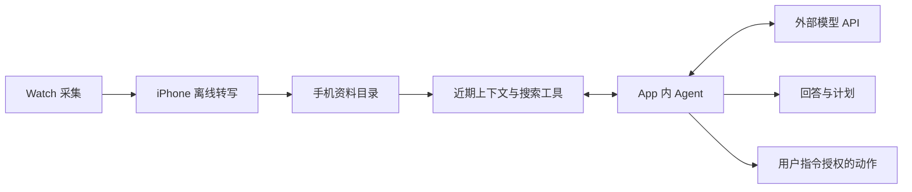

# iPhone 本地资料目录与 Agent 组件调研

日期：2026-10-13。状态：已确认使用 pi 作为 Agent Kit，文本模型调用外部 API；尚未编译、未做真机测试。手机 App 除了阅读转录稿，还运行 Agent，通过近期上下文注入和文件工具理解用户现实生活中的上下文。

## 1. 已确认路线

采用 SwiftUI App、手机本地资料目录、pi / pi-durable Agent Kit 和外部模型 API。iOS 通过 PiDurableKit 接入，具体适配版本需验证。既有 Watch 采集、手机离线转写和持久化任务继续复用；MCP 与云端录音库不进入当前架构。

这一决定已并入[详细开发计划第 14 节](../plan/v0.1-execution-plan.md#14-已确认的手机-agent-方案)及 P12～P13。本文保留组件来源和适配问题；执行范围以开发计划为准。Pi 底座已确定，模型提供方与具体模型尚未确定。



Agent 循环、文件工具和历史记录在手机运行，文本推理调用外部 API。请求中的上下文与工具返回文字会传给提供方；不自动上传原音或整库。本版不开发端侧文本模型。本地语音转写继续使用 SenseVoice 路线。

## 2. Pi Durable 与 PiDurableKit

| 项目 | 定位 | 与我们的关系 |
| --- | --- | --- |
| [pi-durable](https://github.com/earendil-works/pi/tree/main/packages/durable) | TypeScript Agent 执行与持久化组件 | 管理会话、工具与可恢复工作 |
| [PiDurableKit](https://github.com/finnvoor/PiDurableKit) | JavaScriptCore 中的 pi-durable，提供 Swift API | 可嵌入手机 App，支持 Swift 工具、SQLite、目录环境和流式状态 |
| [Cloudflare PiHarness](https://developers.cloudflare.com/agents/harnesses/pi/) | 将 Pi 放入 Durable Object，提供存储与唤醒 | 可选服务端部署方式，本方案无需使用 |

PiDurableKit 声明支持 iOS 17+。手机不需要另装 Node；Swift 负责网络、存储和文件访问桥接。iOS 的目录环境没有 bash。它提供系统提示片段与请求钩子，可用于注入近期资料；文件工具可限定在指定目录中。[项目说明](https://github.com/finnvoor/PiDurableKit#readme)

本轮检查的 main 为 `a89d9091`。GitHub 元数据显示仓库创建于 2026-10-08，查询时没有 tag 或 release；示例安装地址仍有占位符，不能照抄 `from: 1.0.0`。其打包的 pi-durable / pi-ai / chord 为 1.1.0，应固定经过验证的 commit 和打包依赖。[仓库元数据](https://api.github.com/repos/finnvoor/PiDurableKit)、[依赖清单](https://github.com/finnvoor/PiDurableKit/blob/main/JS/package.json)

需要在选型前验证的限制：

- 当前检查的最新 CI 在文档与 iOS 构建步骤失败，退出码 65。这不能证明真机运行失败，也不能把 README 当作当前版本已能出包的证据。[该次运行](https://github.com/finnvoor/PiDurableKit/actions/runs/38308321757)
- 多个 harness 同时打开同一存储可能重复运行任务；先限定一个存储只有一个 owner。[Issue #5](https://github.com/finnvoor/PiDurableKit/issues/5)
- 网络请求挂起与超时已有待处理问题；原型需要自己的请求期限、取消和离线状态。[Issue #4](https://github.com/finnvoor/PiDurableKit/issues/4)
- Pi Durable 目前不能删除单个 conversation。reset 或压缩上下文不能视为物理删除。[官方限制](https://developers.cloudflare.com/agents/harnesses/pi/#limitations)
- CustomProvider 的现成路径是 HTTP 兼容接口。本轮未发现直接接 MLX / llama.cpp 原生流式推理的生产接口，不能把测试 FauxProvider 当作已完成端侧模型适配。

PiDurableKit 自身使用 CC0，打包依赖另有各自许可证和 notices；发布时需要保留实际依赖声明。[许可说明](https://github.com/finnvoor/PiDurableKit#licenses)

## 3. 其他可选组件

以下保留为调研对照，不再作为当前 Agent Kit 的并列候选。当前开发基于 pi，适配问题在 P12 验证和处理。

| 候选 | 已确认能力 | 取舍 |
| --- | --- | --- |
| [zaidmukaddam/swift-ai-sdk](https://github.com/zaidmukaddam/swift-ai-sdk) | Swift、MIT、包声明 iOS 16+；多步 Agent、工具、SwiftUI ChatSession、上下文钩子 | 适合做纯 Swift 原型；本地任务崩溃恢复需应用负责 |
| [teunlao/swift-ai-sdk](https://github.com/teunlao/swift-ai-sdk) | 独立同名项目，Apache 2.0、iOS 16+；工具循环与多种国内 provider | 可比较国内模型接入；不要混用两个同名库的文档 |
| [SwiftedMind/SwiftAgent](https://github.com/SwiftedMind/SwiftAgent) | Swift 宏、工具与会话，iOS 26+ | 系统门槛高于现有 iOS 18 起点，国内模型需适配 |
| [Apple Foundation Models](https://developer.apple.com/documentation/foundationmodels) | 系统模型、结构化生成和 Swift Tool | 可选模型后端，不负责完整档案和工作流恢复 |

Apple 当前支持页仍列出大陆设备与地区限制，不能只凭 iPhone 17 Pro 认定系统模型可用。国内版不能将它设为唯一模型后端。[Apple 中国支持页](https://support.apple.com/zh-cn/121115)

有 ChatSession、保存历史或网络流重连，不代表拥有完整 durable execution。采用 Swift AI SDK 时，需要单独设计步骤提交、取消、工具副作用和重启恢复。界面也仍由我们编写，SDK 不等于一套完成的手机产品。

## 4. 手机上的统一资料目录

用户无需挑文件导入 Agent。转写完成后，App 自动登记资料；Agent 工具直接使用同一资料服务。建议用户看到以下内容：

```text
我的 iPhone / MoMoAgent /
  recordings/2026-10-13/<session-id>/
    manifest.json
    audio/<chunk-id>.m4a
    transcript.json
    transcript.md
  workspace/
    plans/
    notes/
```

这是逻辑布局，不是新增一轮人工导出。音频和结构化转录采用稳定 ID 与版本。已确认保留 SQLite 转写结果为正文真源，JSON / Markdown 是自动投影的资料文件；投影提交、版本校验和外部修改处理见详细开发计划。

App 的 `Documents` 可通过系统文件 App 展示；相关配置是 `UIFileSharingEnabled` 与 `LSSupportsOpeningDocumentsInPlace`。实现后要测试文件 App 的重命名、修改、移动和删除，不能假定外部永远只读。[Apple 文档浏览器](https://developer.apple.com/documentation/uikit/uidocumentbrowserviewcontroller)、[文件共享配置](https://developer.apple.com/documentation/bundleresources/information-property-list/uifilesharingenabled)

Agent 的数据库、运行状态和可重建索引放在 App 私有 Application Support，凭据放 Keychain。它们不需要出现在用户资料目录。整个方案保留本地文件保护和备份策略；目录位于本机，不自动改成 iCloud。

外部编辑 Markdown 作为用户注释或修订导入，不覆盖原始 ASR 版本。检测到删除或正文变化时，更新索引、使旧上下文快照失效，并与原有传输及删除规则对账。音频按保留策略清理后，文字仍可读取，但回放工具明确返回原音已清理。

## 5. 上下文注入与工具分工

每次用户发起任务，先注入一个有大小限制的上下文包，包含当前时间、时区、最新转写位置、尚未收到或尚未处理的范围、最近录音目录，以及相关的少量近期文字。附来源 ID 和版本。超出预算时保留目录并让 Agent 检索，不能一次塞入几个月原文。

首个原型不需要 EmbeddingGemma 或额外 0.6B 文本模型。先验证按时间、中文关键词和精确文本查找的效果；中文分词与短词命中单独测试，再决定是否增加语义搜索。近期上下文包也可以由规则选取，无需先引入自动摘要。

| 工具 | 行为 | 输出 |
| --- | --- | --- |
| `get_context_status` | 查看资料覆盖、最新版本与待处理范围 | 可知与未知的时间范围 |
| `list_recordings` | 按时间筛选录音 | session ID、时间、可用原音与转录状态 |
| `search_transcripts` | 搜索档案正文 | 有界片段、来源 ID、时间、版本和下一页游标 |
| `read_transcript` | 读取指定录音的部分段落 | 正文及可定位的段落 ID，不整库返回 |
| `play_audio` | 在 App 定位并播放原音 | 对应 session 与时间范围；不自动向模型上传音频 |
| `write_plan` | 保存生成的计划 | workspace 内的文件及来源引用 |
| 后续动作工具 | 按明确用户指令创建提醒、日历等 | 结果、目标 ID 与稳定操作 ID |

文件读取与工具调用可以用 Swift 闭包直接提供给 Agent，不需要为手机内部通信架设 MCP。通用 read 工具只开放指定资料视图；write/edit 仅开放 workspace。原始录音、ASR 正文和内部数据库不交给 Agent 自由改写。

转录中的说话内容属于资料。用户向 Agent 发出的任务才是动作依据；旁人提到的计划不能自动变成用户授权。说话者和承担者无法确定时保留未确认状态。明确要求“创建提醒”的指令可在已有系统权限下直接执行，不因使用工具再人为增加一次确认。

## 6. 从实际痛点验证

目标交互：用户刚结束讨论，只说“把刚才定的事整理一下，排进明天”。App 自动带入近期转写位置，Agent 搜索并读取讨论内容，列出事项、时间依据与未明确的信息。每一项可点击回到原始段落和录音。用户不需要再次复述整场讨论。

界面先做三个入口：

- 助理：派活、查看正在读哪些资料、阅读带出处的回答。
- 资料：按日期查看音频和转录，校正识别错误。
- 计划：保存任务结果，区分计划草稿与已执行动作。

这不是视觉设计稿。重点先验证 Agent 是否减少重复提问、能否正确利用现实上下文；不能用“聊天能回复”代替验收。

## 7. 恢复、删除与模型边界

durable 的作用是保存可恢复状态，不是让 iPhone 进程永久存活。用户发起的有限工作可研究 Continued Processing；iOS 仍可结束任务。首轮默认前台工作、明确取消、再次获得运行机会后继续，不承诺锁屏期间 24 小时自主执行。[Apple 后台长任务](https://developer.apple.com/documentation/backgroundtasks/performing-long-running-tasks-on-ios-and-ipados)

读取类工具可以重试。创建提醒等写动作需要稳定操作 ID，以及执行后未提交结果就崩溃的对账方法；不能仅靠 SDK 声称不会重复执行。用户取消与应用主动恢复也要分别保存，避免重新打开 App 后自动恢复已经取消的动作。

删除录音或正文时，必须处理它在 Agent prompt、工具结果、压缩历史和生成计划中的副本。PiDurableKit 当前缺少细粒度删除 API，原型需验证按独立 store 隔离、清理关联会话或补充上游能力的成本。不能直接删除内部 SQLite 的几行后假定仍满足上游存储契约；此问题未解决前不承诺删除已完整覆盖 Agent 历史。

模型接入只验证外部 API 路线。手机直连用户配置的 HTTPS provider，原型使用用户密钥并保存到 Keychain；核对真实工具调用、流式返回、取消和错误。不内置共享 API 密钥，不增加自建中转服务。录音库仍在手机，但送入模型的文字会离开手机。MLX、llama.cpp 与 Apple Foundation Models 不进入本轮实现。

## 8. 首个验证原型

先不依赖 Watch，使用已授权的固定转录资料。固定 PiDurableKit commit，验证真实模型 API 与本地工具；全部待执行。A01～A12 已统一移到[分层验证计划第 10 节](../plan/device-validation.md#10-手机-pi-agent-与模型-api)，避免维护两套验收表。

按 P12～P13 开发。PiDurableKit 的构建、网络、恢复和删除问题需要修复或由维护的适配层补齐；不能未经决定改用另一套 Agent Kit，也不能因此省略关键验收。
